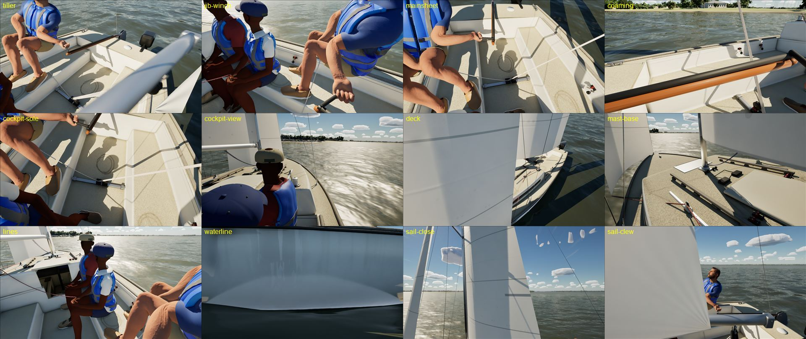

# Boat fidelity, phase 0: gap check and budgets (J/22, Ultra)

Phase 0 of the [Boat Fidelity Plan](https://claude.ai/artifact/X7Qho98woyttCBok2B6hWd): where the player's J/22 stands at
arm's reach on Ultra, against this year's and last year's AAA games, and the budgets the rebuild works to. Measured on
the PC (RTX 4090, i9-9900K) on main 0284444a, Development package with the MetaHuman crew, 1920 x 1080.

Stills: launch arguments only (`-SailingBoat=J22 -SailingWind=9 -SailingTWA=70 -SailingTraffic=0 -SailingNoHud` with
`-SailingCamTarget=<f,s,u> -SailingCamYaw -SailingCamPitch -SailingCamDist` per surface; the cockpit view is
`-SailingCockpit`). The AAA references (Microsoft Flight Simulator 2024, Assassin's Creed Shadows, Ghost of Yotei,
Kingdom Come: Deliverance II, Indiana Jones and the Great Circle, Clair Obscur, Black Myth: Wukong, the Witcher 4 UE5
demo; the latest Far Cry and Battlefield for first-person close-ups and vehicles) are compared from what those games
show; their screenshots, if gathered, stay in a local git-ignored folder (`Data/Reference/raw/aaa`), never in the repo.

## Gaps per surface

| Surface | Ours today (Ultra) | AAA close-up reference | Phase |
|---|---|---|---|
| Gelcoat (hull, deck, cockpit) | One flat white with a light detail normal; no orange peel, crazing, chalking or scuffs; reads as clean plastic | Far Cry / Battlefield vehicles: paint with clear-coat layer, edge wear, grime in recesses, scratches near hands and feet | 1 (materials, wear by Age/Care) |
| Non-skid (deck, cockpit sole, seats) | A soft speckle (T_Detail_NonSkid, 1024 tiled); no raised pattern, no dirt in it, no smooth margins round fittings | Sharp moulded pattern with depth, darker dirt in its pits, worn smooth where walked | 1 |
| Coamings, seat backs | Flat gelcoat; no rounded edges in the shading, no wear on the edges sat on | Rounded, worn edges; scuffs where legs and sheets rub | 1 (edge masks), 3 |
| Hardware (winches, cleats, blocks, tracks, mast-base fittings) | Simple shapes: box cleats, a plain drum winch, slab track; mostly one grey or red | Modelled metal with machined grooves, anodised and brushed finishes, labels, screws, wear on drums | 2 (kit), 1 (metals) |
| Tiller and extension | Varnished teak colour, smooth; no grain depth, no worn grip, plain extension | Wood grain with varnish layer and hand-worn patches; rubber grip on the extension | 1 (wood, rubber), 3 |
| Lines (sheets, tails, coils) | Plain tubes (a braid texture exists but reads as smooth at arm's reach); coils painted flat on the sole | Braided rope with colour flecks and fuzz, real coils and tails lying on the sole, sag | 1 (braid look), 4 (coils, sag) |
| Sails | Plain white panels, faint seam lines; no stitching, tabling, corner patches, batten pockets or dirt at the foot; flat against the sun | Seams and stitching visible, reinforcement patches, slight translucency in backlight | 1 (texture detail), 4 (shape) |
| Waterline and topsides | Clean hull into the water; no wet band, scum line or antifouling edge | Wet darkening above the waterline, a scum line, reflections broken by wetness | 1 (wet darkening), 6 |
| Mast and boom | Aluminium with a uniform finish; small fittings plain | Anodised aluminium with scratches, tape, labels | 1, 2 |
| Crew (not this plan) | MetaHumans read well; hands and wrists deform at the winch; the grooms' card textures are missing in this checkout's MetaHuman copy (cook warnings: `Common/Optional/Grooms`) | | crew lane |
| Water at the hull (not this plan) | No clinging foam or bow sheet; the near foam reads soft (the "motion blur" was the water material) | | water lane |

## Today's numbers

| | Value |
|---|---|
| J/22 hero meshes | Hull (Nanite, fallback 2,459 tris, 16 material slots), Mast (not Nanite, 7,528 tris, 7 slots), Boom (Nanite, 5 slots), Rudder (Nanite, 6 slots), Interior (Nanite, 1 slot), Glass (3 slots). Nanite source triangle counts are not exposed in the editor's Python here; the fallbacks are listed. |
| Hero textures | Hull and deck mould 2048² (base colour, normal, roughness) + 1024² masks; interior, rudder and teak 1024²; detail normals 1024² tiled (gelcoat, non-skid, canvas, teak); rope braid 1024²; wire 512² |
| Texel density (estimate) | Hull about 4–5 px/cm, deck about 5–6 px/cm (2048² over the surfaces), plus the tiled detail normals |
| J/22 alone, Ultra, chase view (2 runs) | MetaHuman crew: 76.9 fps, p99 17.2 ms, game 5.6 ms, render 13.0 ms, GPU 6.2 ms (base pass 2.7); boat_visuals 0.61 ms, sails 0.20, rig lines 0.28, crew 0.08; 3.2 GB used, texture memory 3,256 MB |
| Same, Blender crew (`-SailingBlenderCrew`) | 84.5 fps, p99 16.0 ms, render 11.8 ms, GPU 6.1 ms (base 2.4); texture memory 3,020 MB. The MetaHuman crew costs about 1.2 ms of render thread, 0.3 ms of base pass and 236 MB of textures |

## Proposed budgets (per boat, Ultra unless noted)

| What | Budget | Why |
|---|---|---|
| Texel density, arm's-reach zone (cockpit sole, coamings, seats, tiller, winches, cleats, the main- and jib-sheet hardware) | 10 px/cm base textures (2x the rest), detail normals at 40 px/cm or finer | The plan's first-person rule; Far Cry and Battlefield hold about this for hand-held and cockpit objects |
| Texel density, rest of hull and deck | 5 px/cm, with tiled detail normals and wear masks | Matches today; the gain comes from materials and masks, not bigger unique textures |
| Hardware | On the shared trim sheet at 10 px/cm; no unique texture per part | One sheet serves all nine boats |
| Triangles | Nanite parts (hull, deck, hardware): up to 2 M source triangles per boat; non-Nanite parts (mast, boom, glass, live sails and lines): up to 40 k | Nanite cost scales with pixels, not triangles; the live and translucent parts must stay light for Medium |
| Material slots | Up to 8 per Nanite mesh after phase 1 (the hull has 16 today) | Each slot is a draw and a shading bin; the shared library and trim sheet replace most of them |
| Texture memory | Up to 96 MB per hero boat on Ultra (streamed), half on High, a quarter on Medium | Leaves room for the crew (236 MB) and the world |
| Frame cost | Boat + rig + sails within today's 1.1 ms of game thread; base pass within +0.5 ms on Ultra | Ultra stays above 70 fps on this PC; the Mac gate (Medium 60, High 45) is checked per PR |
| Medium and Low | The same meshes; detail normals and wear masks off, 1024² base textures | The Mac's gate and the plan's cheaper path |

Phase 1 (shared boat materials) starts from this list: gelcoat new to chalky, non-skid, stainless, anodised and painted
aluminium, varnished and bare wood, rubber, rope and sailcloth, with detail normals, wear on the existing Age/Care
custom data and wet darkening; the hardware kit, the J/22 rebuild and the sails and sheets follow in phases 2 to 4.
