# Water through the hulls, every boat (Oct 20 2026)

## Audit

I took about 70 Mac stills on High (`scripts/run-game.sh`, uncooked) of all nine boats: J/22 hero, Sunfish, ILCA 7,
Catalina 22, Catalina 30, Hobie 16, Corsair 880, Lagoon 42 and the maxi. Each was shot heeled upwind at 17 kn true from
above and low to leeward, flat in 4 kn from low beside the hull, in a 2 m Gulf swell from a chase camera, and from the
cockpit. I added the marina's berthed boats from above and low, the J/22 tied up, a race fleet, a J/22 knockdown and
low bow views of the Lagoon and the maxi in the swell.

**What I saw.** No still shows water inside a cockpit, cabin or hull, or poking through the topsides or a transom. That
holds for the multihulls too, and for the marina's berthed boats (their cockpit soles are above the water).

**Why nothing showed, and what was still wrong.** Before this branch, `M_WaterV4`'s clip covered only `Hulls[0]`, and
only through `FHullShape`'s formula:

- It was off for both catamarans (Hobie 16, Lagoon 42) and covered only the Corsair's main hull, not her amas.
- The maxi's hull is her exported sections (`FHullShape::Stations`); the shader drew the formula's stand-in fit, which is
  up to 1.55 m off her real bottom (at the quarters) and 0.87 m off forward.

The wake grid's pressure patches (`FWakeGrid`, each hull pressing the surface down) already push the drawn water down
under every hull, roughly to its draft at rest. So the gap rarely shows. It is not guaranteed, though: the patch is
smoothed, lags the hull and does not follow heel. Sampled on a grid (`SailingSim.Visual.HullClip`'s sweep, the old
clip's maths), water was left above the hull's bottom inside the hulls at 2,190 points for the Hobie, 3,344 for the
Lagoon, 345 for the Corsair's amas and 21 for the maxi. It was 0 for the five monohulls.

## Fix

`FHullClipMap` (`Source/SailingPhysics/Public/HullClip.h`) puts every hull of a boat on one 256 x 128 grid in her body
frame. Each texel holds the bottom (`FHullShape::BottomZ`, the sections for the maxi), the sheer, and the margins inside
the deck edge and the ends, taken from the hull the point is most inside. `AWaterSurface::UpdateHullClip` builds it
once per boat and canoe depth and uploads it as a float texture (`HullClipMap`, `HullClipRect`). `M_WaterV4`'s vertex
shader samples it in place of the formula, with the same drop as before: 1.1 times the immersion plus 3 cm, capped at
2 m, faded over the last 5 cm inside the deck edge and ends (15 cm over the sheer). Between a multihull's hulls the
water is untouched. One texture fetch replaces the formula's maths for the vertices near the boat. `-SailingClassicHullClip`
still draws V7's clip.

`SailingSim.Visual.HullClip` checks, for every boat, that:

- the map's bottom is within 3 cm of the hull's wherever the water can reach (worst 2.5 cm, the Lagoon);
- calm water inside every immersed hull ends up under its bottom;
- no water outside a hull is dropped, between the hulls included;
- each ama is clipped once it is heeled in;
- water over the lee sheer, heeled 25 deg, still drops inside the gunwale;
- `make_materials.py` still has the same drop and fade as `FHullClipMap::Drop`.

Two flags for stills: `-SailingNoHullClip` (the sea drawn through every hull) and `-SailingHideBoat` (the player's
boat and crew hidden).

## Stills

The boat hidden, the clip off, then on, then the difference (only the hulls' footprints change):

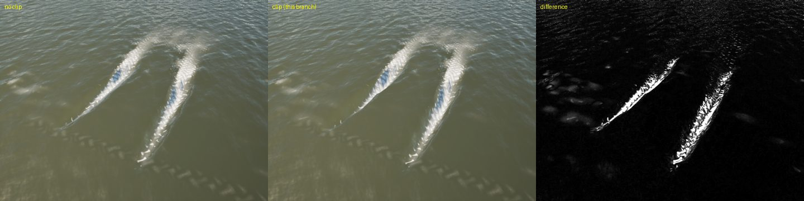
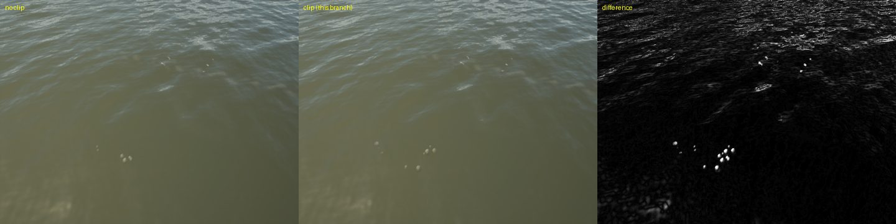
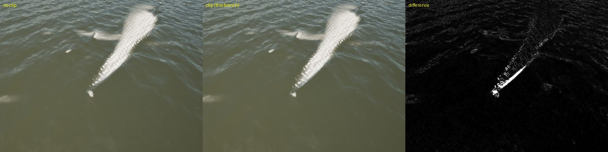
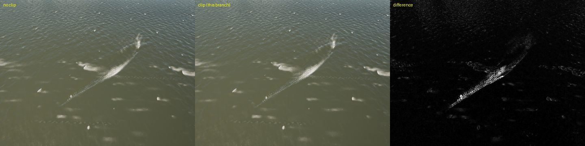
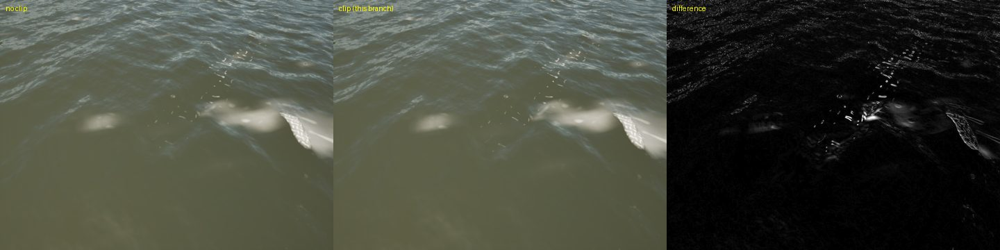

With the boats shown, the stills on this branch match main's (no pits beside the hulls, cockpits dry): Lagoon, Corsair,
Hobie and maxi in the Gulf swell, the J/22's cockpit, the maxi and the Catalina 30 heeled from low to leeward, and the
marina.

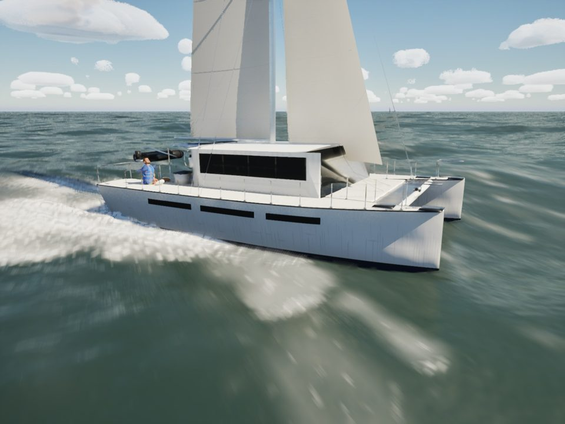 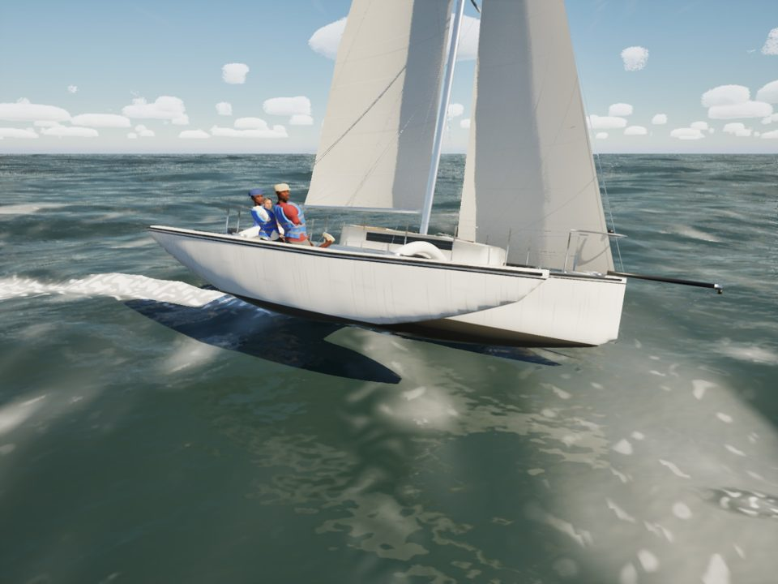 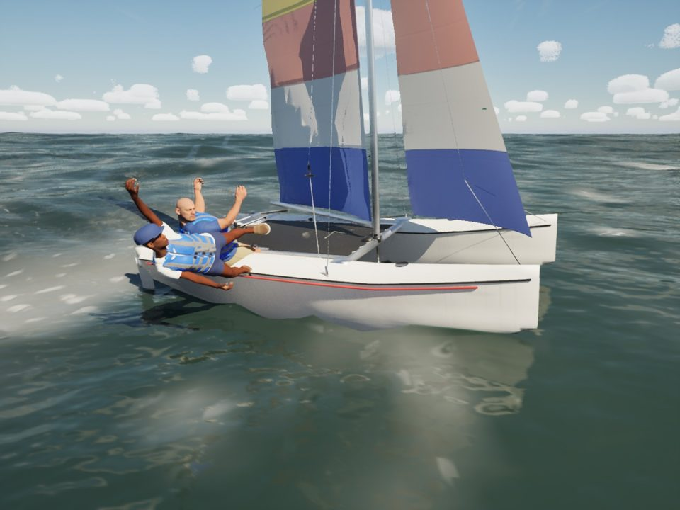 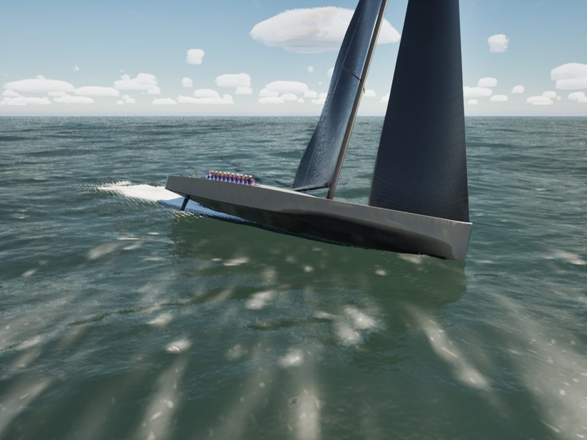
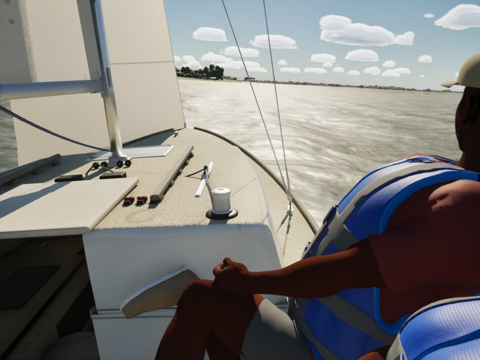 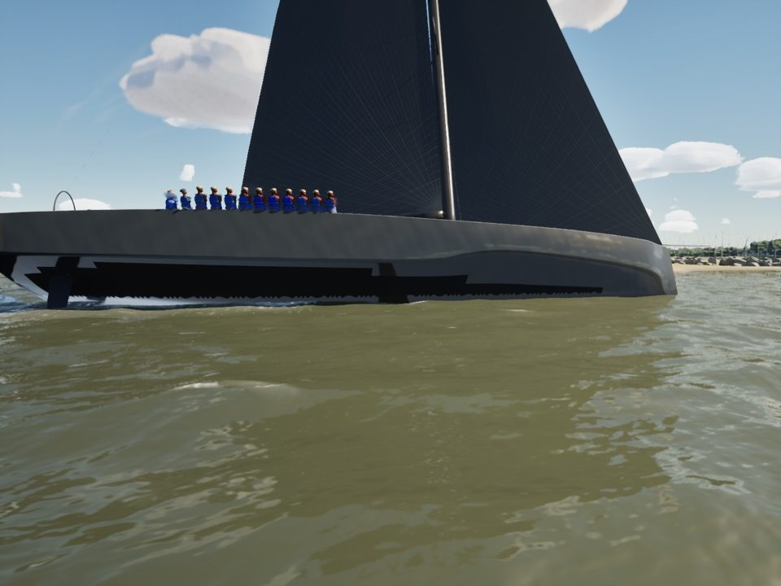 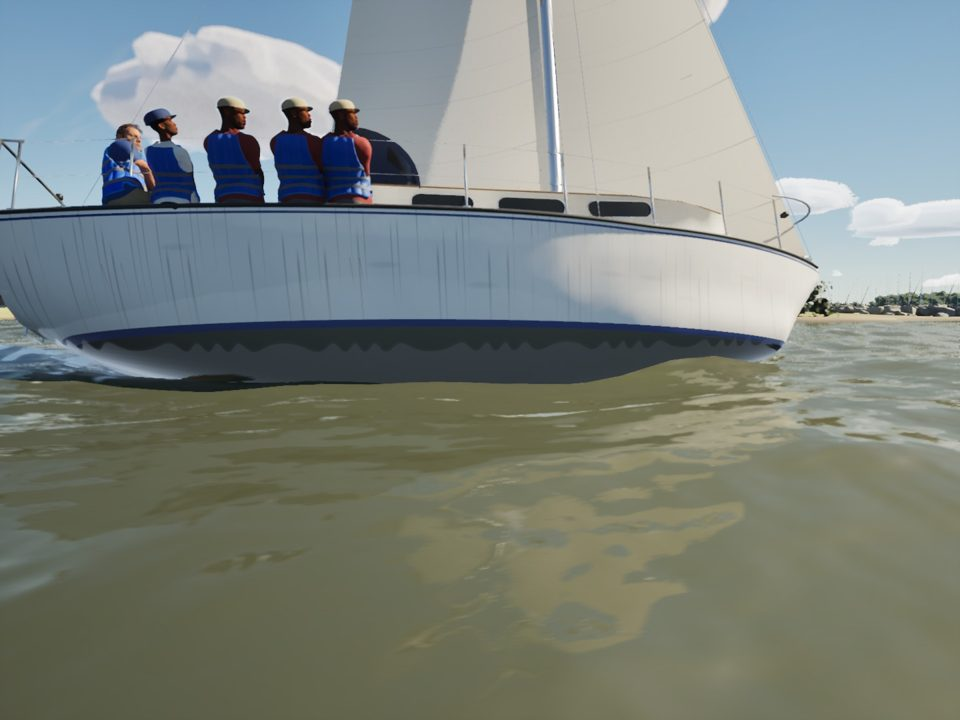 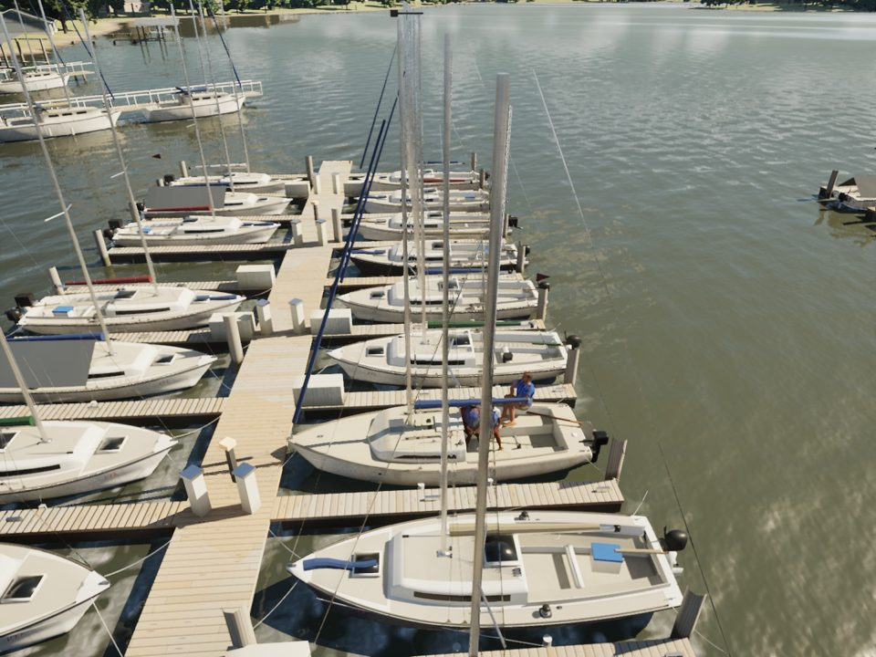

Arguments (with `-SailingQuality=High -SailingNoHud -SailingHour=11`):

- Clip pairs: `-SailingBoat=Lagoon -SailingWind=10 -SailingTWA=90 -SailingHoldTWA=90 -SailingHideBoat
  -SailingCamTarget=0,0,0 -SailingCamDist=14 -SailingCamYaw=150 -SailingCamPitch=-40`, plus `-SailingNoHullClip` for
  the first panel.
- Swell: `-SailingWorld=Gulf -SailingSwell=2 -SailingWind=15 -SailingTWA=50 -SailingHoldTWA=50 -SailingCamDist=<1.2 LOA>
  -SailingCamYaw=-120 -SailingCamPitch=-15`.

## Left alone

- AI boats and the ghost are not clipped (only the player's boat is). None of the race or marina stills showed water in
  them, and their models' cockpits stay above the water at the heel they sail.
- Spray on High is drawn as opaque white spheres (the ILCA, Sunfish and Catalina 22 in the swell). It reads as balls,
  not droplets: water effects.
- The wake's pressure patch shows its own foam pattern inside the hull footprint (visible only with the boat hidden).

## Crew and sheets seen in the stills (for the next jobs)

- The maxi's rail crew: all in one pose, legs through the deck (only the shoes show), in the cockpit view.
- The Lagoon's crew kneel under the cockpit table, through it and through each other.
- The Corsair's crew in the cockpit view sit on the hull's edge overlapping each other.
- The Catalina 22's three crew are piled on the stern quarter in the swell, overlapping.
- The Hobie's crew in the Gulf swell flail and lie across the hull (the knockdown ragdoll), limbs through the hull.
- No sheet-through-sail clipping showed at these camera distances.

## Gate

`scripts/gate.sh --scope water` and `--scope boats` on this branch (merged with main bf639dc0) both pass: 207 tests,
the package, and every view over its floor ([gate-water.csv](gate-water.csv), [gate-boats.csv](gate-boats.csv)).
The water slice is the same as or below what `docs/water-hull-clip/` measured for the formula clip on Oct 18 (another
day's main, so only roughly comparable):

| view | fps | water GPU ms (formula clip, Oct 18) | water GPU ms (map) |
|---|---|---|---|
| beam8 High | 60.6 | 3.13 | 3.10 |
| beat15 High | 63.1 | 3.27 | 3.21 |
| storm High | 45.8 | 2.84 | 2.54 |
| marina High | 62.0 | 3.19 | 2.99 |
| coast-day High | 54.6 | 3.18 | 3.11 |
| gulf-sea High | 66.7 | 3.17 | 3.09 |
| helm-eye High | 60.7 | 2.34 | 2.38 |
| bridge High | 65.7 | 3.47 | 3.26 |
| storm Medium | 66.7 | 2.36 | 2.22 |

Boats scope: beam8 64.6, beat15 63.0, marina 62.1, helm-eye 60.7, slip 53.7, crew 53.6 fps on High (floor 45).
