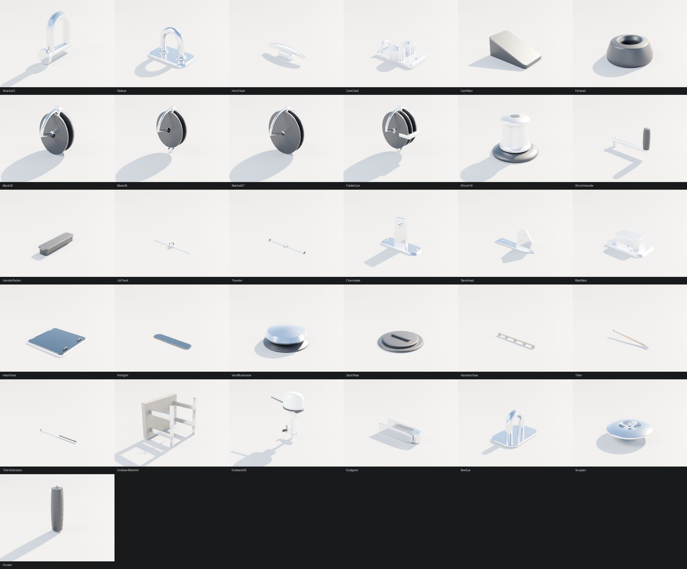
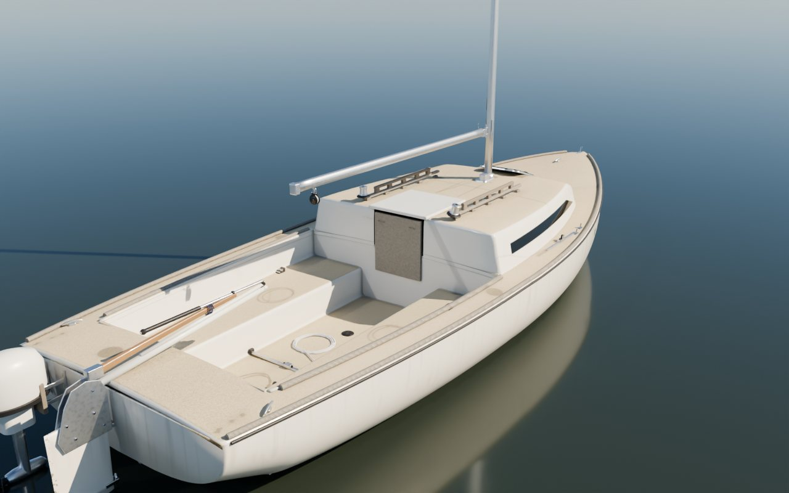
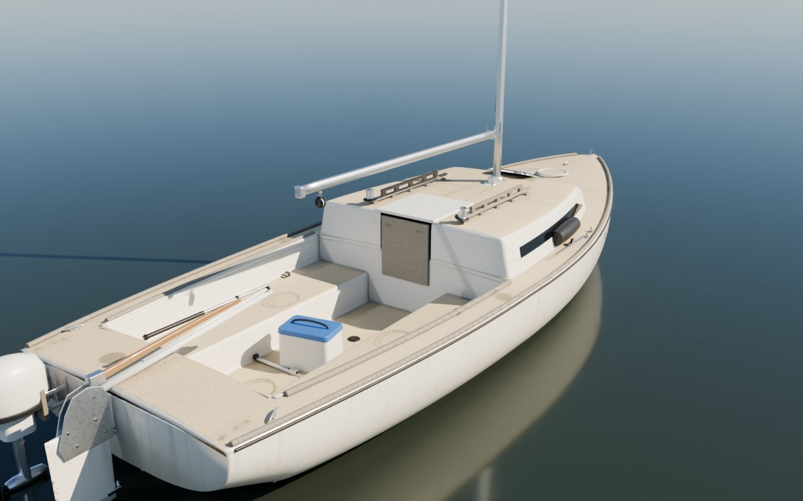
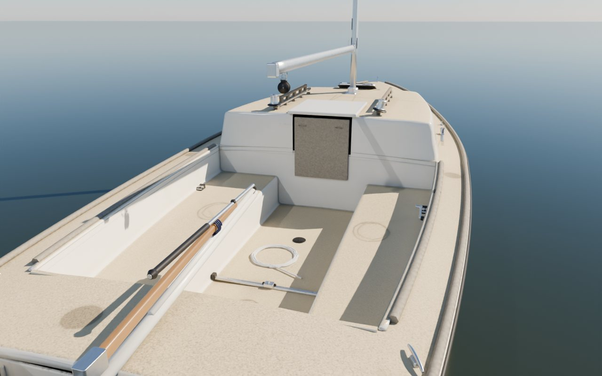
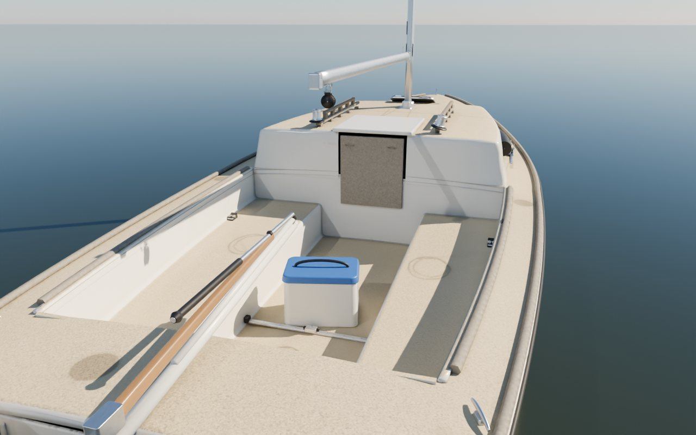
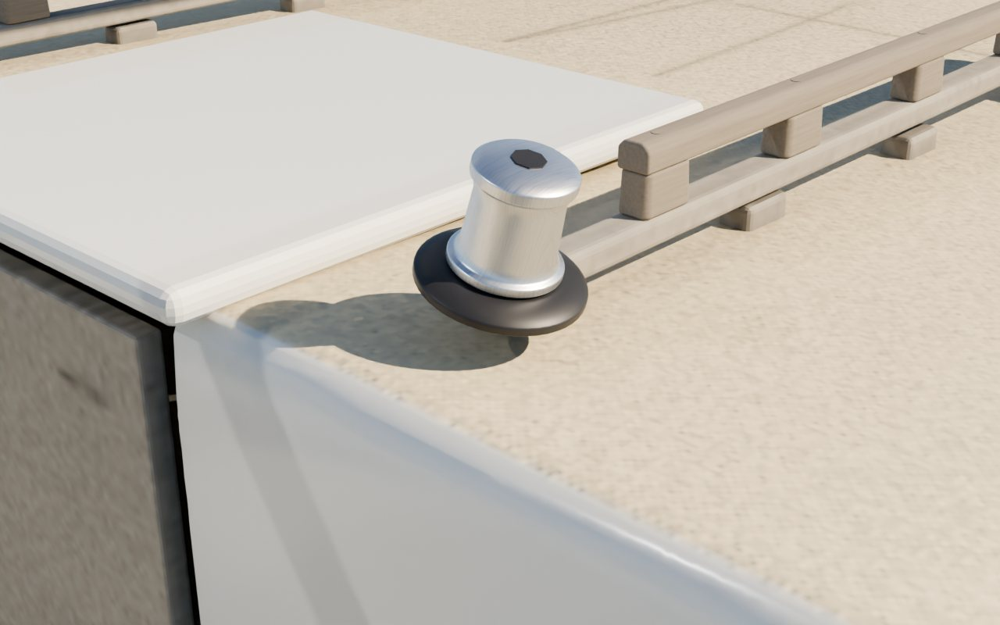

# Boat kit, phase 1: the kit, the J/22 layout and the photo match loop

The first phase of the studio-style boat pipeline (the Claude Doc "Boat modeling pipeline plan", Oct 16 2026). Bean
chose to build from photos and class drawings (no scan) and free tools only. Code and usage: `Tools/boatkit/README.md`.

## What is in it

- **31 shared fittings** (`Tools/boatkit/bk_parts.py`): shackle, padeye, horn cleat, cam cleat and riser, fairlead,
  29/40/57 mm blocks and a fiddle with cam, size 16 winch, winch handle and pocket, jib track and car, traveler,
  chainplate, stemhead, mast step, deck hatch, portlight, mushroom vent, deck plate, teak handrail, tiller, tiller
  extension, outboard bracket, a generic 3.5 hp outboard, gudgeon, bow eye, scupper, fender. About 67,000 triangles in
  all. Every part has angle-limited chamfers, weighted normals, `MI_Boat_*` slot names and named sockets.
  
- **The J/22 layout** (`Tools/boatkit/layouts/j22.json`): 24 placements (33 parts with mirrors) on the hero hull,
  positioned by the hero's sockets or snapped onto the moulding by ray casts, with stacking (cam cleat on its riser,
  outboard on its bracket).
- **Character sheets** (`Tools/boatkit/characters/`): TX 7295 EC and TX 7297 EC, each with a seed, story, wear
  levels (for phase 3's materials) and owner touches: a coiled dock line, the winch handle left in its pocket, a
  bungee on the tiller and a bottle on 7295; fenders on the side deck, a cooler and a line coiled on the foredeck on 7297.
- **The photo match loop** (`Tools/boatkit/photomatch/`): a camera solver (self-test: 1 px picking noise gives
  under 3 cm camera error) and a compare image (photo, render, blend, outline).

| TX 7295 EC | TX 7297 EC |
| --- | --- |
|  |  |
|  |  |

## First photo match: Bean's dock photo IMG_9224

Four points (stem top, forestay tack, chainplate, starboard transom corner), iPhone main lens (24 mm equivalent):
8.8 px rms on a 5712 px photo. The compare image is in the project files (`sailing-sim-boatkit/compare_IMG_9224.jpg`),
not here, because the photo shows a person at its edge. Matches: `Tools/boatkit/photomatch/matches/IMG_9224.json`.

What it found:
1. **Hull outline matches.** Sheer, stem and transom sit on the photo's to within a few pixels.
2. **The jib winches are on the cabin top, not the coamings.** The photo shows a winch on the cabin-top aft corner.
   The hero model (and its `JibWinch_*` sockets) has them on the coamings. The kit layout now follows the photo.
3. **The mast base looks about 20 to 25 cm too far forward** on the hero (a check point lands 184 px from the photo's).
   This is from four hand-picked points, so it is a lead for the next pass, not a measurement.
4. **One chainplate per side** carries both shrouds; the hero has two plates 16 cm apart.
5. The registration and the school sticker sit higher and further forward on the real boat.

## Not done yet

- Nothing is imported into Unreal. Phase 2 (after PR #67 merges): import the kit as Nanite static meshes, place it
  from `placements.json` and take the baked fittings off the hero hull, with the Mac gate.
- Moving the winches, mast base and chainplate (agreed with the boat detail thread, Oct 16) moves sockets the game
  reads (`JibWinch_*`, `MastStep`, `ChainplateUpper/Lower_*`): live sheets, shrouds and the crew's hand targets attach
  there, so it needs an Unreal check, and the mast base must be measured properly and kept in step with the physics
  rig's mast position (`FBoatConfig`). After #67 merges, the hero scripts and `import_j22_hero.py` move to this lane;
  its cabin booleans need closed cutters, a closed trunk and `use_self` (docs/boats-11/README.md).
- The hull itself is still the hero script's. Rebuilding it from class drawings, checked by more photo matches, is
  phase 2's other half; the photo loop now gives the check.
- Wear materials (Material Maker / ArmorPaint, Bean's free-tools choice) are phase 3. The character sheets already
  carry the wear levels.
- Blocks and cleats are generic first passes; the close-ups show the block cheeks are too plain. Interiors and the
  other seven boats come after the J/22 pilot.
