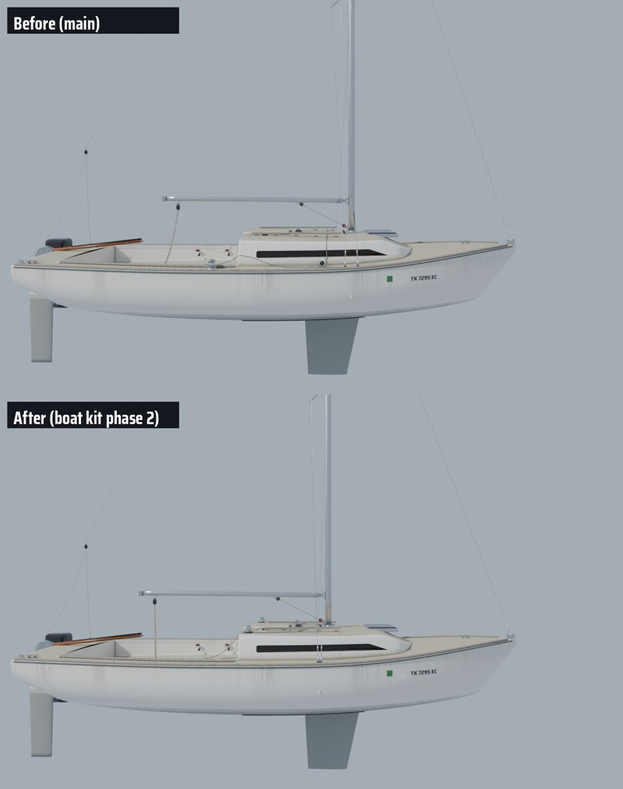
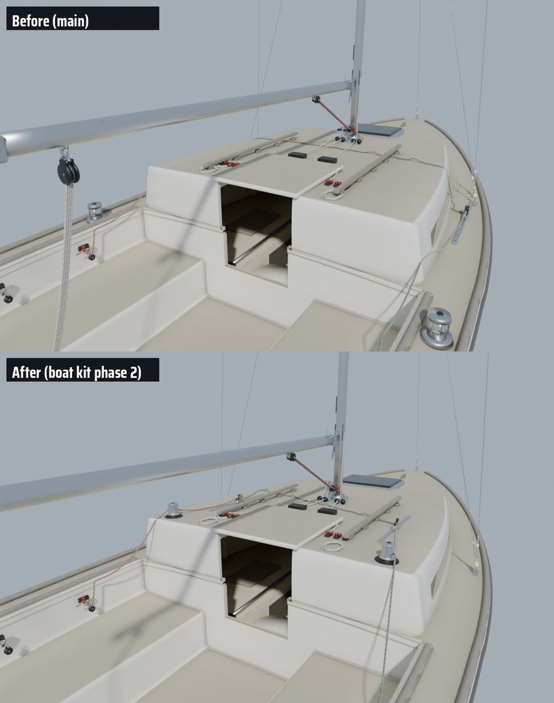

# Boat kit, phase 2: the J/22's rig where the class puts it, and kit fittings on the game's hero boat

Phase 2 of the studio-style boat pipeline (phase 1: `docs/boatkit-1`). It acts on phase 1's photo-match leads. The
mast moves to its class position in both the physics and the models. The hero J/22's jib tracks, winches and
chainplates move to where Bean's dock photos show them. The first two shared kit parts (`Winch16`, `JibTrack`) are now
built into the game's hero hull. Built and rendered in the cloud; nothing here has been through Unreal yet (see the
end).

## The mast: 35 cm aft, to the class's J

The J/22's published J (forestay tack to the mast's front face) is 8.8 ft, 2.68 m (keelindex, Good Old Boat and the
Wikipedia rig table agree: I 24.8, J 8.8, P 26.1, E 9.0 ft). The hero's forestay tack is at x 3.38 m (it matched the
dock photo to 12 px), so the mast's front face belongs at 0.70 and its centre at 0.65. Both the physics (`MastX` 1.0)
and the hero (`MAST_X` 1.0) had it 35 cm further forward. The physics comment had J as 8.0 ft.

- **Physics** (`BoatModel.cpp`): `MastX` 0.65, the main's luff 0.60 (the mast's aft face), the jib's head 0.85. The
  sails moving aft gave more weather helm, so the keel's centre of lateral resistance (a balance knob) moved aft with
  them, 0.70 to 0.45. That holds the Phase 8 helm. New test `SailingSim.Physics.J22RigPosition` (J within 4 cm of
  2.682 m, main luff on the mast's aft face).
- **Models**: the hero follows `MAST_X` 0.65. The game's default J/22 (`Tools/blender/build_j22.py`) already reads
  `mast_x` from the physics export, and its chainplates now follow it.

Standalone checks (clang in the cloud, the same sources as `scripts/polar.sh` and `scripts/reference-checks.sh`):

| Check | Before | After |
| --- | --- | --- |
| Polar, 39 points | 0 outside, worst 6.9% | 0 outside, worst 6.9% |
| Rudder angle close-hauled, 6 / 10 / 15 kn | 0.9 / 1.5 / 2.5 deg | 1.0 / 1.6 / 2.6 deg |
| Tack at 6 / 10 / 15 kn | 6.4 / 4.7 / 4.1 s | 6.2 / 4.6 / 4.0 s |
| Reference checks, 49 | 0 outside | 0 outside (J/22 heel 6.70 to 6.63 deg at 10 kn, tacking angle 76.1 to 76.3 deg) |

With only the rig moved (keel left at 0.70), the helm grew to 1.5 / 2.3 / 2.8 deg.

The keel's `Center` at 0.45 is a balance knob, not where the keel is. The modelled fin did not move: `build_j22.py`
draws its root leading edge at x 1.16 with 17 deg of sweep, so its quarter-chord runs from about x 0.9 at the root to
0.7 at the tip, 25 to 45 cm forward of 0.45. The knob is making up for something else, most likely the sails' centre
of effort sitting too far aft or the hull's lateral resistance. The next calibration pass should look there and bring
`Center` back toward the drawn keel.

Only J changed in the rig. The physics still has I 26.0, P 25.0 and E 9.75 ft against the class's 24.8, 26.1 and 9.0
(mast height and boom length). They are tied to the polar calibration, so correcting them needs its own polar and
reference-check run; it is listed under "Not done yet".

## Deck layout from a closer look at the dock photo

At full resolution, IMG_9224 shows the cabin top clearly:

- **Jib tracks are on the cabin top**, just outboard of the teak handrails, with the car and its block. These are
  inboard leads. The hero had them on the side deck. With the lead at y 0.62 m, the sheeting angle is about
  11 deg, close to the physics' 8 deg minimum. The side-deck tracks gave nearly 20 deg.
- **The winches sit on the cabin top's aft outboard corners.** IMG_9272, looking down the leeward rail, shows the
  same thing. The hero had them on the coamings.
- **One chainplate a side** takes both shrouds, a little aft of the mast. The hero had two plates.

The hero now builds the kit's `JibTrack` (0.70 m, car at x 0.15) and `Winch16` through `kit_part` in
`build_j22_hero.py`. That function builds the part with `Tools/boatkit/bk_parts.py`, sits it flat on the cabin top
and gives its slots the hero's materials of the same name. It also keeps the part's sockets for
`bake_j22_hero.py`, which now reads `JibLead`, `JibWinch` and `JibTailer` off the kit parts. The cabin handrails start
14 cm further forward to clear the winches. The single chainplate is one strap with two holes: `ChainplateUpper` is
the aft hole and `ChainplateLower` the forward one. The stills' jib sheets run through the new lead and winch.

Sockets the game reads that moved (Unreal cm, Y to starboard):

| Socket | Before | After |
| --- | --- | --- |
| `MastStep` | 99.3, 0, 94.9 | 64.3, 0, 94.8 |
| `JibWinch_S` | -83.0, 109.5, 74.8 | -42.8, 74.3, 106.9 |
| `JibLead_S` | 53.0, 102.1, 69.4 | 16.1, 62.1, 100.6 |
| `ChainplateUpper_S` / `Lower_S` | 98.0 / 82.0, 101.2 / 104.1, 69.7 / 69.4 | 48.0 / 52.0, 108.6, 68.6 |
| Every mast socket (`Hounds`, `LowerTang`, `SpreaderTip_*`, `MastheadAft`, `MastBase`) | | 35 cm aft |

The exact values are in `Inputs/j22-hero/J22H_sockets.json`.

## What the photo match got wrong, and a guard for it

Phase 1's camera for IMG_9224 was solved from four points: stem top, forestay tack, chainplate and transom corner.
All four lie close to one plane along the sheer. Their spread off that plane is 0.008 of their length. The fit
looks good (8.8 px rms), but the camera's height and distance trade off freely. The solved camera sits about 0.8 m
above the waterline, yet the photo looks down onto the cabin top. So the "mast 20 to 25 cm forward" lead pointed the
right way only by luck, and a cabin height read from this match is not to be trusted. A trial that raised the cabin
10 cm to match it was dropped. The class's J decides the mast.

`solve_camera.py` now measures how flat the solve points are (`flatness` in the camera JSON) and warns below 0.08.
The next photo matches need points off the sheer: mast fittings, the cabin top or the waterline.
`photomatch/match_blend.py` renders any saved .blend from a solved camera and writes the compare image, so the hero
itself can go through the loop.

## Needs Unreal (PC builds and imports, Mac gate)

1. `scripts/build.sh` and the tests: `SailingSim.Physics.*` (PolarGate, J22RigPosition, LeewayAndWeatherHelm,
   ReferenceChecks), `SailingSim.Visual.J22Mesh`, `J22HeroMesh`, crew and traffic tests.
2. `scripts/make-boat-models.sh`: the game's default J/22 and its berthed dresses follow the new `MastX`. Without the
   rebuild, the mast stands 35 cm forward of the sails.
3. `scripts/import_boat_detail.py`, then `scripts/import_j22_hero.py`: the hero meshes, textures and sockets.
4. Look at it with `-SailingJ22Hero`:
   - the jib sheet from the cabin-top lead to the winch;
   - the trimmer's hand on the tail (the tailer is now about 1.1 m from the seat);
   - both shrouds landing on the one plate;
   - the gooseneck on the mast.
   Then run `scripts/gate.sh --scope boats`.

## Not done yet

- The hull and cabin are still the hero script's guesses. Rebuilding them from class drawings, checked by
  better-conditioned photo matches, comes next. The keel stays where it was drawn.
- The other 29 kit parts still only dress the cloud renders (`dress_boat.py`). Owner touches and wear (phase 3) are not
  in the game yet.
- The physics rig's I, P and E (mast height, mainsail hoist, boom) still differ from the class figures (see above), and
  the keel's `Center` compensates rather than sits on the drawn fin. Both need a calibration pass with its own polar
  run.
- A tape measure from the stem fitting's pin to the mast's front face on TX 7295 EC would settle J for this boat. It
  is optional.

## Follow-up: the jib sheet's tail when no hand holds it

On a beat the trimmer hikes to windward, out of reach of the leeward winch, so the tail fell back to a point behind
and below the self-tailer. That suited the coaming winch; the cabin-top winch is only 13 cm from the trunk's aft edge, so
the tail ran over the corner and stopped in mid-air (the Mac's stills, `mac/tail_floating_crop.jpg`). The hero now has a
`JibTailRest_S`/`_P` socket on the cabin top, 25 cm forward and 20 cm inboard of the winch (x -17.8, y 54.3, z 98.0 cm),
and `BoatModelVisuals.cpp` lays the tail there; the default J/22, with no such socket, keeps the old point on the seat.
Needs `import_j22_hero.py` (the socket only; no mesh or texture changed).
