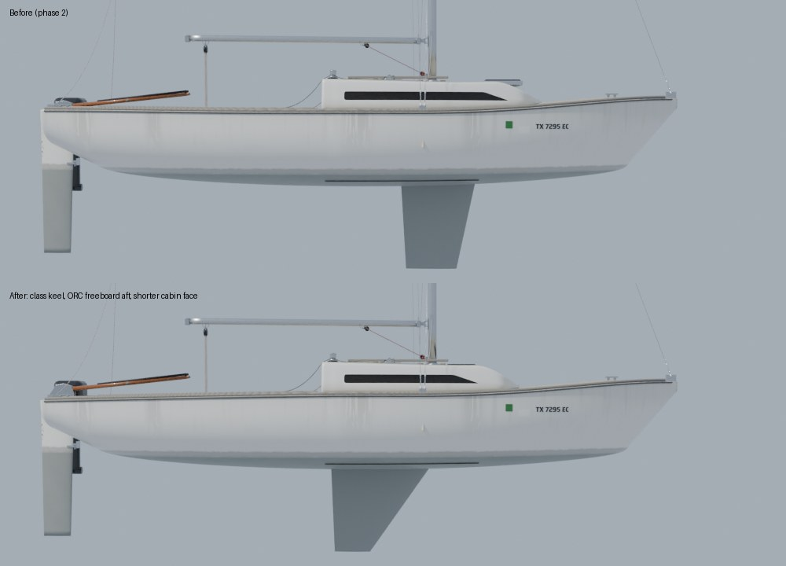

# Boat kit phase 3: the J/22 hero's profile from the class rules and a broadside photo

Phase 3 of the boat modelling plan rebuilds the hero J/22's lines from published numbers and photos instead of
guesses. The first pass covers the side profile: the keel, the sheer and the cabin's raked front.

## Sources

| Source | What it gives | How it was read |
|---|---|---|
| International J/22 class rules (keel template, mast position) | Keel plan form, mast to stem distance | Quoted in search summaries of the j22.org and ffvoile.fr PDFs; the PDFs themselves were not reachable from the cloud session, so read them before relying on a number to the millimetre |
| ORC certificates for J/22s | Freeboard forward 774 mm, aft 568 mm (both plus or minus 6) | Search summaries; the stations are the certificate's usual sheer ends |
| [J-22 sailboat Jay2PLay on trailer](https://commons.wikimedia.org/wiki/File:J-22_sailboat_Jay2PLay_on_trailer.jpg), Thomas Gutenstein, CC BY-SA 3.0 | A square-on broadside with the rudder off: keel, sheer, cabin front | `Tools/boatkit/photomatch/profile_match.py` with the picked pixels in `matches/Jay2PLay.profile.json` (the photo is not in the repo) |

Class rule numbers used, from the hull datum (where the transom meets the bottom of the hull shell on the centreplane):

- Keel at MPA, 216 mm under the hull shell: trailing edge 2883 to 2908 mm forward of the datum, chord 956 to 975 mm.
- Keel at MPC, 483 mm under MPA: trailing edge 3003 to 3029 mm forward, chord 591 to 616 mm.
- Keel depth from MPA to its bottom: 708 to 721 mm.
- Mast: the front face, carried down to the deck, 2615 to 2635 mm aft of the stem and sheer intersection.

## What changed

**Keel.** Both models drew the fin about 70 cm too far forward: the hero's trailing edge was at x +0.29 to +0.35 and
the default model's leading edge at +1.16, where the class puts the trailing edge at -0.51 and the leading edge at
+0.45 (hero frame, x forward from amidships). The photo agrees with the class to 4 cm at the trailing edge and 5 cm at
MPA's leading edge. The fin is now the class template: chord 0.965 m at MPA and 0.603 m at MPC, draft unchanged at
1.16 m. One disagreement: the rule's trailing edge rakes 12 cm forward between MPA and MPC, while the photo shows it
plumb (to a pixel over 0.6 m of depth). Both models rake it 2 cm, following the photo, and keep the class chords.
`keel_edges` in `Inputs/j22-hero/build_j22_hero.py` and the keel block in `Tools/blender/build_j22.py` share the same
two lines.

**Sheer.** The hero's freeboard aft was 0.645 m against the ORC certificate's 0.568 m, and the photo showed the same
8 cm (its sheer runs nearly straight down from the cabin to the transom). `sheer_z` now falls to 0.568 m at the transom
along a gentle power curve from x -0.3; the bow is unchanged at 0.79 m (ORC 0.774 m).

**Cabin front.** The trunk's raked face ran down to the foredeck at x +1.90; in the photo its foot is at +1.50, or
about +1.62 allowing for the centreline standing a half beam further from the camera than the near sheer. `CABIN_FWD`
is now 1.65 with the same face shape (top of the slope about +1.08, photo +1.21). The fore hatch moved from the face to
the flat between the mast step and the slope (`FWD_HATCH`, 0.80 to 1.12), and the portlights now stop at +1.10
(`WIN_FWD` in `j22_interior.py`, mirrored in `j22_materials.py`) so they don't run into the trunk's rounded nose.



The photo overlay is not committed (it is a derivative of a CC BY-SA photo). Reproduce it with:

```
python3 Tools/boatkit/photomatch/profile_match.py Tools/boatkit/photomatch/matches/Jay2PLay.profile.json \
    <hero.blend> <J-22_sailboat_Jay2PLay_on_trailer 960 px thumbnail> overlay.png
```

## Not changed, and why

- **The physics keel.** `FBoatConfig`'s keel `Center` stays at x +0.45: it is a balance knob the polar was tuned with,
  and the drawn fin's centre of area is now near x 0. The grounding contact points no longer depend on it: #88 gives
  `FBoatModel::BuildContactPoints` the class fin's bottom chord (x -0.49 to +0.11) as the J/22's keel footprint.
- **The mast.** The class's mast rule puts the mast's front face at x +0.825 and the forestay tack at about 3.50, 17.5 cm
  forward of phase 2's 0.65 (which came from J = 8.8 ft measured to a tack at x 3.38). The sim thread confirmed the
  reading and moves the mast and the keel `Center` together in one calibration pass after this PR (polar, `--scenarios`,
  reference checks).
- **The rudder.** The class numbers for its depth and chord came only from a search snippet, so the blade is as it was.
- **Plan view and sections.** A broadside says nothing about beam or deck shape. The other Commons photos of J/22s
  (a crane lift, several overheads, the class's category) are the next inputs, solved with `solve_camera.py`.
- **Hull volume.** The lower sheer reshapes the hero's sections slightly below the waterline: canoe volume 1.0835 to
  1.0879 m^3 and centre of buoyancy x -0.219 to -0.226 (physics 1.052 m^3 at -0.195). The default model is the physics
  hull below the water and is unchanged there (`SailingSim.Visual.J22Mesh`).

## To finish on the machines

1. PC: `scripts/make-boat-models.sh` (the default J/22's keel) and `import_j22_hero.py` (the rebaked hero), then push
   the LFS assets.
2. Mac: the boats gate (`scripts/gate.sh --scope boats`) and a beat still to check the keel under water and the cabin
   front from the helm.
