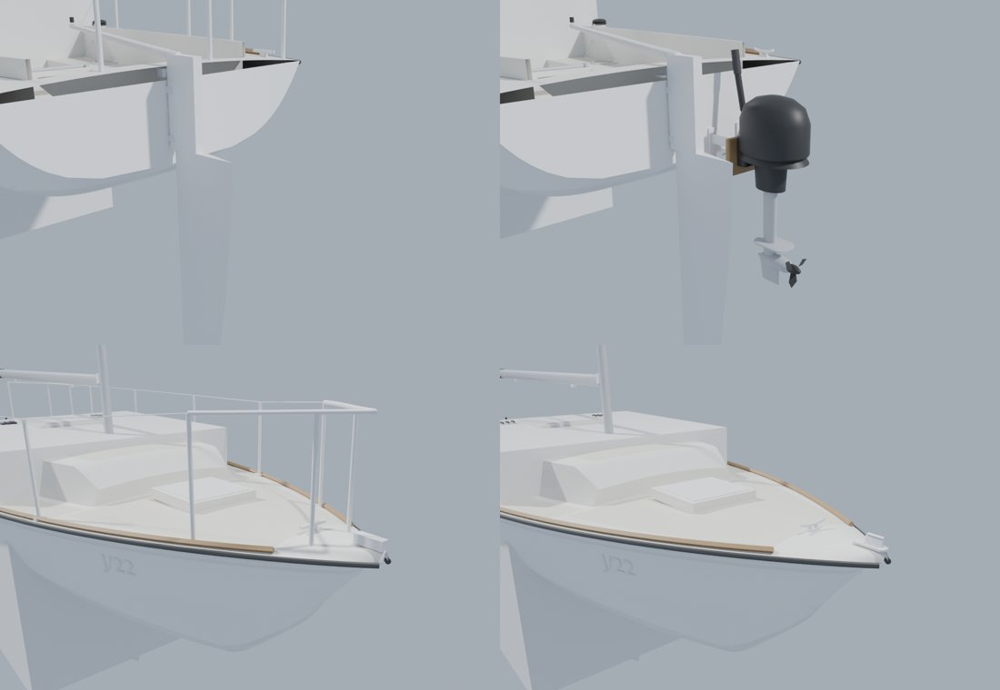

# Boat kit phase 4: round 12's J/22 fixes

Bean marked blind round 12 on Oct 16 and caught all 20 stills. Five of the tells were about the J/22: no wear, blocky
fittings at the winch, untextured gelcoat and non-skid, a tiller texture that looked repeated, chrome too shiny, and a
"random rectangle at the back of the boat". Every one of those stills showed the game's default J/22
(`Tools/blender/build_j22.py`), not the hero model (`Inputs/j22-hero`), which only drew with `-SailingJ22Hero`. The
default model also carried a bow pulpit, stanchions and lifelines, which the lesson boats at Rush Creek (TX 7295 EC,
7297 EC) don't have.

## Part 1: the hero is the player's boat

`ASailboatPawn::ModelMeshesFor` now gives the player's J/22 the hero: the open deck, kit winches and fittings, the cabin,
the outboard on its bracket, the baked gelcoat and wood. AI J/22s and the ghost keep the light model with their
liveries. The pawn's grey box on the transom (a stand-in for engines without a model) is skipped when the model carries
its own outboard (`FBoatModelMeshes::bOwnOutboard`).

- `-SailingClassicJ22` draws the older model on the player's boat, for comparing.
- `-SailingJ22Hero` still works and now also puts the hero on AI J/22s.

The gate: `scripts/gate.sh --scope boats` on the Mac, Medium 60 and High 45. If High falls under 45 with the hero, the
fallback is a per-tier choice in `ModelMeshesFor` (hero only where it holds), not dropping it.

## Part 2: the light model and the boat materials

AI J/22s, the ghost and `-SailingClassicJ22` still draw the light model (`Tools/blender/build_j22.py`), and the boat
materials are shared by every class, so part 2 fixes those too.

**Geometry** (`build_j22.py`):

- No bow pulpit, stanchions or lifelines, as on the lesson boats.
- An outboard on a two-position bracket where the physics puts the engine (`FBoatConfig` engine position), with an
  `Outboard` socket, so the pawn's grey box is skipped (`bOwnOutboard`, part 1).
- Cast fittings instead of plain boxes: rounded blocks (`rbox`) for the chainplates, stem fitting, backstay plate, jib
  car, traveler ends and pintles; horn cleats; rope clutches with a lever; a base pad with bolts under each winch.
- The tiller is one tube tapering along its length. It was eight capped segments, each a step thinner, and shaded in
  bands that read as a repeating texture.
- The logged LOA measures the hull shell alone, as `SailingSim.Visual.J22Mesh` does (the outboard hangs aft).

**Materials** (`make_materials.py`, `BOAT_CODE` and `build_boat_surface`):

- Grime ground into decks and non-skid from three octaves of value noise anchored to the boat, and a faint mottle in
  every gelcoat. How dirty follows E1's seeded `Age` and `Care` (per-instance custom data 10 and 11 on the marina's
  berthed boats, docs/environment-1), or the per-boat `Age`/`Care` parameters, or the livery's oxidation channel.
- Wood grain (`Grain` 1 on `MI_Boat_Wood` and `MI_Boat_Teak`): straight grain along the part with slow wander.
- Stainless at roughness 0.30 and a little darker (it was 0.14 and read as chrome).

To finish on the machines: `scripts/make-content.sh` (or `MATERIALS_ONLY=build_boat_library`), then
`scripts/make-boat-models.sh`, LFS push of the J/22 meshes, then `scripts/test.sh` (`SailingSim.Visual.J22Mesh`) and the
Mac's `scripts/gate.sh --scope boats`.
