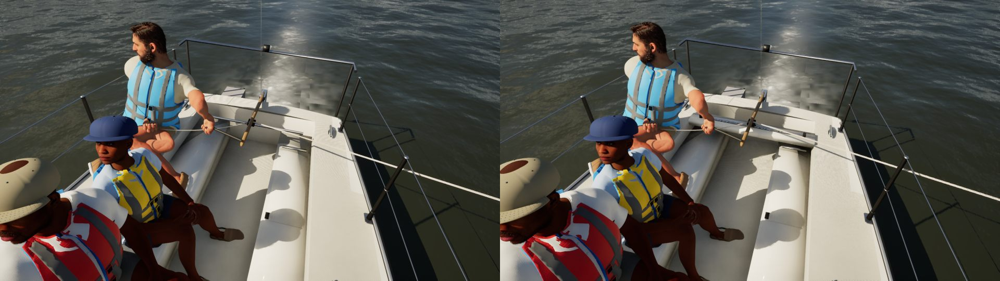
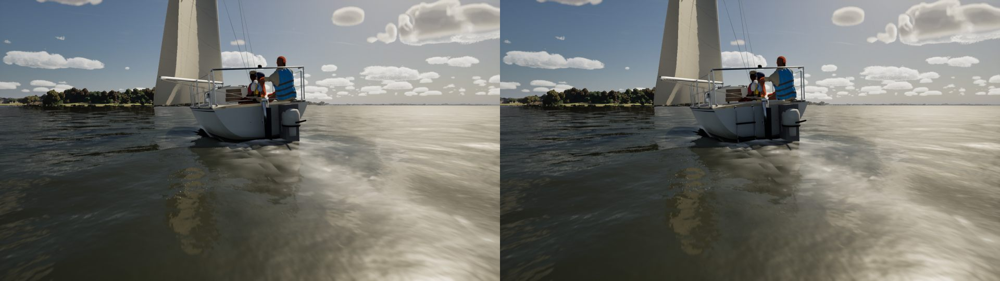
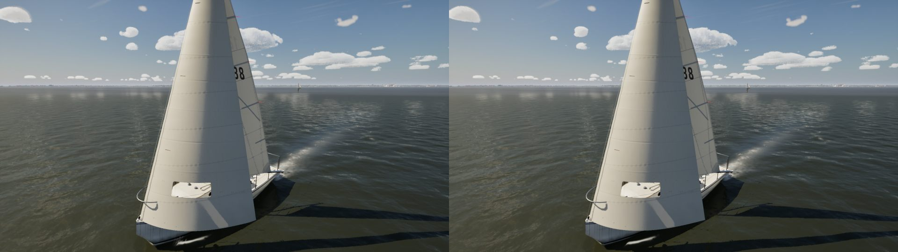

# Catalina 22: traveller and stern ladder (pc/boats-c22-2)

This pass finishes the two items `docs/boats/c22-ilca/notes.md` left. Both are in `Tools/blender/build_fleet.py`
(`c22_traveller_and_ladder`), built with the shared kit and simple tubes, with no new assets. Rebuild with
`scripts\windows\make-boat-models.ps1 -Parts fleet -Fleet Catalina22`.

## What changed

- **Traveller:** the kit's track and car (`Traveler`) on a moulded bridge across the cockpit's aft end. It had been a
  bare aluminium bar spanning the open well. The car stays at `Traveler_C`, so the mainsheet's rig lines are
  unchanged.
- **Stern ladder:** a folding boarding ladder on the transom's port side, clear of the outboard on the starboard
  quarter:
  - two stainless rails from hinge brackets at the transom top down to 0.35 m under the water;
  - three moulded treads.

## Kept as they were

- **FleetMesh:** passes, with the same measures (LOA 6.550 m, beam 2.340 m, canoe volume 1.238 m³).
- **Sockets:** unchanged.
- **Triangles:** hull 202,202 (was 198,550; Nanite). Mast, boom and rudder unchanged.
- **Berthed dresses:** untouched. The narrowed import still re-imports this class's berthed dresses from
  `Artifacts\models`, so I reverted them; they're in no rebuild this time.

## Cost

| View | GPU frame | Earlier the same week (main) |
| --- | --- | --- |
| C22 sailing, three-quarter | 5.93, 5.96 ms | 5.97-6.06 ms |
| C22 deck from above | 5.77, 5.79 ms | 5.86-5.92 ms |

High, uncooked, 20 s each. There's no measurable cost.

## Stills (before | after, High, uncooked)

