# Catalina 22 and ILCA: hardware pass (pc/boats-c22-ilca)

Both boats already had their fidelity passes (`docs/c22-detail`, `docs/ilca-detail`, `docs/fleet-hero`): the C22's kit
outboard, handrails, hatch, rudder head, tiller, windows and drop boards; the ILCA's rudder head, tiller, traveller,
board, strap, bailer and masthead. This pass adds what a tester still sees missing up close in the first hour (at the
helm, on the side deck, at the mast). It uses only the shared kit (`Tools/boatkit`) in `Tools/blender/build_fleet.py`:
no downloads and no new assets. Rebuild with
`scripts\windows\make-boat-models.ps1 -Parts fleet -Fleet Catalina22,ILCA7`.

## What changed

**Catalina 22:**
- **Shrouds:** a stainless chainplate and turnbuckle under each of the four. The wires now end on the turnbuckles'
  eyes, because the C22's `ChainplateUpper/Lower` sockets moved up 0.25 m. Other boats' sockets are unchanged.
- **Mast step:** the kit's cast step, with its hinge pin, on the cabin top under the mast.
- **Stemhead:** the kit's stemhead fitting at the bow, with its forestay tang, in place of the plain box and roller.
- **Vents and scuppers:** two mushroom vents on the cabin top forward of the hatch, and a cockpit scupper each side of
  the transom.

**ILCA:**
- **Inspection ports:** two screw-out deck plates, 100 mm, one on the aft deck's centre and one on the foredeck beside
  the board.
- **Mast collar:** the moulded collar where the mast drops through the deck.

FleetMesh's measures are unchanged, and `SailingSim.Visual.FleetMesh` passes:

| Boat | LOA | Beam | Canoe volume | Centre of buoyancy |
| --- | ---: | ---: | ---: | --- |
| C22 | 6.550 m | 2.340 m | 1.238 m³ | (-0.111, 0, -0.102) |
| ILCA | 4.230 m | 1.370 m | 0.162 m³ | (-0.151, 0, -0.029) |

Hull, mast, boom and rudder are rebuilt for both. The berthed dresses are untouched.

## Triangles (LOD 0, Nanite hull)

| | Main 54ead319 | This pass |
| --- | ---: | ---: |
| Catalina 22 hull | 158,174 | 198,550 |
| ILCA hull | 61,348 | 65,996 |
| Masts, booms, rudders | unchanged | unchanged |

Most of the C22's 40k is the four turnbuckles and chainplates (the kit's hero parts). The hull is Nanite, so it
doesn't count against the 40,000 non-Nanite limit.

## Cost

High, 1920x1080, 20 s each, uncooked on the RTX 4090, in one session. The order was this pass twice, then main's two
boats twice (their uassets checked out from 54ead319), then this pass once more. GPU frame ms:

| View | This pass | Main |
| --- | ---: | ---: |
| C22 sailing, three-quarter (9 m) | 5.97, 6.03, 6.06 | 6.05, 6.04 |
| C22 deck from above (6 m) | 5.86, 5.86, 5.88 | 5.92, 5.87 |
| ILCA sailing, three-quarter | 5.89, 5.87, 5.91 | 5.89, 5.90 |
| ILCA deck from above | 5.89, 5.91, 5.98 | 5.86, 5.88 |

There's no measurable cost: every view is within 0.1 ms of main, and run to run spread is as large. The CSV is
`Artifacts\club-docks\boats-bench.csv` on the PC.

## Also fixed: a narrowed rebuild re-imported every boat

`make-boat-models.ps1 -Fleet <classes>` built only those classes, but `import_boats.py fleet` then imported every
class with an FBX in `Artifacts\models`. That re-imported the other five boats, and the C22's berthed dresses, from
whatever stale FBX was left there. I caught it in `git status` and reverted those files. Now `-Fleet` passes
`only=<classes>` and only they are imported. Checked: a `-Fleet ILCA7` rebuild changed only the ILCA's four uassets.

## Stills

High, 11:00, sailing at 70 degrees to the wind in 6 to 8 kn, uncooked. Before (main) on the left, after on the right:

| | |
| --- | --- |
| C22 three-quarter | 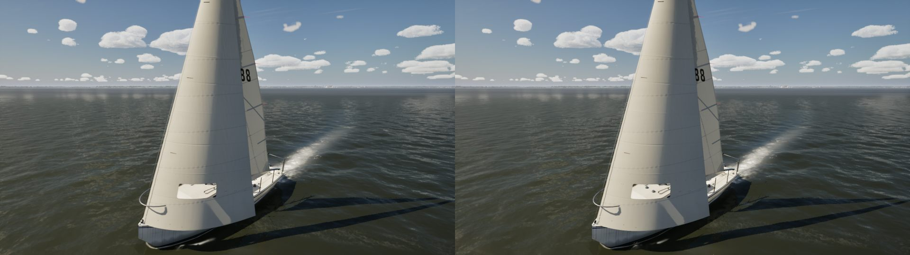 |
| C22 side | 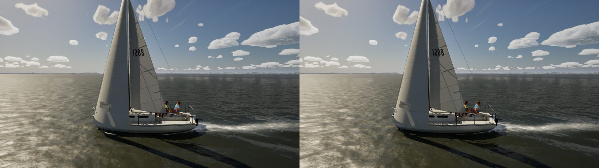 |
| C22 deck | 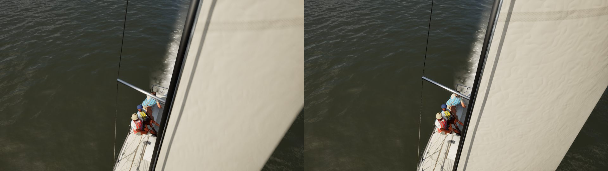 |
| ILCA three-quarter | 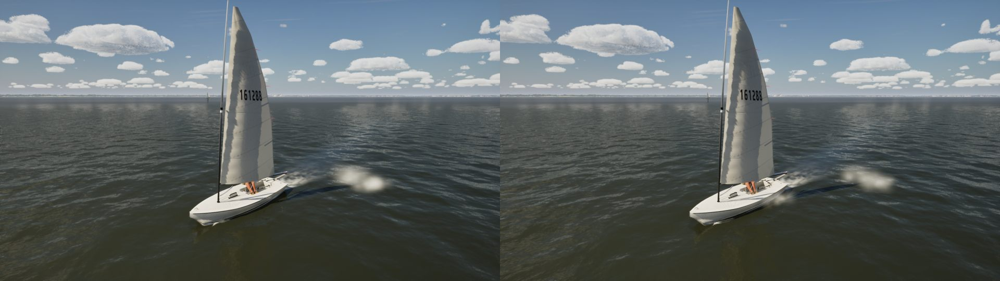 |
| ILCA side | 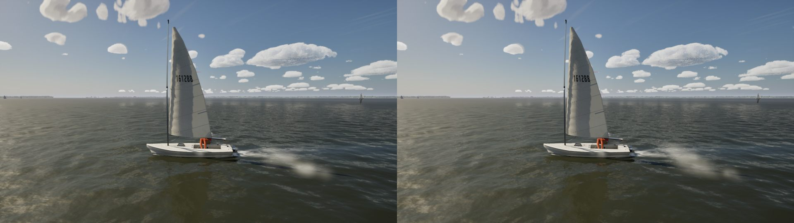 |
| ILCA deck | 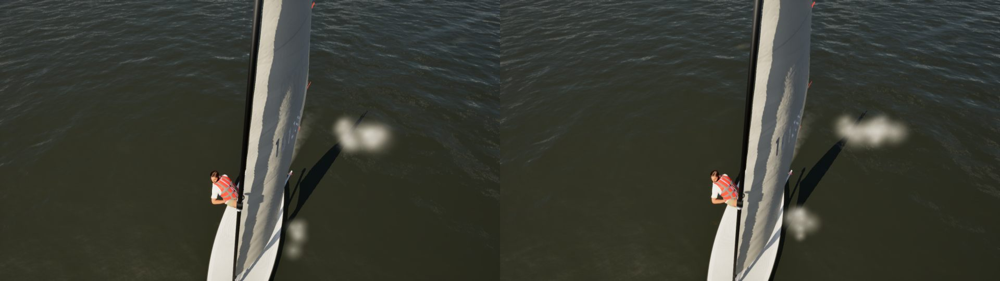 |

Close-ups, after:

| | |
| --- | --- |
| 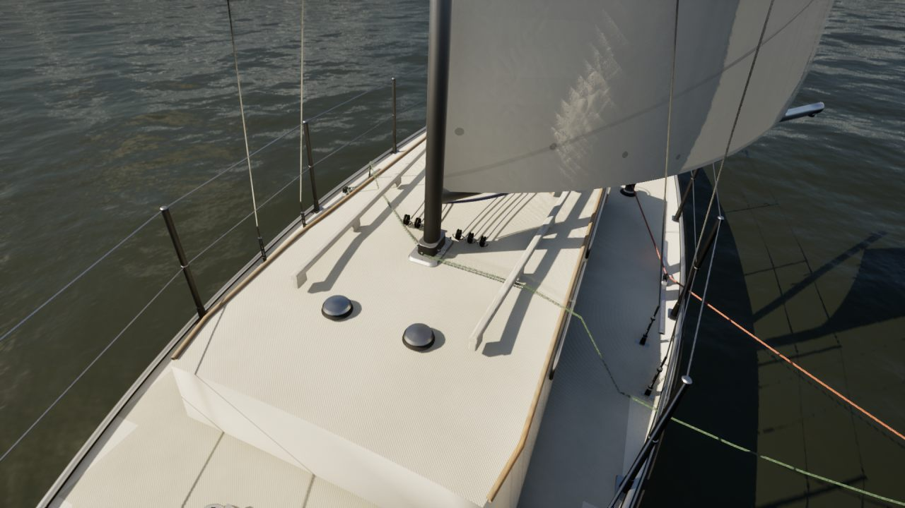 | The mast step, its turning blocks and the two vents |
| 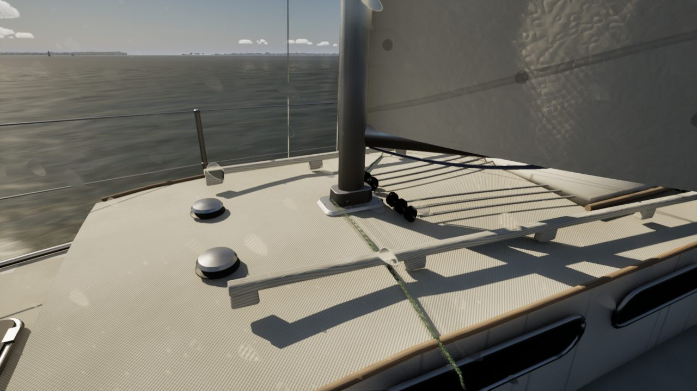 | The cabin top from the side deck |
| 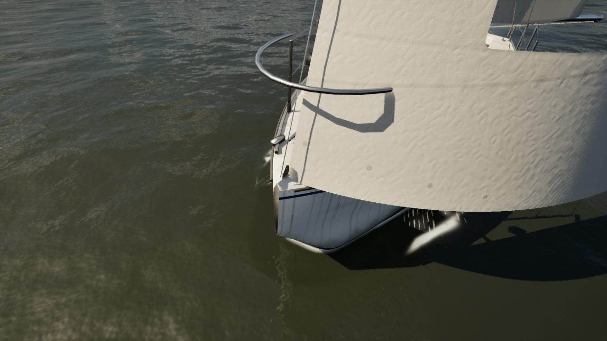 | The bow |
| 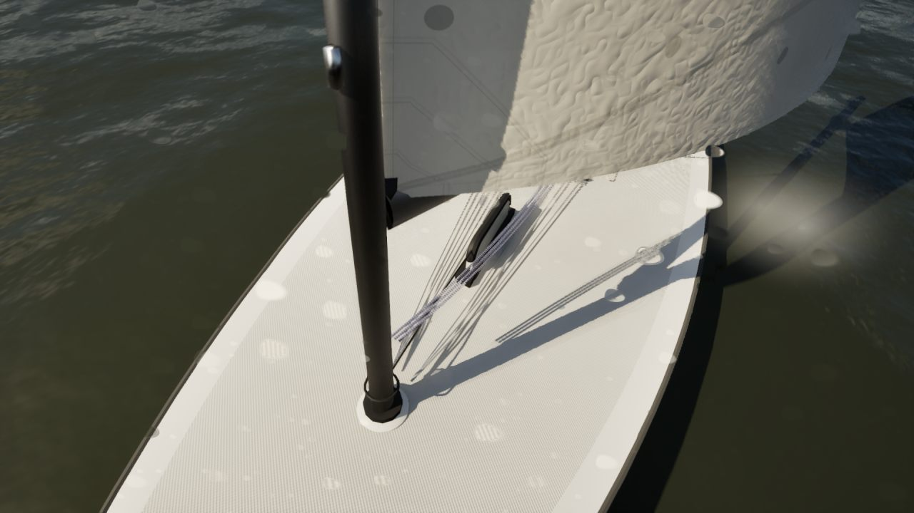 | The ILCA's mast collar |
| 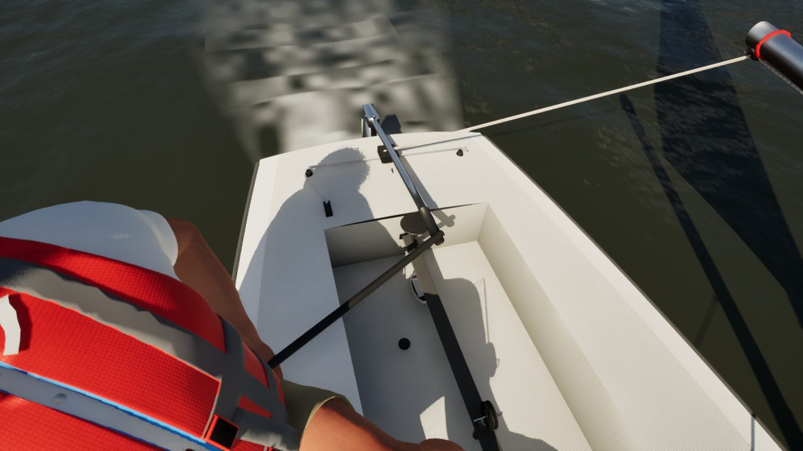 | The ILCA's aft deck |

## Checked

- Built with Blender 4.2 headless and imported in the editor.
- `SailingSim.Lake.*`, `Smoke.*` and `Visual.*`: 110 of 110 pass, FleetMesh included.
- No C++ changed, so there's no MSVC build to run.

## Left for a later pass

- The C22's traveller is still a plain bar across the cockpit. The kit's track would float over the well where the
  bar sits.
- A stern boarding ladder on the C22.
- The sails' cloth detail is unchanged. `M_SailCloth` already has these classes' layouts and the High/Ultra `Detail`.
