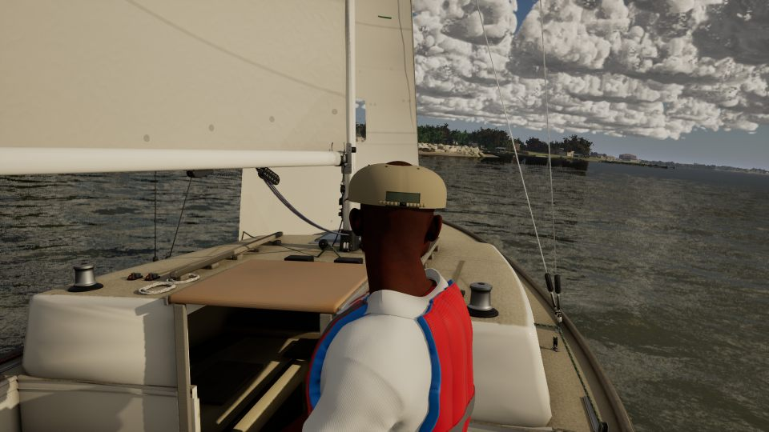
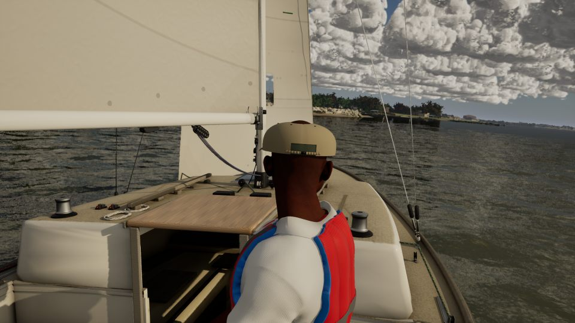
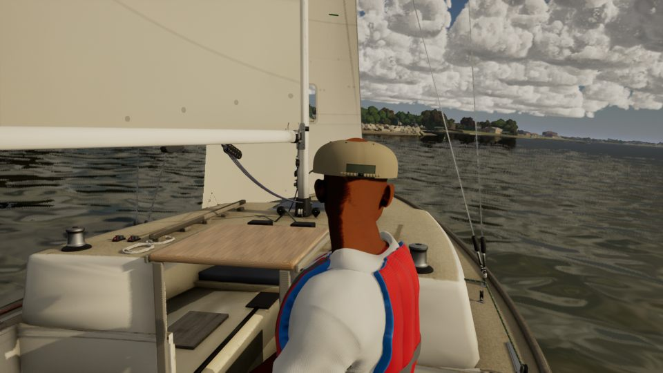
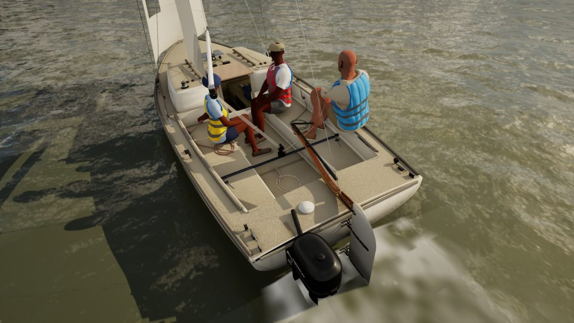
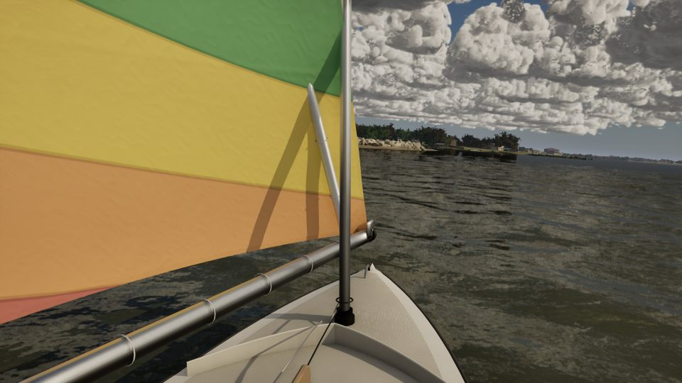
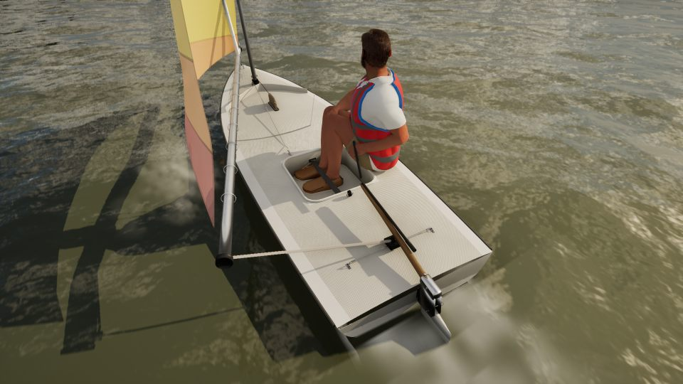

# J/22 and Sunfish up close (pc/boats-closeup)

The J/22 and the Sunfish as the first job and the first lessons show them, looked at from the helm (the HelmEye
capture) and from over the cockpit's aft quarter (the chase camera, 3.6 m on the J/22 and 2.6 m on the Sunfish). The
stills were taken on Ultra and Medium on the uncooked game, at 15:00 in 10 kn at TWA 60 (`Artifacts/boats-closeup/stills.ps1`).

## What read wrong at that distance

| # | Boat | Item | This pass |
| --- | --- | --- | --- |
| 1 | J/22 | The companionway's sliding hatch (varnished marine plywood, from the #235 photos) read as a flat tan board: no grain, no varnish. | Fixed (below) |
| 2 | J/22 | The aft deck's inspection port is one plain white disc: a blob from the cockpit. | Listed: needs a rim, lid and grip bar in `Inputs/j22-hero/build_j22_hero.py`, so a hero rebuild and bake |
| 3 | Sunfish | At helm distance the sail's used-cloth crinkle (`M_SailCloth`) reads close to crumpled paper. | Listed: the crinkle is every boat's sail, and its strength was tuned in docs/sail-cloth-shading; a call for Bean |
| 4 | Sunfish | The mainsheet ends at the aft bridle; on the boat it runs on to the boom's middle block and down to the helm's hand. | Listed: rig-line code (`BoatModelVisuals.cpp`), outside a models-and-materials pass |

**Checked and fine:** the Sunfish's daggerboard (12 cm proud, as referenced), splash guard, bailer, hiking strap,
bridle and rudder head; the J/22 tiller's rake (Bean's photos), winches, cams and the coiled tails. In the helm-eye
still the J/22's trimmer sits in the middle of the frame; that's the crew's placement, not the model.

## The fix: grain and varnish on the J/22's woods

`scripts/import_j22_hero.py` set `Grain` 0 on every flat material and skipped the parameter on the flat instances. So
`M_BoatSurface`'s straight grain (BOAT_CODE, Grain 1) never reached the hero's wood, and only the teak varnish had a
clear coat.

- **Grain 1:** PlywoodVarnish, AshVarnish, TeakVarnish and TeakWeathered.
- **Clear coat:** the varnished plywood (the hatch) and ash (the tiller) now have one.
- **Assets:** the materials were rebuilt with `HERO_MATERIALS_ONLY=1`. Six instances changed: the four woods and the
  two packs that carry them (`MI_J22H_PackWood`, `MI_J22H_PackMetal`). No mesh or texture changed.

| View | Before | After |
| --- | --- | --- |
| Helm-eye, Ultra |  |  |
| Helm-eye, Medium |  |  |
| Cockpit, Ultra |  |  |

The Sunfish as it stands:  

## Cost

| | GPU frame (ms) | Average fps |
| --- | --- | --- |
| After, run 1 | 10.88 | 51.5 |
| After, run 2 | 11.30 | 51.0 |
| Before, run 1 | 11.23 | 50.8 |
| Before, run 2 | 11.30 | 46.1 |

These are the J/22's helm-eye view on Ultra, uncooked, 1920x1080, 20 s each. There's no measurable cost.
