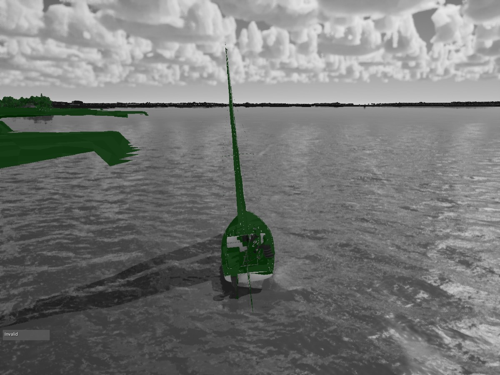

# Perf 3: the sun's scattering and disc setters (Mac, Oct 17 2026)

PR #110 (`perf-sun-setters`, 9efbc9b3 on main cb80cc34): `SetVolumetricScatteringIntensity` and
`SetAtmosphereSunDiskColorScale` in `ASailingEnvironment::UpdateSun` now step by 0.04, the same way the Perf 2 scales do.
Both follow `CloudShade`, which moves every frame as the weather map drifts, and each change marks the light's render
state dirty.

Both builds packaged as Development on Bean's Mac (Apple M5 Pro). Parked on High with soak 3 task A's arguments on the
moving clock, 20 min each, one after the other, window visible, `caffeinate -d`:

    SHOT=soak-sun ARGS="-SailingQuality=High -SailingKeepStart -SailingMooring -SailingBenchTrace \
      -ExecCmds=ToggleDrawEvents -csvCategories=VSM -csvCaptureFrames=200000 -SailingExecAt=1195:CsvProfile+Stop" \
      scripts/bench-mac.sh 1200

Unlike soak 3 there is no `-LLM`, so these fps are not directly comparable with soak 3's 51.2. Main was rerun the same
way as the baseline. The CSV profile ran for the whole window. `-csvCategories=VSM` adds the virtual shadow map's
per-frame page counts.

## Results

> **Correction (Perf 4, below).** These two runs were not of the same scene. The #110 build (9efbc9b3) branched from
> a8ce8ed3, before #109 added `-SailingMooring`, so in its run the flag was ignored and the boat was not parked on the
> buoy, while main cb80cc34 was parked. Rerun like for like, #110 makes no measurable difference on the Mac, parked or
> not. The gain and the page counts below come from the scene. The PC's D3D12 result (below) was measured separately.

| | main cb80cc34 | #110 | change |
|---|---|---|---|
| fps (bench.json, 1200 s) | 54.9 | **59.3** | +4.4 (+8%) |
| p99 ms | 20.64 | **19.25** | -1.4 |
| first / last 10 min fps | 54.9 / 55.0 | 58.8 / 59.9 | |
| first / last 10 min p99 ms | 20.56 / 20.78 | 19.65 / 18.63 | |
| p99 drift (`soak_stats.py`) | **+2.8 ms/h** | **-2.0 ms/h** | |
| GPU ms (CSV `GPUTime`, mean) | 17.65 | 16.36 | -1.3 |
| game thread ms | 2.45 | 2.22 | |
| render thread ms (CSV) | 18.20 | 16.84 | = frame time, see below |
| RHI thread ms | 3.18 | 4.35 | +1.2 |
| VSM pages cleared and redrawn per frame (`NUM_PAGES_TO_CLEAR`) | **974**, flat (943 to 1012) | **238**: 518 in the first 2 min, 101 to 118 from 12 min on | -75%, -89% at the end |
| VSM static pages invalidated per frame | 0.85 | 0.22 | |
| VSM non-Nanite instances drawn into shadow pages | 93 | 80 (86 falling to 76) | |
| VSM dynamic pages invalidated / requested per frame | 1118 / 1173 | 1171 / 1235 | about the same |
| RSS growth after 5 min | +1285 MB/h | +1387 MB/h | soak 3's per-frame Metal leak, unchanged |
| frames over 33.3 ms after warm-up | 2 | 6 | the worst are the 3 s warm-up |

**What the fix changes.** On main the virtual shadow map clears and redraws about 970 pages every frame, at the same
rate for all 20 min: the cache restarts every frame. With #110 that falls to about 100 pages from minute 12 on. The GPU
saves 1.3 ms, fps rises 8%, and p99 no longer climbs (+2.8 ms/h on main against -2.0 with the fix). Over 20 min the
drift slopes are noisy, but the sign matches the brief.

**Still moving.** About 1170 dynamic pages a frame are still invalidated on both builds. These are the pages that moving
casters touch (the boat swinging on its mooring, sails, crew, water). That is what the dynamic layer is for, so it is not
this bug. The cleared pages still fall slowly over the first 12 min with the fix (518 to about 100). Some shade changes
early in the run are bigger than 0.04, so the light is still rebuilt now and then until the weather map settles.

**Draw counts.** `DrawCall/ShadowDepths` and `RHI/DrawCalls` are columns in the CSV, but they read 0 on Metal, with or
without draw events and with `r.GPUCsvStatsEnabled=1`. The Metal RHI doesn't feed the GPU profiler's draw stats in this
build. The VSM category's `NON_NANITE_INSTANCES_DRAWN` is the closest equivalent: 93 on main, 80 with the fix, flat
within each run, against about 1090 non-Nanite instances in the scene.

**Render thread.** On the Mac the CSV's `RenderThreadTime` equals the frame time on both builds, because it includes the
wait for the GPU (`RenderThreadIdle` doesn't count that wait here). So it can't show the PC's 4 ms of render-thread
work. GPU time and the page counts show the saving instead. The RHI thread does about 1.2 ms more per frame with the
fix. It submits 8% more frames a second, so part of that is per-frame work done more often.

## Stills (High, uncooked `run-game.sh`, main against #110)

`perf-sun-setters/helm-eye-main-vs-fix.jpg` (bench-visual's helm-eye row) and `perf-sun-setters/storm-main-vs-fix.jpg`
(Thunderstorm, `-SailingWeatherTime=120`, `-SailingNoLightning`), main on the left:

- helm-eye: mean luminance 125.7 against 125.9. The mean absolute difference, 2.1 of 255, is wave and cloud motion
  between runs. No visible change in the sun's haze or the disc.
- storm: mean luminance 62.9 against 63.0, mean difference 0.45 of 255. The deck's gloom and the dimmed scattering under
  it look the same. The 0.04 step doesn't show.

## Tests

`scripts/test.sh SailingSim.Visual` 32/32, `SailingSim.Smoke` 16/16 on #110.

## Next

The fog setters in `UpdateHaze` were the next suspect. With the cache no longer restarting, the drift is gone over these
20 min, so they matter less, but they still rebuild the fog proxy every frame and are worth stepping the same way. A
longer run, an hour or more, would pin the drift down better than 20 min can.

## Files (`soak/`)

`sun-setters-{main,fix}-2026-10-17.frames-1hz.csv` (1 Hz frames), `.mem.csv` (RSS every 60 s), `.csv-2min.txt` (CSV
profile means in ten 2-minute bins: frame, thread and GPU ms, VSM page and instance counts). The full CSV profiles (146
MB each) stay in the game's sandbox under `Saved/Profiling/CSV/`.

## The PC on D3D12 (main with #110)

The PC's parked soak confirmed #110 on D3D12: p99 drift 3.8 to 0.79 ms/h, Ultra fps 61 to 80, and `ShadowDepths` draws
119 and climbing to 80 and flat. A small residual drift is left on the render thread (+1.66 ms/h). That residual is why
Perf 4 looks at the fog.

## Perf 4: the fog setters (`perf-fog-setters`, Mac, Oct 17 2026)

`ASailingEnvironment::UpdateHaze` set every `UExponentialHeightFogComponent` value every frame. Each setter marks the
fog's render state dirty when its value changes, and the fog's scene proxy is then rebuilt. The inscattering colour
follows `HazeLight` (the metered light, new every frame) and the density follows the visibility, so the fog was rebuilt
every frame. Now density, height falloff, inscattering colour, max opacity, the cinematic glow colour, volumetric
extinction scale and volumetric distance move in steps of 3% of their value. They snap exactly to their lerp ends (dry,
full rain) and to zero. The constant setters (albedo, scattering distribution) were already no-ops after the first
frame.

Both builds are on main d6cf6476 (#110 and #113 merged; #114 is docs only), packaged as Development. Same arguments as
above, parked on the buoy, 20 min each, one after the other:

| | main d6cf6476 | fog steps | change |
|---|---|---|---|
| fps (bench.json, 1200 s) | 55.3 | 55.5 | +0.2, noise |
| p99 ms | 20.55 | 20.44 | -0.1 |
| first / last 10 min fps | 55.3 / 55.3 | 55.5 / 55.6 | |
| first / last 10 min p99 ms | 20.48 / 20.66 | 20.39 / 20.56 | |
| p99 drift (`soak_stats.py`) | +2.0 ms/h | +2.5 ms/h | both noise over 20 min |
| GPU ms (CSV mean) | 17.52 | 17.43 | -0.1 |
| game / render / RHI thread ms | 2.35 / 18.09 / 3.80 | 2.33 / 18.00 / 4.03 | |
| VSM pages cleared per frame | 973, flat | 973, flat | none |
| VSM non-Nanite instances drawn | 93 | 93 | |
| RSS growth after 5 min | +1317 MB/h | +1290 MB/h | soak 3's Metal leak |

**No gain on the Mac.** The fog steps change nothing measurable here. The fog proxy rebuild is cheap on Metal, and on
this parked scene the per-frame work is elsewhere. The change is still right in principle and costs nothing, so the
PC's render-thread residual is where it can show (D3D12 re-creates the proxy on the render thread).

**Why this run reads 973 pages and #110's read 100.** Main parked reads 973 pages cleared a frame, the same as the
pre-#110 parked baseline (974). Two 5-minute probes, unparked, with the #110 run's arguments minus `-SailingMooring`:

| unparked, 5 min | fps | p99 ms | GPU ms | VSM pages cleared per frame, by minute |
|---|---|---|---|---|
| main d6cf6476 | 58.3 | 20.02 | 16.58 | 698, 368, 247, 422, 429 |
| main with 9efbc9b3 reverted | 58.2 | 19.74 | 16.61 | 726, 369, 247, 422, 427 |

With and without the sun steps the unparked runs match frame for frame. So on Metal, #110 changes nothing either, and
its earlier "974 to 100" came from the scene. Parked on the buoy, the virtual shadow map clears about 970 pages every
frame and runs about 3 fps slower than unparked. Something about the parked boat (head to wind, sails up, the mooring line)
keeps the cache from settling. That is a separate lead, not this fix.

**Stills** (High, uncooked, `perf-fog-setters/`, main on the left): helm-eye mean luminance 129.9 against 127.1, mean
difference 6.5 of 255. That is a cloud shadow crossing the deck between runs: a second run of the fix differs from the
first by 7.9, and the horizon haze band reads 123.5 (main) against 119.8 and 124.2 (the two fix runs). Storm: 63.5
against 63.7, difference 0.7. The deck's gloom and haze look the same.

**Tests:** `SailingSim.Visual` 32/32, `SailingSim.Smoke` 16/16.

Files (`soak/`): `fog-setters-{main,fix}-2026-10-17.{frames-1hz.csv,mem.csv,csv-2min.txt}`, and the unparked probes'
CSV-profile means by minute, `unmoored-{main,pre110}-2026-10-17.csv-1min.txt`.

The PC's D3D12 soak of the fog steps (main 0059ea12): `perf-fog-setters-pc-2026-10-17.md` (render-thread drift +1.66 to +0.50 ms/h).

## The parked hour (Mac, main 0059ea12, Oct 17 2026)

One hour parked on the buoy on High, the build packaged at 08:06 from the fog-setters code (the same code as main
0059ea12), started straight after Perf 4. Same arguments as the 20-minute runs above, except `-csvCaptureFrames=400000`,
the profile stopped at 3595 s, and no `-ExecCmds=ToggleDrawEvents`:

    SHOT=soak-hour ARGS="-SailingQuality=High -SailingKeepStart -SailingMooring -SailingBenchTrace \
      -csvCategories=VSM -csvCaptureFrames=400000 -SailingExecAt=3595:CsvProfile+Stop" scripts/bench-mac.sh 3600

bench.json over 3600 s: 54.7 fps, p99 21.37 ms, GPU 17.72 ms, game thread 2.42 ms, RHI thread 3.55 ms.

| 10-min window | fps | p99 ms | GPU ms (CSV) | VSM pages cleared / frame | dynamic pages invalidated / frame | non-Nanite instances drawn |
|---|---|---|---|---|---|---|
| 0-10 | 54.7 | 20.59 | 17.73 | 989 | 1130 | 93 |
| 10-20 | 54.7 | 20.80 | 17.70 | 958 | 1107 | 93 |
| 20-30 | 54.4 | 22.34 | 17.82 | 990 | 1013 | 95 |
| 30-40 | 54.9 | 20.30 | 17.64 | 912 | 1063 | 93 |
| 40-50 | 54.5 | 22.68 | 17.78 | 928 | 974 | 95 |
| 50-60 | 54.9 | 20.40 | 17.67 | 868 | 991 | 94 |

- **No frame-time drift over the hour.** The per-minute p99 fits to +0.12 ms/h (61 minutes), against +2.0 to +2.8 ms/h
  read from the 20-minute runs: those were noise, as suspected. The two 22 ms windows are bumps, not a trend; the
  first and last 10 minutes read 20.59 and 20.40 ms. Only 2 frames over 33.3 ms after the warm-up: 59 ms at 3595 s, when the CSV
  profile stops, and the 190 ms worst at 3602 s, after the measured hour (the screenshot).
- **The parked cache never settles.** Parked, the virtual shadow map clears 941 pages a frame over the hour (989 in the
  first 10 minutes, 868 in the last), against 250 to 430 unparked after the first minute (the Perf 4 probes). The slow
  fall goes with the dynamic invalidations (1130 to 991). So the parked penalty (about 3 fps, about 1 ms of GPU) holds
  for the whole hour; it is not a warm-up effect. The caster is still to be named (item 2 of the brief).
- **RSS grew +3405 MB/h** after 5 min (2365 to 5776 MB), 57 MB a minute, steady. That is 2.6 times the +1290 to
  +1390 MB/h of every 20-minute parked run today. This run ran without `-ExecCmds=ToggleDrawEvents`, so the Development
  build's draw events were on, and those leak about 2 GB/h on Metal on their own (`mac-soak-medium-2026-10-16.md`: an
  encoder-label string autoreleased per encoder on the parallel RHI-translate workers, with no pool; Shipping and Test
  have draw events off). 1.3 GB/h of the known Metal growth plus 2 GB/h of draw events accounts for it; the longer CSV
  capture streams to disk (406 MB file, 2.1 KB a frame like the shorter runs) and is not suspected. Lesson repeated:
  every Development soak on the Mac takes `-ExecCmds=ToggleDrawEvents`.

Files (`soak/`): `parked-hour-2026-10-17.{bench.json,frames-1hz.csv,mem.csv,csv-10min.txt}`. The full CSV profile
(406 MB) stays in the sandbox (`Saved/Profiling/CSV/Profile(20261017_080655).csv`).

### Who keeps the parked cache busy (5-minute probes, High)

The Development package from the #115 gate run (main plus the Shipping guards, which change nothing in Development),
parked with the hour's arguments for 300 s, one run after another:

| parked, 5 min | fps | p99 ms | GPU ms | VSM pages cleared / frame, by minute | mean | dynamic invalidated |
|---|---|---|---|---|---|---|
| `-SailingMooring` | 54.8 | 20.53 | 17.67 | 1040, 976, 966, 994, 995 | 994 | 1146 |
| + `-SailingCrewStill` | 55.2 | 20.44 | 17.53 | 1045, 978, 966, 992, 997 | 996 | 1144 |
| + `-SailingNoCrewClips` | 55.4 | 20.34 | 17.48 | 1043, 978, 966, 994, 996 | 995 | 1144 |

**Not the crew.** Stilling the crew or dropping their idle clips leaves the cleared pages the same to within a few pages
in every minute. The per-minute pattern repeats from run to run, so whatever clears the pages is the deterministic
parked boat itself: the hull on its mooring and the sails. The 0.2 to 0.6 fps gains are crew CPU and GPU, not shadows.
There is no argument that lowers the sails (`-SailingMooring` parks head to wind with them up), so that probe was
skipped. Head to wind, the cloth flogs every frame (`FSailCloth` on High), and the sails are the largest moving casters
over the cockpit. That is the next suspect. A `-SailingSailsDown` switch (or parking at a TWA where the sails fill) would
settle it.

**Left open.** The caster is the parked boat itself, either the hull riding its mooring or the flogging sails; these
probes don't separate the two. Two runs would: a `-SailingSailsDown` switch (sails struck, hull still moving), or a park
at a TWA where the sails fill and stop flogging. If the cleared pages drop with the sails down, the fix is the cloth's
shadow (a cheaper caster or cached shadow on High); if they stay, it's the hull's motion invalidating its pages.

Files (`soak/`): `vsm-probe-{parked,crewstill,noclips}-2026-10-17.csv-1min.txt`.

### Sails down (`-SailingSailsDown`, main 433b3400 plus the switch)

`-SailingSailsDown` with `-SailingMooring` strikes the player's sails: the main, the jib and their telltales are hidden,
and the cloth is not stepped. The physics, the boom and the hull's motion on the mooring are unchanged, so the only
casters taken out are the cloth's. I ran two 5-minute probes, one after the other, on the Development package from this
branch's `gate.sh --scope boats` run. They used the same arguments as the three probes above (`-SailingQuality=High
-SailingKeepStart -SailingMooring -SailingBenchTrace -csvCategories=VSM -csvCaptureFrames=40000
-SailingExecAt=295:CsvProfile+Stop`, `bench-mac.sh 300`). The second run added the switch:

| parked, 5 min | fps | p99 ms | GPU ms | VSM pages cleared / frame, by minute | mean | dynamic invalidated | non-Nanite drawn |
|---|---|---|---|---|---|---|---|
| `-SailingMooring` (same build) | 50.7 | 22.11 | 19.13 | 935, 870, 852, 876, 882 | 883 | 1006 | 89.6 |
| + `-SailingSailsDown` | 51.0 | 22.02 | 19.05 | 939, 873, 856, 880, 889 | 887 | 1008 | 86.2 |

**Not the sails.** With the cloth gone, the virtual shadow map clears the same pages every minute, to within a few
pages, and invalidates the same dynamic pages. The parked cache is kept busy by the boat itself: the hull and rig
riding the mooring, the boom, and the crew. The crew were ruled out above. Striking the sails takes three non-Nanite
instances out of the shadow pages, saves about 0.04 ms of cloth CPU (0.073 to 0.029 ms) and frees 0.3 fps, and that is
all it changes. The fix to look at next is the hull's shadow. The hull moves a little every frame on the mooring, so the
pages it covers are invalidated every frame. Two options to try are caching its shadow as if still while it only
bobs (`ShadowCacheInvalidationBehavior` on the hull components), or parking on a mooring that holds it still.

**This build against #121's.** The same parked baseline on main 433b3400 runs 50.7 fps and 19.1 ms of GPU, against #121's
54.8 fps and 17.7 ms on the #115 package. It clears about 110 fewer pages a frame (883 against 994). The E1 wear
(#119) landed in between. These probes don't separate it, so a like-for-like run of main before and after #119 would
show whether the 1.4 ms is the wear materials.

Files (`soak/`): `vsm-probe-{parked-433b,sailsdown}-2026-10-17.csv-1min.txt` (the CSV profile's means by minute;
this binner counts the first 3 s warm-up, so its first minute reads a little higher than the earlier files').

### E1 wear on and off (Metal, main c903d152)

To settle whether the 1.4 ms above is the E1 wear materials (#119), I ran an A/B on main c903d152. "Off" swaps in
a52f5b7c's (#121's) versions of the materials it touched: `M_WorldSurface`, `MPC_World`, `M_BoatSurface`,
`M_BoatMast`, `MI_World_*` and `MI_Boat_*` (87 assets). The code stays main's. The runs went on, off, on in one session,
each from its own Development package. Each round was the parked High probe (the arguments above, `bench-mac.sh 300`)
followed by marina and slip on High (`bench-visual.sh 20`, `ONLY=marina,slip`). The assets were restored from main
afterwards.

| parked, 5 min | fps | p99 ms | GPU ms (whole run) | render thread ms | base pass ms | VSM pages cleared / frame | dynamic invalidated |
|---|---|---|---|---|---|---|---|
| on (main) | 50.8 | 22.02 | 19.12 | 19.76 | 6.12 | 884 | 953 |
| off (a52f5b7c materials) | 50.6 | 22.33 | 19.23 | 19.86 | 6.49 | 904 | 972 |
| on again | 51.2 | 21.96 | 18.96 | 19.59 | 6.61 | 885 | 951 |

| High, 20 s | marina fps / GPU ms / base ms | slip fps / GPU ms / base ms |
|---|---|---|
| on | 62.4 / 14.70 / 6.34 | 52.4 / 18.25 / 8.01 |
| off | 63.3 / 15.10 / 6.41 | 52.1 / 18.12 / 7.81 |
| on again | 62.5 / 15.24 / 6.56 | 52.1 / 18.16 / 7.82 |

The base-pass column is the three `ProfileGPU` frames after the measured window, so it moves by 0.3 to 0.5 ms from run to
run. The whole-run GPU and render-thread means are steadier.

**Not the wear.** With the wear materials out, the parked probe is no faster: 0.1 ms slower on the GPU and the render
thread, and it clears 20 more pages. Both "on" runs bracket it within 0.2 ms. Marina and slip agree within noise. The
1.4 ms against #121's run lies elsewhere, between the #115 package and main 433b3400. Parked on High, the frame is
render-thread bound (render thread 19.6 to 19.9 ms against a GPU mean of 19.0 to 19.2 ms), so a CPU-side change on the
render thread is the next place to look, not shading.

Files (`soak/`): `e1ab-{on1,off,on2}-2026-10-17.{csv-1min.txt,views.csv,bench.json}` (CSV profile means by minute,
binned on the run's own frame times; the marina and slip rows; the parked bench.json).

### The parked-High CPU gap, bisected in one session (Mac, main b37178d1, Oct 17 2026)

The sections above compare runs from different sessions: #121's 54.8 fps on the #115 package against 50.7 fps on main
433b3400. To check whether that 1.4 ms is code, I packaged main (b37178d1) and e63ad57e (#115) one after the other
(Development, `package-mac.sh`, 2.1 and 2.2 min each, incremental) and ran the parked High probe three times on each in the
same session, then once more on main to bracket. Same arguments as above, 90 s:
`-SailingQuality=High -SailingKeepStart -SailingMooring -SailingBenchTrace -csvCategories=VSM -csvCaptureFrames=40000
-SailingExecAt=85:CsvProfile+Stop`, `bench-mac.sh 90`. Run order is the table's order.

| parked High, 90 s | fps | p99 ms | game ms | render thread ms | GPU ms | RT waiting on visibility ms | VSM pages cleared / frame | dynamic invalidated |
|---|---|---|---|---|---|---|---|---|
| main 1 | 51.3 | 22.23 | 2.50 | 19.46 | 18.92 | 14.93 | 913 | 930 |
| main 2 | 49.4 | 23.36 | 2.73 | 20.20 | 19.64 | 15.39 | 877 | 884 |
| main 3 | 50.0 | 23.43 | 2.71 | 19.92 | 19.35 | 15.07 | 859 | 868 |
| e63ad57e 1 | 50.0 | 22.54 | 2.70 | 19.93 | 19.36 | 15.32 | 850 | 945 |
| e63ad57e 2 | 49.7 | 22.81 | 2.70 | 20.06 | 19.49 | 15.12 | 871 | 976 |
| e63ad57e 3 | 49.9 | 22.96 | 2.72 | 19.99 | 19.42 | 15.23 | 849 | 946 |
| main 4 (bracket) | 49.0 | 23.56 | 2.73 | 20.34 | 19.78 | 15.68 | 878 | 885 |
| **median main 1-3** | **50.0** | 23.36 | 2.71 | **19.92** | **19.35** | 15.07 | 877 | 884 |
| **median e63ad57e** | **49.9** | 22.81 | 2.70 | **19.99** | **19.42** | 15.23 | 850 | 946 |

(fps, p99, game, render thread and GPU from bench.json; the last three columns are CSV-profile means after the first 300
frames.)

**There is no gap.** Run in the same session, main and the #115 package are within 0.07 ms on the render thread (main
faster) and 0.07 ms on the GPU, well inside the 0.3 ms bar, so I stopped the bisect there: 433b3400 and the E1
custom-data probe were not needed. The 1.4 ms between #121 and the later probes is the Mac's drift between sessions.
Within this session the drift is about 0.9 ms too: main went from 19.46 ms on the first run to 20.34 ms on the last,
with e63ad57e's runs in between and on the same trend.

**Parked High is not render-thread bound.** bench.json's render-thread time is the whole frame (19.9 ms of a 19.9 ms
frame), but 15.1 ms of it is `EventWait/Visibility`: the render thread waiting, not working. Its real work is about
4.7 ms. Every working bucket (`RenderOther` 1.28, `RenderThreadOther` 0.95, `RDG` 0.55, `RenderLighting` 0.39,
`InitRenderResource` 0.26, `RenderShadows`, `InitViews_Scene`, `UpdateGPUScene` 0.03, `UpdatePrimitiveTransform` 0.02)
agrees between the two builds within 0.03 ms. The frame is GPU-paced (GPU 19.4 ms), and the render thread's number in
bench.json follows the GPU. Read RT against `EventWait/Visibility` before calling a Mac view render-thread bound.

**What did move, and doesn't cost anything.** Main's VSM marks 180 more software Nanite clusters and builds 90 more HZB
pages a frame (T1's trees are in main, not in e63ad57e). It invalidates 60 fewer dynamic pages. None of it shows in the
GPU time.

**Proposed fix: none.** The E1 custom data (16 floats on the berthed boats, houses and docks) is written once at build, and
its components are Static. `AssignSlipLooks` and `SpawnBerthedBoats` run only in `Build`/`BeginPlay`. The one per-tick
addition, the `Site` MPC scalar in `ASailingEnvironment::Tick`, is the same value every frame, and the MPC skips the
uniform-buffer update when nothing changes. The parked penalty against sailing is still the hull's dynamic VSM
invalidation (above), and that stays the thing to work on.

Method note: in every A/B on this Mac, interleave the builds (A B A, or A A A B B B A) in one session. Two sessions apart,
a 2 to 4 fps difference is noise.

Files (`soak/`): `gap-{main1,main2,main3,e63a1,e63a2,e63a3,main4}-2026-10-17.bench.json`, and
`gap-buckets-2026-10-17.txt` (the render-thread, GPU and VSM columns of the CSV profile, median of three runs per build,
main minus e63ad57e).

### The parked hull's shadow, tested (Mac, main beca766f, Oct 17 2026)

The brief: keep the moored boat's shadow pages cached while she only bobs. Two experiments sat behind one switch in one
Development package (`-SailingMooredHold=0|1|2`), so every state ran from the same build in one session, interleaved. A
small pure-logic hold (`FMooredPoseHold`) anchored the drawn pose while the boat was moored and stayed within 2 cm and
0.2 deg of it, then took the anchor again from where she was:

- **A (mode 1):** while held, don't move the actor (hull, rig, crew, camera) and don't rebuild the rig lines.
- **B (mode 2):** keep moving the boat, but make every one of her non-skinned, non-cloth primitives
  `ShadowCacheInvalidationBehavior::Static` while moored, with one `MarkRenderStateDirty` (one redraw of her shadow) on each
  re-anchor.

Probes: `-SailingMooredHoldScale=1e6` freezes the anchor (the drawn boat never moves again, or her shadow is never
redrawn), mode 9 hides the player's boat entirely, `-SailingTerrainRigid` puts the terrain chunks on `Rigid`. Same parked
High probe as #128 (`-SailingQuality=High -SailingKeepStart -SailingMooring -SailingBenchTrace -csvCategories=VSM
-csvCaptureFrames=40000 -SailingExecAt=85:CsvProfile+Stop`, `bench-mac.sh 90`). fps, p99, render thread and GPU are from
bench.json. The rest are CSV-profile means after the first 300 frames. Run order is the table's order, top to bottom.

| parked High, 90 s | fps | p99 ms | RT ms | GPU ms | RT waiting on visibility ms | VSM pages cleared / frame | dynamic invalidated | re-anchors in 90 s |
|---|---|---|---|---|---|---|---|---|
| main (hold off) 1 | 49.2 | 23.36 | 20.26 | 19.69 | 15.54 | 879 | 882 | |
| A 1 | 49.7 | 23.34 | 20.05 | 19.48 | 15.32 | 865 | 882 | 3883 |
| B 1 | 50.7 | 23.15 | 19.65 | 19.08 | 14.72 | 886 | 877 | 3981 |
| B, boat's shadow frozen | 51.5 | 22.18 | 19.37 | 18.82 | 14.66 | 886 | 902 | 0 |
| A, whole boat frozen | 52.3 | 21.46 | 19.06 | 18.53 | 14.50 | 919 | 907 | 0 |
| A frozen + `r.Shadow.Virtual.Cache.DeformableMeshesInvalidate 0` | 52.3 | 21.57 | 19.07 | 18.54 | 14.71 | 918 | 908 | 0 |
| main + `DeformableMeshesInvalidate 0` | 50.8 | 22.42 | 19.64 | 19.09 | 15.01 | 885 | 904 | |
| main + `-SailingNoTreeWind` | 50.7 | 23.48 | 19.66 | 19.09 | 14.99 | 876 | 887 | |
| player's boat hidden | 50.8 | 22.71 | 19.61 | 19.10 | 15.10 | 920 | 947 | |
| main, moored in open water (`-SailingStartAt=0,-1500,180`) | 50.3 | 22.20 | 19.83 | 19.35 | 15.03 | **83** | 1016 | |
| main, sailing (no `-SailingMooring`) | 50.5 | 23.20 | 19.72 | 19.16 | 15.09 | 504 | 817 | |
| main 2 | 49.2 | 23.54 | 20.24 | 19.68 | 15.57 | 879 | 882 | |
| A 2 | 49.2 | 23.56 | 20.28 | 19.72 | 15.62 | 880 | 880 | 3830 |
| B 2 | 50.8 | 23.21 | 19.62 | 19.04 | 14.73 | 891 | 870 | 3987 |
| B, boat's shadow frozen 2 | 49.8 | 23.53 | 20.04 | 19.47 | 15.24 | 868 | 883 | 0 |
| main 3 | 49.2 | 23.66 | 20.27 | 19.71 | 13.01 | 878 | 885 | |
| A, whole boat frozen 2 | 49.2 | 23.22 | 20.26 | 19.71 | 15.55 | 925 | 899 | 0 |
| main 4 | 49.0 | 23.43 | 20.33 | 19.78 | 15.77 | 874 | 887 | |
| main 5 | 49.2 | 23.28 | 20.26 | 19.69 | 15.42 | 874 | 887 | |
| terrain `Rigid` 1 | 49.7 | 23.32 | 20.08 | 19.51 | 15.28 | 866 | 880 | |
| main 6 | 49.1 | 23.42 | 20.31 | 19.73 | 15.47 | 876 | 886 | |
| terrain `Rigid` 2 | 50.1 | 23.43 | 19.90 | 19.34 | 14.93 | 861 | 866 | |

**Neither A nor B holds the pages, and the boat isn't the caster.** Nothing ships.

- **She doesn't bob, she sails.** On `-SailingMooring` the J/22 sails round her buoy at about 5 kn with the sails up (the
  bench screenshot reads 5.1 kn on a beam reach). She moves 3.7 to 4.2 cm and turns 0.22 to 0.25 deg per frame (logged
  means), so the 2 cm and 0.2 deg hold re-anchors on 43 frames a second out of 50. As a hold, A and B do nothing here.
- **Freezing the boat outright changes nothing either.** With the anchor never taken again (no transform, rig-line or
  shadow update for the whole run), with deformable-mesh invalidation off on top, or with the player's boat hidden, the
  cache still clears 870 to 925 pages a frame. #121's and #124's probes (crew stilled, sails struck) were right that those
  parts weren't the cause. The inference that the hull was is wrong.
- **The cleared pages belong to the shore.** Moored the same way 1.5 km off the shore, she clears **83** pages a frame
  (with the same 1000 dynamic invalidations). Sailing off the start clears 504. The `dirty` and `invalid` visualisations
  (`r.Shadow.Virtual.Visualize dirty|invalid` with `ShowFlag.VisualizeVirtualShadowMap 1`, below) mark the boat and the
  club's shore and breakwater to the left. The dynamic invalidations are as many in open water, so something invalidates
  every frame wherever the camera is. Those pages only cost clearing where shore receivers have them mapped. The casters
  ruled out: the player's boat, tree sway (the trees are already `Static`, and `-SailingNoTreeWind` changes nothing), the
  terrain's curvature WPO (`Rigid` chunks: 861 to 866 pages), and the water (it casts no shadow). The marina, bridges and
  landmarks are `Static` already.
- **And the pages aren't the frame.** Open water at 83 pages runs 19.35 ms of GPU, against 19.69 to 19.78 at the shore.
  So the 800 pages are worth 0.3 to 0.4 ms at most. Parked against sailing in this session is 0.5 ms (19.69 against 19.16),
  not the 3 fps of the earlier cross-session comparison.
- **B's 0.6 ms is not a win.** Both B runs read 19.04 and 19.08 ms against main's 19.68 to 19.78. But B clears the same
  pages, and four runs with nothing that could help (main with `DeformableMeshesInvalidate 0`, `-SailingNoTreeWind`, the
  hidden boat, the first B-frozen) land on the same 19.04 to 19.10. The second B-frozen and the second A-frozen land back at 19.47 and
  19.71. GPU times on this Mac fall in two clusters about 0.6 ms apart from run to run. Without a mechanism, and under the
  brief's bar (1 ms of GPU or 2 fps), I didn't ship B.

*The `invalid` view, parked on High: green pages are invalidated this frame, on the boat and on the shore and breakwater
to the left.*

**Next, if the parked view is still worth chasing:** name the per-frame invalidator that is everywhere. It gives about
1000 dynamic invalidations a frame in open water too, so it is not a shore object. The `casters` view showed no tinted
objects at this camera. A `stat` or Insights capture listing the primitives invalidated per frame (the cache manager's
`AddInvalidation` callers) is the direct way. The prize is at most about 0.4 ms parked near the shore.

Files (`soak/`): `hullhold-{m0a,m0b,m0c,m0e,m1a,m1b,m2a,m2b,f1,f1b,f2,f2b,h9,open0,sail0,tra,trb}-2026-10-17.bench.json`
(m0 main, m1 A, m2 B, f frozen, h9 hidden, tr terrain `Rigid`), and `hullhold-csvmeans-2026-10-17.txt` (the VSM, GPU and
render-thread CSV means of all 22 runs).
