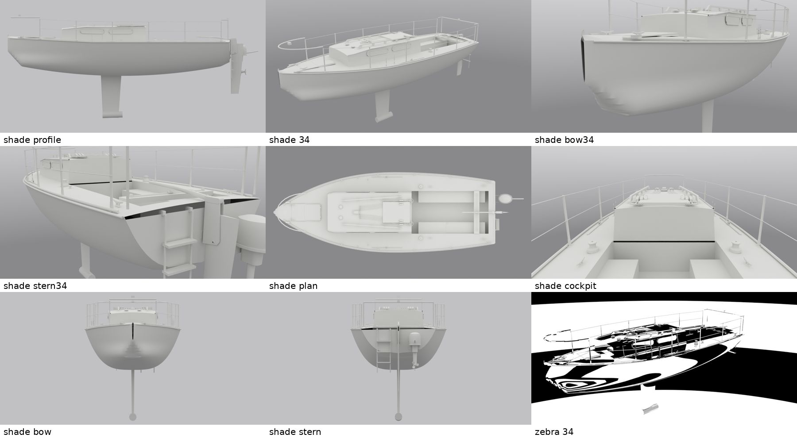
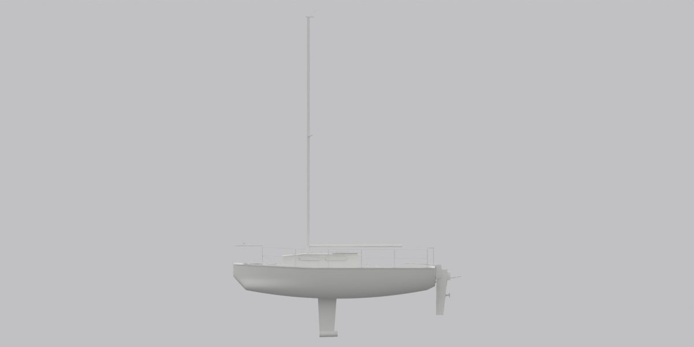

# Catalina 22 rebuild, slice 0: size card, size check and "before"

The Catalina 22 is in the game (Coastal Cruiser's boat on Galveston Bay, and in Free Sail) but has never had the
rebuild the J/22, Sunfish, frigate and J-Class got. She is still drawn by the shared fleet template
(`Tools/blender/build_fleet.py`, which also makes the Catalina 30 and the Corsair), set to her sizes and dressed with
the shared hardware kit (`docs/c22-detail`, `docs/boats/c22-ilca`, `docs/boats/c22-2`). Bean asked for the full rebuild
on Nov 16 2026 and chose the version: **the original swing-keel boat with the pop-top**, built from 1969 until the
"New Design" of 1986-87. It's the one on most Texas lakes, and the one the game's physics already sails. Plan:
<https://claude.ai/artifact/3oMiRWywPhitATHvGxs51a>.

Slice 0 sets up what every later slice is checked against. Nothing is imported into Unreal and nothing in the game
changes. The new files are under `Tools/`, though, so the pull request still needs Bean's `bean-approved` label (the
Sensitive files check). Her physics (slice 10) and the swap into the game (slice 11) wait until after the vertical
slice ships.

## Words used here

- **I, J, P, E:** the four standard rig measures. I is the forestay's height on the mast above the deck and J the
  distance from the mast to the forestay's foot, which together make the foretriangle the jib fills. P is the
  mainsail's luff (its front edge, up the mast) and E its foot (along the boom).
- **Sheer:** the line of the deck's edge seen from the side. **Forefoot:** where the bow curves into the bottom.
  **Canoe body:** the hull without its keel and rudder. **Design waterline:** where she floats in the game.
- **Sockets:** named points on the model where the game hangs the rig's wires, the ropes and the crew.
- **Shape loop:** the J/22's and Sunfish's way of reshaping a boat in rounds: fixed camera views, measurements by
  part ("sections": hull, deck, cockpit, cabin, keel and so on), and blind reviewers. **Zebra stripes:** a mirror-like
  render that shows whether a surface is smooth ("fair"). The stripes bend smoothly on a fair hull and kink at a bump.

## The size card

`Tools/shipkit/catalina22/specs_c22.json` holds the published sizes of the original swing-keel boat, the source of
each (where sources disagree, and what decides), the game's current physics numbers, how the check measures each
target, and the triangle and texture budgets per slice. The tolerance is 3%, tighter than the J-Class's 5%, because
this is a real class Bean sails beside.

| Measure | Published | Target (m) |
| --- | --- | ---: |
| Length of hull | 21 ft 6 in | 6.553 |
| Waterline length | 19 ft 4 in | 5.893 |
| Beam | 7 ft 8 in | 2.337 |
| Draft, keel down / up | 5 ft 0 in / 2 ft 0 in | 1.524 / 0.610 |
| Displacement | 2,250 lb | 1,021 kg |
| Swing keel | 550 lb cast iron | 249 kg |
| I, J | 25.83, 8.00 ft | 7.873, 2.438 |
| P, E | 21.00, 9.66 ft | 6.401, 2.944 |
| Headroom, pop-top closed / raised | 4 ft 4 in / 5 ft 7 in | 1.32 / 1.70 |

Where sources differ:

- **Keel weight:** 550 lb (sailboatdata, keelindex), 500 lb (the 22 Sport's sheet) or 450 lb (one encyclopedia
  infobox). 550 is kept, because it's what the physics carries.
- **Draft with the keel up:** 2 ft 0 in or 1 ft 8 in. A photo of a C22 on her trailer decides it in slice 3.
- **Beam:** one listing for the 1995 MkII gives 8 ft 4 in, which isn't used.

The cloud couldn't open the class site, the maker's site, sailboatdata or Wikipedia (all blocked by the session's
network settings), so every number came through web search results. Each is listed with its source in the card.

## The size check

`Tools/shipkit/catalina22/c22_check.py <stats.json> [<sockets.json>] [--slice N]` compares a built boat with the card.
It reads the stats from `Tools/shapeloop/measure.py`, the same measuring the J/22's and Sunfish's shape loop uses. It
measures:

- the length, beam and waterline length (from a cut of the hull at the waterline: `measure.py` gained that cut in
  this slice, because a line between its 21 cross-sections cuts the corner where the overhangs meet the water and read
  2.9% short);
- the draft with the keel down;
- the displacement (the hull's underwater volume, less the 227 kg crew the game floats her with);
- I, J and E from the sockets.

It fails on anything outside 3%. With `--slice N` it also checks the triangles of each part built so far against that
slice's budget. The keel's weight and the cabin's headroom aren't shapes: slices 3 and 7 check them in their own builds.
The keel-up draft and P print "not yet" until slices 3 and 4 add what measures them.

`Tools/shapeloop/sections_c22.json` names today's model's parts for the loop. To split her deck, cockpit and cabin
apart, `build_fleet.py` now tags them while it builds (`shape_part`, with a new `Cabin` part). The tags only reach the
shape loop's saved scene: the exported models are the same triangles as before.

Today's model against the card:

| Measure | Target | Today | Off |
| --- | ---: | ---: | ---: |
| Length of hull | 6.553 | 6.550 | -0.0% |
| Waterline length | 5.893 | 5.868 | -0.4% |
| Beam | 2.337 | 2.340 | +0.1% |
| Draft, keel down | 1.524 | 1.530 | +0.4% |
| Displacement (kg) | 1,021 | 1,012 | -0.9% |
| I | 7.873 | 8.065 | +2.4% |
| J | 2.438 | 2.380 | -2.4% |
| E | 2.944 | 2.955 | +0.4% |

She passes on sizes. **The gap is her shape, not her sizes**, which is what the renders below show. Her triangles as
built: 420,456 in all, of which the hull shell is 14,786, the deck 2,736, the cockpit well 78, the cabin trunk 1,554,
the keel 760, the rudder 1,264, the mast and boom 1,850, and everything else 397,428. That last part is the
lifelines, pulpits, deck and cockpit detail and the kit hardware.

## Before: today's model



Clay renders from the shape loop's fixed cameras (`Tools/shapeloop/render_set.py`), so every later slice renders the
same views for its before-and-after sheet. Each view is in `baseline/` at 1200 px. What they show against the real
boat, which the slices fix:

- **Hull (slice 1):** her sections are slack and round-bilged from the waterline up to a sheer 0.72 m above it, so
  she reads as a deep U from the bow. The real boat has firmer bilges and flatter, flared topsides. The sheer is dead
  flat aft and only rises at the bow, and the forefoot shows steps in the bow view. The zebra stripes wander along the
  topsides, so the surface isn't fair.
- **Deck and cabin (slice 2):** the cabin trunk has straight sides, a vertical front face and a roof without crown
  (only its forward 30% drops a little). There's no pop-top, and a dark seam opens between the deck and the transom at
  the quarters.
- **Keel (slice 3):** a fixed fin with a torpedo bulb. The real keel is a flat cast-iron plate that swings on a pin and
  folds up into the hull, swept aft when down.
- **Rudder (slice 3):** hung in a tall box. The real boat has a kick-up blade between two cheeks on transom fittings.
- **Rig (slice 4):** I is 2.4% tall and J 2.4% short. Both are inside the tolerance, but slice 4 sets them exactly. The
  physics sails with its jib tacked about 9 cm aft of the model's forestay (J 2.30 m), which slice 10 lines up.



## Reference photos

`Tools/shipkit/catalina22/refs.json` is the list of photos for looking and measuring: public domain, CC0 or plain
CC BY only (no NC, ND or SA, the shipkit's rule), never traced, never in the repo. **It is still empty.** Wikimedia
Commons answered the cloud with "too many requests" all afternoon, so the dozen photos in its Catalina 22 category
weren't read yet. Slice 1 lists them before it draws the hull. The one photo whose licence is known (a C22 on her
trailer) is share-alike, so it's left out. The best references will be Bean's own photos of C22s at Rush Creek; the
plan lists the shots.

## Reproduce

```
SRC=Source/SailingPhysics
clang++ -std=c++17 -O2 -I$SRC/Public $(ls $SRC/Private/*.cpp | grep -v SailingPhysicsModule.cpp) \
    Tools/BoatExport/main.cpp -o <work>/boat-export
<work>/boat-export catalina22 <work>/catalina22.json
FLEET_SHAPE_BLEND=1 blender -b --factory-startup -P Tools/blender/build_fleet.py -- <work>/catalina22.json Catalina22 <work>
blender -b -P Tools/shapeloop/measure.py -- <work>/Catalina22_shape.blend Tools/shapeloop/sections_c22.json <work>/before
blender -b -P Tools/shapeloop/render_set.py -- <work>/Catalina22_shape.blend Tools/shapeloop/sections_c22.json <work>/hull --res 1200
blender -b -P Tools/shapeloop/render_set.py -- <work>/Catalina22_shape.blend Tools/shapeloop/sections_c22.json <work>/rig --res 1200 --with-other
python3 -I Tools/shipkit/catalina22/docs_c22.py <work>/hull <work>/rig docs/c22-1/baseline
python3 -I Tools/shipkit/catalina22/c22_check.py <work>/before/stats.json <work>/Catalina22_sockets.json
```

In the cloud, `blender -b -P <script> --` was a Python 3.13 venv with `pip install bpy numpy pillow`. Under the bpy
module, `build_fleet.py` runs through a wrapper that imports `bpy` first (`bmesh` loads only after it) and sets
`sys.argv`.

## Next: slice 1, the hull shell

Her own hull from cross-sections, the way the J/22's hero hull was made (`Inputs/j22-hero`), in a new build in
`Tools/shipkit/catalina22/`. Slice 1 checks fairness, volume and trim against the card, compares the outline with the
reference photos, and puts three blind reviewers on it against today's model. Below the waterline the new hull is the
design for slice 10's physics. Until then the game keeps today's physics hull.
