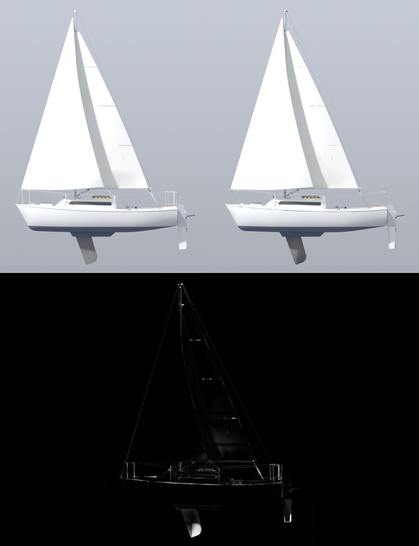
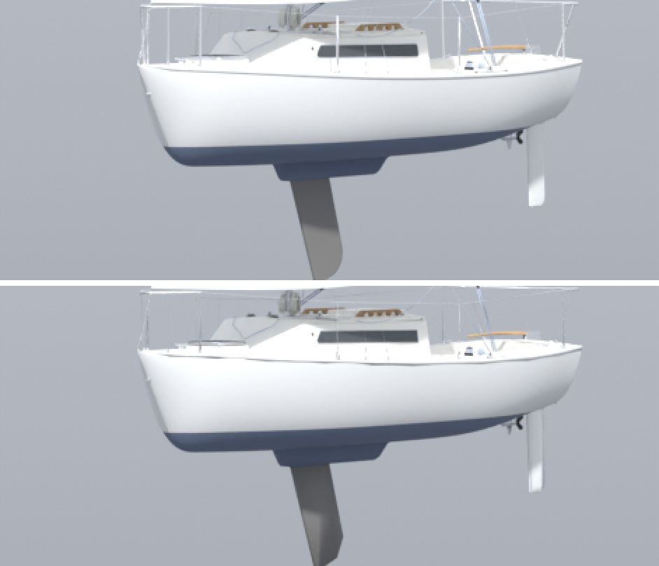
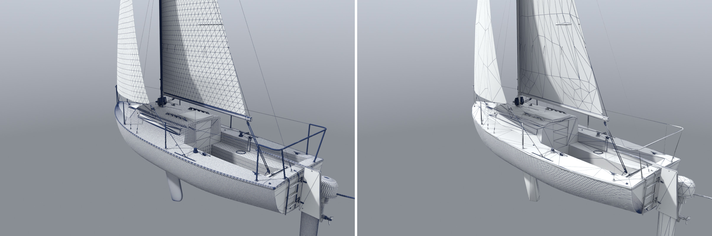
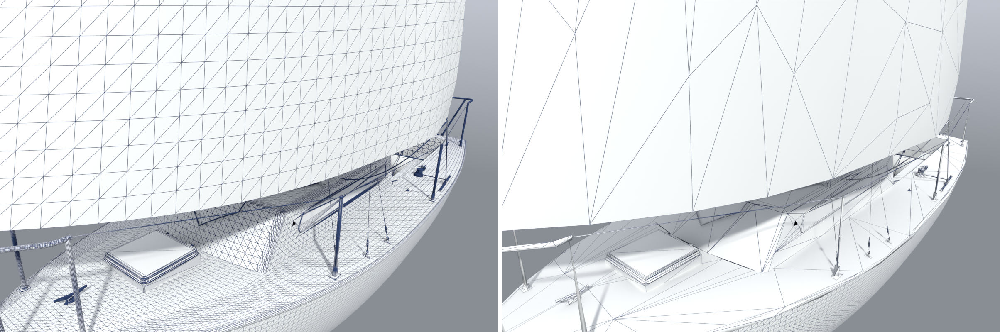

# Catalina 22 rebuild, slice 9: light copy, sockets and the bottom paint's line

Slice 9 gets the rebuilt Catalina 22 ready for the game's wiring (slice 11, `docs/c22-12`) and her textures (slice 8):

- a **light copy**: a lighter twin of every part seen from outside, for boats 50 m off or further (AI boats, marina
  neighbours, distant boats);
- the **jib sheet's tail** sockets the game's trimmer reads;
- the **bottom paint's line** cut into the hull, so the textures' antifouling ends on an edge of the mesh.

Plan: <https://claude.ai/artifact/3oMiRWywPhitATHvGxs51a>. Nothing is imported into Unreal and nothing in the game
changes. The files are under `Tools/`, so the pull request needs Bean's `bean-approved` label.



## Words used here

- **Light copy (LOD):** a simpler version of a model that the game draws when it is far enough away that nobody can
  see the difference. Here it is held to one pixel: no point of it is further than one pixel's width from the
  detailed boat, on a 4K screen at the game's narrowest field of view (60 degrees), 50 m away. That pixel is 15 mm.
- **Triangles:** the flat pieces every 3D model is made of. Fewer triangles draw faster.
- **Socket:** a named point on the model where the game attaches something, here a rope's end.
- **Antifouling:** the bottom paint, which stops weed growing. On a Catalina 22 it ends a few centimetres above the
  waterline.

## What's built

`light_c22.py` runs the J-Class's light copy tool (`Tools/shipkit/jclass/light.py`, `docs/jclass-12`) on the built
`c22.blend` with the Catalina's settings (`light_c22.json`) and her five sail states (Rest, Up, Jib, Reef, Run). Every
mesh but the cabin below gets a twin named `<part>_Light`, hidden, in the collection `Light`, with `light_of` naming
its part. The cabin below has none: the game draws it only up close, from inside.

The tool works part by part:

- **Specks** (a pin, a shackle, anything under a pixel across) are dropped: 944 of them.
- **Tubes** (ropes, wires, rails) are rebuilt with four sides round their own centreline: 197 of them.
- **The rest** is simplified as far as it stays within the pixel, its paint lines kept in place.

| | detailed | light copy | share |
| --- | ---: | ---: | ---: |
| at rest | 308,448 | 35,492 | 11.5% |
| main and genoa (Up) | 325,865 | 39,144 | 12.0% |
| main and jib | 326,805 | 39,445 | 12.1% |
| reefed | 328,053 | 39,427 | 12.0% |
| main and spinnaker | 330,381 | 41,068 | 12.4% |

The plan allowed a quarter. All 45 twins are within the pixel; the worst is 14.95 mm, the lowered jib's.
`baseline/light.json` lists each part's triangles, error, the states it shows in, and `ue_screen_size`: the screen
size below which the game may switch to the twin, which holds the pixel even at the widest field of view.

Two settings differ from the J-Class's, and the tool now takes both (with the J-Class's behaviour as the default):

- **UV seams are not cut.** The Catalina's UV maps are box projections, used only for the tangent frame; no
  material of hers reads them, and the game projects her detail by position. Cut at every projection's edge, her parts
  would hardly simplify (the deck stayed at 10,741 of 10,743 triangles). Only the lines where two materials meet are
  kept exactly.
- **Cracks are judged by where they are, not their length** (`crack_rule: place`). The deck, cabin and well are
  sheets whose open edges meet the hull's and each other's. Where a paint line runs into such an edge, the tool can
  leave a stub of a few millimetres unsewn. That is accepted when every open edge lies within a pixel of the part's
  own edge, where it is hidden by the neighbouring part.

Ropes and wires used to end in a flat polygon. They now end in a fan of triangles from the centre, which looks the
same but lets the tool recognise them as tubes (`build_sails_c22.rings_solid`). Before that change, ropes were
simplified like solids and came out as flat ribbons, thinner than the rope from some sides.

### The sockets

`c22_sockets.json` gains four, all on the hull:

| socket | where |
| --- | --- |
| `JibTailer_S`, `JibTailer_P` | where the jib sheet's tail leaves the winch's top turn: the game draws the tail from here to the trimmer's hand |
| `JibTailRest_S`, `JibTailRest_P` | the cleat behind the winch, where the tail lies when nobody holds it |

The wiring thread adds them to its expected sockets once this is on main.

### The bottom paint's line

`build_c22.py` cuts the hull at 4 cm above the design waterline (`BOTTOM_Z`): material `Topsides` above, `Antifouling`
below. The single `GelcoatHull` material is gone. The line is the one the textures thread paints, so its cards for
`Topsides` and `Antifouling` apply directly. The game's export (`export_game_c22.py`, slice 11) cuts its own boot
stripe above it; its `antifouling_top` moves from 5 to 4 cm in the wiring thread's follow-up.

## Checks

- **Light copy:** `light.json` passes (45 of 45 twins within 15.04 mm, largest state share 12.4%).
- **Renders against the detailed boat** (`render_light_c22.py`, then the J-Class's `light_compare.py`): under main and
  genoa, at a 4K screen's own pixels with a 60 degree field of view, from 50 and 100 m, abeam and 40 degrees off the
  bow. Each pixel's difference is out of 255:

  | view | mean | 99th percentile | pixels differing visibly (over 16) |
  | --- | ---: | ---: | ---: |
  | 50 m abeam | 1.78 | 32 | 2.4% |
  | 50 m off the bow | 1.56 | 33 | 2.4% |
  | 100 m abeam | 1.61 | 24 | 1.5% |
  | 100 m off the bow | 1.41 | 25 | 1.8% |
  | the renderer's own noise (two seeds) | 0.90 | 8 | 0.1% |

  The difference image shows where they differ: the lifelines, stays and shrouds (under a pixel wide, so a four-sided
  wire covers a slightly different share of its pixels), the sheer's highlight, which moves by about a pixel, and the
  keel's leading edge, whose shading is flatter. This is a larger difference than the J-Class's (mean 0.42 there, also
  against noise of about 0.7). The J-Class's parts are larger and smoother, so a pixel is a smaller share of them.
  If it shows in the game, the fix is a tighter tolerance (`pixels` in `light_c22.json`): the budget has room for
  twice the triangles.







- **Size check** (`c22_check.py --slice 9`): passes. All sizes are as in slice 7. The detailed boat is 542,359
  triangles: the rope ends add 628 and the cabin's liner 744 (it is copied from the hull's skin, whose faces along the paint
  line are no longer all four-sided: the copy now takes them too, or the liner would have a gap along the line).
- **Joins** (`seams.py`): all closed.

## For slice 10 (physics) and 11 (wiring)

- The twins are the same parts as the hero's, so the export can write `SM_C22Hero_*_Light` from them. The wiring
  thread keeps AI boats on the fleet model for now.
- The hull's twin is the biggest (18,735 triangles, 40% of its part): the paint line's 453 cut edges hold the
  simplification back. A boot stripe cut in the build, not the export, would need the same care.

## Reproduce

```
<venv>/bin/python Tools/shipkit/catalina22/build_c22.py -- <work>/s9          # or blender -b --factory-startup -P
<venv>/bin/python Tools/shipkit/catalina22/light_c22.py -- <work>/s9          # about 30 min on the cloud's CPU
blender -b -P Tools/shapeloop/measure.py -- <work>/s9/c22.blend Tools/shapeloop/sections_c22_rebuild.json <work>/s9/m
blender -b -P Tools/shapeloop/seams.py -- <work>/s9/c22.blend Tools/shapeloop/sections_c22_rebuild.json <work>/s9/m
python3 -I Tools/shipkit/catalina22/c22_check.py <work>/s9/m/stats.json <work>/s9/c22_sockets.json --slice 9
<venv>/bin/python Tools/shipkit/catalina22/render_light_c22.py -- <work>/s9/c22.blend <work>/s9/lt
python3 -I Tools/shipkit/jclass/light_compare.py <work>/s9/lt docs/c22-10
```

`<venv>` is a Python with the `bpy` module (5.3), numpy, scipy and pillow, as for the J-Class.
`baseline/` holds the light copy's report (each part's summary), the renders' measures (`compare.json`) and the
sockets file.
