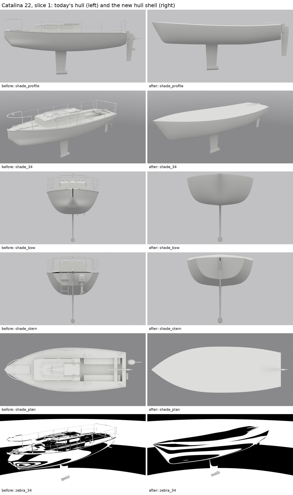
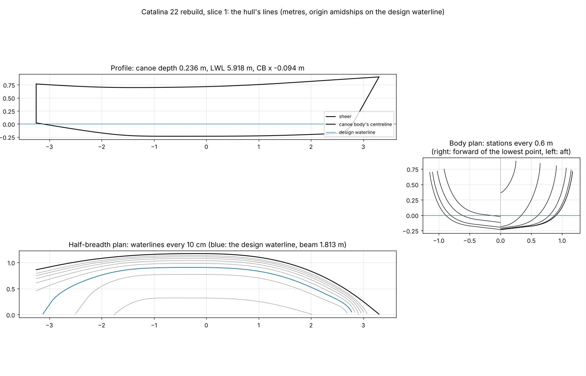
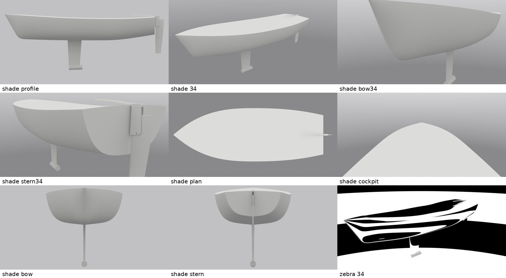

# Catalina 22 rebuild, slice 1: the hull shell

Slice 1 draws the Catalina 22 a hull of her own. It replaces the shared fleet template's hull, which slice 0 showed was
the right size but the wrong shape (`docs/c22-1`). The boat is the original swing-keel boat with the pop-top, built
from 1969 until 1986-87. Plan: <https://claude.ai/artifact/3oMiRWywPhitATHvGxs51a>.

Nothing is imported into Unreal and nothing in the game changes. The game keeps today's model and physics hull until
slices 9 to 11. The new files are under `Tools/`, so the pull request needs Bean's `bean-approved` label.



## Words used here

- **Lines:** the curves a hull is drawn from. The **profile** is her side outline. The **half-breadth plan** is the
  deck's edge and the waterlines seen from above. The **body plan** is her cross-sections, called **sections** or
  **stations**.
- **Sheer:** the deck's edge seen from the side.
- **Run:** the bottom aft, rising to the transom.
- **Forefoot:** where the bow curves into the bottom.
- **Bilge:** the turn from the bottom up into the topsides. A **firm** bilge turns tightly.
- **Flare:** topsides that lean outward as they rise. **Tumblehome** is the opposite.
- **Canoe body:** the hull without its keel and rudder. **Canoe depth** is how deep it goes below the design waterline.
- **Centre of buoyancy (CB):** the centre of the underwater volume. She floats level when it sits under her centre of
  weight.
- **Half-angle of entrance:** the angle each side of the bow makes with the centreline at the waterline.
- **Fair:** smooth, with no bumps, flats or creases. **Zebra stripes:** a mirror-like render whose stripes bend
  smoothly on a fair surface and kink at a bump.
- **Inflection:** a line bending one way and then the other. **Kink:** a sharp peak in a line's curvature.

## How she's drawn

`Tools/shipkit/catalina22/lines_c22.json` holds a few curves, and `hull_c22.py` turns them into a surface:

- **The sheer and the deck's edge**, each a spline through a few points.
  - The sheer is lowest about three quarters aft, at 0.70 m over the waterline. It rises 7 cm to the transom and
    20 cm to the bow.
  - Seen from above, the deck's edge is widest just aft of amidships (2.338 m). The bow rounds tighter toward the
    stem with no shoulder, and the transom is 1.72 m wide.
- **The profile.**
  - The stem is straight, raked 0.56 m aft for each metre down, from its head 0.90 m above the water.
  - It turns into the bottom through a forefoot drawn by its turning angle, so its curvature never steps.
  - The bottom is flat at its lowest point, 0.6 m aft of amidships.
  - Aft, the bottom stays flat and then straightens into a nearly straight run. The run reaches the transom's foot
    2 cm above the water.
- **The sections.** Each is a flat bottom with 6° of deadrise, turning through a firm bilge into flared topsides.
  - They are firmest amidships.
  - They are a little softer toward the transom.
  - They are finer toward the stem.
  - Every change along her length is eased so that it doesn't put a crease in the surface.

The canoe depth isn't drawn; it is solved. `solve_depth` finds the depth at which the hull floats at the game's design
waterline with the game's crew aboard. That makes 2,250 lb of boat plus 227 kg of crew, in the physics' water of
1,000 kg/m³, less the swing keel's own volume, which slice 3 hangs below. It comes out at 0.236 m.

`build_c22.py` meshes it in Blender: 180 stations by 64 girth steps a side, with the steps closer together near the
centreline, where the bottom widens fastest. The transom is a flat face. The build adds a flat placeholder deck (slice
2 draws the real one) and, for the renders, links today's keel, rudder and rig. The hull is 45,903 triangles, against
slice 1's budget of 250,000. It carries box-projected UVs, as the fleet's parts do, for the Unreal import's tangent
frame.



`lines_plot_c22.py` draws these lines from the same code, for laying beside a photo.

## Checks

| Measure | Target | New hull | Off |
| --- | ---: | ---: | ---: |
| Length of hull | 6.553 m | 6.550 m | -0.0% |
| Waterline length | 5.893 m | 5.921 m | +0.5% |
| Beam | 2.337 m | 2.338 m | +0.1% |
| Displacement (mesh, with keel) | 1,021 kg | 1,020.7 kg | -0.0% |
| Draft, keel down (today's keel) | 1.524 m | 1.530 m | +0.4% |

The size check (`c22_check.py`, slice 0) passes everything it can measure so far.

- The displacement is now weighed on the mesh itself: the build cuts it at the waterline and measures the volume below.
  An independent reviewer found that the earlier report quoted the drawing's own integral, which the depth solve sets
  to the target, so the check couldn't fail. The mesh comes out 0.3 kg light of the drawing.
- I, J and E are unchanged, because they come from today's rig.

Other results:

- **Waterline beam:** 1.813 m.
- **Centre of buoyancy:** x -0.094 m. The physics hull's is -0.112. The new hull doesn't float the game yet; slice
  10 sets her physics to it.
- **Fairness** (`Tools/shapeloop/fairness.py`, 10 waterlines and 10 stations cut through the mesh):
  - **Inflections:** none. Today's hull has 3.
  - **Kinks:** 11, against today's 26. Eight are the bilge turn, one per station: a firm bilge is a single tight bend,
    which is the shape asked for. The other three are dips of the curvature to nearly straight on the two lowest
    waterlines, where they run along the flat bottom.
- **Zebra stripes:** they run long and even. Today's hull's stripes break up at the forefoot and wander along the
  topsides.



## Reviews

**Blind reviewers.** Each reviewer saw the new hull and today's hull side by side, in six views. They didn't know
which was which, and the side was shuffled for each reviewer. Both hulls were shown with no deck, cabin or rig.

- **Round 1** (the first draw): all three reviewers chose the new hull, each with high confidence.
- **Their shared notes:**
  - flatten the run aft, so the transom's foot sits near the water;
  - give the sheer a low point about three quarters aft and a lift to the transom;
  - make the bottom flatter and the bilge firmer;
  - lean the topsides out a little;
  - carry the straight stem lower before the forefoot.
- **Rounds 2 and 3:** I made those changes. One blind reviewer compared rounds 1 and 2 and preferred round 2 on the run,
  the bilge and the stem.
- **Final round** (the hull in this pull request, against today's): all three reviewers chose the new hull, each with
  high confidence. Every view went to the new hull, except the plan view, which two of the three called close.

What the final reviewers still see wrong, for the rounds that follow with photos:

- **The sheer** still reads as falling from the bow and running flat aft. They want its low point more visible and a
  clearer lift to the transom.
- **The topsides' flare** splits them. One wants it nearer upright amidships (8-10°). One wants more flare forward.
- **The bow from above** splits them too. One finds it fine; another wants it fuller at the deck.
- **The bottom's deepest point:** one reviewer wants it further aft, under the keel trunk, so she doesn't read
  bow-down.
- **The forefoot** splits them too. Round 1 asked for a tighter turn, and one final reviewer wants a softer one, over
  1.5 to 2 ft.
- **The transom's top corners** show small "ears" where the sheer meets the transom. Part of that is the placeholder
  deck, which slice 2 replaces. Slice 2 fairs the rest where it joins the deck.

**Independent review** of the code and numbers. It found seven defects, and all are fixed:

- the transom face pointed into the hull;
- the mesh was lighter than the report, and the check couldn't fail (above);
- the depth, forefoot and run solves could fail silently at the edges of their ranges (they now stop with an error);
- the hull had no UVs;
- the stem head's top row didn't close;
- the notes held stale numbers and a wrong stem angle;
- the sections file named builders that don't exist.

**Open: a round nose at the forefoot.** The waterlines make about 25° each side 30 to 50 cm back from the stem, which
is right. Nearer the stem they round off: 55° at 2 cm back. A real stem is a sharp edge, but these sections widen fast
off the centreline. A sharp stem needs hollow sections there, and in this round they made the bow's waterlines bend
both ways. It waits for a photo of her bow.

## Reference photos

`refs.json` is still empty. Wikimedia Commons answered every request from the cloud with "too many requests" all day,
and the other open photo searches are blocked by the session's network settings. So this hull is drawn from the size
card, published descriptions and the reviewers' knowledge of the boat, and nothing is traced. Three photos would settle
the open questions (the sheer's low point, the topsides' flare, the stem and forefoot, and the transom's rake): one
from abeam, one bow-on and one from the quarter, ideally Bean's own of a C22 at Rush Creek. The plan lists the shots.

## Reproduce

```
# today's keel, rudder and rig for the renders: Catalina22_shape.blend, as in docs/c22-1
blender -b --factory-startup -P Tools/shipkit/catalina22/build_c22.py -- <work>/s1 --fleet <work>
blender -b -P Tools/shapeloop/measure.py -- <work>/s1/c22.blend Tools/shapeloop/sections_c22_rebuild.json <work>/s1/m
blender -b -P Tools/shapeloop/fairness.py -- <work>/s1/c22.blend <work>/s1/m --object C22_Hull
blender -b -P Tools/shapeloop/render_set.py -- <work>/s1/c22.blend Tools/shapeloop/sections_c22_rebuild.json <work>/s1/hull --res 1200
python3 -I Tools/shipkit/catalina22/c22_check.py <work>/s1/m/stats.json <work>/Catalina22_sockets.json --slice 1
python3 -I Tools/shipkit/catalina22/hull_c22.py
python3 -I Tools/shipkit/catalina22/lines_plot_c22.py docs/c22-2/lines.jpg
python3 -I Tools/shipkit/catalina22/docs_c22.py <work>/s1/hull <work>/rig <work>/s1/docs
python3 Tools/shapeloop/make_sheet.py <work>/before/hull <work>/s1/hull <out.jpg> shade_profile shade_34 shade_bow shade_stern shade_plan zebra_34
```

In the cloud, `blender -b -P <script> --` was a Python 3.13 venv with `pip install bpy numpy scipy pillow matplotlib`,
running each tool through a wrapper that imports `bpy` first and sets `sys.argv`.

## Next: slice 2, the deck and cabin

The deck moulding, the cockpit, and the cabin trunk with its pop-top, closed and raised. It joins this hull at the sheer
(the shape loop's first checked join), with a rubrail where the hull and deck meet.
