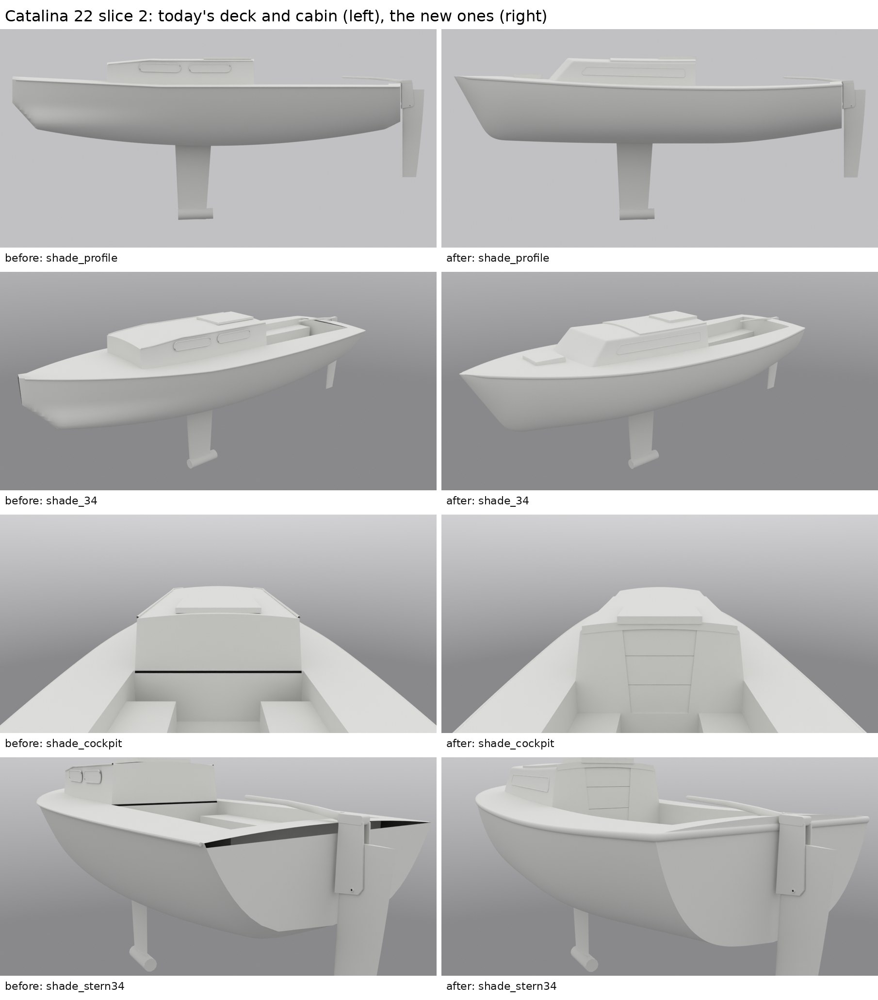
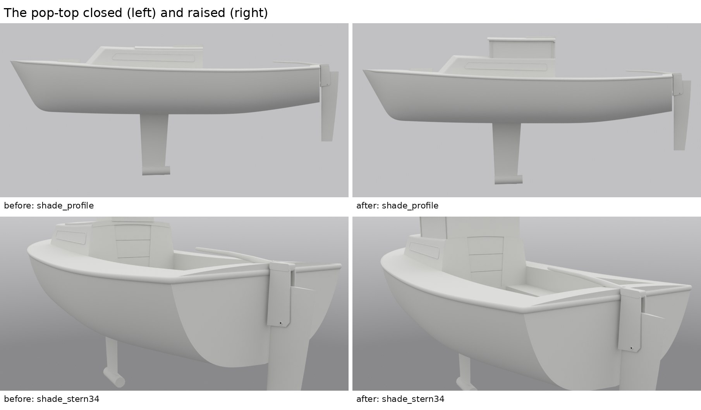
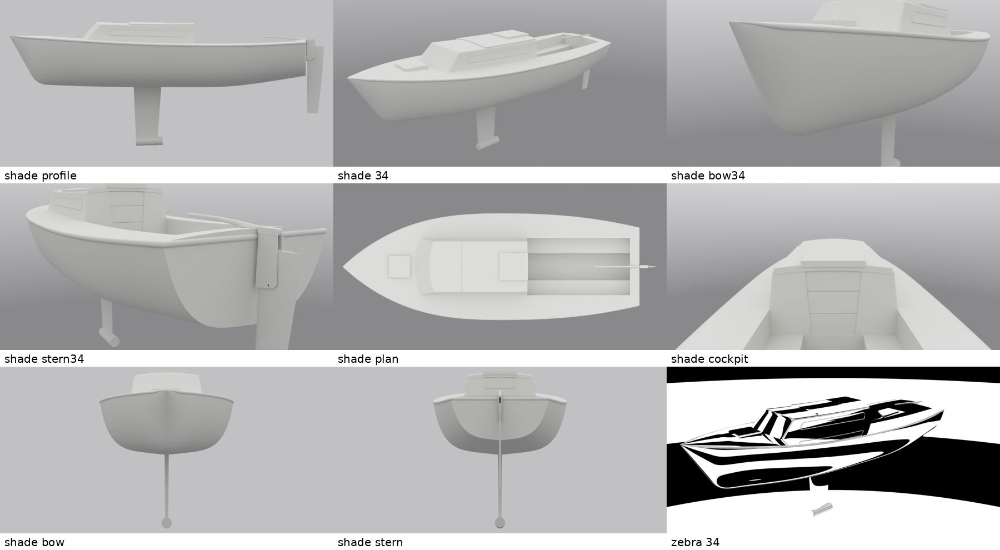

# Catalina 22 rebuild, slice 2: the deck and cabin

Slice 2 gives the Catalina 22 her own deck, cockpit and cabin trunk with its pop-top, on the hull from slice 1
(`docs/c22-2`). The boat is the original swing-keel boat with the pop-top, built from 1969 until 1986-87. Plan:
<https://claude.ai/artifact/3oMiRWywPhitATHvGxs51a>.

Nothing is imported into Unreal and nothing in the game changes. The game keeps today's model until slices 9 to 11.
The new files are under `Tools/`, so the pull request needs Bean's `bean-approved` label.



## Words used here

- **Trunk** (cabin trunk): the raised box of the cabin standing on the deck. Its **top** is the cabin top.
- **Crown** (camber): how much a deck or cabin top rises in the middle over its edges.
- **Pop-top:** the aft part of the cabin top. It lifts on legs with a canvas skirt for standing headroom at anchor.
- **Companionway:** the way down into the cabin from the cockpit. **Drop boards** close it, and a **sliding hatch**
  covers it from above.
- **Bridge** (sill): the bottom of the companionway, here at the cockpit seats' height.
- **Footwell:** the low part of the cockpit between the seats. Its floor is the **sole**.
- **Rubrail:** the vinyl strip over the joint where the hull and the deck meet.
- **Join:** where two separately built parts meet. The shape loop's rule is that they overlap, they don't just touch.

## How she's drawn

`Tools/shipkit/catalina22/deck_c22.json` holds the sizes, each with a note on where it comes from.
`deck_c22.py` turns them into surfaces (pure Python, no Blender), and `build_deck_c22.py` meshes them.

- **The deck** follows the hull's sheer at its edge and has 5 cm of crown. The crown shrinks with the beam forward,
  so the deck closes onto the stem head.
- **The cockpit** runs from x -3.05 to -0.78 and is 1.26 m wide. It has bench seats 27 cm under the deck's edge and a
  footwell 0.6 m wide, with its sole 10 cm above the waterline. The seats are about 0.4 m above the sole. These sizes
  are today's model's.
- **The cabin trunk** runs from the companionway (x -0.78) to its front at x 1.70.
  - Its sides stand 0.63 m out from the centreline, or 0.30 m in from the deck's edge where she narrows. They lean in
    6 cm over their height.
  - Its top is 0.39 m over the deck's centreline at the mast. That puts the mast step at z 1.187, against today's
    socket at 1.188. The top rises to 0.42 m at the companionway and has 4 cm of crown.
  - Its front rakes 0.32 m aft from the deck to the top. It is rounded in plan, its middle 10 cm forward of its
    corners.
  - Its top, front and side corners are rounded on 2.5 cm.
- **The windows:** one long window a side, with its forward end raked like the cabin front. It is dark glass in an
  aluminium frame.
- **The companionway** tapers from 0.44 m wide at the sill to 0.54 m at the top. Three teak drop boards sit behind
  its jambs.
- **The pop-top** covers the cabin top from the companionway to x 0.62, just aft of the mast. It is a moulding
  standing 2.5 cm proud of the top, with its flange turned down round it and the sliding hatch on its aft end.
- **The pop-top raised** (`--raised`) lifts 0.38 m on four stainless legs, with a canvas skirt all round. That lift
  is the card's headroom difference: 4 ft 4 in closed and 5 ft 7 in raised. Practical Sailor says the top lifts
  about 10 in (0.25 m), so Bean's photos decide.



- **The foredeck hatch** is 0.48 m square, at x 2.05.
- **The rubrail** is 4.5 cm tall and 1.4 cm proud of the topsides, its top 6 mm over the deck's edge, so it caps the
  hull-to-deck corner all the way round. It runs round the sheer and across the transom, turning the transom's
  corners on a 4 cm radius, and tapers away over the last 0.3 m to the stem.



## Checks

- **Size check** (`c22_check.py --slice 2`): passes. The hull's numbers are unchanged from slice 1.
- **Triangles:** 29,663 for the deck, cockpit and cabin, against the slice's budget of 300,000.
  - The deck is 17,535 (with the rubrail and foredeck hatch), the cockpit 4,352 and the cabin 7,776 (with the
    window, drop boards and pop-top).
  - The hull is still 45,903.
- **Joins** (`seams.py`): all six are closed along their whole length, with no open bins.
  - hull and rubrail;
  - rubrail and deck;
  - deck and cockpit;
  - deck and cabin;
  - cockpit and cabin, at the bulkhead;
  - cabin and pop-top.
- **The cockpit inside the hull:** the well is at least 208 mm inside the hull's skin. `deck_c22.py` fails if it
  comes within 1 cm.
- **The mast step:** `deck_c22.py` fails if the cabin top at the mast is more than 1 cm from today's socket.
- **Faces:**
  - No new part has a face turned the wrong way. Tested with about 150,000 rays from outside, from the cockpit and
    from the deck, closed and raised.
  - No part has zero-area faces, folded edges or stray vertices.
  - Parts that meet share their vertices where they can (the cockpit's top edges are the deck opening's own points),
    so there are no T-junctions to sparkle in the game.

## Reviews

**Blind reviewers.** Each saw the new deck and cabin and today's side by side in six views, with no rig or hardware.
They didn't know which was which.

- **Round 1:** all three chose the new deck and cabin, with medium to high confidence. Their shared notes:
  - The pop-top should stand proud of the top as its own lid. All three said this.
  - One long, dark window a side instead of two ports. Two of the three said this.
  - The companionway should taper.
  - The rubrail was too fat and stuck out at the stem and the transom's corners.
  - Round the cabin's corners.
- **Round 2:** I made those changes.
- **Final round** (the deck in this pull request, against today's, with the sides shuffled): all three chose the new
  one, each with high confidence. Every view went to the new one.

What the final reviewers still see wrong, for the rounds that follow with photos:

- **The pop-top still reads small.** In clay, the sliding hatch on it catches the eye more than the lid does. Slice 8's
  textures and a photo of a real pop-top decide whether it needs a stronger edge.
- **The window:** two want it bigger and squarer at its ends, about 1.5 m long and up to 0.2 m tall.
- **The foredeck hatch:** they disagree on whether it should move aft toward the cabin front or forward.
- **The cockpit:** two ask for lazarette lids in the seats. Those are slice 6's hardware. One asks for low coamings.
- **The cabin's height and the front's rake:** one finds them a little tall and steep. The others say the rake is
  right.
- **The transom corner:** two saw a thin wedge by the outboard bracket in both models. It is today's rudder fitting,
  which slice 3 replaces.

**Independent review** of the code and numbers. It found seven defects, and all are fixed:

- The raised pop-top had no underside and a one-sided canvas, so from the cockpit you saw through it.
- Its legs stood inside the opening, on nothing.
- The foredeck hatch's base was set from its forward corners, so it floated 2 cm at its aft end.
- The deck kept its full crown to the stem, which left a 5 cm bump over the stem head.
- The cabin's corner rounding was clamped to half its size and left zero-length edges.
- The bulkhead had zero-area triangles where its outline ran in a straight line.
- The rubrail folded on itself at the transom's corners.

A second pass checked the fixes and found one new defect and two small ones, all fixed too:

- The well's aft end, cut as one polygon, no longer shared the walls' and seats' points (T-junctions). It is now built
  on the deck's and walls' own points.
- A 9 mm strip of the deck under the cabin showed across the drop boards. It is cut away there.
- The hull-to-deck corner stood 4 mm outside the rubrail's top at the transom's corners. The rail now caps the edge.

The reviewer also found that the raised pop-top hits the boom. That is true of the real boat: the lid is above the boom at
either lift (0.38 m or 0.25 m), so it goes up only in harbour with the boom topped up or off. `deck_c22.py` reports
it, and slice 9's sockets have to lift the boom with the top in the game.

## Reproduce

```
blender -b --factory-startup -P Tools/shipkit/catalina22/build_c22.py -- <work>/s2 --fleet <work>
blender -b --factory-startup -P Tools/shipkit/catalina22/build_c22.py -- <work>/s2r --fleet <work> --raised
python3 Tools/shipkit/catalina22/deck_c22.py
blender -b -P Tools/shapeloop/measure.py -- <work>/s2/c22.blend Tools/shapeloop/sections_c22_rebuild.json <work>/s2/m
blender -b -P Tools/shapeloop/seams.py -- <work>/s2/c22.blend Tools/shapeloop/sections_c22_rebuild.json <work>/s2/m
blender -b -P Tools/shapeloop/render_set.py -- <work>/s2/c22.blend Tools/shapeloop/sections_c22_rebuild.json <work>/s2/r --res 1200
blender -b -P Tools/shapeloop/render_set.py -- <work>/s2r/c22.blend Tools/shapeloop/sections_c22_rebuild.json <work>/s2r/r --res 1200
python3 -I Tools/shipkit/catalina22/c22_check.py <work>/s2/m/stats.json <work>/Catalina22_sockets.json --slice 2
python3 Tools/shapeloop/make_sheet.py <work>/before <work>/s2/r docs/c22-3/before_after.jpg shade_profile shade_34 shade_cockpit shade_stern34
python3 Tools/shapeloop/make_sheet.py <work>/s2/r <work>/s2r/r docs/c22-3/raised.jpg shade_profile shade_stern34
python3 -I Tools/shipkit/catalina22/docs_c22.py <work>/s2/r <work>/rig <work>/s2/docs
```

`<work>/before` is today's model rendered with the fittings hidden: `sections_c22.json` without its `fittings`
section. In the cloud, `blender -b -P <script> --` was a Python 3.13 venv with `pip install bpy`, as in slice 1.

## Next: slice 3, the keel, rudder and outboard

The cast-iron swing keel in its trunk, with its raised pose (the card's 2 ft draft keel up), and the kick-up rudder on
the transom. The outboard on its bracket.
