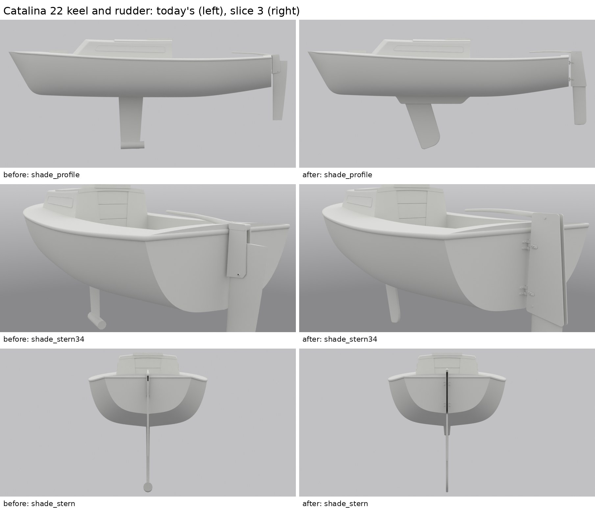
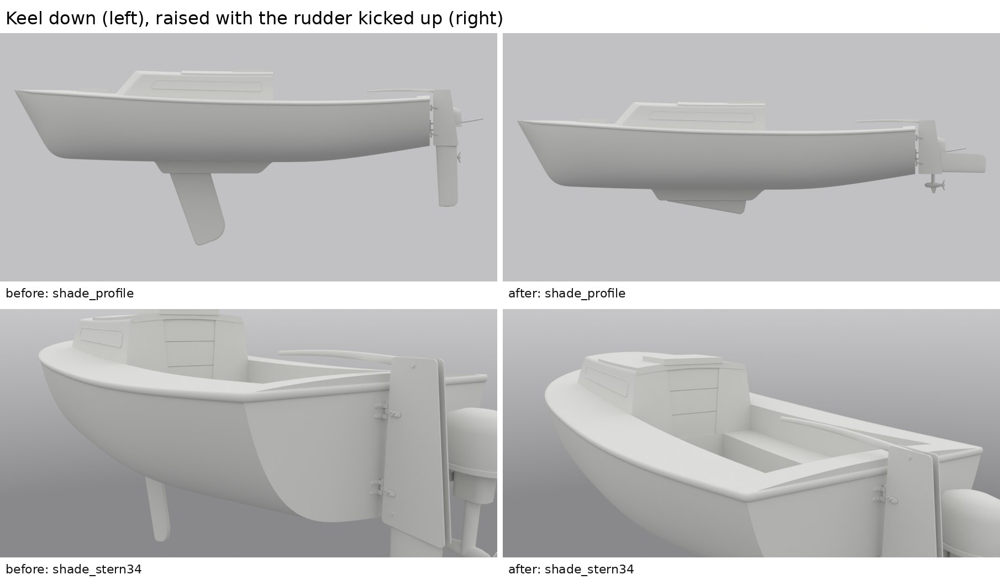
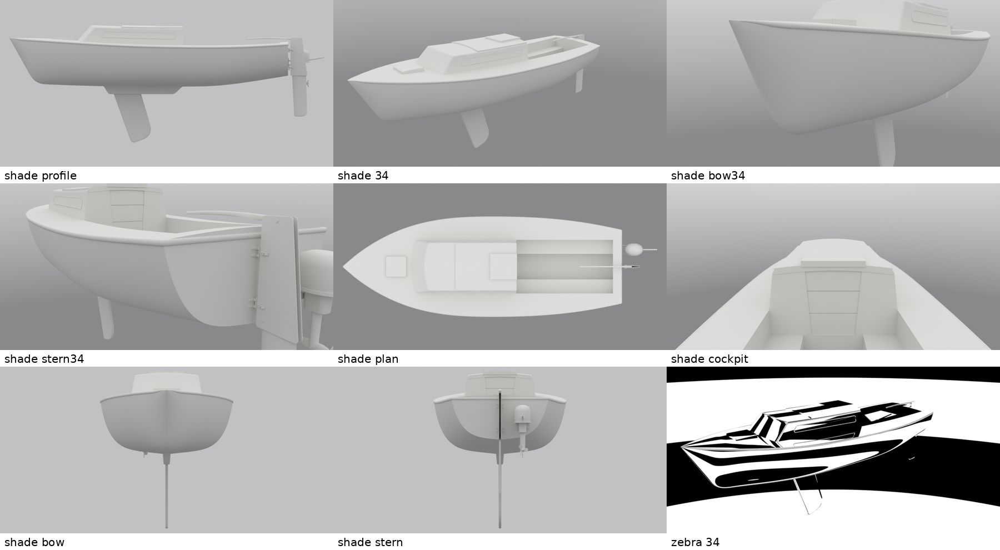

# Catalina 22 rebuild, slice 3: the swing keel, rudder and outboard

Slice 3 gives the Catalina 22 her own cast-iron swing keel in its stub and trunk, a kick-up rudder on the transom with its
tiller, and the outboard on its bracket. They go on the hull and deck from slices 1 and 2 (`docs/c22-2`, `docs/c22-3`).
The boat is the original swing-keel boat with the pop-top. Plan: <https://claude.ai/artifact/3oMiRWywPhitATHvGxs51a>.

Nothing is imported into Unreal and nothing in the game changes. The game keeps today's model until slices 9 to 11, and
the physics (`Fleet.cpp`) is untouched until slice 10. The new files are under `Tools/`, so the pull request needs Bean's
`bean-approved` label.



## Words used here

- **Swing keel:** a flat iron plate that turns on a pin, so it can be cranked up for trailering or shallow water. The
  Catalina 22's weighs 450 to 550 lb (the card keeps 550) and draws 5 ft down, 2 ft up.
- **Stub:** the shallow fibreglass fin moulded under the hull along her middle. The keel's pin is in its forward end, and
  a slot along its bottom lets the keel swing up inside.
- **Trunk:** the box inside the cabin the raised keel swings up into. On this boat it runs down the middle of the cabin
  floor under the dinette table.
- **Kick-up rudder:** a rudder blade that swings up on a bolt when it hits the bottom, instead of breaking. It hangs in a
  **head** (here two aluminium cheeks, a cassette) on two **pintles**, pins that drop into **gudgeons**, straps on the
  transom.
- **Draft:** how deep the boat reaches under the water. Published drafts are for the empty boat. The game floats her with
  227 kg of crew aboard, about 3 cm deeper, so every draft here is measured 2.8 cm (the card's `game.crew_sink_m`) above
  her lowest point.

## How she's drawn

`Tools/shipkit/catalina22/keel_c22.json` holds the sizes, each with a note on where it comes from. `keel_c22.py` turns them
into outlines and sections (pure Python, no Blender) and checks them; `build_keel_c22.py` meshes them. Nothing is traced
from a drawing: sizes come from the size card, the game's physics, Practical Sailor and owners' reports.

- **The keel** is a flat cast-iron plate of even thickness with rounded edges, which is how the physics treats it.
  - Down, the whole plate rakes 20 degrees aft from its pin. Its chord is nearly even, 0.62 m at the root to 0.54 m at
    the tip, with its lower forward corner rounded small and its lower aft corner on a big radius.
  - Its length is solved so its lowest point is the card's 5 ft 0 in draft (1.524 m), plus the crew's sink.
  - Its thickness is solved so the plate is 249 kg (550 lb) of cast iron: 46.6 mm, less the pin's hole. Owners measure
    about 1.5 to 2 in.
  - Above the pin its trailing edge turns forward round the pin, so the plate's top stays low as it swings up.
  - Raised, it turns 59.9 degrees aft about the pin, until its lowest point is the card's 2 ft 0 in (0.61 m) draft.
  - The pin is 1 in across, through the stub's forward end (Practical Sailor's keel overhaul: two bronze castings).
- **The stub** is 0.18 m (7 in) deep under the canoe body, 14 cm wide at the hull and 11 cm at its bottom. It runs
  from x -0.85 to 1.14, its front raked up into the hull at about 40 degrees and its after end faired into the bottom.
  Its bottom is near the physics' keel top (z -0.46).
- **The slot** is 7.5 cm wide, the keel's thickness and 3 cm, open from the raised keel's tip to ahead of the pin.
- **The trunk** inside the hull rises as high as the keel's top swings at each point, 3 cm clear: about 0.2 m over
  the hull's bottom aft, rising to 0.43 m by the pin. Slice 7 puts it under the dinette table.
- **The rudder** hangs on the game's `RudderPivot` socket (2.4 cm aft of the transom), so the game turns it as before.
  - The head is two aluminium cheeks from the waterline to just over the tiller, 0.40 m long at the foot and 0.27 m at
    the top, on two pintles in strap gudgeons on the transom (the boat kit's `Pintle` and `Gudgeon`). The tiller runs back
    between the cheeks to a through-bolt.
  - The blade is fibreglass, a NACA section 10 cm thick, about 13 in of chord, its leading edge 3 degrees off upright,
    its foot flat with the aft corner rounded. It pivots on a bolt near the foot of the head; its top is round about the
    bolt, so it clears the head as it kicks up.
  - With it down she draws 36 in (an owner's figure) plus the crew's sink. About 0.29 m² of blade is under the water,
    against the physics' 0.25 m²; slice 10 takes the physics' area from the model.
  - Kicked up (`--keel-up`), the blade turns 86 degrees aft about its bolt. The bolt is low, so it has to turn nearly
    level to come clear of the water.
- **The tiller** runs from the head's top to the game's `TillerEnd` socket, 47 mm over the deck at the transom.
- **The outboard:** the boat kit's two-position bracket (`OutboardBracket`) on the transom's starboard quarter and its
  brand-free 3.5 hp four-stroke (`Outboard35`), as today's model has them. The physics' engine is at y 0.40.





## Checks

- **Size check** (`c22_check.py --slice 3`): passes, keel down and keel up.
  - Draft keel down 1.524 m and keel up 0.610 m, both against the card's 1.524 and 0.610.
  - Keel weight 248.9 kg against the card's 249.
  - Displacement 1,020.7 kg against 1,021. The hull's canoe depth is solved again with the keel, the stub and the water
    in the trunk counted (0.2367 m, from 0.2336), so she still floats at the game's waterline.
- **The swing** (`keel_c22.py`, which fails if any goes under its limit): raised, the plate's side is 14 mm from the
  slot's wall, its top 35 mm under the trunk's top and its ends 40 mm inside the slot's ends.
- **The rudder** (`keel_c22.py`): kicked up, its lowest point is 4 cm over the water. The tiller is 47 mm over the deck.
- **Triangles:** 46,798 for the keel, rudder and outboard, against the slice's budget of 150,000.
  - Keel and stub 10,250, rudder with its head, tiller and gudgeons 30,532, outboard 6,016.
  - The boat is 148,158 in all.
- **Joins** (`seams.py`): all seven are closed along their whole length, with no open bins. Slice 3 adds the hull and
  the stub.
- **Faces:** the keel, stub and rudder have no zero-area faces, folded edges or stray vertices. The kit's `Gudgeon` and
  `Pintle` carry some of their own (edges shared by more than two faces); they are the shared kit's, and the J/22 and
  others wear them too.

## Reviews

**Blind reviewers.** Each saw the new keel and rudder and today's side by side in six views, on the same new hull, with
no rig and no outboard. They didn't know which was which.

- **Round 1:** all three chose the new ones (confidence medium, high, high). Their shared notes:
  - The plate should rake aft with an even chord and no swelling at its tip, about 1.5 to 2 in thick.
  - The stub should be a shallow, faired fin, not a box, with the slot visible.
  - The rudder blade should be wider and nearly upright, in a cassette head reaching down to the waterline, with the
    pivot bolt near its foot. All three read a raked blade as half kicked up.
- **Round 2:** I made those changes, except pin bosses on the stub's sides, which wait for a photo.
- **Final round** (the keel and rudder in this pull request, against today's, with the sides shuffled): all three chose
  the new ones, each with high confidence. Every view went to the new ones but one, the stern close-up, which one
  reviewer called split.
- **After the final round:** all three said the rudder's head read wrong. It was a tall, narrow, pointed plate rising past
  the tiller, so the tiller looked as if it stopped short of it. The head is now nearly parallel-sided (0.40 m of chord at
  its foot, 0.27 m at its top), its top square and just over the tiller, which runs 22 cm back between the cheeks to its
  through-bolt. This wasn't shown to another blind round.

What the final reviewers still see wrong, for the rounds that follow with photos:

- **The stub:** they disagree. One wants it deeper (12 to 14 in under the hull), one shallower (2 to 3 in) and shorter
  (3.5 to 4 ft), and one keeps its size but wants its ends faired more, the slot shown along its bottom and a boss at
  the pin.
- **The keel's outline:** two want a broader plate (about 2.5 to 3 ft of chord near the stub) with one continuous curve
  round its foot, not a rounded aft corner on a square-ish bottom. At the same weight a broader plate is thinner.
- **The rudder blade:** one wants its leading edge raked slightly aft, which is Catalina Direct's "angled aft".

**Independent review** of the code and numbers. It found seven defects, and all are fixed:

- The gudgeons and the outboard bracket stood 1 mm clear of the transom.
- Kicked up 72 degrees, the blade was still in the water. It is 86 degrees now, and `keel_c22.py` fails if it isn't clear.
- The pintles' straps sank into the cheeks.
- The keel's weight counted the pin's hole as iron, and the thickness was solved on a different grid from the mesh's.
- `c22_check.py` read a `--keel-up` build's drafts the wrong way round.
- The head was open at its front between the cheeks.
- Two figures in `keel_c22.json`'s notes didn't match the build.

## Open for photos

These wait on photos of a real boat (refs.json):

- **The stub:** its depth, width and ends, from a photo of her bottom on a trailer.
- **The trunk:** it rises to z 0.225 inside the cabin, about 0.43 m over the hull's bottom by the pin. A photo of her
  cabin decides how tall the real one stands.
- **The keel's outline and thickness,** from a photo of the keel down on a trailer.
- **The rudder's rake:** Catalina Direct says the original's leading edge is "angled aft". The reviewers read a raked blade
  as half kicked up, so it rakes 3 degrees until a photo of her transom decides. The head's and blade's outlines wait on
  the same photo.
- **The blade's area,** 0.29 m² under the water against the physics' 0.25 m². Slice 10 settles it.
- **The outboard's tiller arm** points aft. That is the boat kit's `Outboard35`, as today's model has it; a kit fix
  would turn it for every boat.

## Reproduce

```
blender -b --factory-startup -P Tools/shipkit/catalina22/build_c22.py -- <work>/s3 --fleet <work>
blender -b --factory-startup -P Tools/shipkit/catalina22/build_c22.py -- <work>/s3u --fleet <work> --keel-up
python3 -I Tools/shipkit/catalina22/keel_c22.py
blender -b -P Tools/shapeloop/measure.py -- <work>/s3/c22.blend Tools/shapeloop/sections_c22_rebuild.json <work>/s3/m
blender -b -P Tools/shapeloop/seams.py -- <work>/s3/c22.blend Tools/shapeloop/sections_c22_rebuild.json <work>/s3/m
blender -b -P Tools/shapeloop/render_set.py -- <work>/s3/c22.blend Tools/shapeloop/sections_c22_rebuild.json <work>/s3/r --res 1200
python3 -I Tools/shipkit/catalina22/c22_check.py <work>/s3/m/stats.json --slice 3
python3 Tools/shapeloop/make_sheet.py <work>/s3old/rb <work>/s3/rb docs/c22-4/before_after.jpg shade_profile shade_stern34 shade_stern
python3 Tools/shapeloop/make_sheet.py <work>/s3/r <work>/s3u/r docs/c22-4/keel_up.jpg shade_profile shade_stern34
python3 -I Tools/shipkit/catalina22/docs_c22.py <work>/s3/r <work>/s3/r <work>/s3/docs
```

The same steps measure and render `<work>/s3u`. `<work>/s3old` is the same new hull with today's keel and rudder in
place of the new ones, and the `rb` renders are the blind reviewers' (render_set.py with the outboard hidden). In the
cloud, `blender -b -P <script> --` was a Python 3.13 venv with `pip install bpy`, as in slice 1.

## Next: slice 4, the mast and standing rigging

Her own mast and boom with the card's I, J, P and E, the shrouds, stays and chainplates.
