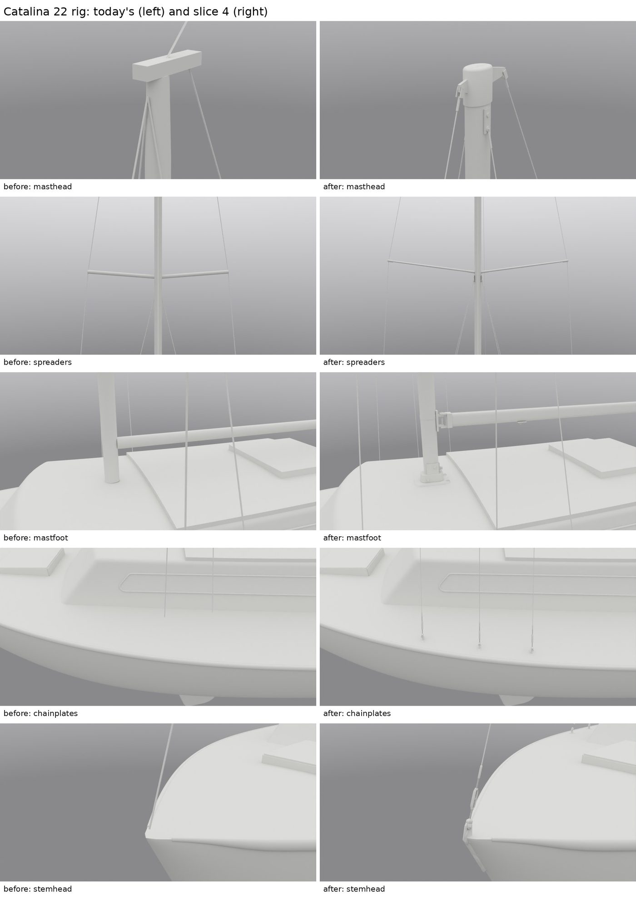
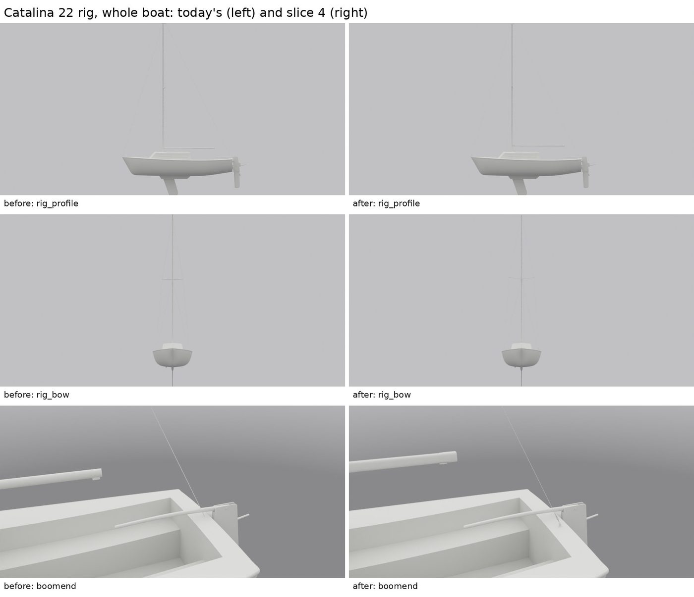

# Catalina 22 rebuild, slice 4: the mast, boom and standing rigging

Slice 4 gives the Catalina 22 her own mast, boom and standing rigging: the wires that hold the mast up, with their
fittings at the mast and on deck. They go on the hull, deck, keel and rudder from slices 1 to 3 (`docs/c22-2` to
`docs/c22-4`). The boat is the original swing-keel boat with the pop-top. Plan: <https://claude.ai/artifact/3oMiRWywPhitATHvGxs51a>.

Nothing is imported into Unreal and nothing in the game changes. The game keeps today's model until slices 9 to 11, and
the physics (`Fleet.cpp`) is untouched until slice 10. The new files are under `Tools/`, so the pull request needs Bean's
`bean-approved` label.



## Words used here

- **Masthead rig:** the forestay (the wire from the bow to the mast) reaches the very top of the mast, as on the
  Catalina 22.
- **Shrouds:** the wires that hold the mast up from the sides. The **uppers** (cap shrouds) run from the masthead over the
  ends of the **spreaders**, the struts sticking out sideways halfway up. The **lowers** run from just under the spreaders
  to the deck, one forward and one aft of the mast on each side.
- **Backstay:** the wire from the masthead down to the transom, behind the cockpit.
- **Chainplate:** the strap on deck each wire is pinned to. **Turnbuckle:** the screw fitting between the wire and the
  chainplate that tightens it. **Tang:** the strap on the mast a wire is pinned to.
- **Gooseneck:** the hinge joining the boom to the mast. **Vang:** the tackle from the boom down to the mast's foot that
  stops the boom lifting.
- **I, J, P, E:** the sail plan's four sizes. I is the forestay's height on the mast over the deck, J the distance from
  the mast to the forestay's foot, P the mainsail's luff (up the mast), and E its foot (along the boom). P and E run
  between black **bands** painted on the spars; the sail may not be hoisted or pulled past them.

## How she's drawn

`Tools/shipkit/catalina22/rig_c22.json` holds the sizes, each with a note on where it comes from. `rig_c22.py` turns them
into points and checks them (pure Python, no Blender), `build_rig_c22.py` meshes them, and `render_rig_c22.py` draws the
close-up views below. Nothing is traced from a drawing: sizes come from the size card (I, J, P, E), the game's physics and
sockets, owners' reports and a 1980s rigging list posted by an owner.

- **The mast** is a deck-stepped aluminium extrusion, 25 ft 0 in from heel to cap, as owners and mast makers give it.
  - It stands on the cabin top at the physics' mast x (0.86 m), which puts the masthead 8.87 m (29.1 ft) over the
    waterline, an older owner's manual's figure, against the physics' 8.84.
  - Its section is an oval 90 mm fore and aft (the card's mast diameter) by 58 mm across, with the mainsail's groove up
    its after face.
- **The step** is the boat kit's `MastStep` (a cast plate on the cabin top with two turning eyes). For the C22, two cheeks
  stand on it either side of the mast's heel with a pivot bolt through them and the mast, aft of its middle: her mast is
  lowered aft on that hinge for the trailer.
- **The masthead** is a low, flat-topped cast cap, 10 cm tall, following the mast's section.
  - The two halyard sheaves sit in slots let into its top (the jib's forward, the main's aft).
  - The forestay is pinned in a lug on its forward face, 4.5 cm under the top; the backstay in a short crane aft, 3.5 cm
    under it, so the two pins are about level.
  - The uppers are pinned to strap tangs lying flat on the mast's sides, 17 cm under the top.
- **The spreaders** are one pair of slim aluminium struts straight across the boat at 5.03 m, 30 in from the mast's
  middle to the tip (owners measure 29 to 36 in). Each is tilted up 7.3 degrees, so it splits the upper's angle at its
  tip in two, as a rigger sets them. Each has a socket at its root and a taped cap over the wire at its tip.
- **The wires** are all 1/8 in 1x19 stainless (the owner's 1980s rigging list): the forestay, a single backstay, two
  uppers and four lowers. Each ends in a fork or an eye at the mast and in the kit's smallest `Turnbuckle` on the kit's
  `Chainplate` on deck.
  - The chainplates stand on the side deck, 8 cm inboard of its edge: the uppers' beside the mast, the lowers' 36 cm
    forward and aft of it.
  - The forestay's foot is the kit's `Stemhead`, a short strap down the stem's face (15 cm) with the turnbuckle pinned in
    its tang.
  - The backstay's chainplate is on the transom's top, 20 cm to port of the centreline, clear of the rudder's head and
    tiller, as owners of 1970s boats describe theirs. Many have since fitted a split backstay; the original is drawn.
- **The boom** is an aluminium extrusion 80 mm deep by 50 mm wide, on a gooseneck on the mast's after face 1.565 m over
  the waterline: 11.5 cm (4.5 in) over the physics' boom height (1.45 m), because Bean saw it sat 4 to 5 in too low.
  Slice 10 lifts the physics' boom and mainsail to match. It has a cast end with the outhaul's sheave, a black band at E, and bails underneath for the
  mainsheet and the vang. The vang's foot is a tang on the mast's after face, 8 cm over the step. The vang's tackle and
  every other line are slice 6's running rigging.
- **The sockets** keep today's names and meanings (`Hounds`, `SpreaderTip_*`, `Chainplate{Upper,Lower}_*`, `LowerTang`,
  `MastBase`, `Boom_Clew`, `Boom_Vang`, `Boom_Mainsheet` and the rest). New ones: the mast's bands (`BandBoom`,
  `BandTop`, for P), the uppers' `CapTang_*`, the forward lowers', the deck pins (`ChainplatePin*`), and the stays' feet
  (`ForestayFoot`, `BackstayFoot`).



## Checks

- **Size check** (`c22_check.py --slice 4`): passes.
  - I 8.072 m against the card's 7.873 (+2.5%), J 2.384 against 2.438 (-2.2%), both inside the card's 3%.
  - P and E exact (6.401 and 2.944 m), measured between the bands.
  - J is short because the stem can't take the forestay further forward: the physics' mast x (0.86) may sit a little far
    forward, and I a little high. Slices 9 and 10 settle the mast's place with the sail plan.
- **The rig** (`rig_c22.py`, which fails if any of these goes under its limit):
  - The boom swings 74.5 degrees out before it touches the aft lower; the physics eases it to 70.
  - Its underside is 34 cm over the cabin top's highest point aft of the mast.
  - The backstay passes 28 cm from the tiller swung 45 degrees to port.
  - The vang runs 26 degrees from its foot to the boom's bail.
  - Each spreader splits its upper's angle to within 0.001 degree.
- **Triangles:** 50,024 for the rig, against the slice's budget of 150,000: mast 1,960, boom 1,052, wires 280 and
  fittings 46,732. The turnbuckles are the kit's light copy (a quarter of its triangles); the full kit turnbuckle is
  18,000 triangles, and eight of them alone would have spent the budget. The boat is 196,332 in all.
- **Joins** (`seams.py`): all seven are closed along their whole length, with no open bins.
- **Faces:** no zero-area faces in the rig. The kit's `Stemhead` had 651 left by its boolean union, which showed as a dark
  striped triangle on its tang; the build now dissolves them when it places a kit part.

## Reviews

**Blind reviewers.** Each saw the new rig and today's side by side in seven views, on the same new boat, with today's
mast and boom and its wires as the game draws them on the other side. They didn't know which was which.

- **Round 1:** all three chose the new rig, each with high confidence. Their shared notes:
  - The masthead should be a flat-topped casting, not a dome, with a stubby backstay crane and the tangs lying on the
    mast.
  - The mast should be a clear fore-and-aft oval, not a round tube.
  - The spreaders should be slimmer (about 1 in by 0.6 in) with a compact root socket and small taped tips.
  - The forestay should land on a stem fitting.
- **Round 2:** I made those changes.
- **Final round** (the rig in this pull request, against today's, with the sides shuffled): all three chose the new rig,
  each with high confidence, and gave it every view but the whole-boat view, which one called a tie.
- **After the final round** I made the changes more than one of them asked for:
  - The masthead is lower (10 cm, from 11), its sheave slots are let into its top instead of standing on it, and the
    forestay's pin is up near the top, level with the backstay's (3 of 3 had something to say about the masthead).
  - The stem fitting is a short strap (15 cm, from 32) and its slivers are gone (3 of 3 saw a gap or a long strap there).
  - The boom is 80 mm deep, from 95, so it no longer reads deeper than the mast (one reviewer measured it; one asked for
    about 3 by 2 in).
  - The step is a hinge, with cheeks and a pivot bolt (2 of 3).
  - The spreaders' view is now taken from straight ahead: two reviewers read the old three-quarter view's perspective as
    the two spreaders tilting differently. They are tilted alike.

  These weren't shown to another blind round.

What the final reviewers still see wrong, for the rounds that follow with photos:

- **The boom's height.** One reviewer read it as too low, about 1 ft over the cabin top. Bean agreed from the renders
  ("looks maybe 4-5 inch too low"), so the gooseneck is now 11.5 cm higher (above). P is unchanged: both bands moved up
  with it.
- **The mast's section.** Two read the mast as round in the mast-foot view, which looks at it from abeam and aft. Its
  section is already an oval 1.55 times as long as it is wide, the ratio one of them gave.
- **The turnbuckles.** Two thought the forestay's turnbuckle heavy for 1/8 in wire. It is the kit's smallest size,
  18 cm from pin to sleeve, within the 6 to 8 in one of them gave.
- **The backstay's chainplate** reads tight beside the tiller to one reviewer. It is 28 cm clear.

**Independent review** of the code and numbers. Its first pass found seven defects, all fixed:

- The gooseneck's cheeks didn't reach round its pin, and the pin didn't run through both.
- The gooseneck's jaw hit the mast's lugs and slide as the boom swung; it now clears them out to 80 degrees either way.
- The chainplates were placed at the wrong size, so the turnbuckles' pins missed theirs.
- The stemhead stood off the stem; it now follows the stem's own line.
- The chainplates and the backstay's plate stood level, not square to the deck's surface, so their edges floated.
- The wires passed through the masthead's lugs and the shrouds' tangs; they now end in forks and eyes.
- Some socket names and meanings didn't match today's file.

Its re-check confirmed those and found five more, all fixed: the vang's foot was 20 cm up as on today's model, which under
the boom laid the vang nearly flat (it is now 8 cm up, 26 degrees with the raised boom); the mast's heel floated 0.3 mm over the step's
tilted shoe at its aft edge; the shrouds' swage sleeves cut 0.8 mm into their tangs; the wires stopped at the rim of each
turnbuckle's sleeve instead of entering it; and the stemhead's slivers. It also noted the stays' feet had no sockets
(`ForestayFoot` and `BackstayFoot` are new).

## For slice 9 (sockets and the game's wires)

- The rig's wires are their own object (`C22_Wires`) here, with the kit's turnbuckles on deck. The game draws its own live
  wires between sockets. Slice 9 decides which the game shows; if it keeps its own, they run from the wires' feet
  (`Chainplate*_*`, `ForestayFoot`, `BackstayFoot`), not the deck pins, so they don't pass through the turnbuckles.
- The game draws the uppers from the spreader tips to `Hounds`. Here they go to the cap tangs (`CapTang_*`) under the
  masthead.
- The raised pop-top still meets the boom (slice 2's note). Slice 9 lifts the boom with it.

## Open for photos

These wait on photos of a real boat (refs.json):

- **The boom's height** is Bean's 4.5 in lift; a photo of her mast's foot would confirm it.
- **The mast's section and its step**, from the same photo.
- **The chainplates' places** on the side deck, from a photo of her side deck.
- **The masthead casting,** from any photo up the mast.

## Reproduce

```
blender -b --factory-startup -P Tools/shipkit/catalina22/build_c22.py -- <work>/s4
python3 -I Tools/shipkit/catalina22/rig_c22.py
blender -b -P Tools/shapeloop/measure.py -- <work>/s4/c22.blend Tools/shapeloop/sections_c22_rebuild.json <work>/s4/m
blender -b -P Tools/shapeloop/seams.py -- <work>/s4/c22.blend Tools/shapeloop/sections_c22_rebuild.json <work>/s4/m
python3 -I Tools/shipkit/catalina22/c22_check.py <work>/s4/m/stats.json <work>/s4/c22_sockets.json --slice 4
blender -b -P Tools/shipkit/catalina22/render_rig_c22.py -- <work>/s4/c22.blend <work>/s4/rig --res 1000
python3 Tools/shapeloop/make_sheet.py <work>/s4old/rig <work>/s4/rig docs/c22-5/before_after.jpg masthead spreaders mastfoot chainplates stemhead
python3 Tools/shapeloop/make_sheet.py <work>/s4old/rig <work>/s4/rig docs/c22-5/sheet.jpg rig_profile rig_bow boomend
```

`<work>/s4old` is the same new boat with today's mast and boom and straight wires between today's sockets, as the game
draws them, in place of the new rig. The sheets were then saved smaller as JPEGs. In the cloud, `blender -b -P <script>
--` was a Python 3.13 venv with `pip install bpy`, as in slice 1.

## Next: slice 5, the sails

Her mainsail and jib on this rig, cut to P, E, I and J, with their battens, reefs and numbers.
