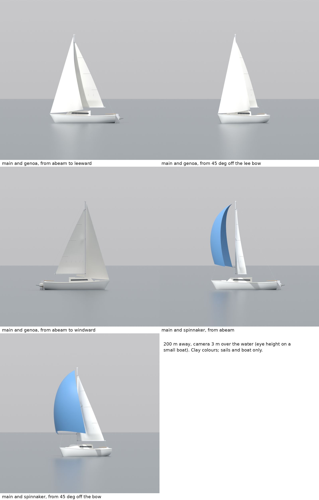
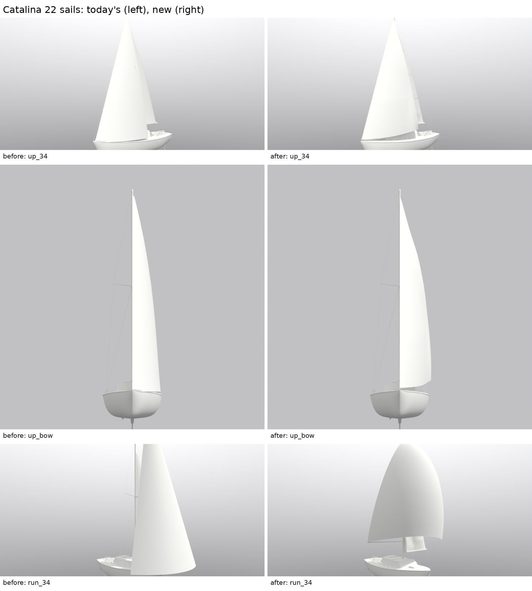
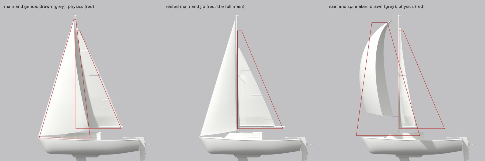
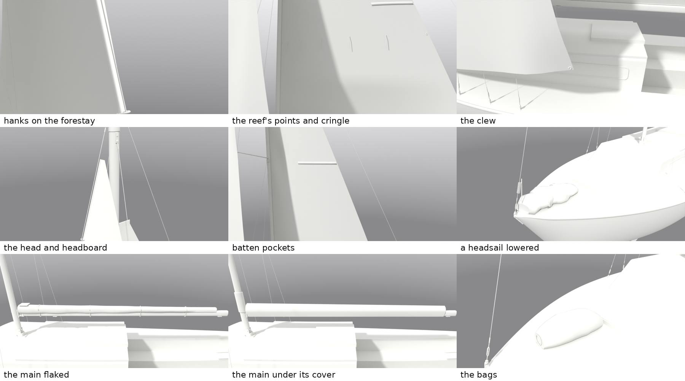

# Catalina 22 rebuild, slice 5: the sails

Slice 5 gives the Catalina 22 her own sails, cut to slice 4's rig (`docs/c22-5`): a mainsail with one reef, a working
jib, the 135% genoa and a spinnaker, each set, lowered and bagged. The boat is the original swing-keel boat with the
pop-top. Plan: <https://claude.ai/artifact/3oMiRWywPhitATHvGxs51a>.

Nothing is imported into Unreal and nothing in the game changes. The game keeps today's sails (the physics' flat strips,
drawn as cloth by `FSailCloth`) until slices 9 to 11, and the physics (`Fleet.cpp`) is untouched until slice 10. The new
files are under `Tools/`, so the pull request needs Bean's `bean-approved` label.

This slice ends at **Milestone A**: the whole boat, hull to sails, seen from 200 m at eye height. Those views are below for
Bean.





## Words used here

- **Luff, leech, foot:** a sail's front edge, back edge and bottom edge. **Tack, clew, head:** its front lower corner,
  back lower corner and top.
- **Roach:** the curve of the mainsail's leech out past the straight line from head to clew, held out by **battens**
  (stiff strips in pockets).
- **Reef:** a band across the mainsail's foot that can be tied down to the boom to make the sail smaller in a breeze.
  **Reef points** are the short ties across the sail; **cringles** are the rings at each end of the band.
- **Hanks:** the clips that hold a headsail's luff to the forestay. The Catalina 22's jib and genoa are hanked on (no
  roller furler on the original boat).
- **Genoa, 135%:** a headsail whose clew reaches aft past the mast. 135% is its **LP** (the shortest distance from the clew
  to the luff) as a share of J. A **working jib** is smaller and clears the mast.
- **Spinnaker:** the big, light, balloon-shaped sail flown in front of the boat downwind. Its **pole** holds its windward
  corner out from the mast.
- **Twist:** how much the sail's angle opens up from foot to head.

## How they're drawn

`Tools/shipkit/catalina22/sails_c22.json` holds every size and shape, each with a note on where it comes from.
`sails_c22.py` turns them into cloth grids and checks them (pure Python, no Blender), `build_sails_c22.py` meshes them,
`render_sails_c22.py` draws the views here, and `sail_plan_c22.py` lays the physics' sail planforms over the profiles.

- **Sizes.** The mainsail is cut to P and E (between the spars' black bands), 9.42 m² as a triangle, the physics' figure.
  With its headboard and roach it is 10.31 m² of cloth, 2.1% under the physics' own strips (which carry 0.08 m of roach).
  The genoa is 13.03 m² against the physics' 12.90 (+1.0%), the spinnaker 26.95 m² of cloth against 26.0 (+3.6%). The
  working jib (8.54 m²) has no physics figure.
- **The mainsail** has a headboard, four battens with their pockets, a 0.12 m roach, one reef at 20% of the luff with its
  points and cringles, and bolt ropes in the mast's and boom's grooves. Set, it is close-hauled on starboard tack (the
  boom 4° to port, 9° of twist). Run, it is squared off to 70° (the physics' limit) and lies on the lee shrouds. Reefed,
  it is hoisted 20% lower with the reef's panel rolled along the boom and tied round it.
- **The headsails** hank to the forestay. Their tack is on the stemhead fitting just behind the forestay's turnbuckle,
  their head under the halyard's block. The clew is solved from the LP, its height and its sheeting angle.
  - **The working jib is a 90%**, not the plan's 110%. With her forward and aft lowers, a jib whose clew reaches aft of the
    mast can't set: the forward lower runs from the mast to the side deck ahead of it, through where that leech would be.
    `sails_c22.py` finds every jib over about 92% crossing it. Its clew is only 0.33 m off the centreline, over the cabin
    top, so its lead is a short track or block on the cabin top beside the mast (slice 6 places it).
  - **The 135% genoa** is sheeted 19.5° off the centreline, outside the shrouds, with 20° of twist. Its cloth is pressed
    7.8 cm (3 in) clear of the upper shroud where its leech passes the spreader, and that push fades over about a metre up
    and down the sail, so the leech has no step.
- **The spinnaker** is a symmetric masthead sail on a run. Its head hangs under a halyard block on the masthead's forward
  face, its tack is on a pole J long squared 84° to starboard, its clew is level with it to port. Its luff and leech are
  cubic curves out to broad shoulders. Its girth is about 5.7 m at the foot, 4.8 m halfway up and 3.3 m three quarters up.
  Its foot bows forward round the forestay and clears it by 16 cm. Its colours are made up.
- **Lowered and bagged.** The mainsail flakes on the boom with four ties, or sits under its cover, which wraps the boom
  and the mast's foot. The ties and the cover's lower half follow the boom's boxy section. A lowered headsail lies in a
  heap on the foredeck, ending 5 cm forward of the fore hatch, its 13 hanks still on the forestay, stacked at its foot.
  Each sail has a bag on the foredeck, sized to its cloth.
- **The cloth** of each set sail is one mesh with UV0, UV1 and UV2 (the same convention as the J-class's sails), wound so
  its normals face one side. The trim (bolt ropes, patches, rings) carries UV0 and empty UV1 and UV2, so each sail joins
  into one object with exactly three maps.





## Checks

- **Size check** (`c22_check.py --slice 5`): passes. The boat's sizes are unchanged from slice 4 (I +2.5%, J -2.2%, P and E
  exact).
- **The sails** (`sails_c22.py`, which fails if any of these goes over its limit):
  - Areas within 5% of the physics' (above).
  - Every set sail clear of every wire, the mast, the deck and the cabin top by at least 1 cm, measured triangle by
    triangle: mainsail 3.2 to 4.1 cm off the lowers, jib and genoa 1.4 cm off the forestay (the luff's own wire), the
    genoa 7.8 cm off the upper, the spinnaker 16.4 cm off the forestay.
  - No crease in any free cloth (sharpest bend under 4.5 cm between neighbouring grid points): the genoa's is 4.0 cm,
    the rest 0.4 to 3.6 cm.
  - No sail vertex inside the mast, other than the main's bolt rope in its groove.
- **Triangles:** 50,632 for the sails, against the slice's budget of 150,000. The set sails are 6,128 to 7,412 each, the
  lowered and flaked states 2,196 to 2,664, the bags 548. Only one state of each sail shows at a time. The boat is 246,964
  in all.
- **Joins** (`seams.py`): all seven are closed along their whole length.

## Reviews

**Blind reviewers.** Each saw the new sails and today's side by side in the same views, on the same new boat. Today's
sails were drawn as the game draws them: flat strips from the physics' planforms, set at the same angle and twist as the
new ones, with the physics' camber. They didn't know which was which.

- **Round 1:** all three chose the new sails.
- **Final round** (with round 1's notes made): all three chose the new sails again.
- **After the final round** I made the changes more than one of them asked for, and the independent review's:
  - **The genoa's leech is smooth at the spreader** (3 of 3 saw a step there). The tack moved to the stemhead, the clew
    rose, twist went up, the cloth is pushed only where a wire stands within its span, and the push fades over a metre.
  - **The spinnaker's foot** now bows round the forestay instead of being pushed through it.
  - The lowered headsail ends forward of the fore hatch and keeps all 13 hanks.

  These weren't shown to another blind round.

What the final reviewers still see, for the rounds that follow with photos:

- **The spinnaker's shoulders** read narrow and pointed to two of three. Its area is held to the physics' 26 m²; wider
  shoulders would need a smaller foot or a larger sail in the physics. Photos of her spinnaker decide.
- **The spinnaker's sheet and guy**, and every other line, aren't drawn yet: slice 6.
- **The mainsail's roach** still reads straight to one reviewer. It is 0.12 m, a guess for a 1970s main.
- **The mainsail's head** sits about 0.8 m (2.7 ft) under the masthead. P is the card's, so this follows from I being 2.5%
  long. Slices 9 and 10 settle the mast with the sail plan.
- **More twist low in the genoa**, asked by one.

**Independent review** of the code and numbers. Fixed:

- The clearance check measured grid points only; it now measures each triangle against each wire. The run's mainsail
  was 0.7 cm off the lowers, not 3 cm; it is now 3.2 cm.
- A collapsed triangle at the spinnaker's head read as touching the forestay; it is now measured by its edges.
- A sail's faces were each turned to the sail's side one by one, which could flip single faces on a deep sail; each
  sail is now wound once, from its mean normal.
- The mainsail had no check against the physics' strips (above).
- The lowered headsail's heap ran over the fore hatch, and its hanks cut into the stay.
- The sail ties and the cover's lower half cut into the boom's corners; they now go round them.
- The trim's UV map was joined under the wrong name.
- Notes and a docstring were out of step with the numbers.

## For slice 6 (hardware and running rigging)

- Sheets for the jib (a cabin-top lead), the genoa (a side-deck track outside the shrouds) and the mainsail.
- The spinnaker's sheet, guy, foreguy and topping lift, and the pole's fittings.
- The halyards, the reef lines and the outhaul.

## For slice 10 (physics)

- The physics' boom, main foot and main head are 11.5 cm under the new boom (slice 4). `sail_plan.jpg` shows it.

## Open for photos

These wait on photos of a real boat (refs.json):

- **The mainsail's head and I,** from a photo of her rig from abeam.
- **The working jib's size and lead,** from a photo of her jib set.
- **The spinnaker's shape and sheeting,** from a photo of her spinnaker set.
- **The roach and battens,** from a photo of her mainsail.

## Reproduce

```
blender -b --factory-startup -P Tools/shipkit/catalina22/build_c22.py -- <work>/s5
python3 -I Tools/shipkit/catalina22/sails_c22.py
blender -b -P Tools/shapeloop/measure.py -- <work>/s5/c22.blend Tools/shapeloop/sections_c22_rebuild.json <work>/s5/m
blender -b -P Tools/shapeloop/seams.py -- <work>/s5/c22.blend Tools/shapeloop/sections_c22_rebuild.json <work>/s5/m
python3 -I Tools/shipkit/catalina22/c22_check.py <work>/s5/m/stats.json <work>/s5/c22_sockets.json --slice 5
blender -b -P Tools/shipkit/catalina22/render_sails_c22.py -- <work>/s5/c22.blend <work>/s5/sails --res 1000
python3 -I Tools/shipkit/catalina22/sail_plan_c22.py <work>/s5/sails docs/c22-6/sail_plan.jpg
python3 Tools/shapeloop/make_sheet.py <work>/s5old/sails <work>/s5/sails docs/c22-6/before_after.jpg up_34 up_bow run_34 --title "Catalina 22 sails: today's (left), new (right)"
```

`<work>/s5old` is the same new boat with today's sails as the game draws them (flat strips from `Fleet.cpp`'s planforms,
trimmed like the new ones) in place of the new sails. `milestone_a.jpg` is the `far_*` views side by side and `sheet.jpg`
the detail views, both saved smaller as JPEGs. In the cloud, `blender -b -P <script> --` was a Python 3.13 venv with
`pip install bpy`, as in slice 1.

## Next: Milestone A, then slice 6

Bean looks at the far views above. Then slice 6 adds her deck hardware and running rigging.
