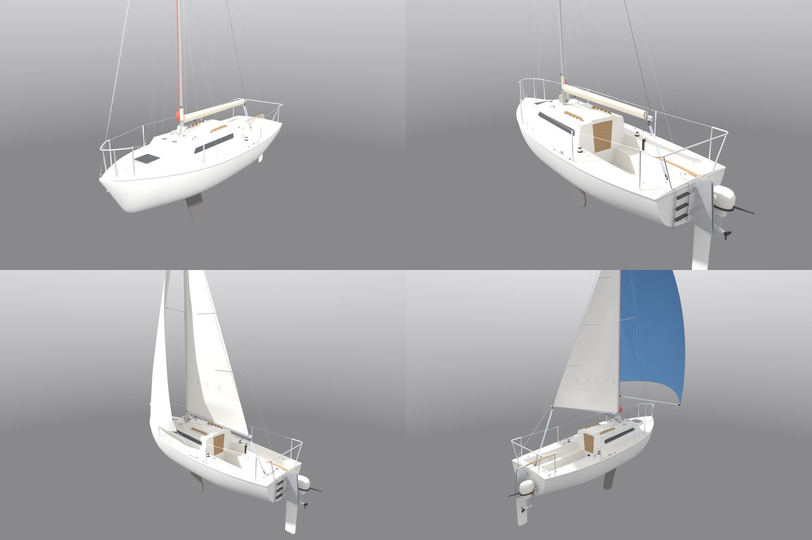
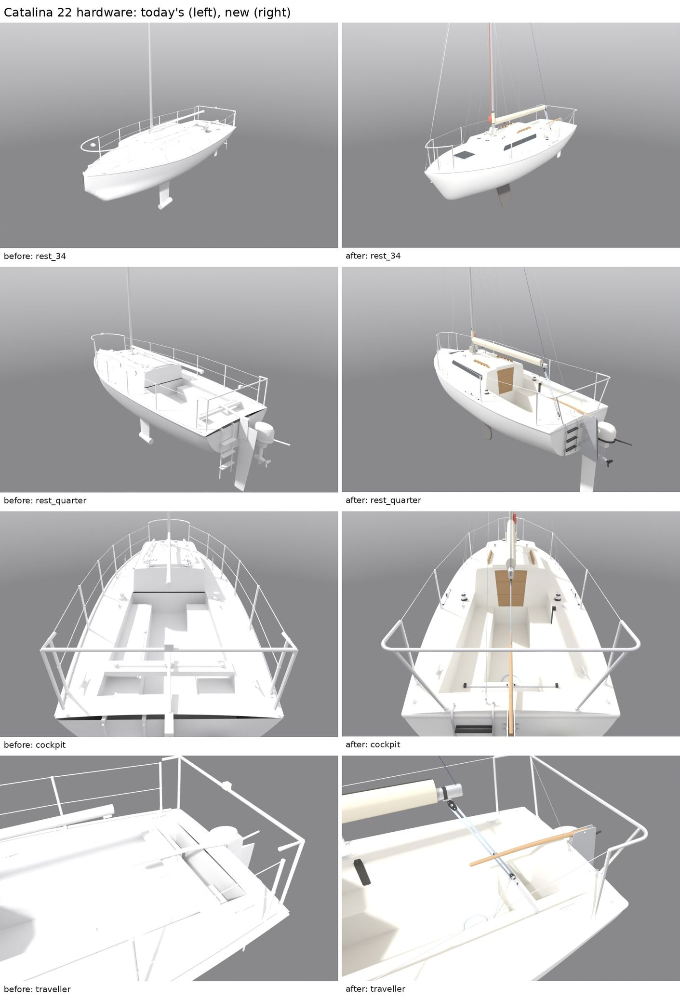
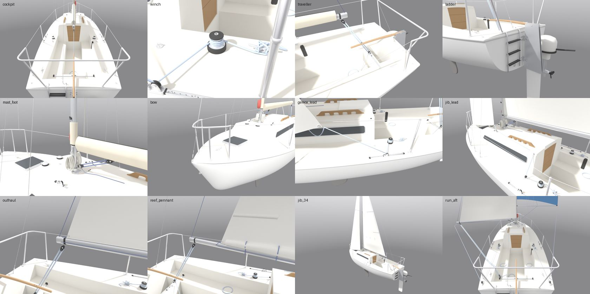

# Catalina 22 rebuild, slice 6: deck hardware and running rigging

Slice 6 puts the Catalina 22's deck hardware on slice 2's new deck and leads her running rigging on slices 4 and 5's rig
and sails: winches, cleats, tracks, the traveller, handrails, vents, the fore hatch, the stern ladder, the bow pulpit,
stern rail and lifelines, then the halyards, sheets, mainsheet, vang, outhaul, reef line, topping lift and the spinnaker's
lines, each led, made fast and coiled. The boat is the original swing-keel boat with the pop-top. Plan:
<https://claude.ai/artifact/3oMiRWywPhitATHvGxs51a>.

Nothing is imported into Unreal and nothing in the game changes. The game keeps today's model and its live ropes until
slices 9 to 11. The new files are under `Tools/`, so the pull request needs Bean's `bean-approved` label.

This slice ends at **Milestone B**: the whole boat close up, at her mooring and under each sail plan. Those views are below
for Bean.





## Words used here

- **Winch:** a drum the sheet is wrapped round (clockwise, seen from above) to pull it in. **Cleat:** where a line is made
  fast. A **horn cleat** takes a cleat hitch round its two horns; a **cam cleat** grips a line in two toothed jaws.
- **Track and car:** a metal rail on deck with a sliding block on it. Moving the car moves where the headsail's sheet pulls
  from (its **lead**).
- **Fairlead:** a smooth ring a line runs through to change direction. A **turning block** does the same with a wheel.
- **Traveller:** the track across the cockpit that the mainsheet's lower block slides on.
- **Tackle:** two blocks with the line running back and forth between them (4:1 here: four parts of line).
- **Vang:** the tackle from the boom down to the mast's foot that holds the boom down.
- **Outhaul:** the line that pulls the mainsail's clew out along the boom. **Reef pennant:** the line that pulls the reef's
  clew cringle down to the boom.
- **Topping lift:** the line from the masthead to the boom's end that holds the boom up when the sail is down.
- **Pulpit, stern rail (pushpit), stanchions, lifelines:** the stainless rails at the bow and stern, the posts along the
  side decks, and the wire between them.
- **Guy and sheet (spinnaker):** the spinnaker's two lines: the guy from the pole's end, the sheet from the free corner.
  The **pole lift** holds the pole up and the **foreguy** holds it down.

## What's built

`Tools/shipkit/catalina22/hardware_c22.json` holds every placement and size, each with a note on where it comes from.
`hardware_c22.py` places the fittings, lays every line and checks them (plain Python, no Blender). `build_hardware_c22.py`
meshes them from the shared boat kit (`Tools/boatkit`), and `render_hardware_c22.py` draws the views here.

- **Fittings.** Two size 8 plain-top winches beside the cockpit's forward end, each with a 6 in horn cleat aft of it. A
  600 mm genoa track a side just inside the rubrail. A 250 mm jib track a side on the fixed cabin top forward of the
  lid, a fairlead at the trunk's aft corner and a turning block on the side deck. The traveller on a moulded bridge
  across the cockpit's aft end (end-boom sheeting, as on the original boat). An 8 in bow cleat, a 6 in stern cleat a
  side, teak handrails on the pop-top's lid, two mushroom vents, the fore hatch on slice 2's curb, a bow eye for the
  trailer, two scuppers, a winch handle pocket and a folding stern ladder on the transom's port side.
- **Rails.** A bow pulpit drawn to her bow: it narrows with the deck, its nose rounds the forestay and the headsails'
  luffs, and the stay leaves the stemhead under it. A stern rail round the transom's corners, two stanchions a side and a
  single lifeline a side. All the feet stand on the deck, 7 cm inside its edge.
- **On the mast.** The main and jib halyards run inside the mast and leave through slots just under the gooseneck,
  to horn cleats low on its sides. The spinnaker halyard runs outside, down the front's starboard quarter to its own
  cleat. Each is made fast with a cleat hitch, and its tail is coiled and hung over the cleat's upper horn. The pole lift
  has a block on the mast's front and a cam cleat on the front's port quarter.
- **Lines, one set per state.** Only one state shows at a time:
  - **Rest** (at her mooring): the main under its cover on a centred boom, the jib halyard clipped to the pulpit, the
    main's to the headboard, the spinnaker's down the mast to its cleat.
  - **Up:** close-hauled on starboard tack under main and genoa. The working sheet runs from the clew over the genoa
    car's sheave to the winch: three turns, the tail cleated and coiled on the seat. The lazy sheet hangs in a curve from
    the clew, round the mast's front, forward of the vents and back to the starboard car and winch.
  - **Jib:** the same under the working jib, led over its cabin-top car, through the fairlead and the turning block.
  - **Reef:** the jib, with the reef pennant pulling the reef's clew down to the boom.
  - **Run:** main and spinnaker, the pole squared to starboard. The guy and sheet run to blocks on the aft deck's
    corners, then forward to the winches. The sheet passes outside the boom's end, and the mainsheet lies over the
    coaming.
  - **Every sailing state:** the mainsheet's and vang's 4:1 tackles at that state's boom angle, the outhaul along the
    boom to a cam cleat, and the topping lift bowed to leeward of the leech.
- **Sizes of line:** 3/8 in sheets, 5/16 in halyards and spinnaker lines, 1/4 in control lines, and a 3/16 in lifeline
  (owners' lists and Catalina Direct's running rigging kit).



## Checks

- **Size check** (`c22_check.py --slice 6`): passes. The boat's sizes are unchanged from slice 5.
- **The hardware** (`hardware_c22.py`, which fails if any of these does):
  - **Fittings sit on their surfaces.** Every deck fitting's base is within 6 mm of the surface under it. No two deck
    fittings' footprints overlap. The pulpit's and stern rail's feet are on the deck, at least 3 cm inside its edge.
  - **Leads.** Each headsail's lead halves its clew's angle, seen square to the sail: the genoa 0.1° off, the jib 8.1°.
    Every sheet meets its winch's drum between 80° and 95° to its axis (86° to 93°).
  - **Lines clear of the rig.** Every line and coil is at least 1 cm clear of the wires, mast, lifelines, stanchions,
    the pulpit's and stern rail's tubes and legs, and the boom. A line may touch only what it is led through.
  - **Lines on the boat, not in it.** No line or coil goes under the deck, seats, sole, cabin top or lid by more than
    3 mm. None goes into a fitting it isn't led through or made fast on. Lines lie over the coaming's and trunk's edges.
  - **No line passes through another or through a sail,** in any state.
  - **The boom is the sails' boom:** its end is within 20 cm of the mainsail's clew in each state.
- **Triangles:** 213,850 for the hardware and lines, against the slice's budget of 250,000:

  | Part | Triangles |
  |---|---|
  | Deck fittings | 83,090 |
  | Pulpit, stern rail, stanchions, lifelines | 14,304 |
  | Mast hardware | 15,740 |
  | Halyards | 10,592 |
  | Lines at rest | 11,244 |
  | Lines up | 18,017 |
  | Lines jib | 19,129 |
  | Lines reef | 19,129 |
  | Lines run | 22,605 |

  Padeyes and blocks use a tenth of the kit's triangles (the full ones are 6,700 to 29,000 each). Cleats, tracks and
  small parts use a quarter, as the kit's own light copies do. The boat is 460,814 in all, with every state's lines
  counted.
- **Joins** (`seams.py`): all closed, as in slice 5.

## Reviews

**Blind round.** Three reviewers saw the new hardware and today's model side by side, in clay, in the same views. Today's
model had the game's live ropes drawn as straight lines. They didn't know which was which. The new hardware won 22 of 24
picks. A critique round on the colour views asked for:

- a lazy sheet that sags (done);
- the winch view showing the sheet on it (moved to the close-hauled state);
- more at the bow (the pulpit was redrawn; see below).

**Independent review** of the code and numbers found real faults that the checks had missed. All are fixed:

- **Cleat hitches.** Every hitch kept half a metre of its lead-in, so halyards climbed back up the mast and sheet tails
  doubled back through the drum. The hitch now starts where its line arrives.
- **Lifelines.** They crossed the boat diagonally (a sign flip on the pulpit's and rail's sockets). The exported lifeline
  sockets were swapped too.
- **The pulpit.** Both headsails passed through it. It now encloses the forestay and narrows with the bow.
- **The run.**
  - The spinnaker's sheet went through the mainsail; it now passes outside the boom's end.
  - The mainsheet cut into the coaming; it now lies over it.
  - The mainsheet's coil sat in the seat; it now lies on the footwell's sole.
- **Clashes on deck.** The jib sheets ran through the handrails, which moved inboard and are shorter. The lazy genoa
  sheet ran through a vent and now passes forward of the vents. The spinnaker's lines ran over the stern and winch
  cleats, which moved.
- **Clashes on the mast.** The halyard coils hit each other's cleats; the cleats were respaced. The spinnaker halyard ran
  through the pole lift's padeye; it now runs down the mast's front quarter. The slots' plates were above the gooseneck;
  they are now under it.
- **Sockets.**
  - `Traveler_S` and `Traveler_P` came out fore and aft of the car; they are now at the track's ends.
  - `JibWinch_*` was on the side of the drum a line from aft comes onto; it is now where the headsail sheets come on.
- **The checks** left out the deck, the boom, the sails, the fittings, the rails and line against line. They have them
  now (above), and it was those that found the cleat, coaming and trunk-edge clashes.
- **Notes.** Some notes and comments were out of step with the numbers; they now match.

These fixes weren't shown to another blind round.

## For Bean: the genoa against the pulpit and lifeline

Slice 5 cut the 135% genoa as a deck-sweeper sheeted to the rail, with its clew outside the lifeline. With the pulpit
round its luff and a lifeline at its clew, the cloth can't miss them: on a real boat it lies on them.

- The model's genoa passes through the port lifeline and the pulpit's two port legs where they meet it.
- `hardware_c22.py` reports this as a known contact rather than failing it.
- Three ways on, in the pull request:
  - drop the lifelines and stanchions (many original boats had only the pulpits);
  - press the genoa onto them so it lies on them, with a crease;
  - or cut the genoa with a higher clew on a short tack pennant, so it clears them.

## For slice 9 (light copy and sockets)

- The winches' drums are 6 cm over their bases. The game's `JibWinchDrumCm` assumes 8.
- The new sockets are in `c22_sockets.json` under `hardware_note`: `MainsheetBlock` and `MainsheetCam`, the cars, the
  fairleads, the lifelines' ends, the cleats and the halyard cleats on the mast. They are where the game's live ropes
  should end.

## For slice 7 (cabin below)

- The swing keel's line and its winch are inside the cabin. They come with the cabin.

## Open for photos

These wait on photos of a real boat (refs.json):

- **The jib's lead** (cabin-top track, fairlead and turning block), from a photo of her jib set.
- **The handrails** (on the lid or the fixed top), from a photo of her cabin top.
- **Lifelines or not,** and the pulpit's shape, from a photo of her bow.
- **Where the halyards are cleated** (on the mast, as here, or led aft), from a photo of her mast's foot.
- **The stern cleats and ladder,** from a photo of her stern.

## Reproduce

```
blender -b --factory-startup -P Tools/shipkit/catalina22/build_c22.py -- <work>/s6
python3 -I Tools/shipkit/catalina22/hardware_c22.py
blender -b -P Tools/shapeloop/measure.py -- <work>/s6/c22.blend Tools/shapeloop/sections_c22_rebuild.json <work>/s6/m
blender -b -P Tools/shapeloop/seams.py -- <work>/s6/c22.blend Tools/shapeloop/sections_c22_rebuild.json <work>/s6/m
python3 -I Tools/shipkit/catalina22/c22_check.py <work>/s6/m/stats.json <work>/s6/c22_sockets.json --slice 6
blender -b -P Tools/shipkit/catalina22/render_hardware_c22.py -- <work>/s6/c22.blend <work>/s6/hw --res 1000
python3 Tools/shapeloop/make_sheet.py <work>/s6/hw_old <work>/s6/hw docs/c22-7/before_after.jpg rest_34 rest_quarter cockpit traveller --title "Catalina 22 hardware: today's (left), new (right)"
```

`<work>/s6/hw_old` is today's model with its live ropes drawn as straight lines from its sockets. `milestone_b.jpg` is four
views and `sheet.jpg` the detail views, both saved smaller as JPEGs. `--clay` renders everything in one clay, as the blind
rounds saw it. In the cloud, `blender -b -P <script> --` was a Python 3.13 venv with `pip install bpy`, as in slice 1.

## Next: Milestone B, then slice 7

Bean looks at the views above. Then slice 7 builds the cabin below.
