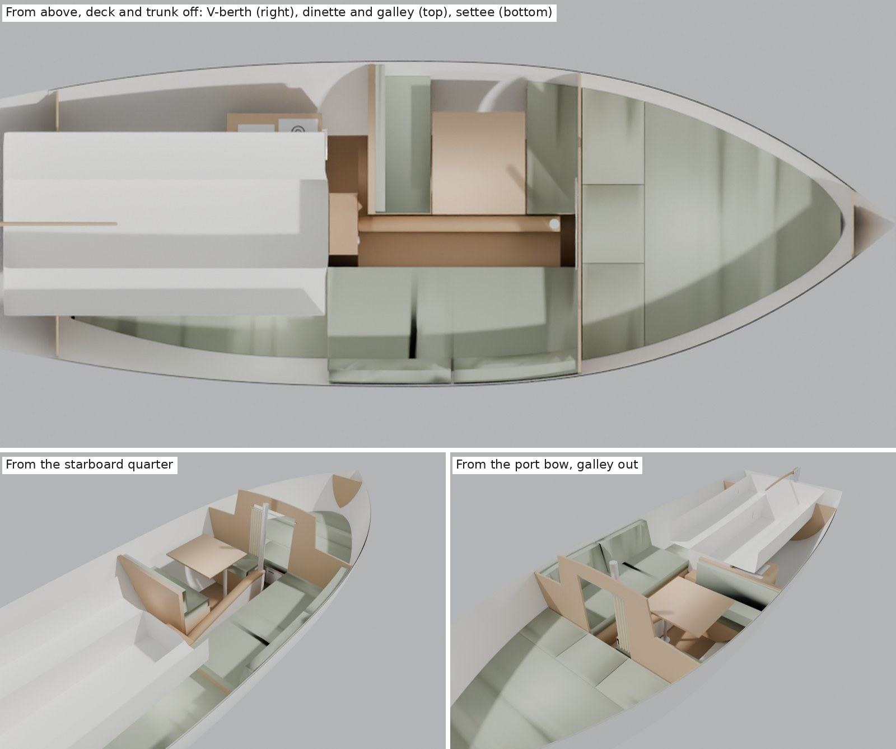
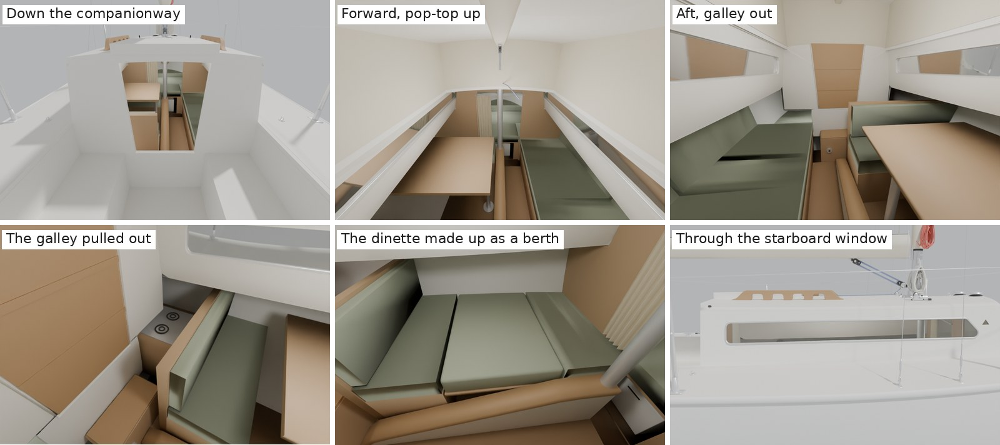

# Catalina 22 rebuild, slice 7: the cabin below

Slice 7 builds the Catalina 22's cabin inside slices 1 and 2's hull, deck and trunk:

- the V-berth, with its curtain;
- the dinette to port, which drops into a berth;
- the settee to starboard, which runs aft into a quarter berth under the cockpit seat;
- the galley, which slides out from under the port cockpit seat;
- the porta-potti under the V-berth;
- the companionway step, with the swing keel's winch inside it;
- the cushions, liner and headliner.

The boat is the original swing-keel boat with the pop-top. Plan: <https://claude.ai/artifact/3oMiRWywPhitATHvGxs51a>.

Nothing is imported into Unreal and nothing in the game changes. The game keeps today's model, which has no cabin,
until slices 9 to 11. The new files are under `Tools/`, so the pull request needs Bean's `bean-approved` label.





## Words used here

- **V-berth:** the double berth in the bow, V-shaped because the hull narrows. A **curtain** across its doorway closes
  it off.
- **Dinette:** two seats facing each other across a table. On this boat the table drops to the seats' level and a filler
  cushion goes on it, making a short double berth.
- **Settee:** a bench seat along the side. **Quarter berth:** a berth that runs aft under the cockpit seat, in the
  boat's "quarter".
- **Sole:** the cabin's floor. **Bulkhead:** a wall across the boat. **Compression post:** the post under the mast that
  carries its load from the cabin top down to the keel trunk.
- **Keel trunk:** the slot down the middle of the cabin that the swing keel pivots up into. The **keel winch** raises
  and lowers the keel on a cable. On this boat it sits under the bridgedeck, inside the companionway step, at the
  trunk's aft end.
- **Liner, headliner:** the inside skin of the hull, and of the deck and cabin top.

## What's built

`Tools/shipkit/catalina22/cabin_c22.json` holds every size, each with a note on where it comes from. `cabin_c22.py` lays
out every piece and checks it, in plain Python with no Blender. `build_cabin_c22.py` builds the meshes and
`render_cabin_c22.py` draws the views here. The layout is the original boat's as owners and Catalina's brochures
describe it (`specs_c22.json`, "cabin"). Every size is a guess from the hull and the published headroom until a photo of
her cabin. They are listed under "Open for photos" below.

- **The inside skin.**
  - The hull's, deck's and trunk's skins are drawn again inside their laminate, facing in. The hull's is 12 mm in, the
    deck's 25 mm and the trunk's 20 mm.
  - The deck's skin under the trunk used to roof the cabin. It is cut away, and the trunk's liner comes down to meet the
    deck's.
  - A bulkhead closes each end of the liner: aft of the quarter berth's foot, and forward of the V-berth (the forepeak).
  - The trunk is cut open behind each window, with a reveal through the laminate. The cabin shows through the glass from
    outside, and the outside through it from inside.
- **The sole** is 14 cm under the waterline. It runs from the companionway to the bulkhead, on each side of the keel
  trunk, which stands up through it down the middle.
- **Headroom.** The closed pop-top's underside is 1.33 m over the sole and the raised one's 1.71 m. The card gives
  4 ft 4 in and 5 ft 7 in (1.32 and 1.70 m).
- **The main bulkhead** is just forward of the mast, with the V-berth's doorway in it. The compression post stands under
  the mast step. The curtain hangs on a rod across the doorway, drawn to port.
- **The V-berth** is 1.85 m long and 1.75 m wide at the shoulders. Its top is 20 cm over the sole, with 49 cm of
  sitting room under the deck. The centre insert is a cushion on a lift-out board over the porta-potti. The porta-potti
  stands on its own floor board and shows through an opening in the berth's front.
- **The settee** is 1.80 m long, with a seat 43 cm high and back cushions leaning on the hull. **The quarter berth**
  runs on aft from it under the starboard cockpit seat: 1.84 m long, 61 cm wide at the shoulders, with 34 cm over the
  cushion.
- **The dinette** has seats 43 cm high and a table 72 cm high on one leg beside the trunk. With the table lowered to
  the seats' bases and its filler cushion on, it is a berth 1.46 m long.
- **The galley** is a box under the port cockpit seat with a two-burner stove and a small sink. It slides 28 cm into
  the cabin to be used, and its handle stops 13 mm short of the dinette's back.
- **The companionway step** is a box with a teak tread, halfway between the sole and the sill: two rises of 31 cm.
- **The keel winch** is a reel winch inside the step, under the bridgedeck, as Practical Sailor's review describes. Only
  its crank socket shows, in a boss on the step's face, to starboard. Its cable runs straight forward into the keel trunk.
- **The keel trunk** stands up through the sole down the middle, from 2 cm over the sole at its aft end to 38 cm at its
  forward end. It has a teak cap so it reads as the flat-topped box owners step over.
- **States.** The table up (shown) or down (`C22_Interior_TableDown`, hidden), and the galley home (shown) or out
  (`C22_Interior_GalleyOut`, hidden).

**The pop-top's handrails** were found in the cabin with the top raised. They had stayed at the closed lid's height. They
are now their own objects: `C22_LidRails` on the closed lid, and `C22_LidRailsRaised`, hidden, which goes up with the
lid. `build_c22.py --raised` builds only the raised ones, under the closed name, as it does the lid.

## Checks

- **Size check** (`c22_check.py --slice 7`): passes. It now reads the cabin's headroom from the build's report: 1.329 m
  closed (+0.6%) and 1.708 m raised (+0.5%).
- **The cabin** (`cabin_c22.py`, which fails if any of these does):
  - **Every piece is clear of the liner.** That means the hull at its height, the deck or trunk top over it, and, under
    the cockpit, the well's sides and seats. It is checked by at least 5 mm (to 1.5 mm of sampling) in each state: as
    moored, galley out and table down.
  - **No piece stands in the keel trunk, and none goes through another.**
  - **Sizes against owners' numbers:**

    | Measure | Value | Limits |
    |---|---|---|
    | Headroom, pop-top closed | 1.328 m | 1.30 to 1.34 |
    | Headroom, pop-top raised | 1.708 m | 1.68 to 1.72 |
    | V-berth length | 1.845 m | 1.78 to 2.10 |
    | V-berth width at the shoulders | 1.746 m | 1.20 to 2.00 |
    | V-berth sitting room | 0.489 m | at least 0.48 |
    | Quarter berth length | 1.840 m | 1.83 to 2.10 |
    | Quarter berth width at the shoulders | 0.614 m | 0.50 to 0.80 |
    | Quarter berth room under the seat | 0.341 m | at least 0.30 |
    | Settee and dinette seat height | 0.430 m | 0.40 to 0.48 |
    | Settee length | 1.800 m | 1.75 to 2.10 |
    | Dinette berth length | 1.460 m | 1.42 to 2.00 |
    | Dinette berth, filler cushion to seat cushions | 0 | within 5 mm |
    | Table height | 0.720 m | 0.68 to 0.76 |
    | Companionway rises | 0.310 m | at most 0.32 |
    | Galley under the seat, stowed | 0.036 m | at least 0.03 |
    | Galley out, handle to the dinette's back | 0.013 m | at least 0 |

- **Triangles:** 72,807 for the cabin, against the slice's budget of 400,000:

  | Part | Triangles |
  |---|---|
  | Liner (hull and well) | 41,728 |
  | Headliner (deck, trunk, window reveals) | 14,707 |
  | Sole, bulkheads, berth fronts, step, trunk cap, post, curtain, winch socket | 6,192 |
  | Cushions | 6,900 |
  | Porta-potti | 564 |
  | Table (and lowered, hidden) | 228 (832) |
  | Galley (and out, hidden) | 828 (828) |

  The boat is 540,081 in all, every state counted. The fittings are now 222,066, because the lid's handrails are drawn
  twice (closed and raised), against their 250,000.
- **Joins** (`seams.py`): all closed, as in slice 6. The trunk's windows are cut inside the trunk's skin, away from its
  seams with the deck and the lid.

## Reviews

**Independent review** of the code and the built model found these, all fixed:

- **Most of the cabin was outside its section.** The section's rule matched only `C22_Interior` exactly, so the liner,
  cushions and the rest were counted as "other" and not against the cabin's budget. The rules for the cabin and the lid's
  handrails now match by prefix.
- **A slit along the trunk's foot.** The deck's liner stopped at the trunk's outer edge and the trunk's liner 2 cm
  inside it, leaving a gap either side and across the front. The trunk's liner now comes down to the deck's.
- **The step's back face** was in the plane of the cockpit well's front, so the two would flicker. The step now starts
  3 cm forward of it.
- **The galley's handle** went 27 mm into the dinette's back when pulled out. The check counted only the box. It now
  counts the handle, and the galley slides 28 cm, not 32.
- **The porta-potti stood on nothing**, 7 cm over the hull, since the sole ends at the bulkhead. It now has a floor
  board.
- **The settee's back cushion** went 12 mm into the deck's liner. Its top is now kept clear of it.
- **The checks didn't see the cockpit well,** so the quarter berth and galley were tested only against the seat at
  their ends. The well's sides, sole and seats are now in the liner check.
- **The curtain had one face,** so in the game it would vanish from the V-berth side. It has two now.
- **The liner was open at both ends.** It is closed now by the aft and forepeak bulkheads.
- **The windows were blank from inside:** the trunk was solid behind its glass, and the headliner covered it too. Both
  are now cut open.
- Smaller: a check's pass/fail line read the wrong list, the V-berth's top was one board under a "removable" insert (the
  insert now has its own board), and three notes didn't match the code.

**The renders** found two more, both fixed:

- **The handrails inside the cabin** with the pop-top up (above).
- **The dinette's table, lowered,** sat 12 cm too high, so its filler cushion stood proud of the seats. It now drops
  to the seats' bases and the cushions are flush. A check holds that.

**Review round.** One reviewer saw the colour and clay views, with the layout as owners describe it, and checked the
boat against owners' forums and reviews found by web search. They couldn't open the pages, only the search summaries.

Their verdict: the plan view gets the Catalina 22's layout right, but inside it didn't read as her yet. What they asked
for, and what happened:

- **The keel trunk looked like a pipe on the floor.** Done: it has a flat teak cap, and its edges are drawn sharp.
- **The keel winch stood on the open floor.** Done: it is inside the companionway step, with only its socket showing.
- **Round rails along both sides.** These were the corner where the trunk's side meets the side deck's underside, shaded
  smooth round the corner. Done: the liner's corners are sharp now.
- **The galley didn't show.** Done: a new view shows it pulled out, between the cockpit well's front and the dinette's back.
- **The compression post blocks the doorway.** An owners' thread says it stands at the doorway's port side, against the
  bulkhead. Moving it there means cutting into the dinette's forward seat, so it waits for a photo.
- **The pop-top doesn't read as one with the top up.** Its canvas skirt is in the placeholder colour, the same as the
  walls. It should read once slice 8 gives the canvas its own look.
- **The quarter berth sits lower than the settee.** It is kept lower so there is 34 cm over its cushion under the
  cockpit seat. At the settee's height there would be 15. It waits for a photo too.
- **The bulkhead's top steps** up the trunk's side. That is its real shape, under the side deck and then the trunk's top.
  It shows as steps only in the cutaways, where the deck is hidden.

These fixes weren't shown to another review round.

## For slice 8 (textures and wear)

- The slots are new: `Liner`, `Headliner` (a vinyl or carpet headliner on the originals), `Sole` (teak and holly),
  `Laminate` (the joinery's teak-grain laminate), `Cushion`, `Curtain` and `WhitePlastic`.
- The pop-top's canvas skirt (`SailCover`) should read as canvas, not as the cabin's walls.
- The window glass is one-sided, facing out. From inside it needs a two-sided material, or a second face.

## For slice 9 (light copy and sockets)

- The cabin is loaded only up close or below. The light copy can drop it, or keep only the liner and the solids.
- The galley and table states need sockets or a swap of meshes, as the pop-top does.

## Open for photos

These wait on photos of a real boat's cabin (refs.json):

- **The layout's sizes:** where the bulkhead stands, the V-berth's height and the insert, the dinette's table and its
  leg, the settee's back, and how far the galley slides.
- **The headliner** and the joinery's colour.
- **The curtain** (or a door) at the V-berth.
- **The keel winch's socket:** where it is on the step's face.
- **The compression post:** whether it stands at the doorway's port side (the review's source), and how it clears the
  dinette's forward seat.
- **The quarter berth's height** against the settee's.

## Reproduce

```
blender -b --factory-startup -P Tools/shipkit/catalina22/build_c22.py -- <work>/s7
python3 -I Tools/shipkit/catalina22/cabin_c22.py
blender -b -P Tools/shapeloop/measure.py -- <work>/s7/c22.blend Tools/shapeloop/sections_c22_rebuild.json <work>/s7/m
blender -b -P Tools/shapeloop/seams.py -- <work>/s7/c22.blend Tools/shapeloop/sections_c22_rebuild.json <work>/s7/m
python3 -I Tools/shipkit/catalina22/c22_check.py <work>/s7/m/stats.json <work>/s7/c22_sockets.json --slice 7
blender -b -P Tools/shipkit/catalina22/render_cabin_c22.py -- <work>/s7/c22.blend <work>/s7/cab --res 900
```

`cabin.jpg` is the plan over the two cutaways and `views.jpg` the six views, both saved smaller as JPEGs.
`--clay` renders everything in one clay, for the review round.
