# Catalina 22 rebuild, slice 8: her textures and wear

Slice 8 of the Catalina 22 rebuild (plan: <https://claude.ai/artifact/3oMiRWywPhitATHvGxs51a>) gives every surface of
the boat a look and the texture loop's five wear levels ([docs/texture-loop](../texture-loop/README.md)), from launched
new to twenty years left on a trailer. Outside: the hull's gelcoat and the lake's clay line, the deck and its non-skid,
the blue bottom paint and the iron swing keel, the oiled teak and the varnished tiller, the pop-top's canvas and the
sail cover, the vinyl rubrail. Below: the moulded liner, the vinyl headliner, the teak and holly sole, the oiled veneer
joinery, the tweed cushions and the curtain, the white plastic, the stainless, the aluminium and the smoked windows. Two
close-up maps of her own (grained vinyl and woven tweed) join the boats' shared library.

The page is `docs/c22-9` because slice 9 (the cabin's second half) was planned before this slice was split off to run
beside it; the numbers in the plan are unchanged. Like the other slices it is tools and docs only: nothing is imported
into Unreal and nothing in the game changes. The cabin thread calls `weathering_c22.dress(level)` from `build_c22.py`
once this is on main; the game's material entries come in a separate small pull request (below). The new files are
under `Tools/` and `Inputs/`, so the pull request needs Bean's `bean-approved` label.

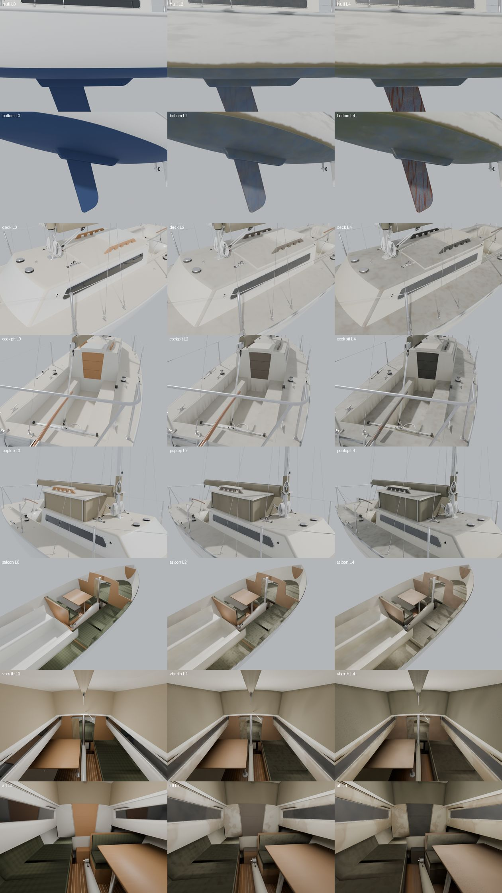

## Words used here

- **Gelcoat**: the hard, glossy outer skin of a fibreglass boat. In the sun it goes chalky (a white powder that rubs off),
  then yellow, and fine **crazing** (spider cracks) opens at corners and round fittings.
- **Non-skid**: the moulded diamond pattern on the deck where you walk, so feet grip when it is wet.
- **Antifouling** or **bottom paint**: soft paint below the waterline that stops weed and slime growing.
- **Lake mustache**: the brown band of clay and slime a boat on a muddy lake gets at the waterline, thickest at the bow.
- **Headliner**: the vinyl ceiling of the cabin; **liner**: the moulded white fibreglass of the cabin's inside.
- **Sole**: the cabin floor; on the Catalina 22, teak strips with thin pale holly strips between them.
- **Tweed** or **plaid**: the woollen check cloth the period's cushions were covered in.

## The five levels

The loop's levels (`Tools/texloop/levels.json`), as they read on her. She lives on Lake Ray Hubbard, fresh water: no
barnacles or salt, rust and stainless tea staining at a third of the salt-water rate, and the lake's red-brown clay at
the waterline instead.

| Level | Age, care | On the Catalina 22 |
| --- | --- | --- |
| L0 | new | launched new: glossy white gelcoat, crisp beige non-skid, a deep even blue bottom, golden oiled teak, fresh tan canvas, white vinyl, bright cushions and curtains |
| L1 | 0.3 years, 0.9 | her first season on the lake: the gelcoat's gloss a touch softer, a faint tan clay line at the waterline, dust in the non-skid, the teak paling, the cushions just used |
| L2 | 6 years, 0.5 | six years a club or family boat, half kept: chalky topsides with black streaks under the fittings and windows, a brown clay mustache and slime at the waterline, grey teak, faded canvas, brown water stains on the headliner, worn varnish in the cabin's walkway, faded cushions |
| L3 | 30 years, 0.9 | thirty years old and well kept: polished but faded and faintly yellow gelcoat with spider cracks at the stanchions and corners, the windows hazed and crazed, oiled teak, newer canvas, the vinyl yellowed, the sole's varnish deep amber |
| L4 | 20 years, 0.1 | twenty years left on a trailer or a mooring: heavy chalk, black streaks everywhere, green slime and clay over a pale worn bottom, the keel's iron rusting through, black teak, rotten canvas, a stained and mildewed headliner, mildew on every surface below, the sole's varnish gone grey and black |

## What slice 8 builds

### The cards

One card per surface (`Tools/shipkit/catalina22/textures/textures_c22.json`). Each says which of her materials it
covers (by kind), how close a camera comes, the pattern's real size, the detail maps it draws, its colour targets, and
what each level looks like on her. Every material the build makes is in a card or in `unweathered` with its reason (the
sails' cloth, drawn by `M_SailCloth` with its own `Age` and `Care`; the live ropes, drawn by `M_RigRope`; the name and
graphics, which are the boat kit's lettering); `dress()` stops otherwise.

| Surface | Her materials (by kind) | Closest camera | Detail maps | Colour targets (CC0 scans) |
| --- | --- | --- | --- | --- |
| Gelcoat | topsides: GelcoatHull, Topsides; deck: Deck; liner: Liner | 0.6 m | Gelcoat (shared) | none: every CC0 "white plastic" is lit, not an albedo |
| Non-skid | nonskid: NonSkid | 0.5 m | NonSkid (shared) | none |
| Bottom | antifouling: Antifouling (and the hull below the paint line); iron: Keel | 0.8 m | Gelcoat (shared) | rust: Poly Haven rusty_painted_metal, ambientCG Rust009 |
| Teak | oiled: Teak; varnish: Wood (the tiller) | 0.5 m | TeakWeathered, WoodVarnish (shared) | Poly Haven teak_veneer (L0), wood_planks_grey (L2), weathered_planks (L4) |
| Canvas | acrylic: SailCover (the pop-top's skirt and the main's cover); bag: SailBag | 0.6 m | Canvas (shared) | none |
| Vinyl | headliner: Headliner; rubrail: Rubrail, Lifeline | 0.4 m | Vinyl (hers) | none |
| Sole | sole: Sole | 0.4 m | WoodVarnish (shared) | none |
| Veneer | laminate: Laminate | 0.4 m | WoodVarnish (shared) | none |
| Fabric | cushion: Cushion; curtain: Curtain | 0.4 m | Tweed (hers) | none: no CC0 scan of a 1970s plaid |
| Plastic | white: WhitePlastic; black: BlackPlastic, Rubber | 0.4 m | none | none |
| Metal | stainless: Stainless, Wire; aluminium: Aluminium; painted: PaintedAluminium | 0.4 m | Metal (shared) | none |
| Acrylic | window: CabinWindow | 0.6 m | none | none |

The scans are measured only (their mean albedo), never shipped, and kept in the git-ignored
`Data/Reference/raw/textures/C22`.

Each card also gives every slot its new finish (`finish`): colour, roughness, metal and clear coat, from the game's
`BOAT_LIBRARY` where the slot exists there, so the Blender looks and the game's match. Eight slots have no library entry
yet; they are listed under "The game's side" below.

### The wear

`Tools/shipkit/catalina22/textures/weathering_c22.py` turns a level into wear terms and puts them on her, in the same
way as Bluebonnet's ([docs/jclass-11](../jclass-11/README.md)), whose node helpers and measuring modes it reuses.
`amounts()` gives each surface's terms from the loop's own time and dirt numbers (`Tools/texloop/wear.py`); neglect's
own terms (rust, rot, mildew, crazing past a few cracks) start past a threshold of dirt a kept boat never reaches; a
first season's marks grow as the square root of dirt, so L1 is not new; and a kept boat's routine renews what owners
renew (bottom paint every season and a half, the canvas every four years, cushions every three, the curtain every five,
the sole's varnish and the teak's oil each spring).

- **Gelcoat.** The gloss and clear coat go; chalk lifts the white to a flat dead white, most on what faces the sky; it
  yellows with age. Black streaks run down from the fittings, the ports and the rubrail's ends, and a dirty film settles
  in the corners. Scuffs gather in a band along the topsides where fenders and docks rub. Crazing opens at the
  stanchion bases and the moulding's corners. At the waterline the lake leaves its mark: a tan clay line in the first
  season, a brown clay mustache with green slime by six years, thick clay and slime when neglected; a kept boat's
  waterline is scrubbed clean. Inside, the liner greys where hands go (aft, round the companionway) and grows mildew low
  down where damp lies.
- **Non-skid.** Dust, then grey-brown dirt packed into the pattern along the walking paths; chalky and faded elsewhere;
  worn smooth on the paths of a kept old boat; dark grey-green with mildew and stains when neglected.
- **Bottom.** The blue fades and chalks, a clay film and soft slime smears gather (most toward the waterline), and the
  paint wears thin to the grey primer and white gelcoat at the edges and the keel stub. The iron swing keel rusts
  through its paint: soft brown bleeds, runs down from the edges and blisters.
- **Teak.** Oiled teak silvers within a season or two and goes black and green with mildew, its checks opening, when
  neglected; a kept boat's teak is oiled back to golden brown. The tiller's varnish dulls and wears where hands go, ambers
  with the years and peels to grey wood.
- **Canvas.** The acrylic fades on top, gathers dirty streaks along the lower edges and folds, and spots with mildew;
  neglected it is bleached and rotten with black mildew and green streaks.
- **Vinyl.** The headliner yellows, grimes round the hatch and handholds, and spreads brown leak stains from the
  windows and fittings, with black mildew dots when neglected. The rubrail chalks and scuffs.
- **Sole.** Teak strips 50 mm wide with 6 mm holly between them. The varnish wears grey down the middle where feet go,
  water stains the edges and the step dark, and the holly goes from cream to honey to grey-black.
- **Veneer.** Dries pale, darkens where hands hold the edges, and black water lines rise from the sole; re-oiled it
  deepens.
- **Fabric.** The tweed fades on top, wears at the seat fronts, and stains; neglected, washed-out with dark stains and
  mildew specks. The curtain fades in the light from the windows.
- **Plastic, metal, acrylic.** The white plastic creams and scuffs, the black greys and chalks. Stainless dulls and,
  only when neglected, tea-stains and rust-spots (slowly, in fresh water). Aluminium dulls, grimes and blooms white
  oxide. The smoked windows haze, craze and grime.

Each term is a value node named `wear:<surface>.<term>` in the material; `apply_level()` sets them for a level (or any
age and care), so one build renders every level.

### Her own detail maps

`Tools/shipkit/catalina22/textures/textures_c22.py` makes two close-up maps with numpy (no photos), using Bluebonnet's
generator's noise, normal-map and measuring helpers, written to `Inputs/c22-detail` as plain PNGs (the folder's
`.gitattributes` keeps them out of Git LFS, which the cloud cannot push): a normal map and a mask map each, tileable,
sized from the card's real pattern.

| Map | Tile | Pixels | Pixels a mm | Mask channels | Pattern (measured on the map, against the card) |
| --- | --- | --- | --- | --- | --- |
| Vinyl | 60 x 60 mm | 512 x 512 | 8.5 | cavity, roughness, height | grain 0.76 mm (card 0.6 to 1.6) |
| Tweed | 60 x 60 mm | 1024 x 1024 | 17.1 | plaid tone, weave gaps, height | weave 1.2 mm (card 0.8 to 1.6), plaid 60 mm (card 60) |

The vinyl is a pebbled leather grain for the headliner and rubrail; the tweed is a 2/2 twill of thick woollen yarns in a
6 cm plaid of three tones, the period's olive and brown. The shared library's maps (`Inputs/boat-detail`: Gelcoat,
NonSkid, TeakWeathered, WoodVarnish, Metal, Canvas) are already resident for the J/22, so they cost her nothing.

### The budget

Her own maps only, block compressed with mips (BC5 normals, BC1 masks):

| Tier | Budget (set here) | Her maps |
| --- | --- | --- |
| High and Ultra | 3 MB | 2.5 MB: Vinyl 0.5, Tweed 2.0 |
| Medium | 0 MB | none: Medium draws no detail maps, only the colour and roughness math |

## Checks

`wear_check_c22.py` measures the renders (88 of them: eight views at five levels, lit and as albedo, plus an id shot
each), as Bluebonnet's `wear_check.py` does, and writes `wear_check.json`:

| Check | What passes | Result |
| --- | --- | --- |
| Coverage | every material the build makes has a card or a reason in `unweathered` | pass |
| The ladder, 20 kinds | each level's mean colour (CIELAB, measured per material in the albedo shots and averaged by pixels) at least 8 from new at L4 and 4 at L2, L1 no further than L2 and L2 no further than L4, and the kept L3 at least 6 from the neglected L4 | all pass (stainless held to fresh water's slower steps, below) |
| Colour targets, 4 | each within 6 in colour (a, b) of the CC0 scans' mean albedo | all pass |
| Her maps | tiling, no big repeat, 4 px a mm or more, the pattern the card's size | both pass |
| Budget | High 3 MB, Medium 0 MB | 2.5 MB and 0 MB: pass |
| Blind ladder | three reviewers, each putting all five levels right or swapping only two neighbours, on every sheet | eight of ten sheets pass; the bottom (one reviewer swapped her first season and the kept old boat) and the deck (two swapped new and kept old) do not |

The ladder, as each level's colour distance from new (and the kept L3's from the neglected L4):

| Kind | L1 | L2 | L3 | L4 | L3 to L4 |
| --- | --- | --- | --- | --- | --- |
| gelcoat.topsides | 1.5 | 6.9 | 4.2 | 10.6 | 6.9 |
| gelcoat.deck | 0.7 | 5.2 | 6.2 | 11.1 | 7.0 |
| gelcoat.liner | 1.9 | 6.4 | 8.2 | 11.7 | 6.2 |
| nonskid.nonskid | 2.7 | 11.4 | 5.3 | 24.2 | 19.8 |
| bottom.antifouling | 13.0 | 25.9 | 13.9 | 31.2 | 18.9 |
| bottom.iron | 12.8 | 23.8 | 13.3 | 29.1 | 18.9 |
| teak.oiled | 19.1 | 29.8 | 13.1 | 43.5 | 30.9 |
| teak.varnish | 0.5 | 6.6 | 5.2 | 30.9 | 30.9 |
| canvas.acrylic | 0.5 | 9.5 | 1.7 | 16.3 | 16.9 |
| vinyl.headliner | 1.4 | 9.7 | 8.2 | 19.2 | 13.0 |
| vinyl.rubrail | 2.7 | 10.9 | 5.4 | 15.1 | 9.7 |
| sole.sole | 1.4 | 8.2 | 9.3 | 14.6 | 8.0 |
| veneer.laminate | 1.5 | 7.1 | 8.9 | 13.2 | 14.8 |
| fabric.cushion | 1.5 | 7.7 | 4.3 | 13.8 | 9.6 |
| fabric.curtain | 1.4 | 6.0 | 6.0 | 9.9 | 7.5 |
| plastic.white | 1.0 | 10.0 | 10.4 | 16.3 | 8.8 |
| plastic.black | 1.6 | 13.6 | 8.4 | 18.3 | 9.9 |
| metal.stainless | 0.0 | 1.7 | 0.5 | 2.3 | 1.8 |
| metal.aluminium | 0.7 | 7.9 | 3.0 | 11.7 | 8.9 |
| acrylic.window | 6.3 | 20.0 | 19.0 | 28.1 | 9.2 |

Stainless is the one kind held to smaller steps: in fresh water it hardly changes colour in twenty years (its tea
staining and rust come at a third of the salt-water rate), so its ladder is judged by its own steps (2, 1, 1), not the
loop's. Two kinds are in no view at her mooring and are listed, not failed: the sail bags (`canvas.bag`, seen only under
sail) and `PaintedAluminium` (no part of the rebuilt boat uses it yet).

The colour targets (distance in a and b; the lightness, d_L, is reported, not held: a scan's lighting is not hers):

| Target | Scans | d_ab | d_L |
| --- | --- | --- | --- |
| the keel's rust colour | rusty_painted_metal, Rust009 | 1.7 | -1.9 |
| teak.oiled at L0 | teak_veneer | 0.5 | 1.7 |
| teak.oiled at L2 | wood_planks_grey | 5.1 | 14.2 |
| teak.oiled at L4 | weathered_planks | 5.7 | -2.0 |

The ladder sheets, each surface's crop from the view that shows it best, new (L0) to twenty years neglected (L4) left
to right; the blind sheets the reviewers saw are the same crops shuffled under A to E (`blind/`, key in
`blind/key.json`):

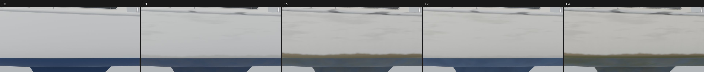
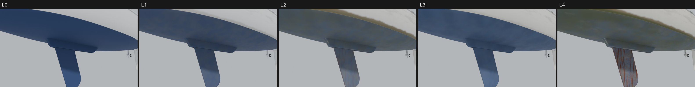
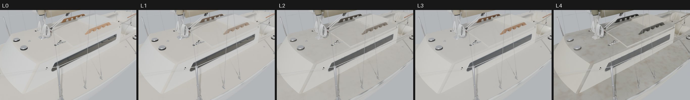
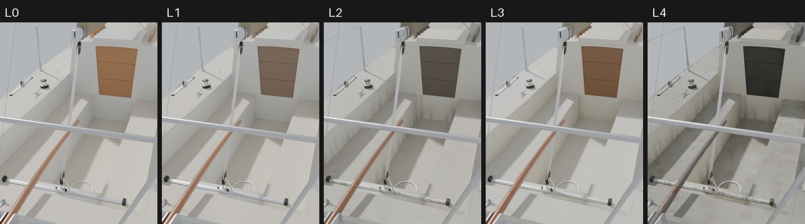
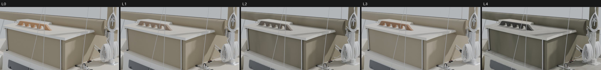
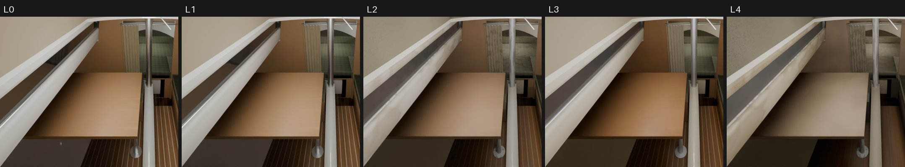
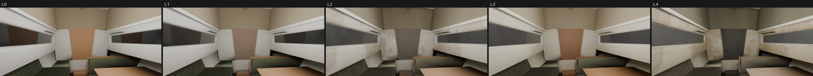
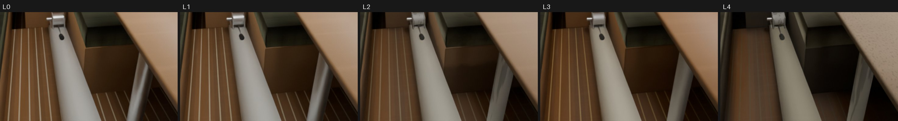
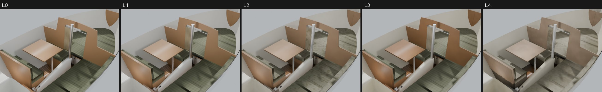
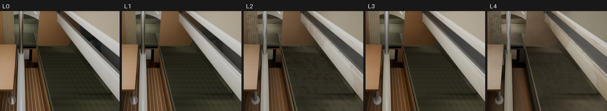

## Review

Four blind rounds, each with three new reviewers who saw only the shuffled sheets and the cards' words
(`reviews_c22.json` keeps every round's answers and notes). Between rounds the checks were run again and the notes
answered:

| Round | Sheets all three put in order | What the notes said, and what changed after |
| --- | --- | --- |
| 1 | topsides, bottom | the waterline clay a row of stamped blobs; the keel's rust leopard spots; mildew a leopard print on the headliner; the window's crazing and the vinyl's grain a granite speckle; camouflage on the deck and the old teak; a hair-like fringe of black streaks under the coamings; and new, first season and kept old mixed up on six surfaces. Changed: the clay and slime a continuous band, mildew sparse soft dots thickest where damp lies, the fine detail faded at arm's length, the deck's film even, the streaks fewer and wider, and stronger first-season and kept-old cues (teak greys within weeks, a kept boat's teak, sole and joinery oiled or varnished a deeper brown, a creamier old gelcoat, a chalkier old non-skid) |
| 2 | topsides, canvas, cushions | new and kept old still swapped on the deck, liner, sole and joinery; the sole hidden behind a post. Changed: what no care takes off an old boat (`patina`, by age alone: dirt for good in the moulding's corners and the non-skid, the sole's path, handled edges), a yellow-brown neglected headliner, the sole judged from the V-berth looking aft |
| 3 | teak, canvas, headliner, sole, joinery, cushions | the waterline a ruler-straight band; the keel's rust an even wash. Changed: the line ragged with the wavelets and higher at the bow, the rust in runs from the edges |
| 4 | topsides, teak, canvas, liner, headliner, sole, joinery, cushions | the bottom: one reviewer took the freshly repainted kept bottom (L3) for the first season (L1), which the cards make close; the deck: two swapped new and kept old |

## Known gaps

- **The deck's and the bottom's blind ladders.** The kept old deck is still read as new by some reviewers: its fading
  and patina are too quiet beside new beige non-skid. The kept bottom is repainted, so it is meant to look nearly
  new; the cards could give L3 an older paint line or worn keel edges to tell it from L1. Both for the next wear round.
- **What the last round's reviewers still found least real**, for the next round: the waterline still too even along
  its length; the black streaks soft smudges that do not start at the fittings; the keel's rust runs too regular, like
  a barcode; the old deck's dirt a cloudy camouflage that ignores where feet and water go, and the non-skid pattern not
  visible at a few metres; the drop boards flat colour without grain or checks, the black one like painted plywood; the
  canvas changing in tone only (no fold-line dirt or mildew spots that read); leak stains on the headliner spread
  everywhere rather than running down from the windows; the old sole losing its holly evenly rather than down a worn
  path; the old veneer a desaturated wash without a tide line; and the tweed's plaid too faint at a few metres.
- **No blind A/B.** This is her first wear round, so there is no earlier round to hold it against.
- **Colour targets for four only.** No CC0 scan is really her white gelcoat, beige non-skid, tan acrylic, vinyl, 1970s
  plaid or veneer; the blind ladder judges those.
- **Gloss is judged by eye.** The colour checks read the albedo, which has no shine.
- **The game's twin.** The wear is in Blender's nodes here; the boat materials' HLSL twin and her import are the game
  wiring slices'.
- **Slice 9 cuts the hull.** `C22_Hull` is now Topsides above z = +0.04 m and Antifouling below (cabin thread, PR #774),
  so `GelcoatHull` goes; the cards cover both halves and the GelcoatHull branch in `dress()` goes unused.

## The game's side

The game draws her through the shared `M_BoatSurface` and `BOAT_LIBRARY` in `scripts/make_materials.py`. Most of her
slots map to library entries that exist (Topsides, Deck, NonSkid, Teak, Wood, SailCoverTan, SailCover, WhitePlastic,
BlackPlastic, Rubber, Stainless, Aluminium, CabinWindow). Eight are new, and come in a separate small pull request once
this one is on main, since `make_materials.py` is shared by every material and needs the Mac's rebuilt assets committed
with it:

| New entry | Surface kind | From her slot |
| --- | --- | --- |
| Liner | 1 gelcoat | Liner |
| Headliner | 0 (plain) | Headliner |
| Sole | 6 varnished wood, grain | Sole |
| Laminate | 6 varnished wood, grain | Laminate |
| Cushion | 11 canvas | Cushion |
| Curtain | 11 canvas | Curtain |
| RubrailWhite | 8 rubber | Rubrail |
| AntifoulingBlue | 0 (plain) | Antifouling, Keel |

The entries are in `BOAT_LIBRARY` now, with Sole and Laminate taking the wood grain. Her slots still point at the old
entries in `Tools/shipkit/catalina22/game_c22.json` ("materials") until the next export of her model moves them
(Liner, Headliner, Sole, Laminate, Cushion, Curtain, Rubrail to their own entries). Antifouling and Keel are packed in
`PackCanoe` and `PackDeck`, which the mesh tests measure, so AntifoulingBlue goes in with that export and a look at
`SailingSim.Visual.C22HeroMesh`.

## How to run

The same venv as slices 1 to 7 (Python with pip `bpy`, numpy, scipy, pillow). From the repo root:

```
python3 -I Tools/shipkit/catalina22/textures/textures_c22.py              # her two maps into Inputs/c22-detail
<venv>/bin/python Tools/shipkit/catalina22/build_c22.py <out>              # the boat (slices 1 to 7)
blender -b -P Tools/shipkit/catalina22/textures/render_wear_c22.py -- <out>/c22.blend <out>/wear
python3 -I Tools/shipkit/catalina22/textures/wear_check_c22.py <out>/wear --fetch --sheets docs/c22-9 \
    --blind-key docs/c22-9/blind/key.json
```

With the pip `bpy` module, `<venv>/bin/python Tools/shipkit/catalina22/textures/render_wear_c22.py <blend> <out>` runs
the same. `weathering_c22.py` can also dress a build and save it: `blender -b -P weathering_c22.py -- <c22.blend>
<out.blend> [--level L2]`. The render is eight views at five levels, lit and as albedo, plus an id shot each: 88 renders,
about 45 minutes at 900 pixels on the cloud's CPU. `--fetch` downloads the CC0 colour targets once.

## Files

| File | What it is |
| --- | --- |
| `Tools/shipkit/catalina22/textures/textures_c22.json` | new: the twelve cards, the unweathered materials and why, each slot's finish and its game entry, her maps' cards, the budget |
| `Tools/shipkit/catalina22/textures/weathering_c22.py` | new: the wear terms by level (`amounts`), the Blender dressers per surface, `dress()`, `apply_level()`, the id and albedo modes, the texture report |
| `Tools/shipkit/catalina22/textures/textures_c22.py` | new: her two detail maps (vinyl, tweed) and their measures |
| `Tools/shipkit/catalina22/textures/render_wear_c22.py` | new: the eight wear views at five levels, lit, as albedo and as ids |
| `Tools/shipkit/catalina22/textures/wear_check_c22.py` | new: the ladder, colour, maps, budget and blind checks, and the ladder and blind sheets |
| `Tools/shipkit/catalina22/textures/reviews_c22.json` | new: the blind reviewers' answers and least-real notes, all four rounds |
| `Inputs/c22-detail/` | new: the two maps (normal and mask PNGs, plain git) and `c22_detail.json` |
| `docs/licences/assets.csv` | a row for `Inputs/c22-detail` (generated, our own) |
| `docs/c22-9/` | this page, the contact sheet, the ladder sheets, the blind sheets and their key, `wear_check.json` |
