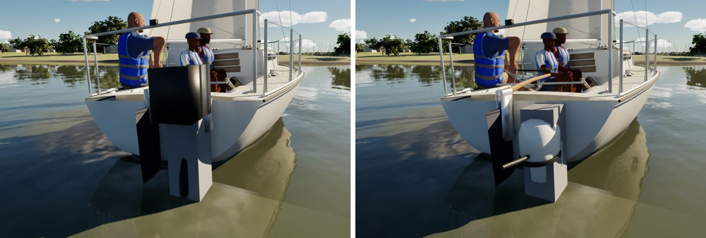
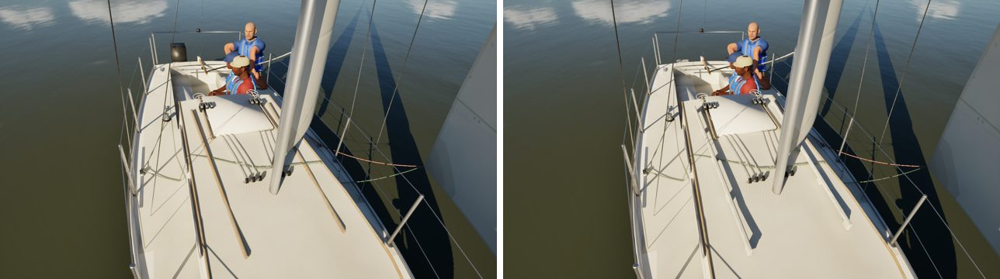
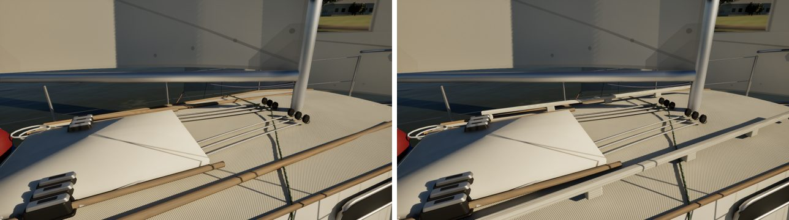
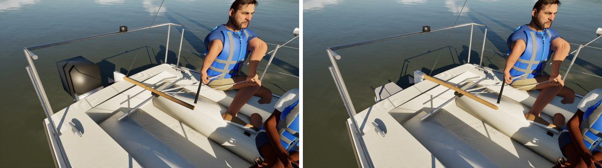

# Catalina 22, assembly by assembly (boat fidelity: pc/c22-fidelity)

The third fleet boat in the boat-fidelity queue, done with the Sunfish's method.

- **References:** there are no Bean C22 photos yet, so this pass works from the class layout and the Commons Catalina 22
  candidates already on this machine.
- **Comparisons:** reference, before and after for each assembly, in `compare/`. That folder is git-ignored and never
  committed.

The renders are the game at Ultra.

## What changed (`Tools/blender/build_fleet.py`)

| Assembly | Before | Now |
| --- | --- | --- |
| Outboard | three boxes and a cylinder | the shared kit's brand-free 3.5 hp four-stroke (cowl, midsection, foil leg, skeg, three-blade prop, tiller arm) clamped to the kit's two-position transom bracket on the starboard quarter |
| Cabin-top handrails | two round sticks | the kit's teak handrails, four hand holes each, along the trunk top |
| Forward hatch | a dark box | the kit's low acrylic hatch: frame, smoked lid, hinges, handles |
| Rudder head | a white box | the cast aluminium head #286 generalised from the Sunfish's, at 1.4 times the size and 45 cm tall on her high transom: cheeks on a through-bolt, the pintle's barrels on the pivot axis, the blade hung aft of it |
| Gudgeon | none | a stainless plate on the transom, its arm out to the pivot 2.4 cm off it |
| Tiller | a round stick | varnished, deeper than wide and tapering to a rounded grip, 1.0 m |

On the outboard's height: the bracket is set so the anti-cavitation plate is 10 cm under the water and the prop about
16 cm down, with the cowl's top a little under deck level, as a lowered long-shaft sits (the clamp is 0.52 m over the
plate). The physics' engine position is unchanged.

The handrails, hatch and outboard apply only to the Catalina 22. The Catalina 30 and the Corsair, which share the cabin
and outboard code, keep theirs until their own passes.

## Kept as they were

- **Sockets:** all unchanged (`Catalina22_sockets.json` identical), so there were no socket moves to report.
- **Measures:** FleetMesh's are unchanged.
- **Triangles:** hull 158,174 (Nanite), rudder 548 (was 340).
- **Material slots:** unchanged.
- **The berthed dresses:** not touched.

## Renders (before | after)

