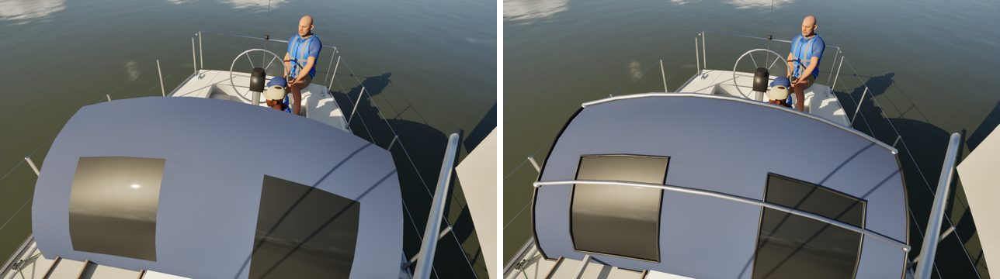
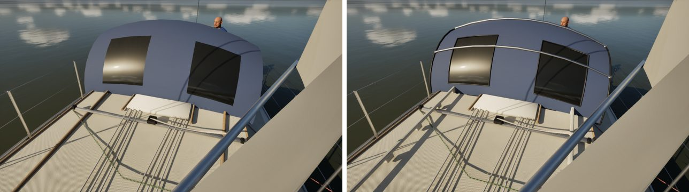
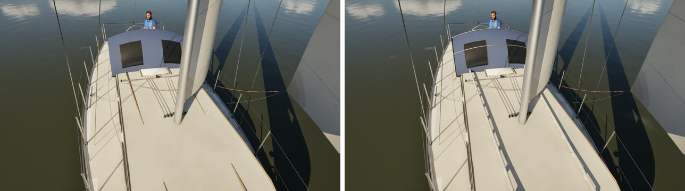

# Catalina 30, assembly by assembly (boat fidelity: pc/c30-fidelity)

The sixth fleet boat in the boat-fidelity queue, done with the Sunfish's method.

- **References:** there are no Bean C30 photos yet, so this pass works from the class layout and a Commons Catalina 30
  photo already on this machine.
- **Comparisons:** reference, before and after for each assembly, in `compare/`. That folder is git-ignored.

The renders are the game at Ultra.

## What changed (`Tools/blender/build_fleet.py`)

| Assembly | Before | Now |
| --- | --- | --- |
| Dodger | a bare canvas sheet with two dark squares | the same canvas on its stainless bows (one along the aft edge, one across the middle, their feet in deck fittings), a dark binding round its edges, the windows' stitched frames |
| Cabin-top handrails | two round sticks | the kit's teak handrails (#288's), a hand hole every 30 cm along the 30's long trunk |
| Forward hatch | a dark box | the kit's low acrylic hatch |

The wheel, binnacle and stern ladder (Boats 11) and the C30's wheel steering are as they were. The C22 keeps its four
hand holes, so its mesh is untouched.

## Kept as they were

- **Sockets:** all unchanged, so there were no socket moves to report.
- **Measures:** FleetMesh's are unchanged.
- **Triangles:** hull 185,494 (Nanite).
- **Material slots:** unchanged.
- **The berthed dresses:** not touched.

## Renders (before | after)

