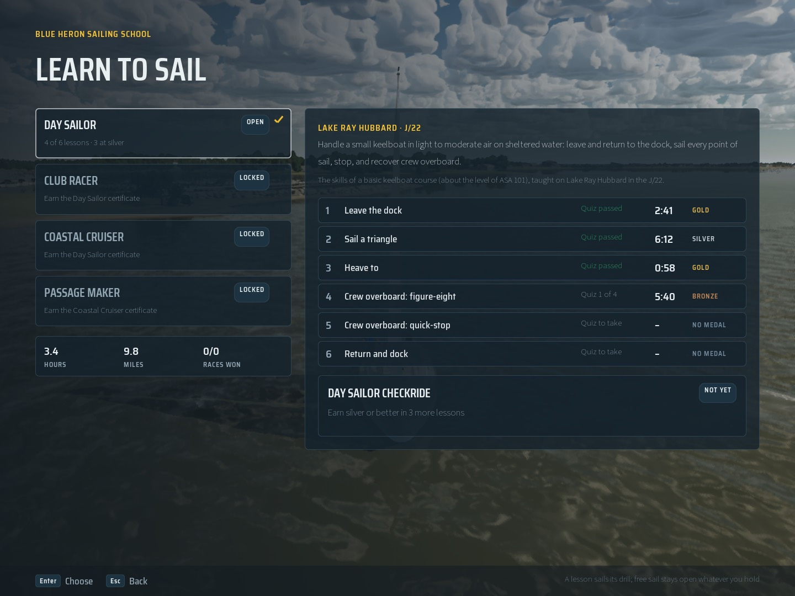
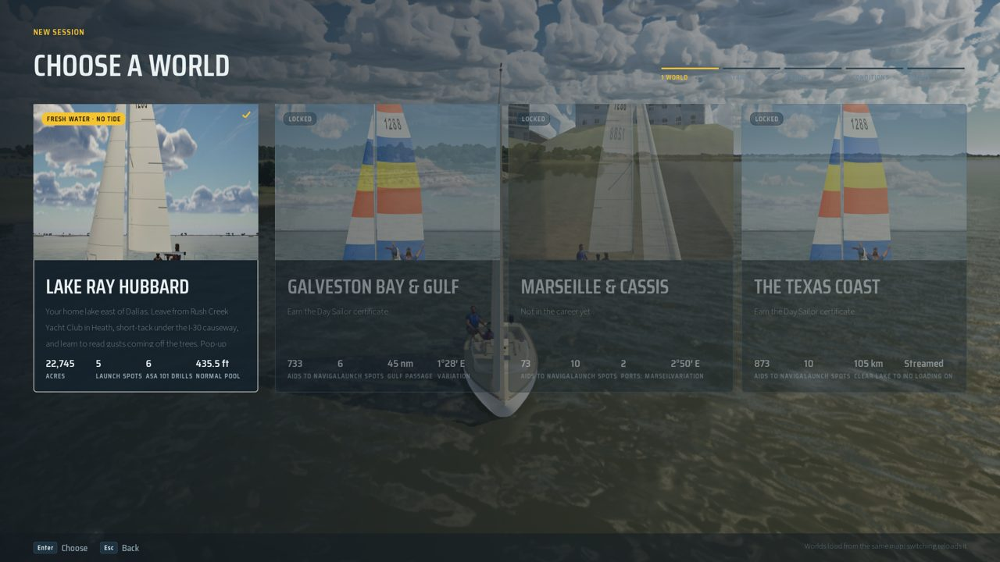
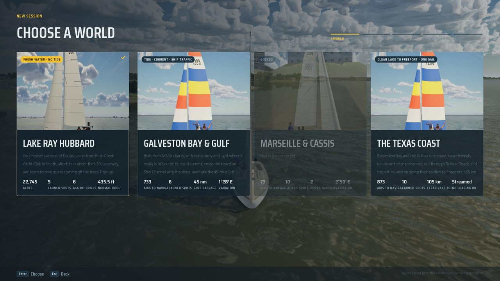

# The learn-to-sail career

The career mirrors real sailing certification. A **tier** is a course (Day Sailor, Club Racer, Coastal Cruiser,
Passage Maker); it has **lessons**, each a drill graded **bronze, silver or gold** and closed by its short quiz; a
**checkride** (every lesson at a minimum medal, then a written quiz); and the **certificate** the checkride awards, which
opens further tiers, worlds and boats. The title screen's other mode, **Free Sail** (`docs/free-sail/README.md`), opens
everything and records no medals; locks only grey out choices in the menus.

Career 1 filled in the Day Sailor tier (the six drills on Lake Ray Hubbard in the J/22); the Free Sail job filled in
Club Racer's Sunfish lessons (`docs/free-sail/README.md`). Coastal Cruiser and Passage Maker are stubs with their ids,
names, worlds and the boats the roadmap names, so the loader, the save and the tests see the whole shape.



*The Career screen with a save part way through Day Sailor (`docs/career/still-save.json`; the still is
`scripts/run-game.sh 6 -SailingFrontEnd=Career -SailingSave=SaveGames/career-still.json -SailingShot=career` after copying
that file into `Saved/SaveGames/`).*

## Where things are

| What | Where |
| --- | --- |
| Data (hand-edited) | `Content/Career/career.json`, staged loose like `Content/Learning` (`DefaultGame.ini`) |
| Validator (no game) | `python3 Tools/career/validate.py` |
| Logic (plain, no world) | `Career.h`: `FCareerContent` (load, validate, checkride quiz, grading), `FCareerProgress` (records, checkride, certificates, unlocks, session totals) |
| The game's edge | `SailCareer::*` in `Career.h`: the loaded content over `SailSaveStore::Progress()`, each record written to the save |
| Wiring | `ASailboatPawn` (a finished drill grades its lesson; `EndPlay` adds the session's hours), `ATrafficManager` (rules penalties during a drill, races sailed and won), `SSailFrontEnd` (Career screen, locks, quizzes, the title's Mode switch) |
| Save | `progress.lessons`, `progress.checkrides`, `progress.certificates`, `settings.career.freeSail` (`docs/save/README.md`) |
| Tests | `SailingSim.Career.*` in `Source/SailingSimTests/Private/CareerTests.cpp` |

## The data

```json
{
  "schema_version": 1,
  "school": "Blue Heron Sailing School",
  "medals": ["bronze", "silver", "gold"],
  "always_open": { "tiers": ["day-sailor"], "worlds": ["ray-hubbard"], "boats": ["J22"] },
  "tiers": [ {
    "id": "day-sailor", "name": "Day Sailor", "status": "ready",
    "summary": "...", "learning": "... (about the level of ASA 101) ...",
    "world": "ray-hubbard", "boats": ["J22"],
    "lessons": [ {
      "id": "day-sailor.leave-the-dock", "title": "Leave the dock",
      "drill": "LeaveTheDock", "quiz": "LeaveTheDock", "quiz_pass": 0.66,
      "medals": {
        "bronze": {},
        "silver": { "outcomes": ["clean"], "max_seconds": 300, "max_infractions": 0 },
        "gold":   { "outcomes": ["clean"], "max_seconds": 180, "max_collisions": 0, "max_infractions": 0 } } } ],
    "checkride": { "id": "day-sailor.checkride", "title": "Day Sailor checkride", "lessons": ["..."], "min_medal": "silver",
                   "quiz": { "drills": ["LeaveTheDock", "..."], "questions": 12, "pass": 0.8 } },
    "certificate": { "id": "day-sailor", "name": "Day Sailor certificate" },
    "unlocks": { "tiers": ["club-racer", "coastal-cruiser"], "worlds": [], "boats": [] } } ]
}
```

- **Ids are stable strings** (online rule 7): tiers `day-sailor`, lessons `<tier>.<name>`, checkrides `<tier>.checkride`,
  certificates the tier's id. The save keeps them, so never rename one; add a new one instead.
- `world` and `boats` are the save's ids (`FSailSave::WorldId`, `FSailSave::BoatId`: `ray-hubbard`, `galveston-bay`,
  `gulf`; `J22`, `Sunfish`, `ILCA7`, `Catalina22`, `Catalina30`, `Hobie16`, `Corsair880`, `Lagoon42`).
- `drill` and `quiz` are `Content/Learning` drill ids: the lesson runs that drill, and its quiz is that drill's quiz
  (`FLearningContent::MakeQuiz`, `quiz_after` questions).
- `status`: `ready` (lessons filled in) or `stub` (ids and names only: no checkride yet).
- ASA appears only in `learning` text (the trademark, used descriptively). Names in the game are generic.

## Grading

A medal comes from the sim's own result for the run (online rule 8: `FDrillRunner` and the boat's telemetry, never the
HUD), gathered by `MakeCareerRun`:

| Field | From |
| --- | --- |
| complete, outcome | `FDrillRunner::IsComplete`, `GetOutcome` (`clean`/`contact`, `done`, `proper`/`improper`, `gentle`/`hard`) |
| seconds | `FDrillRunner::GetElapsed`, on the sim clock |
| max contact | the hardest touch on a dock or hull during the drill, knots |
| collisions | contacts begun during the drill (`FBoatTelemetry::bCollision` rising edges) |
| infractions | rules-coach penalties (negative `FRulesCoach` scores) during the drill |

Each medal is a rule; an unset limit asks nothing. A run earns the best medal whose rule holds **and every medal below
it holds too**; a finished run always earns at least bronze when bronze is `{}`. The validator and
`FCareerContent::Validate` insist each medal asks at least what the one below asks.

The Day Sailor times are first guesses, checked against the autopilot's own runs: `SailingSim.Drills.SailATriangle`
sails the triangle in 4:36 (gold under 5:30, silver under 8:00), the quick-stop recovers in 0:51 (gold under 1:30),
heave-to holds in 0:27 (gold under 1:30). Tune them by playing; they live in the data.

**Easy mode earns at most bronze** (`"easy_max_medal": "bronze"` at the top of `career.json`, read by `FCareerContent`;
no field means no cap). The run carries its difficulty (`FCareerRun::bEasy`: the assists were on at any moment of the
drill) and `FCareerContent::Grade` caps it; the lesson remembers that its best medal was an Easy one (`medalEasy` in the
save) until the same medal or better is sailed on Realistic, and the Career screen shows it as "Easy: bronze". The
checkride asks for silver, so it needs the lessons sailed on Realistic; the screen says so. See `docs/easy-mode/README.md`.

A lesson keeps its best medal, its fastest medal run and its best quiz score. It is **closed** once it holds a medal and
its quiz has passed (`quiz_pass`, two thirds for Day Sailor). A run counts for a lesson when the lesson's tier is open
and the run's boat is one of the tier's boats (empty: any boat); the tier on the run's world is preferred.

## Checkride and certificate

The checkride is ready when every lesson it lists holds at least `min_medal` (silver for Day Sailor). Its written quiz
(`quiz`: `questions` drawn from the listed drills' questions and the general ones, `pass` as a share) is taken from the
Career screen. Passing it while ready awards the certificate, dated (UTC). A stub tier has no checkride. Both rules live
in `FCareerProgress` (`IsCheckrideReady`, `RecordCheckrideQuiz`), not the UI.

## What is open

- `always_open` tiers, worlds and boats, plus the world and boats of every always-open tier.
- A certificate opens its tier's `unlocks`: the tiers listed (and with them their world and boats), and any worlds and
  boats listed outright.
- **Free Sail** (the title screen's Mode switch, also Settings > Gameplay > Mode; `USailingSettings::bFreeSail`, saved as
  `settings.career.freeSail`; `-SailingFreeSail=0|1`) opens every tier, world and boat, and records no lesson, medal,
  quiz, checkride or certificate (`FCareerProgress`'s `bFreeSail`); the logbook and races still count. It replaced
  Career 1's Open everything switch, under which progress still counted (`docs/free-sail/README.md`).

With the current data: Day Sailor opens Club Racer and Coastal Cruiser, so the Sunfish, Galveston Bay and the Catalina 22
and 30, and outright the Texas coast (`texas-coast`, world streaming's one-piece bay and Gulf: Bean, Oct 20 2026, "Career
unlocks the Texas coast after the lake"; `SailingSim.Career.TexasCoastUnlock`); Marseille is not in the career yet (Free
Sail); Club Racer opens the ILCA 7; Coastal Cruiser opens Passage Maker, so the Gulf (the Passage mode). A world or boat that no certificate opens says
"Not in the career yet". Locks are applied by the menus only (World, Boat and Mode screens grey the card and say which
certificate opens it); command-line runs, benches and Continue are not locked.




Stills: `RESX=1920 RESY=1080 scripts/run-game.sh 6 -ForceRes -SailingFreeSail=0 -SailingFrontEnd=World
-SailingSave=<abs path>` with `docs/career/still-save-new.json` or `still-save-day-sailor.json` (copy them out first: a
run writes back to its save).

## The save

Version stays 1: the new fields read as empty from older files (`docs/save/README.md`, "Adding a field").

```json
"settings": { "career": { "freeSail": false } },
"progress": {
  "lessons": { "day-sailor.heave-to": { "medal": "gold", "medalEasy": false, "bestSeconds": 58, "runs": 1, "quizPassed": true, "quizBest": 3, "quizOf": 3 } },
  "checkrides": { "day-sailor.checkride": { "passed": true, "quizBest": 11, "quizOf": 12 } },
  "certificates": { "day-sailor": { "earnedAt": "2026-10-18T16:30:00.000Z" } },
  "hoursSailed": 3.4, "logbook": { "sessions": 5, "entries": 31, "nauticalMiles": 9.8 }, "racesSailed": 0, "racesWon": 0
}
```

Each record is keyed by its id in an object, so a later game's lessons and fields survive a write by this one. Hours
sailed come from the world clock (the boat's physics time, online rule 3) when the session ends (`ASailboatPawn::EndPlay`:
a map reload or quit), with the logbook's entries and miles; races sailed and won when a race is over.

## Adding a lesson or a tier

1. Write the drill in `FDrillRunner` and its briefing and quiz in `Inputs/drills` (copy to `Content/Learning`; `python3
   Inputs/drills/validate.py`). A lesson can only name a drill the learning content has.
2. Add the lesson to its tier in `Content/Career/career.json` with a new id, its medal rules and `quiz_pass`; add it to
   the checkride's `lessons`.
3. For a new tier: an id, `status: "stub"` until its lessons exist, its world and boats, a checkride id
   `<tier>.checkride`, a certificate, and a certificate somewhere whose `unlocks.tiers` lists it (or `always_open`).
4. `python3 Tools/career/validate.py`, then `scripts/test.sh SailingSim.Career`.

## Waiting on Bean

- **Which boats come later**: Passage Maker holds none; the Hobie 16, Corsair 880 and Lagoon 42 are in no tier yet (open
  in Free Sail). Add their ids to a tier's `boats` or `unlocks.boats`.
- **Club Racer's J/22 racing lessons** (starts, roundings, the rules): they need race drills first. The Sunfish is the
  dinghy (Bean, Oct 18); its lessons are in.
- **Real names**: the school is a placeholder ("Blue Heron Sailing School"); certificates use generic names.
- **Medal times**: first guesses (above); worth a pass after Bean has sailed them, on Easy and on Realistic.
- **Lesson content** for Coastal Cruiser and Passage Maker (stubs).

## Not covered yet

- The checkride is the lessons' medals plus a written quiz; there is no separate sailed checkride run.
- In Game mode the drill's quiz does not open, so a lesson's medal counts but the lesson stays open until it is sailed in
  Learning mode.
