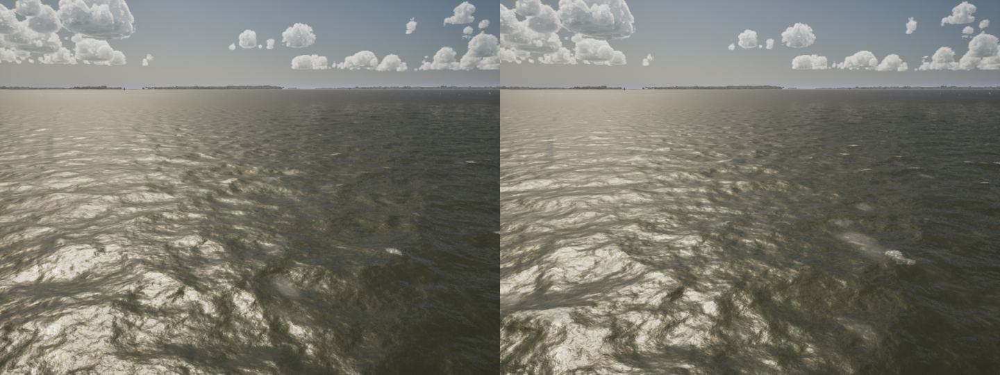
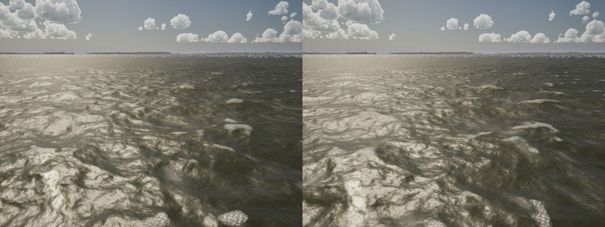
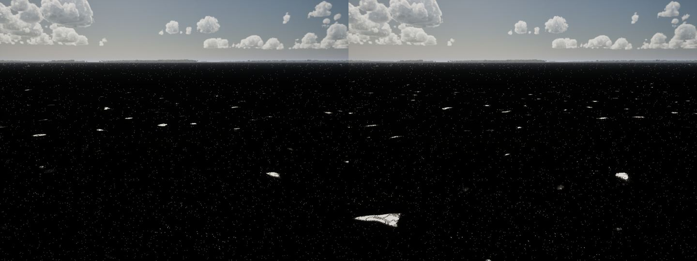
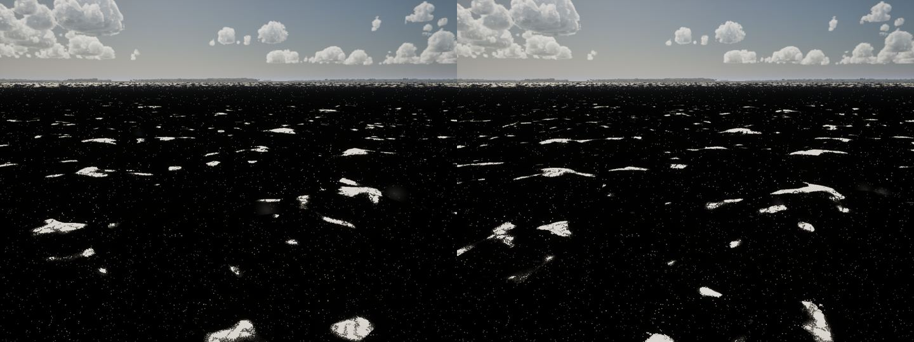

# The caps stop repeating every 23 m (storm-water step 4)

**Before:** the short waves were one FFT tile, 128^2 over 23 m, carrying everything from 0.4 to 4 m. Every crest, and
so every whitecap (they fold on that tile's blurred Jacobian), came back on a 23 m grid. From a boat at 20 kn and over,
the caps visibly repeated.

**Now:** the chop is split at 1.6 m onto two tiles with no common repeat (`FWaveDetail::ChopCascade`,
`LongChopCascade`). The sum is the same spectrum.

- **The chop:** 0.4-1.6 m on the 23 m tile, as before.
- **The long chop:** 1.6-4 m on a 128^2, 61.7 m tile whose axes are turned 37 deg (`FCascadeSpec::Rotation`; sampled
  through `ToGrid`, its displacement and slopes turned back). 61.7 / 23 is no simple ratio, and the turn moves its
  repeat off the chop's axes.
- **Its fold:** the long chop's whitecap Jacobian is the exact one. Its waves are wider than the caps' blur, and central
  differences on its 0.48 m texels halved a 1.6 m wave's slope.
- **What reads both:** the caps (`M_WaterV4`'s `jd`), the fold table (`JCapBoth`), the foam grid and the solved cap
  threshold all read both chops' folds. `M_WaterV4` samples the long chop in the vertex shader (height, displacement)
  and the pixel shader (slopes, fold): `DetailD`, `DetailE`, `DetailQ`.
- **Cost:** one more 128^2 FFT at 30 Hz on a worker, two texture fetches a pixel and one a vertex.
- **Comparison:** `-SailingOneChop` draws the one tile as before.

**Tests:**

- **Repeat:** `SailingSim.Visual.CapRepeat` builds the caps' mask (the threshold that caps 1% of the sea) at 20 kn over
  92 m and correlates it with itself one chop tile (23 m) along each axis. With the one tile it is 1.00 and 1.00; with
  the two cascades 0.00-0.01.
- **Cover:** the cover tests now read both chops (the test helpers sample the long chop as the shader does, `FoldInLong`
  as the renderer does), and nothing else needed a refit. `Whitecaps` covers are on Monahan: 1.07% at 20 kn against
  1.09%, 0.32% at 14 kn against 0.32%.
- **Also passing:** `WhitecapsSeen`, `WhitecapSize`, `WhitecapOnset` and `WaveMatch` (drawn Hs in the Phase 8 band).

**Stills** (lake, High, 13:00, low camera downwind; one tile left, two cascades right), at 20 and 35 kn, and the caps
alone (`-SailingDebugFoam`):

Not done: the plan's wave-group factor (caps clustering at the long waves' group peaks). The caps already gather on
the long waves' crests (their fold multiplies the chop's), and the two chops now beat against each other. An envelope
term would need another vertex-to-pixel value; it's left for the long-wave FFT (step 5), which brings real groups.
