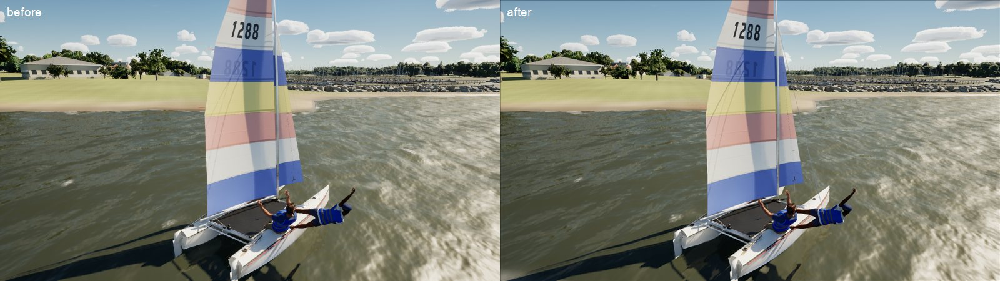

# Clipping audit (Bean's playtest, Oct 2026)

The Ultra clipping audit (all eight boats and the maxi; heeled, from above, the cockpit view, the crew close up, Gulf
swell; launch arguments only) and the fixes that came out of it.

## Hobie 16: the trapeze wire

The crew out on the trapeze hung from nothing: the mast model's trapeze wires (`build_fleet.py`) hang on their shock
cords over the trampoline. `ASailboatPawn::UpdateModelRig` now draws a wire from the hounds to the harness of each crew
member out beyond the rail (taut; a stub at the hounds when they are in on the boat, so the rig mesh keeps its vertex
count). It is drawn about 12 mm across, thicker than the real 3 mm wire: at the real size it vanished from the chase
camera (as the shrouds still do: a rig-wide visibility item for the boat fidelity phase).

Repro: `-SailingBoat=Hobie -SailingWind=18 -SailingTWA=60 -SailingHoldTWA=60 -SailingCamYaw=-40 -SailingCamPitch=-15
-SailingCamDist=7` (Ultra).
