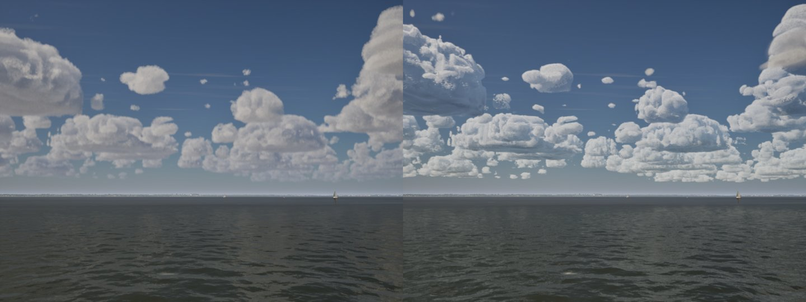

# Clouds switching after the start (playtest, Oct 27)

**What Bean saw:** the clouds first appear as soft, fluffy shapes, then suddenly turn more detailed and a little grainy.

**Why.** On Medium, High and Ultra the clouds past 5 km come from the sky cache (`docs/ultra-sky-cache/`), a panorama
drawn in strips. The first panorama took about 4 s and could only start once the first weather map was in, and the
loading screen let the player in as soon as the weather map was ready. For those first seconds the live volumetric clouds
drew the whole sky. To reach 15 km their rays get coarse steps (about 190 m on High), so they read soft and fluffy. When
the panorama finished, the far clouds switched to it (finer steps, crisper tops) and, in the same frame, the live clouds
were cut to 5 km with their steps refined to about 60 m. The whole sky changed at once in front of the player.

Left: the live clouds alone (what the first seconds showed, `-SailingNoSkyCache`). Right: after the hand-over.

**Fix.** The loading screen now waits for the first panorama too (`ASailingEnvironment::IsSkyReady`; it is ready at once
with no cache, or while a storm or a closed deck keeps the live clouds on the whole sky). The first panorama is drawn
four times as fast (0.8 s on High, against 3.96 s), behind the loading screen, so loading takes well under a second
longer. Later panoramas keep the 4 s refresh. The hand-over still happens in play when a storm or a deck clears, which
is rare and happens while the sky is changing anyway.

The light grain in the cached far clouds is the cache's own look on High (96 steps out to 40 km), not part of the
switch; it is left alone here.
