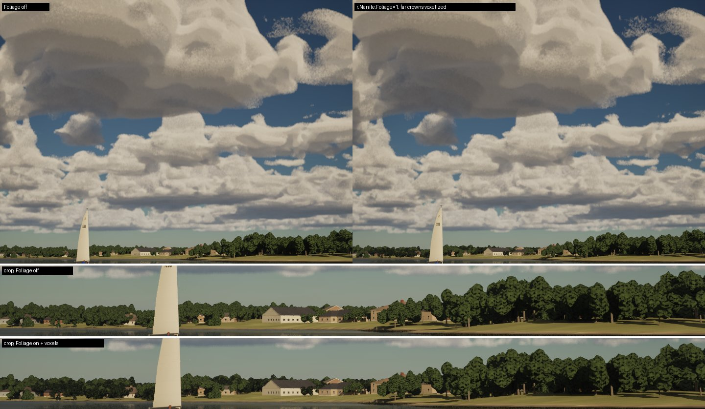
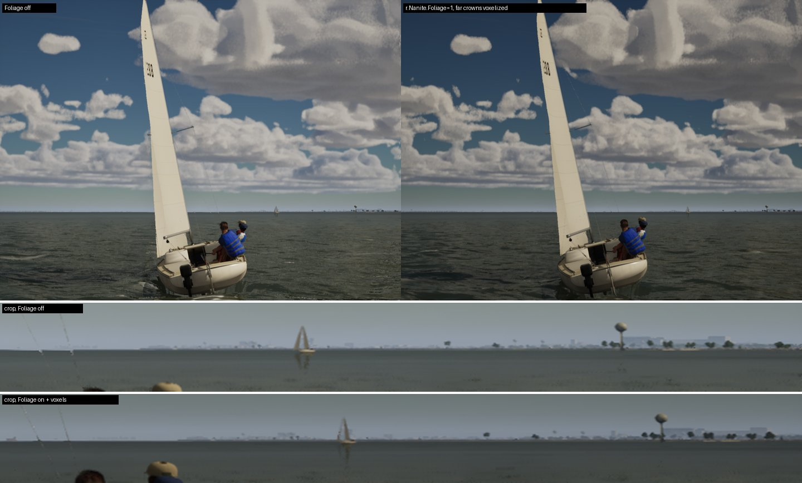
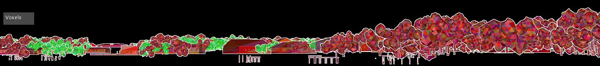

# Nanite Foliage on the Mac (T3 pre-check, Oct 17 2026)

The question from `Inputs/clouds-trees/plan.md` step T3: does Unreal 5.8's experimental Nanite Foliage run on this Mac
(Apple M5 Pro, Metal), on High, in this project? **Yes.** It turns on, its shaders compile, and voxelized tree crowns
draw on Metal. The GPU cost was the same as without it in both views (within 0.3 ms). Turning it on has two costs
elsewhere: every shader and every Nanite mesh gets rebuilt, and uncooked runs stall on distance-field rebuilds at
every launch.

## How 5.8 exposes it

- **One project setting, no plugin.** Project Settings > Rendering > Nanite > *Nanite Foliage (Experimental)* is
  `r.Nanite.Foliage` (`URendererSettings::bEnableNaniteFoliage`, `ConfigRestartRequired`). The cvar is read-only, so it
  can't be set from the console or through `-SailingExecAt`. It has to come from the ini at startup.
- **It turns on voxels and assemblies.** `NaniteVoxelsSupported()` is `r.Nanite.Foliage || r.Nanite.AllowVoxels`, and
  `NaniteAssembliesSupported()` is `r.Nanite.Foliage || r.Nanite.AllowAssemblies` (RenderUtils.cpp). Curves
  (`r.Nanite.AllowCurves`) are separate. TSR's thin-geometry path also checks the flag, but this project doesn't run
  TSR on the Mac.
- **Everything gets rebuilt.** Both flags feed the global shader key (`Shader.cpp`, "Voxels"/"Assemblies") and the
  Nanite DDC version (`_VOXEL2`, `_ASSEMBLIES3`). The first launch with it on recompiles every shader and rebuilds every
  Nanite mesh, and a packaged build needs a full recook.
- **Meshes and materials have to opt in.** A mesh voxelizes in the distance only with Nanite *Shape Preservation* =
  *Voxelize* (`FMeshNaniteSettings::ShapePreservation`; also `bVoxelNDF`, `bVoxelOpacity`, `VoxelLevel`, `NumRays`).
  Without the project flag, the mesh builder warns and drops Voxelize. Each material on the mesh needs *Used with
  Voxels* (`bUsedWithVoxels`). Otherwise the log says `missing usage flag Voxels! Default Material will be used in
  game`. Voxels rasterize only in fixed-function bins, "Fixed Function (Voxel)" (`NaniteCullRaster.cpp`): not
  two-sided, not spline meshes. They are dispatched inside "SW Rasterize (Triangles)", so `ProfileGPU` can't show them
  as a separate pass. `r.Nanite.Visualize Voxels` does show them.
- **No Metal gate.** Nothing in the engine's Mac config, `DataDrivenPlatformInfo.ini` or the renderer turns voxels or
  assemblies off for Metal. This project's Mac shader platform is METAL_SM6 (`DefaultEngine.ini` targets only
  `SF_METAL_SM6`).

## What I ran

Throwaway setup, nothing committed:

- The flag came from the command line:
  `-ini:Engine:[/Script/Engine.RendererSettings]:r.Nanite.Foliage=1`. The log shows `Set CVar [[r.Nanite.Foliage:1]]`
  and `r.Nanite.Foliage = "1" LastSetBy: ProjectSetting`.
- For the voxel runs, an editor Python script set *Voxelize* on the eight far crown meshes (`SM_<Species>_<n>_Far`,
  about 1,130 triangles each: the mid and far bands of `ALakeTerrainActor::PlaceCrownTrees`) and *Used with Voxels* on
  `M_TreeBark` and `M_TreeCrown`. All ten assets were restored from git afterwards.

The two views were round 12's `r12-lake-towers` and `r12-galv-texascity` (`docs/round-12/game/scenes.csv`), on High,
through `capture-scenes.sh` (uncooked, `run-game.sh`, 1440x1080, 30 s each). Each state ran once to compile and was then
measured on a warm run. The baseline was run twice, before and after; the two baseline runs agree within 0.2 fps.

| view | state | fps | p99 ms | worst ms | GPU frame ms (mean) | `ProfileGPU` total / base ms | distance fields rebuilt in the run |
|---|---|---|---|---|---|---|---|
| lake towers | Foliage off | 62.9 | 17.3 | 1338 | 14.70 | 15.94 / 5.35 | 0 |
| | Foliage on | 55.8 | 77.7 | 2521 | 14.61 | 15.99 / 6.11 | 13 |
| | on, far crowns voxelized | 55.8 | 54.7 | 2463 | 14.55 | 14.87 / 4.85 | 9 |
| Texas City | Foliage off | 46.2 | 23.7 | 1305 | 19.78 | 19.74 / 8.69 | 0 |
| | Foliage on | 44.4 | 38.5 | 1988 | 19.55 | 20.11 / 8.95 | 12 |
| | on, far crowns voxelized | 42.8 | 80.9 | 2470 | 19.49 | 19.59 / 8.72 | 11 |

`ProfileGPU` is three frames after the window, so its slices are noisier than the GPU frame mean.

## What it shows

- **It enables on Metal and the shaders compile.** No unsupported-RHI, feature-level or fallback messages, and no
  shader errors. The first launch with the flag compiled the global shaders in about 2 minutes (9 local workers) and
  rebuilt 827 static meshes for the lake (1,832 for Galveston). The game was running about 3 minutes after launch.
  Later launches load from the DDC.
- **Voxels draw.** With `r.Nanite.Visualize Voxels` (`nanite-foliage-voxels-view.jpg`, the towers view's shore), the
  distant crowns on the left are voxel clusters (green) and the nearer ones are triangles (red), as intended.
- **GPU: no change.** The GPU frame time is within 0.3 ms in both views and all three states. The voxelized crowns'
  base pass reads 0.5 ms lower in the towers view and the same at Texas City. That is inside `ProfileGPU`'s noise.
- **The fps loss is CPU, and it comes from running uncooked.** With the flag on, every launch rebuilds 9 to 13 mesh
  distance fields: the far tree crowns and some house tiles, logged as `0 triangles`. They are not kept in the DDC
  between launches. While they finish, the render thread is flushed: `FlushRenderingCommands called recursively`
  appears, and the game thread's water texture uploads rise from 0.03 to about 2 ms. That gives the 2.5 s stalls and
  the p99. A cooked build bakes its distance fields, so this probably goes away there. I didn't test that: it needs a
  full recook with the flag on.
- **Not visible at these distances.** The far crowns are low-poly blobs (about 1,130 triangles), so voxelizing them
  doesn't change their silhouettes. The crops in the stills don't differ beyond the frame-to-frame motion between runs.
  Voxels pay off on dense meshes whose leaves would otherwise thin out with distance. T2's trees would be those meshes,
  and T3 needs them to show anything.

## For T3

- On the Mac it's a go: it renders on Metal at no GPU cost with the current trees.
- It costs a one-time rebuild of every shader and every Nanite mesh when the flag goes into `DefaultEngine.ini`, on both
  machines and the package.
- Each tree mesh needs Voxelize, and its materials need Used with Voxels (`import_world.py`/`make_materials.py` would
  set them).
- The `_Far` crowns' sway (`M_TreeCrown` WPO) is already off past 1.5 km, and voxels drew in this view with it on
  nearer in.
- Still to measure: a cooked build (do the distance-field stalls go away?) and T2's dense trees, where the voxels are
  meant to hold the canopy's density at range.
