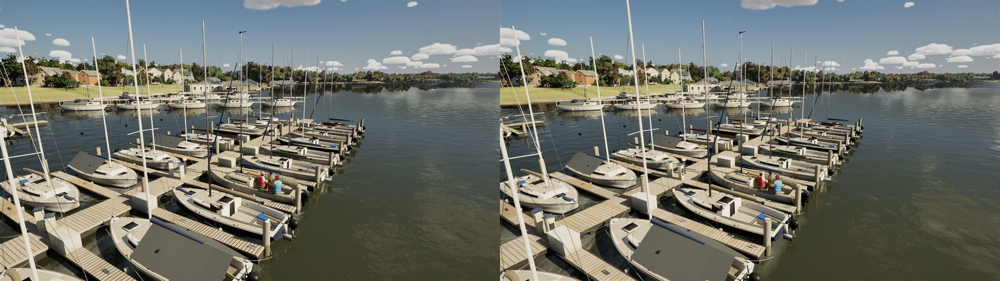
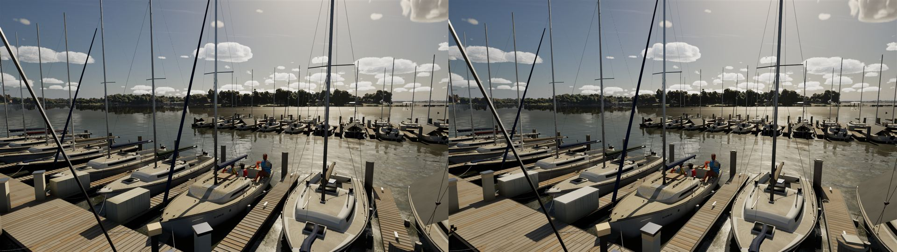
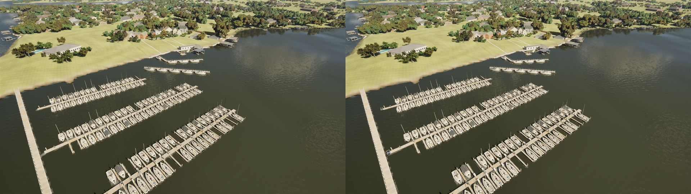

# Rush Creek club docks, pass 1 (slice #405 part 2: pc/club-docks)

The club's floating docks get their hardware, built by the marina's own generator (`AMarinaActor::BuildGeometry`) from
the same rows and slips in `Content/TerrainData/RayHubbard.marina.json`. So the layout, the home slip and the physics
obstacles (`FMarina`) are unchanged. The baked tiles (`/Game/World/Baked/SM_Marina_*`, `UWorldKitLibrary::BakeMarina`)
are rebaked from it. It uses only the existing `MI_World_*` looks, so there are no new materials or assets.

## Added

- **Float sections:** each dock row's deck in 6 m sections with a joint between them, on separate 2.4 m float modules
  with gaps that show at the waterline (it was one deck on one float).
- **Rub strips:** black, along every row and finger edge.
- **Pilings:** white caps; on the rows, a steel hoop round each piling from the dock's edge (an eight-segment ring, two
  arms) with two black rollers.
- **Cleats:** a cast base and two horns along the finger (they were a bar).
- **Power pedestals:** a dark meter face and an outlet plate toward the finger, and a lamp band under the cap.
- **Dock boxes:** a lid proud of the box, and its hasp.
- **Where a row meets the walkway:** a hinged transition plate with side rails.
- **Row ends:** a swim ladder into the water.

Fire extinguisher cabinets need a red look, so they wait for pass 2, which builds the hardware as real meshes.

## Triangles per 40 m tile

The 22 tiles hold 15,562 quads (about 31,000 triangles) of full Nanite detail in all. The bake's per-tile triangle counts
below are each mesh's LOD 0 as `get_num_triangles` reports it, the same measure before and after (Nanite's own fallback,
so far below the full detail). The busiest tile grew by 1.7 times. A whole tile is still a few thousand Nanite triangles,
trivial for the GPU; the Mac's High 45 fps gate is checked on its next run.

| Tile | Before | After |
| --- | ---: | ---: |
| SM_Marina_0_3 | 339 | 557 |
| SM_Marina_0_4 | 348 | 455 |
| SM_Marina_m1_2 | 838 | 809 |
| SM_Marina_m1_3 | 663 | 970 |
| SM_Marina_m1_4 | 792 | 1,105 |
| SM_Marina_m1_5 | 256 | 289 |
| SM_Marina_m2_3 | 724 | 1,241 |
| SM_Marina_m2_4 | 813 | 1,116 |
| SM_Marina_m2_5 | 470 | 811 |
| SM_Marina_m3_3 | 164 | 256 |
| SM_Marina_m3_4 | 112 | 252 |
| The other 11 (clubhouse, piers, walkway) | 1,807 | 1,807 |
| **All 22** | **7,326** | **9,668** |

## Stills

High, 11:00, uncooked. Before (main, left) and after (right, the rebaked tiles):

| | |
| --- | --- |
| The home slip |  |
| At dock level |  |
| The marina from above |  |

## Checked

MSVC build clean. `SailingSim.Lake.*` and `SailingSim.Smoke.*`: 36 of 36 pass.
