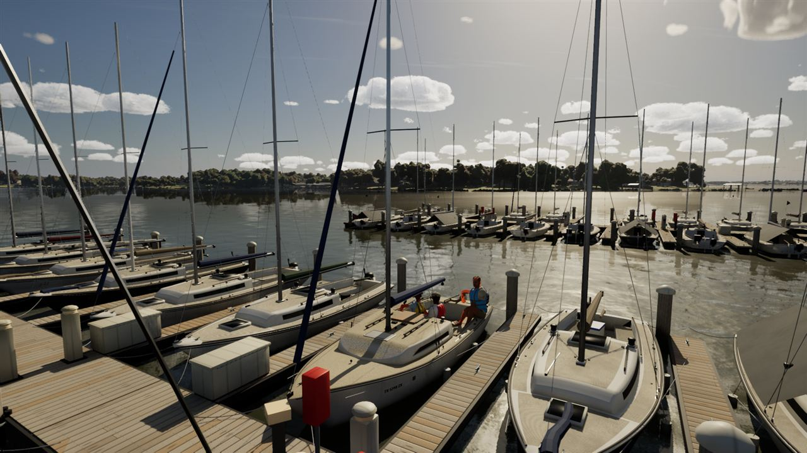

# Rush Creek club docks, pass 2 (slice #405 part 2: pc/club-docks-2)

The floating docks' hardware as real meshes, at real size, in place of the marina generator's kit boxes. The layout, the
home slip and the physics obstacles (`FMarina`) are unchanged.

## The kit (`Tools/blender/build_docks.py` -> `/Game/World/Docks`)

| Mesh | Triangles | What it is |
| --- | ---: | --- |
| `SM_Dock_Cleat` | 368 | a 10 in cast cleat: base plate, two splayed feet, the horn tapering to rounded ends |
| `SM_Dock_Pedestal` | 692 | a shore power pedestal: moulded post, meter window and two outlet covers toward the slip, lamp lens, domed cap |
| `SM_Dock_Box` | 460 | a moulded dock box: rounded body, the lid proud with a lip, hinge, hasp, dark toe kick |
| `SM_Dock_PilingCap` | 180 | a conical cap with its skirt over a 0.34 m piling |
| `SM_Dock_Hoop` | 720 | a steel hoop round the piling, two arms to a plate on the dock's edge, two black rollers |
| `SM_Dock_Ladder` | 704 | a stainless swim ladder off a row's end: rails bent onto the deck, four treads down to 1 m under water |
| `SM_Dock_Float` | 540 | a polyethylene float with moulded ribs (unit size, scaled per module) |
| `SM_Dock_Extinguisher` | 444 | a fire extinguisher cabinet on a post: red cabinet, window, label |

They're built by `scripts/make-world-models.sh` (`build_docks` in its generators) and imported by `import_world.py`
(`SM_Dock` -> `Docks`). The slots are `MI_World_*` looks: White, Steel, Dark, LampGlow, and the new `SafetyRed`
(`WORLD_LIBRARY` in `make_materials.py`).

## Placement

`AMarinaActor::DockKitPlacements` puts each mesh where the generator's boxes stood, from the same rows and slips, as
static instances: 780 in all.
- Two cleats per finger.
- A pedestal at every other slip, and an extinguisher cabinet at every other pedestal.
- Dock boxes where the slip's hash gives one.
- A cap on every piling, and a hoop on every row piling.
- A ladder at each row's end.
- Floats under every 2.4 m module and finger.

They draw within 150 m; the floats draw to 600 m. When the kit is in the content (`HasDockKit`), `BuildGeometry` and the
bake leave those boxes out, so they never draw twice. Without the kit, the boxes stay.

## Triangles per 40 m tile

With pass 1 merged in (main 16a0835b + #416), the baked tiles keep pass 1's deck sections, rub strips and walkway
plates and lose the boxes the kit replaces: 5,711 quads in 22 tiles (pass 1 alone had 15,562, pass 2 alone 4,161).
Counts are each mesh's LOD 0 by `get_num_triangles`, the Nanite fallback, the same measure in every column:

| Tile | Main (16a0835b) | Pass 1 alone | Pass 2 alone | Merged |
| --- | ---: | ---: | ---: | ---: |
| SM_Marina_0_3 | 339 | 557 | 256 | 396 |
| SM_Marina_0_4 | 348 | 455 | 306 | 331 |
| SM_Marina_m1_2 | 838 | 809 | 788 | 898 |
| SM_Marina_m1_3 | 663 | 970 | 339 | 854 |
| SM_Marina_m1_4 | 792 | 1,105 | 364 | 950 |
| SM_Marina_m1_5 | 256 | 289 | 156 | 256 |
| SM_Marina_m2_3 | 724 | 1,241 | 735 | 857 |
| SM_Marina_m2_4 | 813 | 1,116 | 374 | 975 |
| SM_Marina_m2_5 | 470 | 811 | 302 | 473 |
| SM_Marina_m3_3 | 164 | 256 | 162 | 242 |
| SM_Marina_m3_4 | 112 | 252 | 60 | 84 |
| The other 11 (clubhouse, piers, walkway) | 1,807 | 1,807 | 1,807 | 1,807 |
| **All 22** | **7,326** | **9,668** | **5,649** | **8,123** |

The kit adds 780 instances of 180-720 triangles each, drawn within 150 m (the floats to 600 m).

## Cost

The marina view (bench-phase3's camera, 40 m out, High, 1920x1080, 20 s), uncooked on the RTX 4090, in the same session:

| Build | fps | GPU frame | Game thread |
| --- | --- | --- | --- |
| main | 61.3, 62.2 | 6.39 ms | 12.4-12.6 ms |
| pass 2 (after its rebuild) | 62.5 | 6.39 ms | 12.6 ms |

There's no measurable cost. Pass 2's two runs before main's (55.2 and 59.2 fps, the GPU 6.4-6.7 ms) were the first
after a long pause. Uncooked frame rates aren't the packaged game's; the Mac's High 45 gate is the check.

## Stills

High, 11:00, uncooked. Before (main, left) and after (right, the rebaked tiles and the kit):

| | |
| --- | --- |
| The home slip |  |
| At dock level |  |
| The marina from above |  |

Merged with pass 1, at dock level (nothing drawn twice: one cap per piling, single pedestals and boxes, pass 1's
rub strips on the fingers):

## Notes

- `MI_World_SafetyRed` comes from `make_materials.py -Only build_world_surface` (a one-off stand-in while a stuck editor
  held `M_WorldSurface` was replaced after the PC's restart).
- Merged with pass 1 (#416): pass 1's kit boxes for the same hardware (floats, caps, hoops, ladders, cleats, dock boxes,
  pedestal faces) are skipped under `bDockKitMeshes`, and the marina is rebaked from the merged generator.

## Checked

MSVC build clean. `SailingSim.Lake.*` and `SailingSim.Smoke.*`: 36 of 36 pass, before and after the merge.
