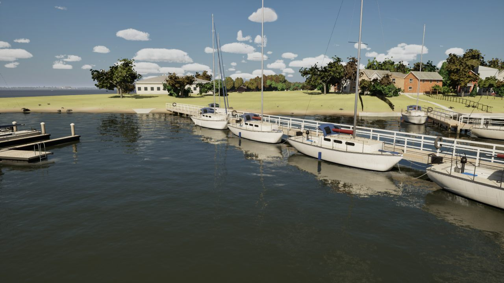
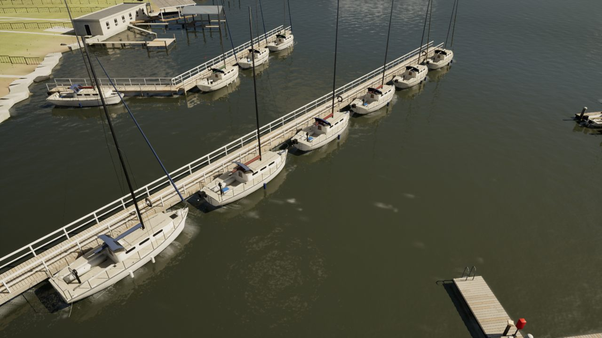
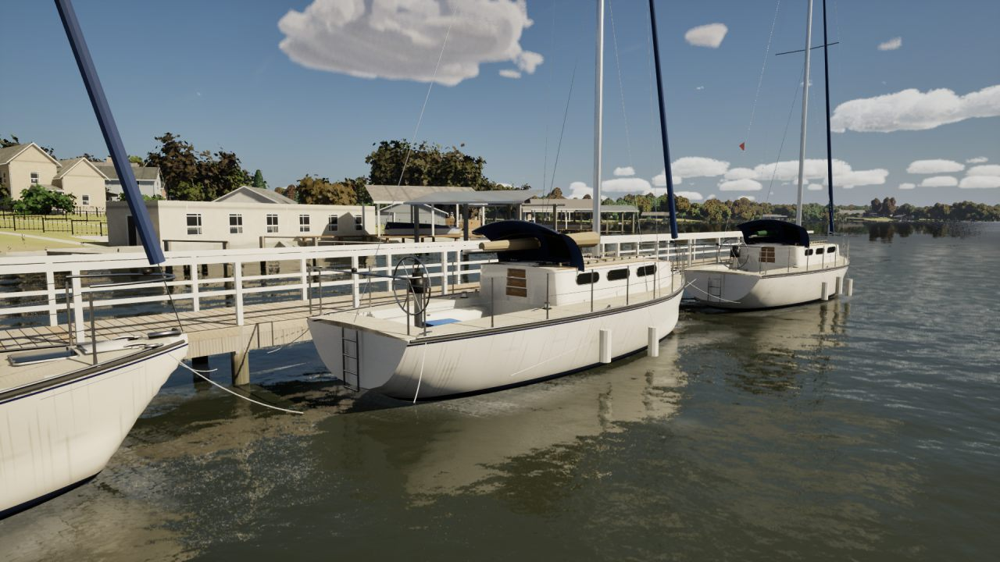
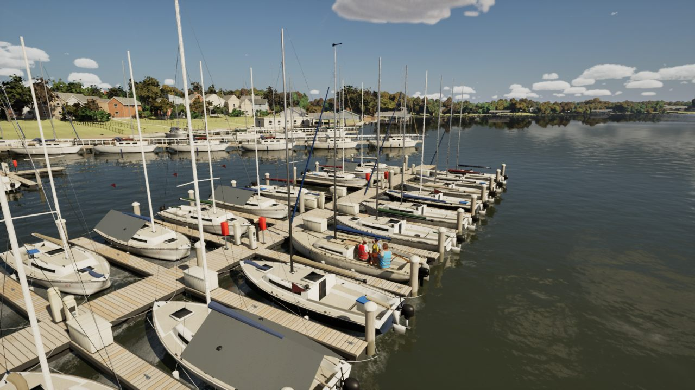
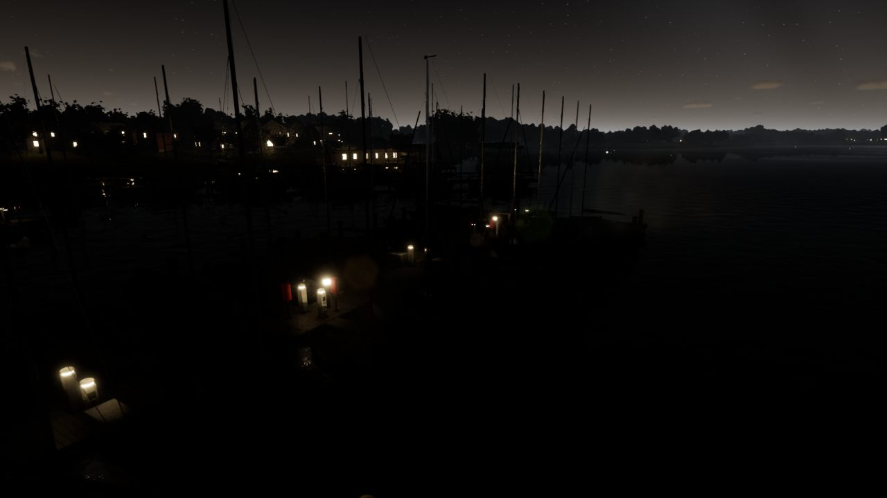
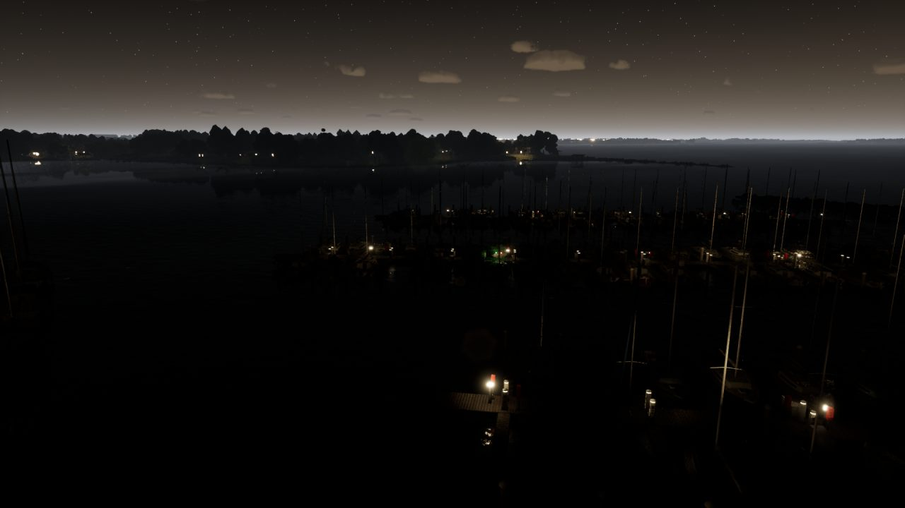

# Rush Creek club docks, pass 3 (pc/club-docks-3)

The fixed piers finished underneath, a concrete launch ramp beside the ramp pier, and lamps on the dock pedestals at
night. The floating docks, the home slip and the kit meshes are as pass 2 left them.

## What changed

- **Fixed piers and the walkway** (`AMarinaActor::BuildGeometry`): a timber pile cap across each 4 m bent under the
  deck, stringers along both edges, and the hand rails' middle course.
- **The launch ramp** (`FMarina::PlaceRamps`): a 5 m by 18 m concrete slab with kerbs beside each `*.ramp` pier, from
  dry ground down to 1.4 m under the water. Its head is walked back up the beach until the ground is at least 0.4 m
  above the water (`DryGround`), so it starts on land. `AMarinaActor` draws it and `FLakeData` makes it a physics
  obstacle, from the same placement.
  - Only the slab's dry part (the head to the waterline, 5.3 of 18 m at Rush Creek) stops a boat. Under the water the
    slab is no higher than the bottom a boat grounds on.
  - Catalina 30s lying alongside keep clear of a ramp (`PlaceRamps` runs before `PlaceAlongside`).
- **Pedestal lamps at night**: a fixture at each pedestal's lamp (every other slip). `ANightLightsActor` lights the
  nearest from its fixed pool (160 on High), so this adds no lights.

## The ramp pier in `RayHubbard.marina.json`

`rcyc.pier.ramp`'s shore end stood 36 m out from the beach, in 2.4 m of water. A ramp on the real shoreline then sat
36 m from its pier. The shore point moves along the pier's own line to the beach, from `[32.2, 166.3]` to
`[41.8, 135.8]`, so the pier is 32 m longer and the slab starts beside its landward end. `SailingSim.Lake.Marina`
checks that every drawn deck is still an obstacle, and that the ramp starts on dry ground with only its dry part an
obstacle.

## Triangles per 40 m tile

The marina rebaked on its own (`UWorldKitLibrary::BakeMarina`): 6,412 quads in 23 tiles. That's one tile more than
pass 2: `SM_Marina_1_3` holds the longer pier and the ramp's head. These are LOD 0 counts, the same measure as pass 2's
table.

| Tile | Pass 2 (main) | Pass 3 |
| --- | ---: | ---: |
| SM_Marina_0_1 | 130 | 158 |
| SM_Marina_0_3 | 396 | 531 |
| SM_Marina_0_4 | 331 | 366 |
| SM_Marina_0_5 | 432 | 492 |
| SM_Marina_1_3 | (none) | 168 |
| SM_Marina_1_4 | 473 | 603 |
| SM_Marina_1_5 | 385 | 477 |
| SM_Marina_m1_1 | 36 | 38 |
| SM_Marina_m1_2 | 898 | 970 |
| SM_Marina_m2_3 | 857 | 862 |
| SM_Marina_m3_3 | 242 | 256 |
| The other 12 | 3,943 | 3,943 |
| **All** | **8,123** | **8,864** (+9%) |

## Cost

Three views at High (1920x1080, 20 s), uncooked on the RTX 4090, from the baked world, all in one session, two runs
each. Main is 5382a5f2 (this branch's base). These are GPU frame times: uncooked frame rates swing about 5 fps from run
to run here.

| View | Main | Pass 3 | Change |
| --- | ---: | ---: | ---: |
| The marina (40 m out) | 6.66 ms | 6.60 ms | -0.9% |
| The home slip (16 m) | 6.79 ms | 6.80 ms | +0.2% |
| The marina at 21:00 | 6.02 ms | 6.06 ms | +0.7% |

That's within the noise. At +0.2%, the Mac's 45.7 fps in the slip view would be about 45.6, above the High floor of
45. The Mac's gate re-measures it.

## Stills

High, uncooked, the baked world.

| | |
| --- | --- |
| The ramp beside its pier, from the water |  |
| The ramp pier from above |  |
| The north pier close: pile caps, stringers, mid rail |  |
| The home slip |  |
| The home slip at 21:00: the pedestal lamps |  |
| The marina at 21:00 |  |

## Checked

- MSVC build clean, with no warnings from the project's code.
- `SailingSim.Lake.*`, `Smoke.*` and `Visual.*`: 104 of 104 pass. Six pass with warnings that were already there: the
  wind audio samples, world clean-up notes, the J/22 hero mesh's volume tolerance, and `GalvestonBay.detail`.
