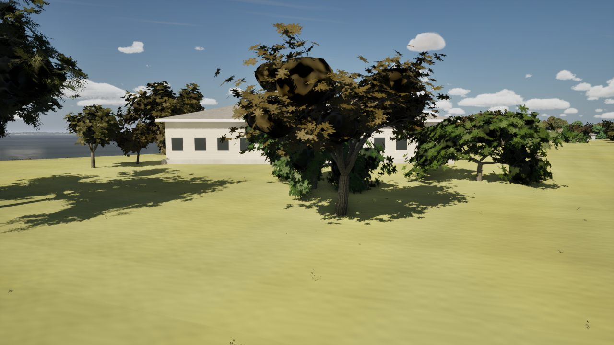
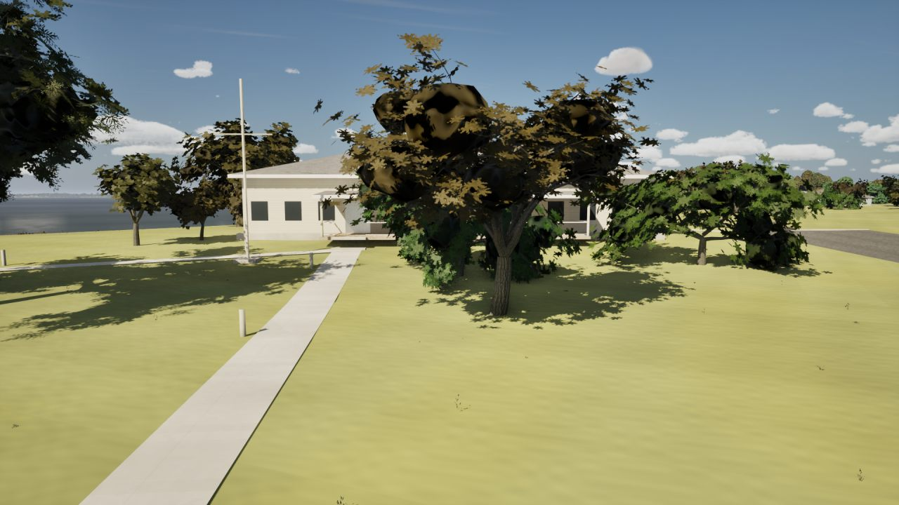
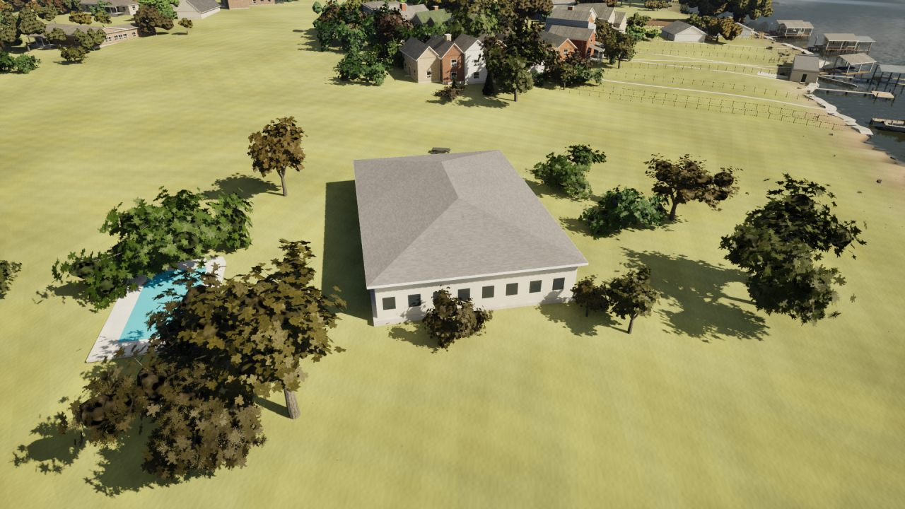
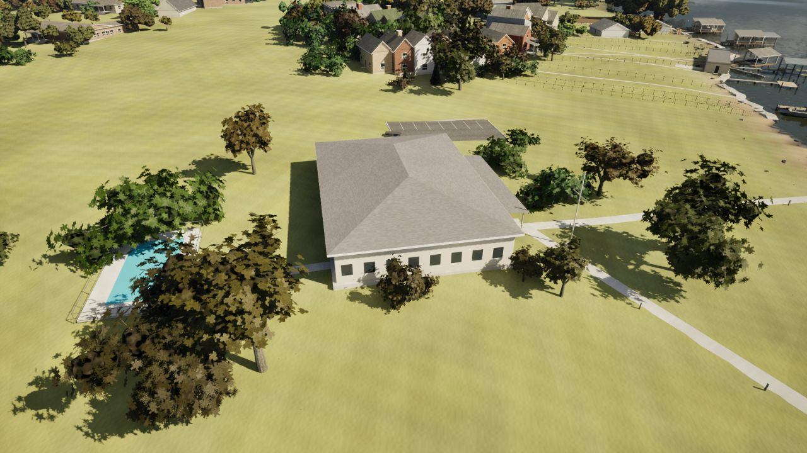
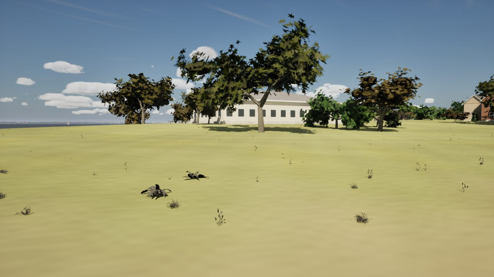
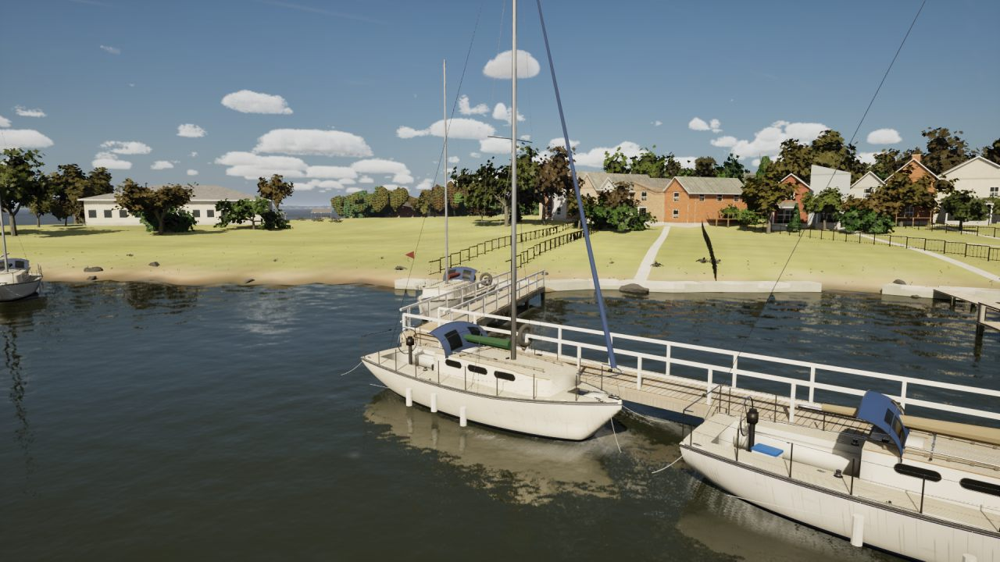
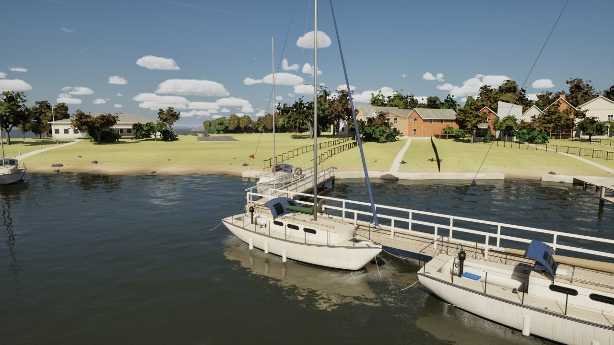
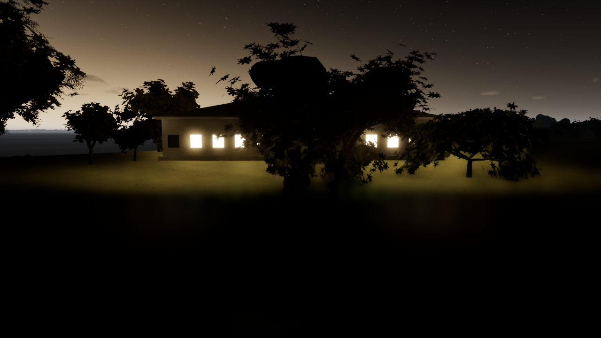
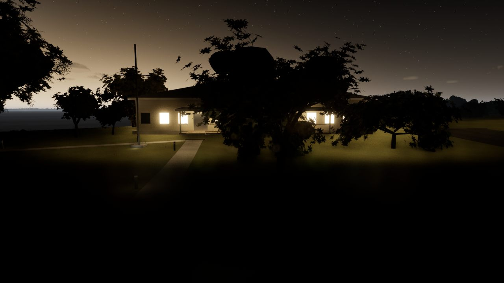

# Rush Creek club grounds (pc/marina-polish)

Until now the clubhouse was a plain box with a hip roof standing on bare lawn: no way in, no path to the docks, nowhere
to park, and a bare slab round the pool. This pass gives the club its grounds. It's all procedural in
`AMarinaActor::BuildGeometry` (the new `BuildClubGrounds`, plus a pool fence in the pool branch). It uses the existing
kit looks and adds no assets.

## What's built

- **Porch:** a covered porch along the clubhouse's dock side, 18 m by 4 m.
  - The deck is flush with the floor, with white posts, a rail with a gap at the steps, and a shed roof under the eaves
    over a ceiling.
  - Two lights hang under the roof.
  - Steps go down at the west end. There are double doors onto the porch, a door in the north-east end wall and one at
    the back.
- **Walks:** concrete walks, 1.8 m wide, run from the porch steps to the shore walkway's nearest end and to the ramp
  pier's landward end. A 1.5 m walk runs from the back door to the pool. Low bollard lights stand every 12 m along the
  dock walks.
- **Lot:** eight stalls of 2.7 m on a 6 m aisle past the north-east end. It is kerbed, its lines are painted, and a walk
  leads to the end door.
- **Flagpole:** the club's 10 m white pole with a 3.2 m yardarm, beside the walk, lit from its foot.
- **Pool:** a 1.2 m metal fence round the deck, with posts every 2.4 m and a gate gap at the back walk.

The walks and the lot follow the ground through `FLakeTerrain::HeightAt` (the lidar shore detail): slabs of up to 2 m,
or 2.7 m strips, each 3 to 4 cm above the ground at its ends, so nothing floats. Every light is a fixture in
`ANightLightsActor`'s fixed pool (160 on High), so this adds no lights.

## Placement and the marina footprint

The grounds are placed around the lidar crowns and the G6 houses near the clubhouse, from a probe of
`FLakeData::Crowns` and `Houses` within 90 to 120 m:
- No crown's trunk stands in the lot, a walk or the porch.
- The ramp walk starts at the porch's west steps, because from the middle it ran through the trunk at (70.2, 98.3).
- The nearest house is 50 m away (they start at x 133).

`FMarina::Bounds()` is the obstacle lines plus 20 m, so it reaches only x 81.5. The clubhouse (82.5, 79.1), the pool and
these grounds already sat just outside it. The OSM docks dropped inside the box are unaffected. **If someone widens
`Bounds()` later to take in the buildings, the grounds come with it**: check what else that drops.

## Triangles per 40 m tile

Marina-only rebake (`UWorldKitLibrary::BakeMarina`): 6,947 quads in 24 tiles (pass 3: 6,412 in 23). LOD 0 triangles go
from 8,864 to 9,590 (+726, +8%), all in the club's tiles:

| Tile | Pass 3 (main) | Polish |
| --- | ---: | ---: |
| SM_Marina_0_1 | 158 | 212 |
| SM_Marina_0_2 | 10 | 40 |
| SM_Marina_1_1 | 19 | 31 |
| SM_Marina_1_2 | 12 | 256 |
| SM_Marina_1_3 | 168 | 202 |
| SM_Marina_2_1 | 40 | 256 |
| SM_Marina_2_2 | 15 | 147 |
| SM_Marina_2_3 | (none) | 4 |
| The other 16 | 8,442 | 8,442 |

## Cost

High, 1920x1080, 20 s each, uncooked on the RTX 4090, from the baked world, all in one session. The order was polish
twice, then main d51a5196 twice, then polish once more. These are GPU frame times:

| View | Polish | Main |
| --- | ---: | ---: |
| The marina (40 m out) | 6.65, 6.66, 6.65 ms | 6.69, 7.15 ms |
| The home slip | 6.82, 6.80, 6.78 ms | 7.31, 7.33 ms |
| The marina at 21:00 | 6.04, 6.06, 6.05 ms | 6.53, 6.54 ms |
| The clubhouse from the water | 5.71, 5.74, 5.74 ms | 6.13, 6.18 ms |

Main came out 0.3 to 0.5 ms slower in every view, including the ones this doesn't change. I read that as the state
after the detached checkout (main's tiles reloaded) rather than a gain. The polish runs before and after main agree
within 0.05 ms and match pass 3's numbers from earlier the same day (6.60, 6.80 and 6.06 ms). **There's no measurable
cost, and the slip view is unchanged.** The Mac's gate re-measures it.

## Stills

High, 11:00 (the night pair at 21:00), uncooked, the baked world. Before on the left, after on the right.

| | |
| --- | --- |
|  |  |
|  |  |
|  |  |
|  |  |
|  |  |

## Checked

- MSVC build clean, with no warnings from the project's code.
- `SailingSim.Lake.*`, `Smoke.*` and `Visual.*`: 110 of 110 pass, 8 with warnings. Six were there before: the wind audio
  samples, world clean-up notes, the J/22 hero mesh's volume tolerance and `GalvestonBay.detail`. The two new ones are
  `Visual.RigClearance` and `Visual.SheetClearance`, each with
  `LogHttp: HTTP request timed out after 3.00 seconds URL=https://www.google.com/generate_204`. That's the engine's
  connectivity check timing out during the run, not the tests' own checks.
