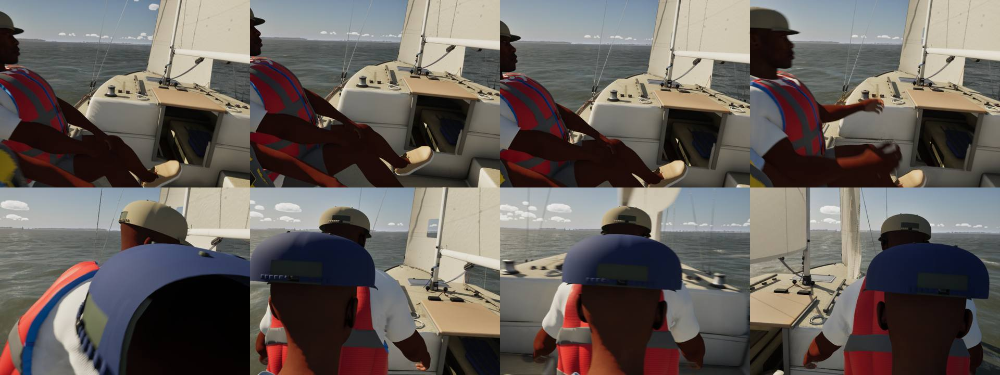
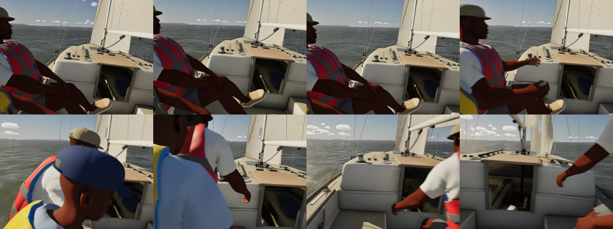

# The cockpit camera through a tack (brief: `Inputs/cockpit-camera/brief.md`, inputs branch)

**Before:** the cockpit view is the helm's own eyes. It sat on the hidden helm's raw head bone, so through a crossing
(`docs/crew-tack/`) it dropped with the helm's crouch to the height of the other crew's heads, bobbed with every step,
and ended a few centimetres behind the trimmer's cap.

**Now:** `FCockpitEye` (`CockpitEye.h`, plain logic) steadies the eye that `ASailboatPawn::UpdateCockpitCamera` feeds
it (the head bone plus the eyes' offset, as before):

- **Across and fore and aft:** critically damped springs, soft through the crossing (omega 6, about a second to settle,
  and across one way only), stiff outside it (omega 30, so steady sailing looks as it did: within 1 cm of the head),
  handing back over 1.5 s after the crossing.
- **Height:** through the crossing the eye goes down only 40 % of the head's drop, on a soft spring (omega 4) that
  takes out the steps' bob. It stays 15 cm under the boom's underside where the boom is over it, and starts down when
  the boom is within a metre across (a quicker spring then), so the clamp seldom binds.
- **A gap:** for any other sailor's head ahead of or beside the eye nearer than 45 cm, the eye eases aft until it is 45 cm
  away (in over 0.15 s, out over 0.5 s). It never goes forward and never leaves the cockpit well. Where the well's end
  stops it, it lifts up to 10 cm, still under the boom.
- **A look into the turn:** the turn rate x 0.5 s, at most 15 deg, through a spring (omega 6). It is off while the
  player has turned the view in the last 2 s.
- **Resets:** switching the view on, or any jump over a metre (a teleport, a new boat), starts it at the head.
  `-SailingCockpitRaw` is the old raw head eye, for comparison.

The head lean and acceleration sway stay as they were, applied after.

**Test.** `SailingSim.Visual.CockpitEye` runs a J/22 tack and gybe at 60 Hz with her three crew posed (SK_Sailor) and the
eye fed the helm's head:

| Check | Tack | Gybe |
|---|---|---|
| Closest other head (at least 35 cm) | 35.6 cm | 36.5 cm |
| Under the boom (at least 15 cm) | 15.0 cm | 15.0 cm |
| Bob over the steps, away from the boom (under 3 cm) | 1.0 cm | 0.9 cm |
| Back toward the old side | 0.00 cm | 0.00 cm |
| Back on the head 1.5 s after (under 2 cm) | 1.2 cm | 1.1 cm |
| Look lead | 13.4 deg | 5.7 deg |

At rest, with the head swaying, the eye stays within 1 cm of it. All 68 `SailingSim.Visual` tests pass.

The brief also asks for the Catalina 22, Catalina 30 and Hobie 16. The test covers the J/22 only: the other boats'
crossings use the same code, but they are not measured here.

**Stills:** a demo tack at 12 kn from the cockpit, every 0.375 s from 9.75 s of sim time (`-SailingCockpit -SailingDemo
-SailingShotCrew=<name> -SailingShotAtSim=<s>`). Before (raw head):

After:

Before, the second row is the back of the trimmer's cap and head filling the view. After, the crew cross in front at a
distance; in one frame the trimmer's shoulder is still close as they pass. The gap keeps heads away, not bodies.

Also in this PR: main's `UpdatePhotoSettings` loop (`for (TActorIterator...; ++It) { ...; break; }`, from #370) failed
clang's `-Wunreachable-code-loop-increment` whenever `SailboatPawn.cpp` compiled on its own. It is now an `if`.
