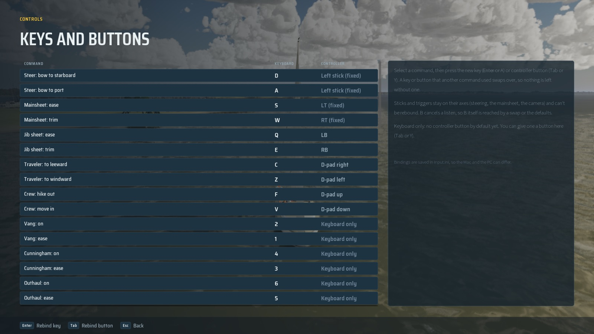

# Controls: "Keyboard only" (#497)

Bean's call (Nov 6 2026): for the slice, the boat commands with no controller button stay on the keyboard. On the
Controls screen their controller column read a dash; it now reads **Keyboard only** (`SailingBindings::PadColumnText`),
and the side panel says a button can still be given to one there (Tab or Y). A command driven by a stick or trigger
keeps "<axis> (fixed)".

Rows that read Keyboard only by default: vang, cunningham and outhaul (on and ease), spinnaker, reef, the board,
righting, engine neutral and twin-engine steering (both ways). A hold-to-shift controller layer for them is #497,
after the slice.

`SailingSim.UI.KeyboardOnlyRows` checks the board, spinnaker, reef, righting, engine neutral and twin-engine steering
rows, and that a button and a fixed stick read as before.

Still: `RESX=1920 RESY=1080 scripts/run-game.sh 6 -ForceRes -SailingFrontEnd=Controls -SailingShot=controls-keyboard-only`.
