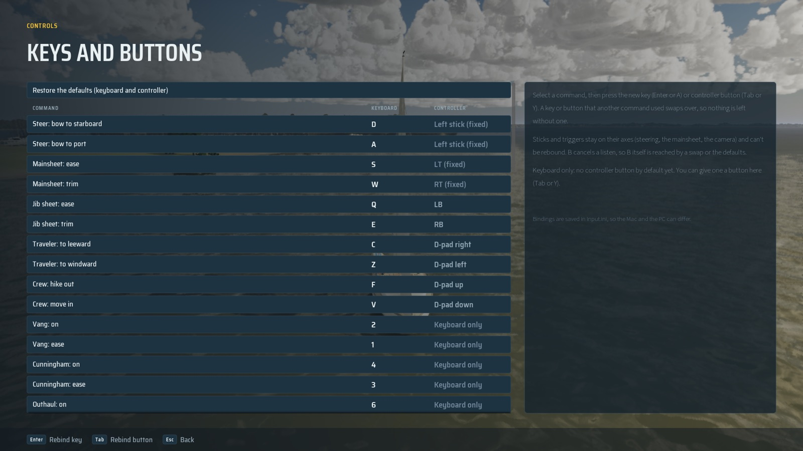

# Controls: Restore the defaults at the top (Bean, Nov 7 2026)

"Restore the defaults (keyboard and controller)" sits above the command rows on the Controls screen, so it no longer
hides at the bottom of a long list. The screen still opens with the focus on the first command; Up from it reaches
Restore, and after a restore the focus stays on the button. Its behaviour is unchanged (`ASailboatPawn::ResetKeys`).

Still: `RESX=1920 RESY=1080 scripts/run-game.sh 6 -ForceRes -SailingFrontEnd=Controls -SailingShot=controls-restore-top`.
