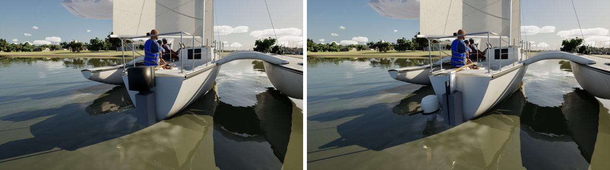
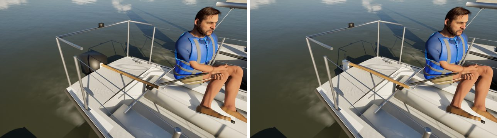
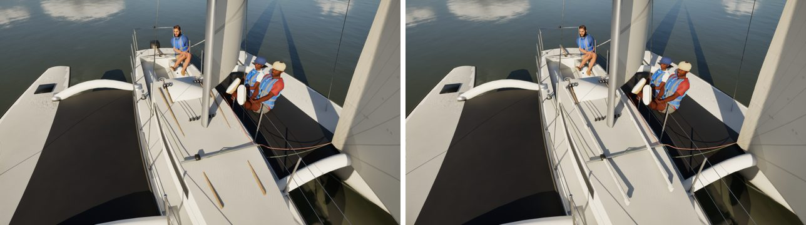

# Corsair 880, assembly by assembly (boat fidelity: pc/corsair-fidelity)

The fifth fleet boat in the boat-fidelity queue, done with the Sunfish's method.

- **References:** there are no Bean Corsair photos yet, so this pass works from the class layout and a CC0 Commons Corsair
  photo already on this machine.
- **Comparisons:** reference, before and after for each assembly, in `compare/`. That folder is git-ignored.

The Corsair shares the keelboat code with the Catalinas, so she takes the C22's new parts (#288). The renders are the
game at Ultra.

## What changed (`Tools/blender/build_fleet.py`)

| Assembly | Before | Now |
| --- | --- | --- |
| Outboard | two boxes on the centreline, through the rudder | the kit's brand-free 3.5 hp four-stroke on its two-position bracket, on the port quarter, the anti-cavitation plate 10 cm under |
| Rudder head | a white box | the cast aluminium head at the C22's size (45 cm tall, 1.4 times the dinghies'), a gudgeon arm to the pivot, the blade hung aft of the pintle |
| Tiller | a round stick | varnished, deeper than wide, tapered |
| Cabin-top handrails | two round sticks | the kit's teak handrails, four hand holes each |
| Forward hatch | a dark box | the kit's low acrylic hatch |

The physics' engine is on the centreline, where the rudder hangs, so the visual outboard goes on the port quarter. The
engine position in the physics is unchanged.

## Kept as they were

- **Sockets:** all unchanged, so there were no socket moves to report.
- **Measures:** FleetMesh's are unchanged.
- **Triangles:** hull 199,038 (Nanite), rudder 548.
- **Material slots:** unchanged.

## Renders (before | after)

