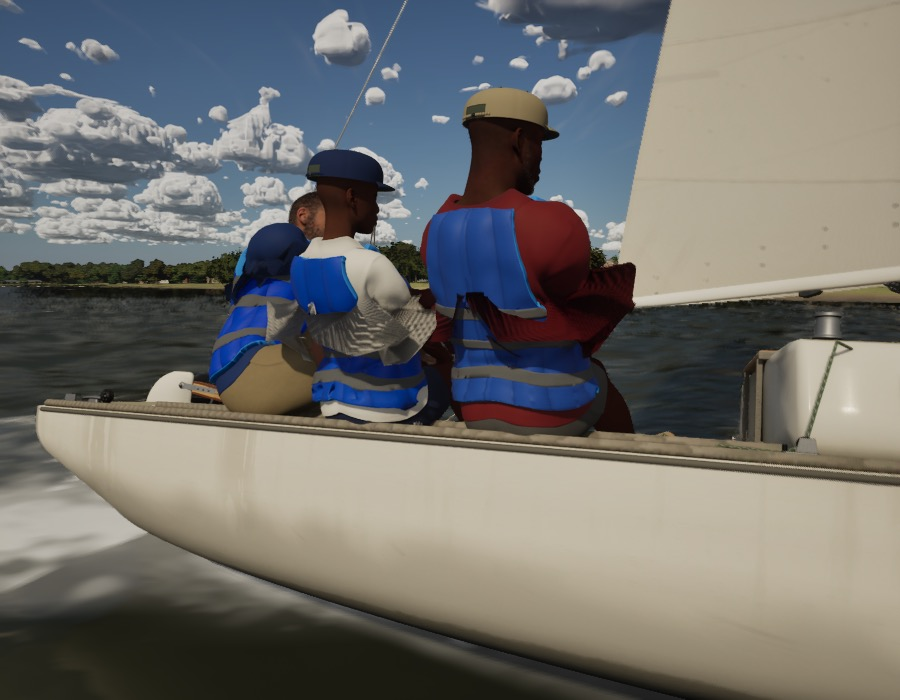
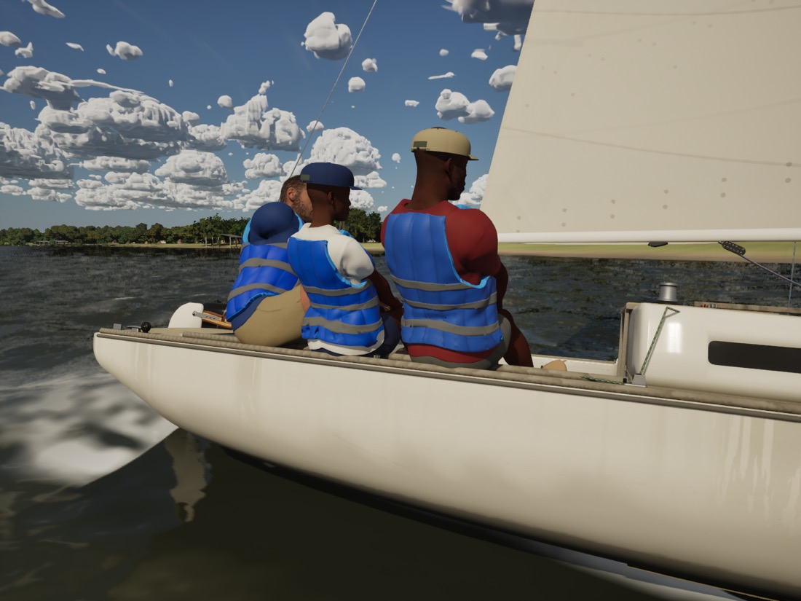

# Crew cloth in the wind (Ultra audit item 7)

The Ultra audit (docs/ultra-audit-1024/) found the crew's clothes rigid: nothing moved with the wind or the boat. This
moves the part of a sailor's clothes that hangs free, the polo's hem below the life jacket and its cuffs. The life jacket
(stiff foam over the polo), the cap and the shorts don't flap, and stay still.

## Where the cloth is free

`Tools/blender/crew_looseness.py` (run by `scripts/make-crew-clothes.sh` after the vest) writes each polo vertex's looseness
into its colour's red channel: 1 at the hem (the polo's lowest band: it is folded and closed, so not an open edge) and at
the cuffs (the open loops furthest out on each side), falling to 0 ten centimetres up the cloth, measured along the mesh.
The collar and the torso cut away under the life jacket stay at 0 (the cut's loop is the lowest open loop: taking it for
the hem moved cloth under the jacket, which could poke through it). It is the only colour set, as the outfit's export
carried a white one and Unreal's FBX import takes the first. `scripts/import_crew_clothes.py` imports the colours.

## How it moves (M_CrewFabric, world position offset)

- **Flutter.** A free edge flaps above an onset speed (about 3 m/s for a light knit), at a Strouhal frequency
  f = St U / c (St 0.2, c the 10 cm flap: 16 Hz in 8 m/s of apparent wind), amplitude about 0.15 c (1.5 cm), as a wave
  running downwind at half the wind's speed, along the cloth's normal. The edge also trails downwind with the dynamic
  pressure (up to 5 mm).
- **Lag.** The flap rings on its own stiffness at about 4 Hz, so it hangs back from the boat's acceleration a by
  a / omega^2 (5 mm at 3 m/s^2).
- The pawn feeds each polo's instances the apparent wind and the boat's acceleration in the world (`WindWS`, `AccelWS`,
  `UpdateCrewFigures`). Every other instance of M_CrewFabric leaves them at 0 and doesn't move. `-SailingStiffCrewCloth`
  compares.

The movement is physically small: a centimetre or two at the hem and cuffs, a shimmer in a breeze at helm-eye range,
not visible from the chase camera. `looseness-test.jpg` is a debugging still with the offset set to 20 cm wherever the
wind reaches, to show where it acts: only the polos' hems and cuffs, not the life jackets, caps or shorts.

## Measured

Tests 236/236, with the new `SailingSim.Visual.CrewClothLooseness` (each polo: the hem band loose, the collar not, a
tenth or so of the cloth loose). `scripts/gate.sh --scope crew` passes (High: beat15 56.9, helm-eye 56.1, slip 52.1, crew
52.6). The flutter costs nothing measurable: helm-eye on High at 16.50-16.61 ms GPU either way.

## For the PC

The polos are git-ignored MetaHuman assets: re-pack the crew (`scripts/pack-metahumans.sh`) for the PC to get the colours.
Without them the material sees no looseness and nothing moves (the colour reads white only on meshes with no colours,
which the pawn doesn't drive).

## Not here

The audit's "poses read as held" is the crew motion system (C1's balance and the CMU idle clips); this pass is the cloth.

