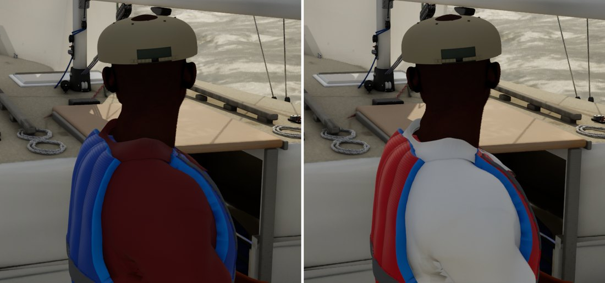
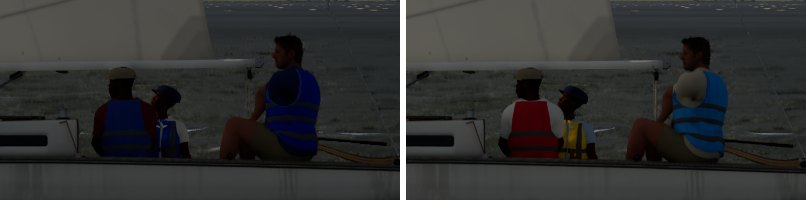

# Crew colours

Backlit-fill's findings (Ultra audit item 2's GI half): the crew read near-black backlit mostly because of what they
wore. The polos were navy and maroon (linear albedo 0.03-0.06) and the life jackets the sailing school's royal blue.
Lumen's fill on them was close to right. Bean picked the fix: **"Lighter mix"**. Each sailor wears a light polo and a
bright life jacket (yellow, red or light blue), varied between boats.

## What changed

- `CrewOutfit.h/.cpp`: the palettes and `SampleCrewOutfit(seed, sailor)`.
  - **Polos** (linear albedo, luma 0.4-0.8): white, ice grey, stone, pale blue, sky, aqua, soft yellow, pale pink, sage.
    These are the light tops club and school crews wear in the sun.
  - **Life jackets**: yellow, red and light blue nylon shells, each new and sun-faded.
  - **Seeding** as the livery (`BoatLivery.h`): the pawn keeps the livery's seed (`CrewSeed`). Seed 0, the player's
    boat, is a fixed set: white polo and red jacket, pale blue and yellow, stone and light blue. AI boats draw from their
    unique id: a different polo for each sailor, the three jacket colours in turn, a new or faded shade.
    `-SailingLiverySeed=<n>` picks one for stills. (Marina neighbours carry no crew figures.)
- `ASailboatPawn`: the MetaHumans' polo (`Color` on each polo slot, the rib a shade darker) and the tailored life
  jacket's shell (`PFD`), or the rigid stand-in jacket, take the outfit. The SK_Sailor figures (AI boats, Low) take the
  polo colour on their top (`Jacket` slot) and the jacket colour on their `PFD` slot.
- All of it is runtime material parameters. No colour lives only in the Mac's git-ignored MetaHuman outfit assets: the
  MetaHumans' own T-shirt is hidden under the scripted polo, and its old colours are untouched.
- Test: `SailingSim.Visual.CrewOutfit`. Polos light (luma over 0.35) and jackets bright; seed 0 fixed with three jacket
  colours; AI seeds deterministic, three colours and three polos for a crew of three, every polo first on some boat.

## Before and after (Ultra, `-SailingCloudShade=0.15`, the audit's backlit views)

Before (main, left) and after (right):

| Helm eye | Chase (the crew) |
| --- | --- |
|  |  |

The skin is unchanged (the MetaHumans' own). Its backlight transmission is the next PR, `pc/skin-backlight`.

## Checks

Full suite 236/236 on the PC (MSVC clean), with `SailingSim.Visual.CrewOutfit` new.
