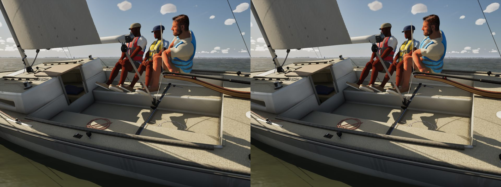
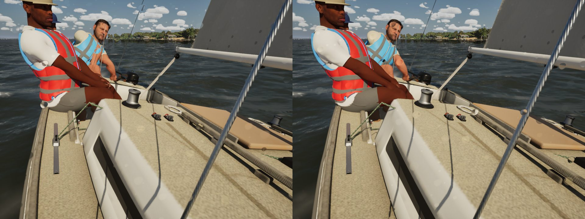

# Crew elbows and knees on a hinge (playtest, Oct 27)

**What Bean saw:** the crew's arms often bent backwards at the elbow, which no arm can do.

**Why.** Every held hand and every placed foot goes through one two-bone solve, `CrewSolver::ReachArm` (`CrewPose.cpp`).
It put the elbow in the plane the stance had it in, then turned the forearm straight at the target with a
shortest-arc rotation about any axis. The elbow had no hinge. When the target lay across that plane, the forearm folded
the wrong way. The held-line search also swung the elbow freely round the reach (60 deg either way), limited only by
"not above the shoulder". Knees went through the same function.

**Fix.** The middle joint is a hinge now:

- **The hinge axis:** each joint's axis comes from the rig. The elbow turns about the character's up (+ left, - right),
  because the T-posed forearm swings forward. The knee turns about the character's right, read off the hips so it holds
  for every rig's frame (`LimbHinge`).
- **The bend plane:** the elbow goes in the stance's bend plane where that lies within 75 deg of where the arm's own
  hinge puts it. That is roughly the shoulder's and hip's range of rotation. An asked bend (a dinghy's knees up under
  the strap) is taken as asked.
- **The upper arm:** aimed with its hinge square to that plane, so the forearm reaches the target by turning about the
  hinge alone. Flexion runs from straight to 145 deg (the knee 160: a deep squat, a Sunfish sailor's feet tucked under
  the strap beside the hips). It never goes backwards; a target too close leaves the joint at its limit.
- **The held line:** the search for a square grip keeps its 10 deg steps, up to 60 deg from the stance's elbow and
  inside the 75 deg range.
- **The strap foot:** turning the thigh to put a knee up rolled the foot onto its side, so the foot under a dinghy's
  strap is now aimed with its sole down and its toes across, at most 4 cm ahead of the ankle (`CrewMotion.cpp`).

**Test.** `SailingSim.Visual.CrewElbow` covers SK_Sailor and the three MetaHumans, both arms and both legs. Each gets
500 random targets in the reach sphere, from random start poses: no flexion below 0 (the worst is +12 deg), none past
the limit, nothing off the hinge by more than 3 deg (0.00 for arms, 2.5 for the MetaHumans' knees from their rest shins),
and reachable targets met within 2 cm (worst 0.12 cm). All 66 `SailingSim.Visual` tests pass, including CrewHeldLine,
CrewFeet, DinghyStrap and CrewHullClearance.

Stills: J/22 at 17 kn, TWA 50, High, before (left) and after (right). Steady sailing changes little; the bad elbows
were at the reaches across the stance's plane, which the test covers.

