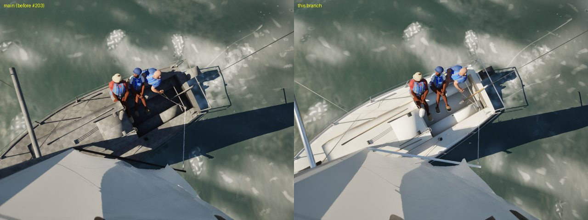
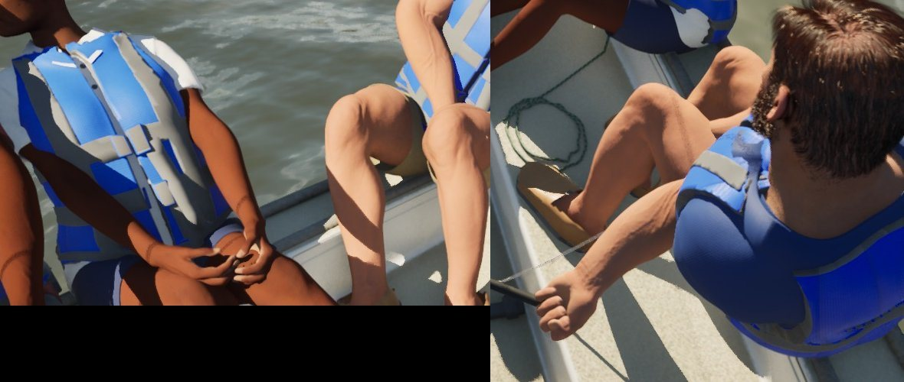
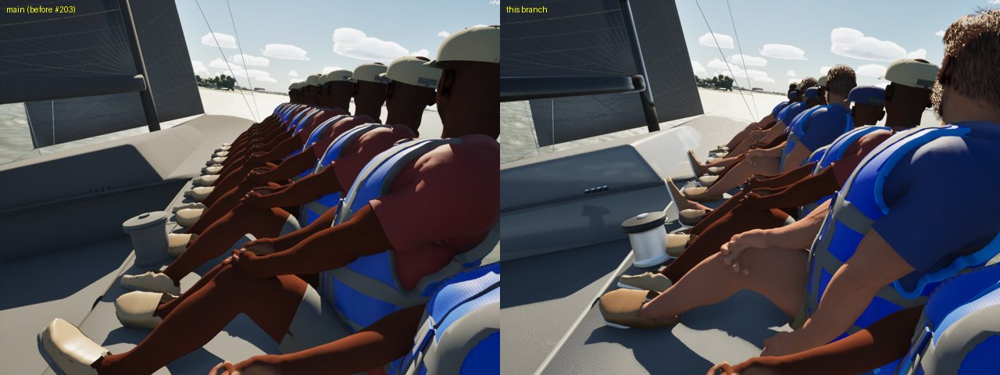
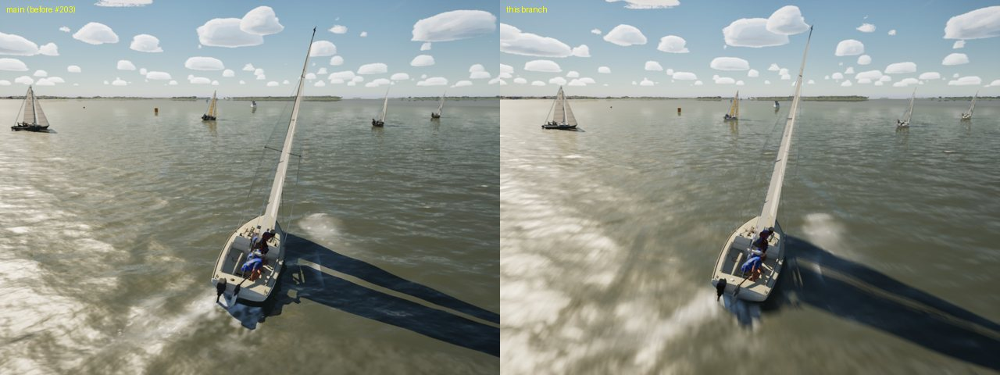
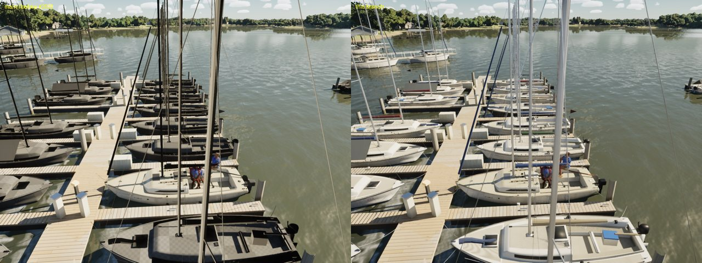

# Crew follow-ups (Oct 21 2026)

The four left over from `docs/crew-hull-clip/`. Mac High, `scripts/run-game.sh`.

The "before" stills come from a tree that predates #203, so their boats are on the default material. That fallback is
#203's subject, not this branch's, but it shows what the High-tier stills of AI and marina boats catch.

## The Catalina 22's crew bunching aft

Not the weight model: the Catalinas have no fore-and-aft crew movement (`CrewAftRange` 0). Their sailors were placed
0.55 m apart round `CrewCG`, so the forward hand, the trimmer and the helm sat shoulder to shoulder. Now:

- the forward hand sits at the cockpit's forward end;
- the helm sits along the tiller, three quarters of the way out (steering from the extension);
- the others are spread evenly between, 0.55 to 0.9 m apart.

On the Catalina 30 the helm stays where the wheel is. The J/22's hand-tuned places are unchanged.

## The Hobie's trapeze arm

The handle arm was raised 55 deg over the shoulder. With the body flat out over the water it read as flailing. The handle
hand is now at chest height toward the wire with the elbow bent (the harness hook takes the weight). The sheet hand is
unchanged. The stance's limbs are held by `SailingSim.Visual.MetaHumanCrew`, which passes.

I couldn't frame the trapeze in a still. At 18 kn by the shore the Hobie capsized, and at 13 kn the wire was on the far
hull from the camera.

## Hands at the jib winch

Close-ups of the J/22's cockpit at 14 kn upwind, from both quarters and from ahead (`-SailingCamTarget=-1.6,±0.3,0.8
-SailingCamDist=1.6`):

- the helm's hand closes round the tiller extension with the wrist straight;
- the crew's hands rest on their knees.

In these trims the trimmer doesn't tail the jib sheet (`JibGripCm` was not held), so the winch grip the PC saw on Ultra
didn't come up, and there was nothing to fix. To reproduce it, the trimmer needs to be tailing: an Ultra trim with
the sheet on the self-tailer.

## The maxi's faces

All twelve crew wore role 2's MetaHuman. `CrewMetaHumanRole(N, I)` keeps the helm on role 0 and the trimmer on role 1.
On a crew of more than four, the rest cycle through all three built presets: no new characters and no cloud rig. The
pawn and the crew tests use the same function.

Role 0's longer legs reached into the cockpit-edge rule for feet, so a flat-deck sitter's feet now never go into a well
(`FCrewGround::bFlatDeck`).

## Materials on High

A still of the AI fleet at a race start and one of the marina, on High, both on the real material:

## Gate

`scripts/gate.sh --scope crew` and `--scope boats` (merged with main) both pass: 202 tests and the package. On High:

- **Crew:** beat15 61.4, helm-eye 60.6, slip 53.9, crew 54.1 fps.
- **Boats:** beam8 62.5, beat15 61.6, marina 60.9, helm-eye 60.4, slip 54.2, crew 54.0 fps.

See [gate-crew.csv](gate-crew.csv) and [gate-boats.csv](gate-boats.csv).
