# Crew through the hull (Oct 21 2026)

This job came from the clipping audits: sailors through decks, tables, each other and lifelines. The Marseille lane
started it with a diagnostic (`SailingSim.Visual.CrewHullClearance`, the local branch `crew-hull-clip` at de863944),
which this branch carries on. Each pair has main on the left and this branch on the right (Mac High,
`scripts/run-game.sh`, same run).

## What the boat was missing

The crew's picture of the solid boat (`CrewInsideBoat`, `CrewFloorZ`, `CrewSeatSurfaceZ` in `CrewPose.cpp`) was the hull,
the deck at the sheer and the cockpit well. It had none of these, all of which the drawn models carry:

- **Cabin trunks** (`CrewCabinTrunk`), from build_fleet.py SPECS and build_j22.py:

  | Boat | x | Size |
  |---|---|---|
  | J/22 (light model) | -0.72 to 1.60 | 0.31 m high, 0.36 m side decks |
  | J/22 (hero) | -0.55 to 1.65 | 0.30 m high |
  | Catalina 22 | -0.78 to 1.70 | 0.62 m half width, 0.42 m high |
  | Catalina 30 | -1.32 to 2.85 | 0.92 m half width, 0.60 m high |
  | Corsair 880 | -0.95 to 2.2 | 0.62 m half width, 0.48 m high |
  | Maxi (coachroof, ref.json) | -4.6 to 3.6 | 4.1 m wide, 0.52 m high |

  A foot on a trunk now stands on its top.
- **The maxi's cockpit and deck:** her cockpit well (x -14.6 to -4.6, 4.7 m wide, 0.55 m deep) and her deck's 12 cm
  camber. The camber also applies to the Hobie's, Corsair's and Lagoon's crowned decks in `CrewFloorZ`.
- **Between the hulls:** the trampoline and nets (8 cm), the Lagoon's bridgedeck (30 cm), her saloon (x -2.4 to 2.8)
  and her cockpit table (1.5 by 1.1 m at x -3.3, 0.71 m up). Her helm seat is now a seat surface.

## What the crew did about it

All in `CrewPlacement` and the attach points (`CrewMotion.cpp`), and the stance poses and the foot planting
(`CrewPose.cpp`):

- **The maxi's rail crew (legs through the deck).** The rail pose dropped the lower legs into a cockpit well, but on the
  maxi there is 1.1 m of deck between the rail and her well, so the legs went through it. Now, where the floor in front
  of a rail sailor is as high as the seat, they sit with their knees up and their feet on the deck (`bFlatDeck`). The
  same applies on the multihulls' decks and nets.
  - They don't brace a foot toward the far seat.
  - A foot only just into the deck is lifted onto it instead of being sent into the well. The well rule is kept for a
    foot under a side deck within 0.4 m of the well, as on the J/22.
  - Her twelve crew are no longer one pose repeated: each is a little more or less hiked and a little fore or aft.
  - Her helm sits aft of the windward wheel, on the cockpit's edge with the legs in it.

  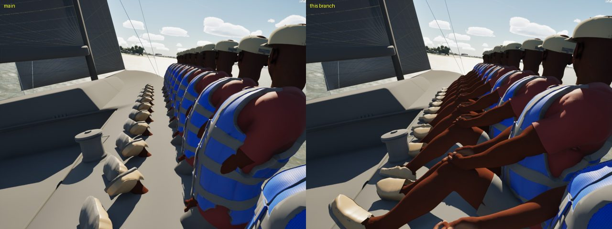 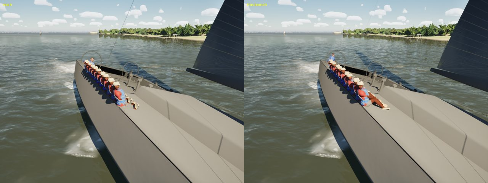
- **Lifelines (the Catalinas and the Corsair: rig lines through the shoulders).** The rail crew sat 12 cm in from the
  edge, which is through the stanchions (5 cm in) and the wires (0.3 and 0.6 m up), and leaned out through them. They
  now sit 0.32 m in, and their lean stops at the wires (hike up to 0.3).

  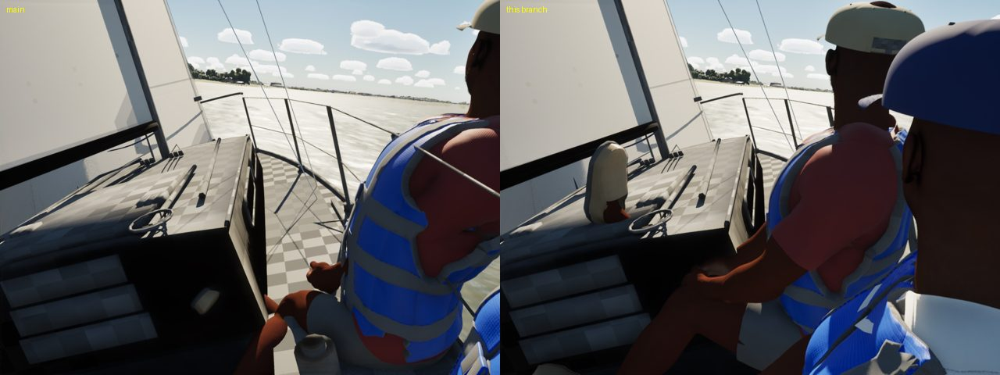 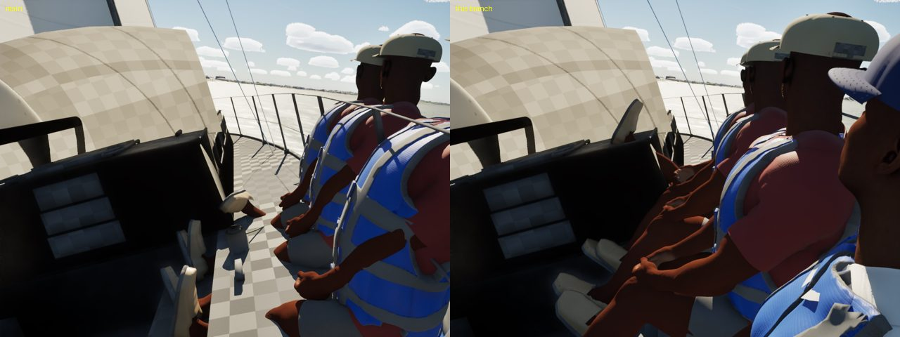 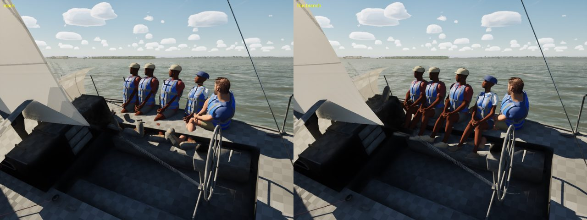
- **Cockpit seats.** The light-air seat put the pelvis 4 cm over the seat, about 6 cm into it. It is now at least 9 cm
  over the seat. Sitting or crossing in the well, the crew keep 0.3 m clear of its forward end. At 0.12 m, the hip of a
  sailor facing across the boat went into the cabin trunk's face. The cabin-top handhold sits on top of the trunk.
- **Crossing.** A tack's crouch keeps the pelvis 30 cm over the floor (at 22 cm the folded knees went through the
  sole), and crosses on top of a trunk where there is one.
- **The Corsair (two crew overlapping on the hull edge).** They sit apart on the net, feet on it. 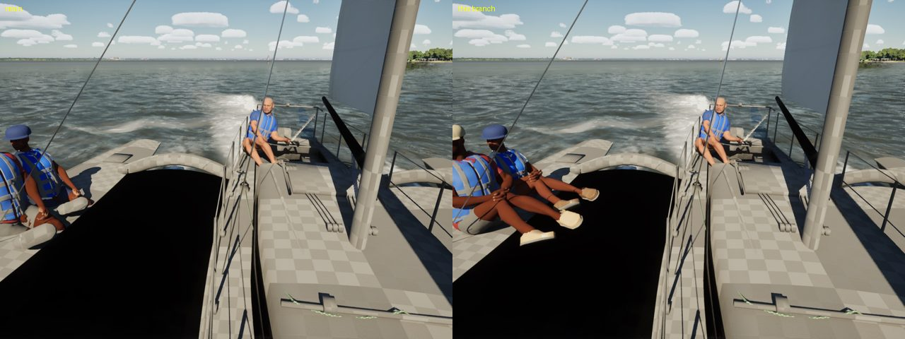
- **The Lagoon (crew kneeling through the table and each other).** Her crew stay in her cockpit (aft of the saloon,
  forward of the bridgedeck's end) and clear of the table (0.9 m out either side of it). Her helm sits on the helm seat
  instead of a hull's aft deck. 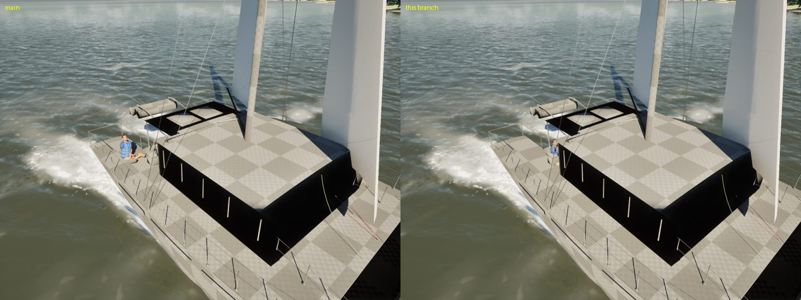
- **The Hobie's crowned hull.** The seat height is taken under the thighs, a little inboard, where the crown is higher.

The J/22 and the Sunfish are unchanged and clean: 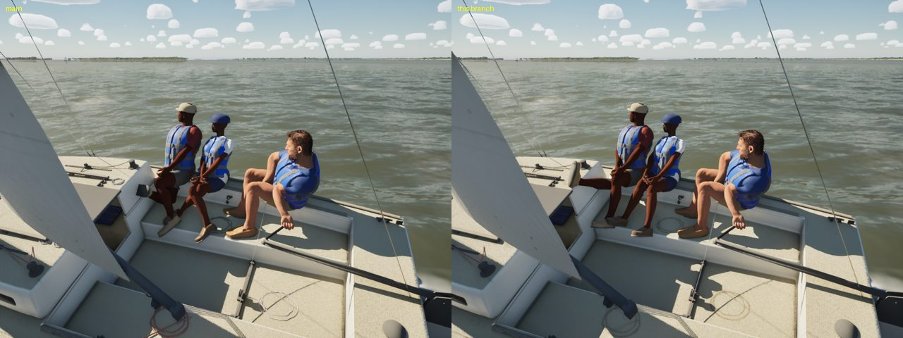 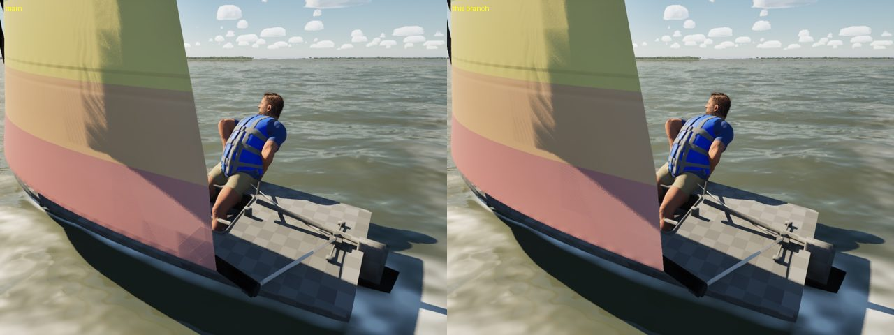

## Test

`SailingSim.Visual.CrewHullClearance` (the Marseille lane's diagnostic, made into a gate) covers:

- **What:** every boat, every crew member, eight cases (sitting up on each side, hiked, the light-air seat, downwind,
  knocked down to 42 deg, tacking, gybing). Each is posed through a chop on SK_Sailor and on the MetaHuman for that role.
- **How:** each body bone's centreline at four points, with a flesh radius below and to either side.
- **Pass rule:** no flesh may be more than 2.5 cm inside the boat. The give is 1.5 cm, or 4 cm for seated flesh (hips,
  lower back, thighs, calves).
- **Not checked:** the MetaHumans' corrective and muscle helper joints, which sit at the skin, not on a centreline.
- **Crossing:** a half-second transition, so its clips are counted and listed but don't fail.

The diagnostic itself had a bug: it checked the pelvis along the segment from the root (at the figure's origin),
which isn't body.

| | body points | inside | clips failing |
|---|---|---|---|
| main + the diagnostic | 4.05 M | 185,808 | 4,673 (most from the root segment) |
| this branch | 1.65 M | 28 | 0 |

CrewFeet, CrewMotionFeet, MultihullCrewSeat and MetaHumanCrew stay green: all 41 `SailingSim.Visual` tests pass.

## Left for the next job

- **The Catalina 22's pile-up on her stern quarter in a swell:** placement there is now clear of the hull, but the
  three crew still bunch aft in the chase view (below). That is the crew model's weight placement in a seaway, not a
  clip. 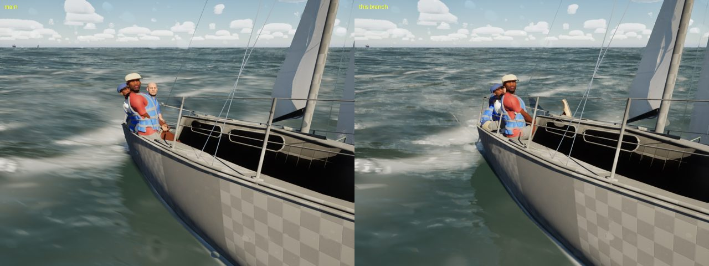
- **The Hobie's crew in the Gulf swell:** these are the trapeze crew flat out on the wire with an arm up to the handle,
  not a clip. If the arm-up pose reads as flailing, that's a stance change. 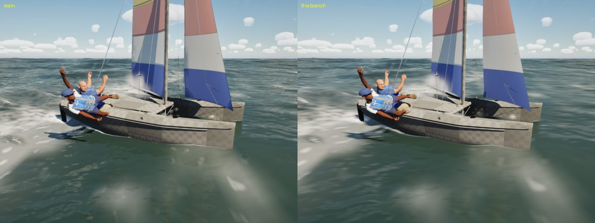
- **Hands and wrists at the jib winch:** not reworked here. I couldn't frame the winch hands in a still with the sails
  up, so it needs a close camera and the PC's rope work in place.
- **The maxi's crew all wear role 2's MetaHuman (one face):** that's a content change (more MetaHumans), not
  placement.

## Gate

`scripts/gate.sh --scope crew` and `--scope boats` on this branch (merged with main) both pass: 214 tests and the
package. Crew on High: beat15 61.9, helm-eye 60.4, slip 57.7, crew 53.6 fps. Boats on High: beam8 63.0, beat15 61.8,
marina 61.3, helm-eye 60.5, slip 57.5, crew 53.5 fps ([gate-crew.csv](gate-crew.csv), [gate-boats.csv](gate-boats.csv)).
