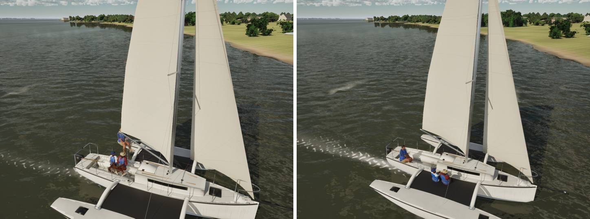
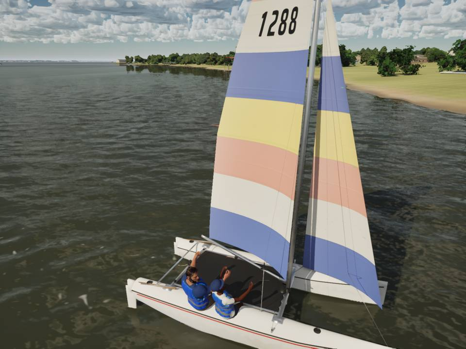
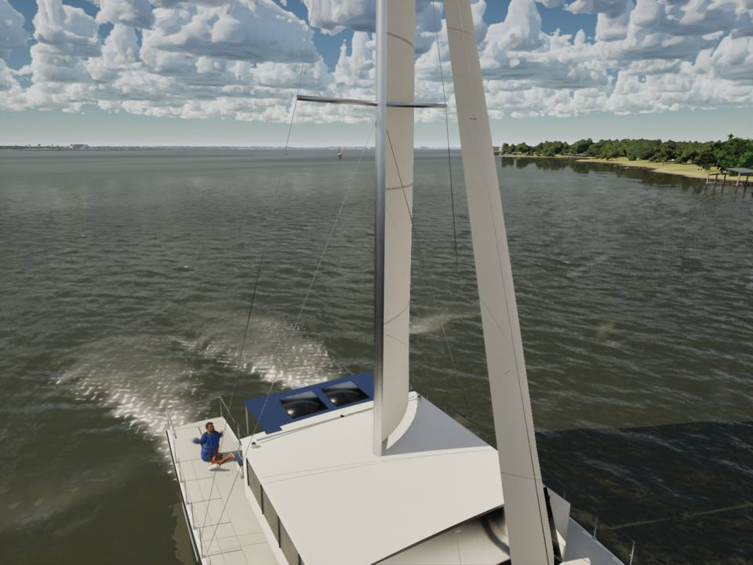
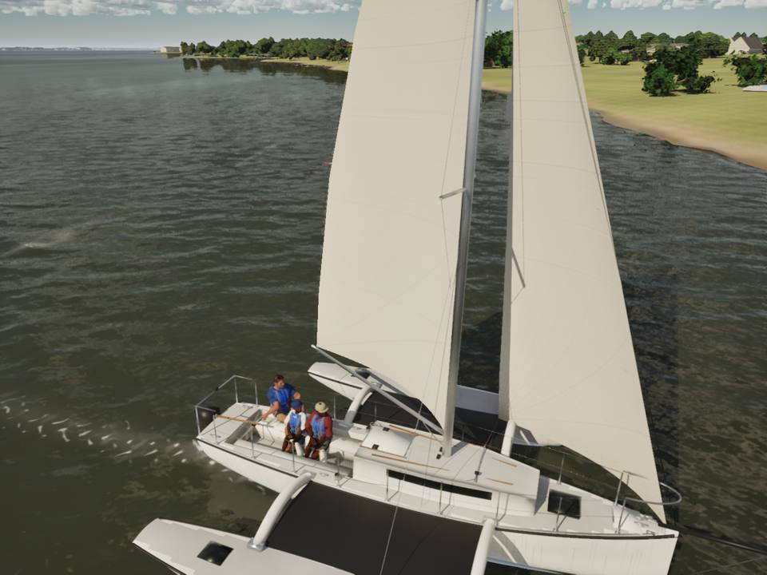

# Multihull crew: seated on what is under them

`CrewPlacement` (`CrewMotion.cpp`) put every multihull sailor at the main hull's sheer plus 0.1 m, at the outer hull's
centreline plus a margin when hiking. `-SailingDebugCrew` now logs each pelvis and the floor under it; at 12 kn, 80 deg:

| Boat | Sailor | Before | After |
|---|---|---|---|
| Corsair 880 | helm | on the windward ama (y 2.86), 0.22 m over its deck, 2.8 m from the tiller | in the cockpit at the coaming (y 0.65), 0.07 m over the deck |
| Corsair 880 | crew 0, 1 | x -2.05 and -2.6, y 1.58: over the water aft of the after aka (nothing under them) | on the windward net beside the cabin, forward of the cockpit (x -0.05 and -0.60), 0.07 m over it |
| Hobie 16 | both | 0.16 m over the hull's sheer | 0.06 m over the crowned deck (the old +0.1 had nearly matched the 0.12 m crown) |
| Lagoon 42 | crew 0-2 | pelvis at the bridgedeck's level (legs through it), cockpit stance | sitting on the bridgedeck, 0.07 m over it |
| Lagoon 42 | helm | 0.17 m over the hull's sheer | 0.07 m over its crowned deck |

## How

- `CrewSeatSurfaceZ` (`CrewPose.h`): a hull's deck with `build_fleet.py`'s crown (Hobie 0.12, Corsair 0.05, Lagoon 0.04),
  the sheer inside a cockpit well (where the keelboat stances' offsets apply), else `CrewBetweenHullsZ`: the Hobie's
  trampoline (0.10 m over the sheer at the forward beam), the Corsair's nets (main deck edge to the ama, bellied 0.12 m
  as drawn), the Lagoon's bridgedeck (0.02 m over the sheer); `CrewNetSpan` holds their fore-and-aft extents (beams, akas,
  bridgedeck). Keep them in step with `build_fleet.py`.
- `CrewFloorZ` returns the surface between the hulls too (it was -1e9 there, so feet on a net found no floor).
- Multihull stances are placed over 0 and lifted onto the surface under the pelvis; a cockpit stance with no well under it
  (a net, the bridgedeck) sits as on a side deck.
- A trimaran's helm sits on the main hull (the tiller is on the centreline); her crew past the main hull's deck sit on the
  windward net forward of the after aka and of the cockpit (their feet had come down on the seats' edge beside it), 0.55 m
  apart.

## Measured

`SailingSim.Visual.MultihullCrewSeat` places every sailor on the three multihulls from inboard to fully hiked on both
tacks: each over the boat (except on the wire), 0.03-0.10 m over their seat (-0.15 in a cockpit well), at least 0.4 m
apart, the Corsair's helm on the main hull. Crew tests 10/10; `scripts/gate.sh --scope crew` passes (beat15 62.6, helm-eye
60.1, slip 53.4, crew 53.2 on High).

## Gaps

- The physics still puts the crew's weight where the crew model says (`CrewSitOut` 1.5 m on the Corsair); moving them
  forward onto the net changes only where they are drawn.
- The Lagoon's crew have no cockpit benches to sit on (the model has none); they sit on the bridgedeck.
