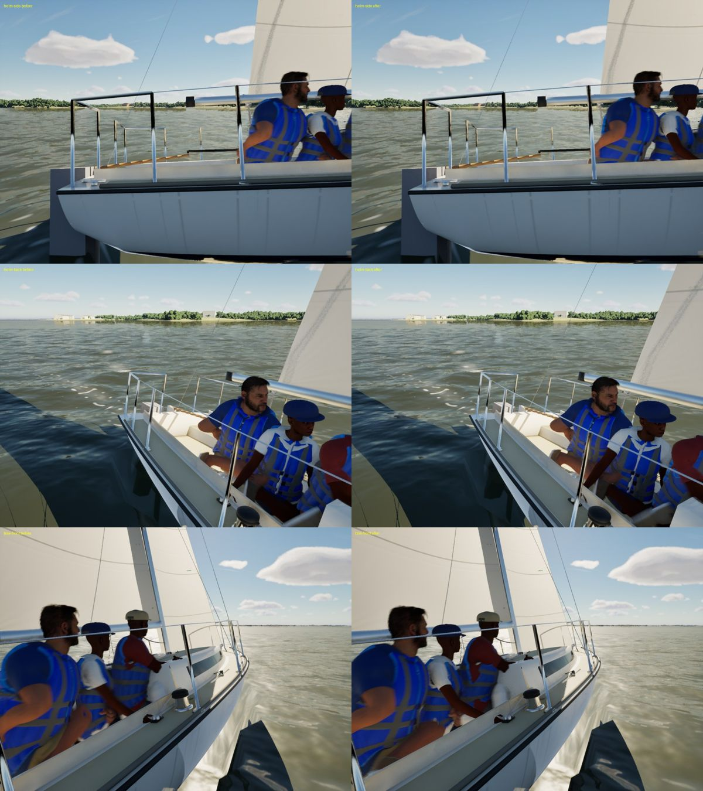
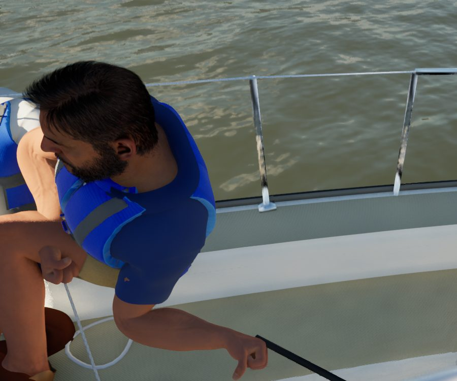

# Round 11 crew fixes: the vest and the polo

Round 11's still07 ("lack of detail, person looks like a doll"), diagnosed in `docs/round-11/crew/README.md`. These are
items 1 to 3 of that list; the cap's sweat band and the neck's roughness (item 4) are not in this change.

## What changed

1. **The armhole no longer tears in seated poses.** `scripts/import_crew_clothes.py` copies the T-shirt's weights onto
   the vest by closest point. That gave the armhole's edge the sleeve's upper-arm weights, so the edge swung with the arm
   while the polo under it didn't. Now every arm bone's weight on the vest goes to the clavicle on the same side
   (`keep_arms_off`: about 5,000 vertices a vest). A life jacket doesn't follow the arm. The armhole is also 2 cm more
   open above the armpit (`ARMHOLE_OPEN` in `Tools/blender/build_vest.py`), and the polo is cut away 7 cm inside it.
2. **Flat front panels.** The foam's channels (`M_CrewFabric`, `ChanPeriod`) run only on the back and sides, where |U|
   is past `ChanFront` (0.19 m), with a 2 cm fade, and they are 0.10 m wide (6.5 cm before). `build_vest.py` now puts
   U = 0 at the front's centre on every role (it was at the back when the outfit faced -Y). The shell's roughness goes
   from 0.55 to 0.66, so it reads less like an inflatable.
3. **Strap tails.** 15 to 20 cm loose webbing ends hang from each chest buckle's adjuster and stand off a little further
   as they fall.
4. **The polo.** Diagonal pull creases on the sleeve heads, deepest at the front (every seated sailor has their arms
   forward). The collar's points lie down on the shirt and, below the vest's neckline, on the vest's foam. The knit's
   normal strength goes from 1.0 to 0.55.
5. **The export on Windows.** `export_crew_bodies.py` no longer calls `os._exit` there; it runs in the full editor with
   `-ExecutePythonScript`, since the FBX exporter needs the meshes' render data.

## Stills

Packaged High build, lake, 10 kn beat, the crew on the starboard rail. Before (main 719a6e9d) on the left, after on
the right. Rows: helm from outboard, helm and trimmer from forward, bow from forward.

The helm's front panel from above the boom (after): flat foam, the piping smooth round the armhole, a clean shoulder.

## To land it

The polos, vests and shoes are git-ignored with the MetaHumans, so this change carries only the scripts and the fabric
material. After it merges, the Mac reruns `scripts/make-crew-clothes.sh` (the export, Blender and import steps), then
`scripts/pack-metahumans.sh` for the PC. Tests: `SailingSim.Visual` 32/32 on the PC, including MetaHumanCrew and the
crew pose, feet, clip and falls tests.
