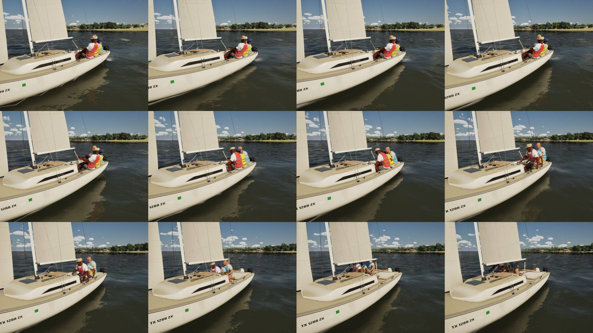
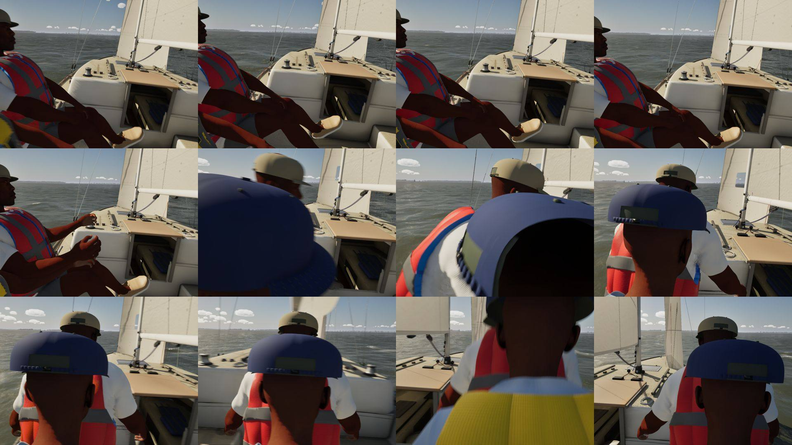

# Crossing the cockpit on a tack or gybe (playtest, Oct 27)

**What Bean saw:** crossing the cockpit on a tack or gybe was "not even close to realistic". The whole move was one
crouched stance, blended in over 0.45 s, the pelvis slid across by the crew model, with no steps, no handholds and
the facing jumping.

**What real crews do** (the plan's sources, `Inputs/crew-tack/plan.md` on the inputs branch): they stay on the old
side until the boat is head to wind. They rise into a half-crouch facing forward and cross low under the boom in two
steps, a hand on the coaming or the cabin handrail. They turn and sit on the new side. On a gybe they crouch low before
the boom moves, hold still as it passes, then cross. On a 22-footer the whole move takes 4-6 s.

**Now:** `FCrewCrossing` (`CrewMotion.h`), kept per figure by the pawn, scripts the crossing against the boom. Tau is
the time from the boom crossing the centreline. It is estimated from the boom's swing until the cross begins, and it
never runs backwards.

| Phase | Tau (s) | Body | Feet | Hands |
|---|---|---|---|---|
| A set | -1.2..-0.8 | 10 cm inboard on the old side | stance | aft hand to the old side's coaming |
| B rise | -0.8..-0.3 | up to 0.55 m over the floor, turned to face forward | onto the sole | holding |
| C cross | -0.3..+0.7 | across, lowest (0.5 m, under the boom lower) as it passes | two steps of 0.3 s on a 12 cm arc, the other planted | to the new side's coaming |
| D sit | +0.7..+1.3 | turned to the new seat and down onto it | released to the stance | released |

Details:

- **Gybe:** A and B start at -2.0. The sailor comes off the rail into the well's edge, 0.45 m over the floor, holds
  still from -0.2 to +0.3 as the boom passes, then crosses (C +0.3..+1.3, D to +1.9).
- **Dinghy:** 0.65 of the times.
- **Helm:** keeps the tiller extension and the mainsheet throughout.
- **Forward hand:** takes the cabin-top handrail. On the coaming, their arm went through the jib sheet's tail by its
  winch.
- **Fore and aft:** each sailor sits down at the same station they rose from.
- **Under the boom:** the rise and the low point both stay under the boom, no lower than a deep crouch.
- **Start:** a crossing starts only on a turn (a tack, a gybe, or a gybe coming: past 165 deg toward dead downwind).
  The crew model's other moves keep the old stance change.

**Test.** `SailingSim.Visual.CrewTack` drives a J/22 tack and a gybe at 60 Hz for each of her three crew and checks:

- on the old side until tau -0.3;
- across one way only, inside the boat;
- the posed head (SK_Sailor, its top) 10 cm under the boom wherever the boom is over them;
- one foot stepping at a time, the planted one on the floor;
- the gybe holding still (under 2 cm) as the boom passes;
- the stance back three seconds on.

All 67 `SailingSim.Visual` tests pass.

**Strip:** a demo tack at 12 kn, every 0.25 s from 9.75 s of sim time (`-SailingDemo -SailingShotCrew=<name>
-SailingShotAtSim=<s>`, new for this). From abeam:

From the helm's eye (the cockpit camera). It stays where the helm sat, so as the crew cross in front of it, and the
helm crouches, it sees the backs of their heads. That is the cockpit camera's own follow-up.

Left for PR 3 (`crew-cross-2`): the helm's hand swap behind the back, a deeper gybe crouch, and the light-air roll
tack's delay.
