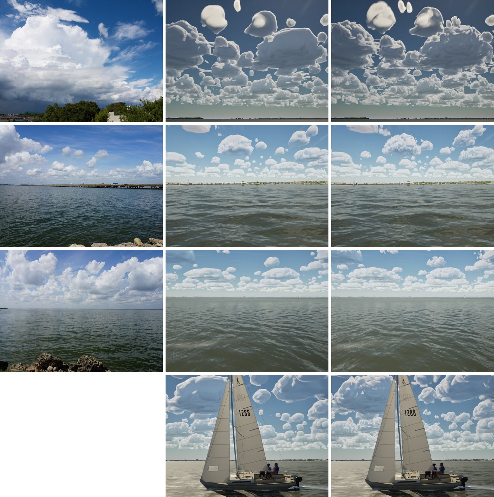
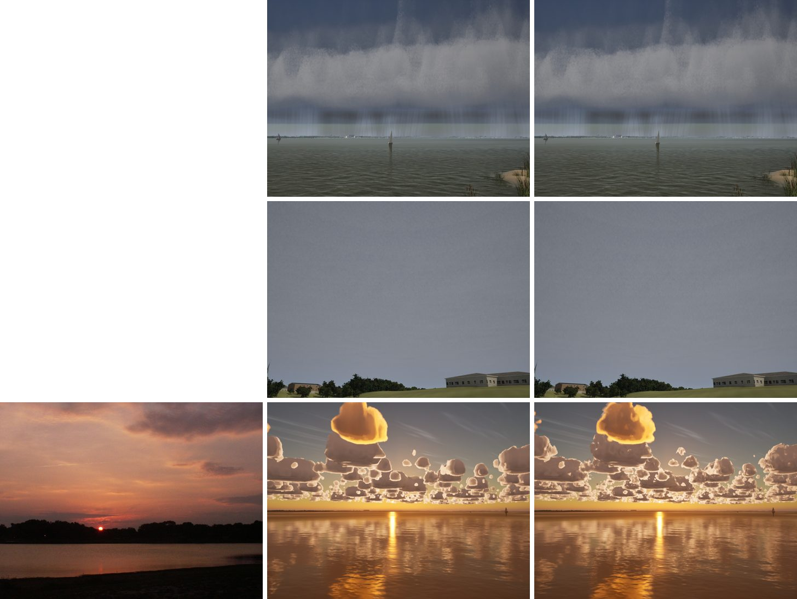

# Cumulus billows

After #260 the fair-weather cumulus had the right sizes, but each was one smooth, rounded mass with a glossy sheen.
The photos show bubbles packed on bubbles: every lobe white on top, with a grey crease under it.

## Cause

- The shape noise's billows are its 500 m and 250 m Worley octaves. Through the remap and coverage they only set
  the outline.
- The detail noise that erodes the edge is filtered by the sample's footprint, which never goes below 110 m
  (G8, W5a). At cloud distances that is mip 3 to 4 of a 667 m tile, so the detail is close to flat. Making the
  erosion stronger, finer, or reach deeper (eleven variants) only moved a thin skin.
- The sheen is not a sky-cache bug. The live clouds near the 5 km seam had it too, and without the cache the far
  clouds only went soft. Nothing in the cloud varied at the 100–300 m scale of real billows, and the shadow rays
  toward the sun step about 500 m. So each cloud shaded as one smooth balloon.

## Fix

A new volume, `T_CloudBillow` (`Tools/clouds/make_cloud_noise.py`, our own generator, `billows()`), holds packed
lobes. It is 128^3 over a 3 x 3 x 1.5 km tile, with a different period from the shape's 4 x 2 km. It is built as
follows:
- Big lobes, 250–400 m in radius, placed by dart throwing at least 1.15 radii apart.
- Lobes of 150–220 m in the gaps.
- Each texel holds the highest sphere cap over it. Lobes are placed in metres, so they are round in the world.

In `CLOUD_CODE`, and so in both `M_CloudLayers` and `M_CloudCache`, only the cumulus branch samples it:
- The mip follows the same footprint as the shape (a 23.4 m texel). A 150 m lobe is still about 3 texels at the
  110 m floor, and past a few kilometres the mips flatten it.
- The lobes' crowns push the cell's outline out across its soft margin and their creases cut it in:
  `shapeCu += 6 (billow - 0.79)`. The field's mean, 0.79, is taken out so coverage holds.
- The term is off over the cell's last 6% of coverage (lobes there floated free as shreds) and at the cell's flat
  base.

The storm shelf, the core, the stratus deck and cirrus never read it, so #255's shelf, #259's face and #263's
overcast
are unchanged. The second sheet checks this.

`SailingSim.Visual.CloudNoise` also checks the billow volume:
- 128^3;
- the mean is the shader's 0.79;
- 10–40% of it is crease (0.22 measured);
- sampled as the shader does, it doesn't repeat within 15 km (autocorrelation 0.14).

### Also tried, not kept

- A weaker curl warp (0.6 km instead of 1.3): less marbling, but blobbier clouds.
- Grey crevices from the lobes: no visible gain on top of the lobes.
- Darker thin edges (powder): no visible change.

### Import gotcha

`make-content.sh` now runs `import_cloud_noise.py` twice. A volume texture created in the same editor session as its
freshly imported atlas came out 186 x 93 x 121 instead of 128^3, and only a second run fixed it.
`CLOUD_NOISE_ONLY=T_CloudBillow` imports just that one, leaving the other noise assets byte for byte.

## Stills

Columns: real photo (G5 pack, Commons), main, this branch. Rows: the cumulus view, the I-30 bridge, the open lake,
and the J/22 chase (its photo has people, so it isn't shown).

The shared noise: the storm shelf, the overcast deck looking up, and the lake at sunset (photo left).

## Gate

`scripts/gate.sh --scope clouds`: see the PR.
