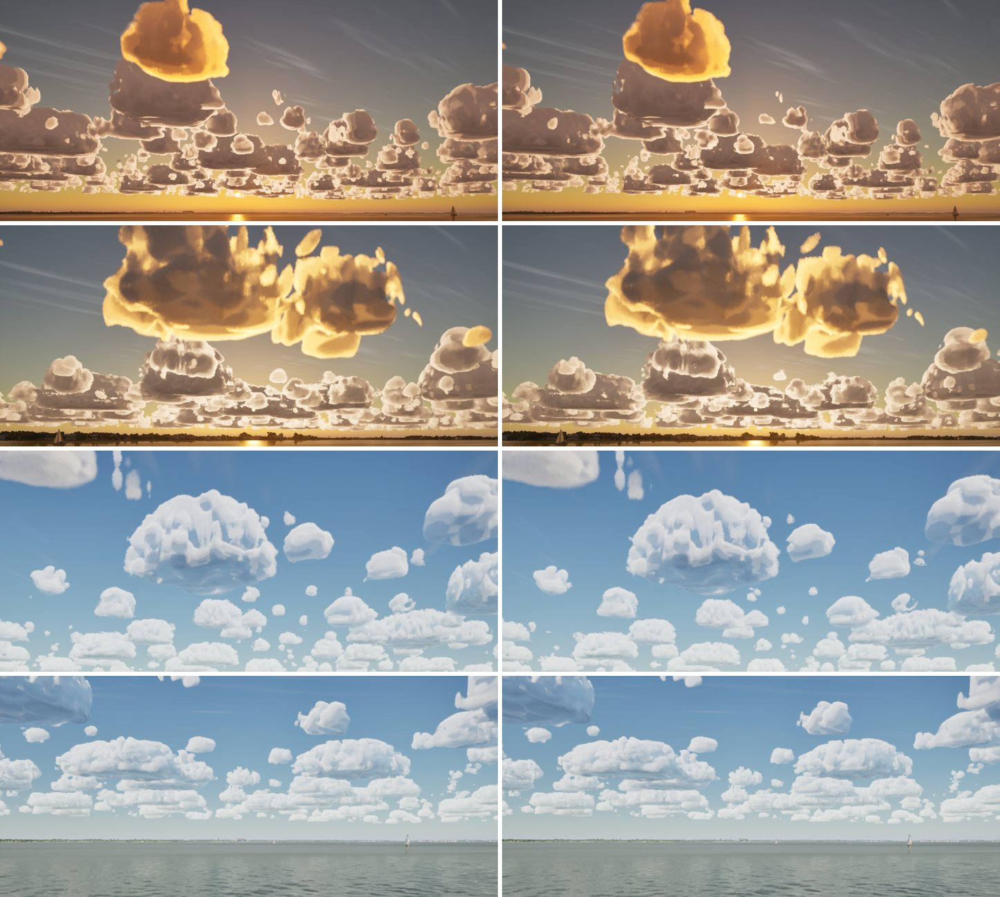
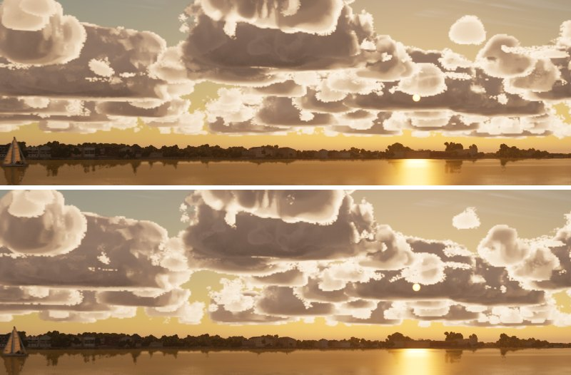

# Round "holes" in the cumulus

After #277 the coordinator spotted round see-through pits in the cumulus of the low-sun and bridge stills (the
exposure-choice sheet, `docs/exposure-choice/`), like holes punched through the cells.

## Cause

The holes aren't holes, and the billows didn't make them:
- Switching the billow term off (`T_CloudBillow`, #271/#277) leaves them all.
- Capping how deep its creases cut changes nothing.

They are the small cumulus cells. A small cell's presence in the weather map saturates in its core just as a big
cell's does (`FWeatherMap`), so its outline was the map's round footprint. The result was a flat round dome. In low sun
these small, thin domes are lit through, while the big cells behind them are self-shadowed and dark, so each small one
reads as a pale round hole in a dark cloud. They were there in the Oct 22 captures too, before the billows.

## Fix

In `CLOUD_CODE`, a small cell's coverage is broken up by the shape noise's coarse Worley (500 and 250 m):
`covCu *= lerp(1, saturate(lowFbm x 1.8 - 0.4), 1 - smoothstep(0.3, 0.7, cuSize))`. That is full strength for the
smallest size class (`CumulusTop` under 0.3) and none from 0.7, so the big cells, their billows and the storm are
untouched. Small cells now have a cumulus's ragged outline, not a disc's.

Not changed here: the bright, slightly jagged rims on far cells toward a low sun. The jaggies are the sky cache's
texels (4096 x 512 over 36 deg) showing at the sharp lit edge; that is for a later cache pass.

## Stills

Main left, this branch right. Rows: the lake sunset, dusk toward the sun, the I-30 bridge, the open lake.

Dusk close up, main above, this branch below:

