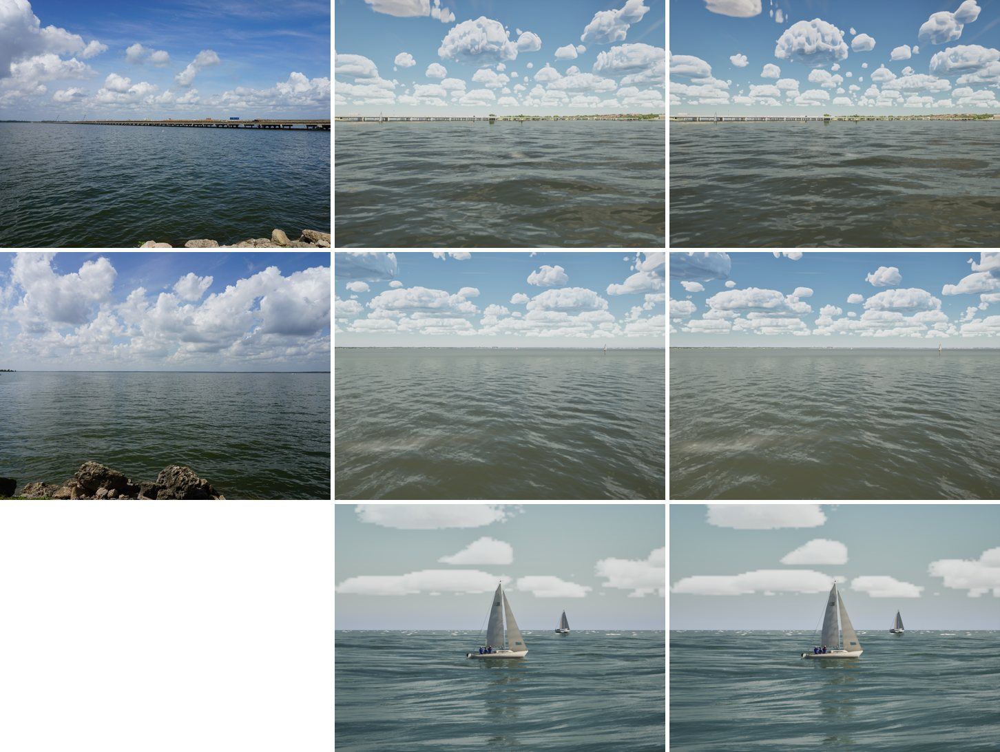
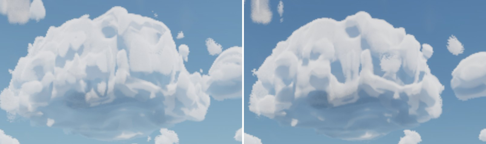
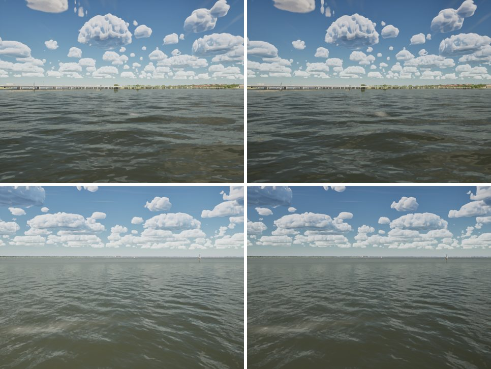

# Cumulus rims, faceted lobes and the veiled low sky

Realism audit Oct 23 (`docs/realism-audit-1023/`), item 4: each cumulus had a bright rim, like a drawn outline; the
lobes were faceted; and toward the horizon the small cells packed into a solid white band. The near-horizon sky
saturation check (`docs/sea-reflectance/`) traced the pale low sky partly to the same clouds. This PR fixes four
things.

## 1. Billows veiled the low sky (#271)

#271's billow term pushed density out across a cell's soft margin wherever its coverage passed 0.06. That put thin
cloud across every margin, and summed along a ray toward the horizon it veiled the low sky white. On the bridge view,
sky red over blue at 12 deg was 0.76; it had been 0.63 before #271.

The term now acts only inside a cell's core (coverage over 0.4, eased in from 0). The cauliflower outlines stay, and
the wisps and stray fragments between cells go.

## 2. The grainy rim

With the lobes in the outline, the edge-to-body ramp's top of 6 made an edge finer than the march step. Its jittered
samples frosted every small cloud with a grainy white rim. The ramp now tops out at 4: crisp, without the grain.

## 3. Faceted lobes

`T_CloudBillow` took the hard maximum over its sphere caps, which left a sharp kink where two lobes met; the clouds lit
it as a hard plane edge. It now takes a polynomial smooth union, 0.15 of cap height wide (`BILLOW_CREASE` in
`Tools/clouds/make_cloud_noise.py`). The field's mean (0.788) and crease share (0.22) are unchanged, so the shader's
0.79 and `SailingSim.Visual.CloudNoise` hold.

Some vertical plane faces remain inside the big cells. They look like the cell's outline extruded upward, not like
billow creases, and are left for later.

**Import fix.** Rebaking the billows showed the importer never rebuilt an existing volume. Setting its atlas to the
same object changes nothing, and a volume given its atlas cuts it near-cubic (186 x 93 x 121) until its tile size
changes. `scripts/import_cloud_noise.py` now:
- imports the atlases and builds the volumes in separate passes (`CLOUD_NOISE_PASS=atlas|volume`, both run by
  `make-content.sh`);
- in the volume pass, clears the volume's atlas, sets it again, then moves the tile size off its value and back, so
  the last rebuild has both. It comes out 128^3, checked by `SailingSim.Visual.CloudNoise`.

## 4. Ground albedo

The sky atmosphere's ground under its multiple scattering was the engine's 0.4 grey, which lit the low sky grey from
below. Open water and woods are about 0.1, which `ASailingEnvironment` now sets on every world.

## Results

Sky red over blue by elevation (row medians of blue sky pixels; the G5 photos are 0.58–0.77 at 3–8 deg):

| | 3 | 5 | 8 | 12 | 20 deg |
|---|---|---|---|---|---|
| bridge, main | 0.90 | 0.86 | 0.92 | 0.76 | 0.51 |
| bridge, this branch | 0.87 | 0.83 | 0.83 | 0.55 | 0.35 |
| open lake, main | 0.94 | 0.89 | 0.87 | 0.71 | 0.43 |
| open lake, this branch | 0.89 | 0.85 | 0.83 | 0.60 | 0.36 |

On the Gulf view (shore telephoto, clear) it goes from 0.91 / 0.86 / 0.75 to 0.86 / 0.81 / 0.69 at 1 / 3 / 5 deg.

At 3–5 deg the rest is the tone curve (`docs/sea-reflectance/`). The bare atmosphere there is 0.59–0.78 in linear
light, and the filmic shoulder washes it at our exposure. For now that is left as it is (see Exposure, below).

`Tools/water/reflectance_check.py` still matches Cox-Munk:
- bridge, 3–12 deg: 0.40 / 0.31 / 0.34 / 0.24;
- Gulf: 0.41 / 0.28 / 0.45 at 1 / 3 / 5 deg.

The water's colour did not follow the bluer sky, though. Its red over blue stays 0.83–0.94 on the lake, while the
photos show 0.55–0.79. The water reflects the sky as the sky light's low-resolution capture sees it, where its
roughness lobe mixes clouds and sky into a pale average, not as the sharp sky the camera sees. That is the next lever
for item 1.

Unchanged, as intended: the sunset, the storm shelf and the overcast shore.

## Stills

Columns: photo, main, this branch. Rows: the bridge, the open lake, the Gulf (clear; no photo).

A cumulus close up, main left, this branch right:

## Exposure: for Bean to choose

Clear air carries a +0.5 EV lift, calibrated in phase 8 to the reference video. A still camera's meter has no lift;
at bias 0 our horizon sky's display luminance matches the G5 photos (0.47 against 0.48). Left: as now (+0.5). Right:
bias 0. The bridge is on top, the open lake below. Nothing here changes it; this is for a later choice.

