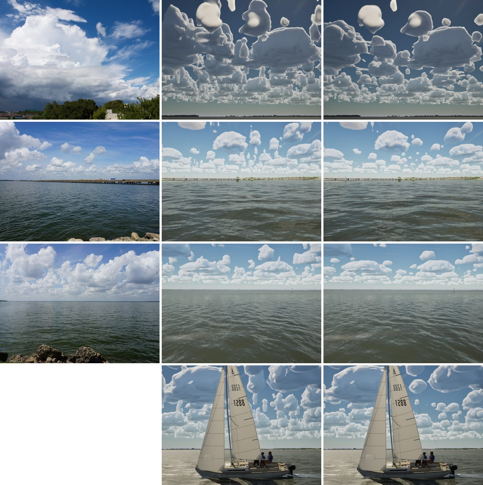

# Cumulus as tall as they are wide (realism audit item 1)

The realism audit (`docs/realism-audit-1022/`) ranked the fair-weather cumulus first. They were a field of narrow
pillars and smooth blobs, worse than in the Oct 14 G5 captures.

## Cause

W5a paints cells in four size classes with a peak presence that grows with size ((R / R_max)^0.6), so small cells were
meant to be low puffs. But the map's threshold ramps presence over 1.1 standard deviations, and the material scales it
by 1.25, so presence saturates in every cell's core whatever its size. C1 (round 12) then took a cell's top as
`pow(presence, 0.3)`. Every small cell, a few hundred metres wide, stood most of the layer's 1.2 km height: a pillar.

Changing the exponent alone didn't help (0.6 changed nothing; 1.5 made cones), because presence no longer says how big
a cell is.

## Fix

The map now carries each cell's size:
- `FWeatherMap::Paint` records the size factor of the winning cell per texel (`CumulusTop()`, (R / R_max)^0.6 clamped to
  1; 0 where no cell paints).
- `ASailingEnvironment` uploads it as an R16F texture beside the weather map, `CumulusTop` on `M_CloudLayers` and
  `M_CloudCache`.
- The shader tops a cell at `size * pow(presence * 1.25, 0.3)`, floor 0.12: C1's dome, scaled by the cell's size.

On a fair day (cells scaled 0.6) the classes are about 200, 360, 660 and 1200 m in radius, which gives tops of about
410, 590, 840 m and the full 1.2 km.

`SailingSim.Visual.CumulusSize` (new) checks that the sizes lie within 0–1, that small cells are painted small, and
that the largest class is painted.

## Stills

Real photo left (G5 pack, Commons), main 1a843e20 middle, this branch right. From the top:
- the cumulus view;
- the I-30 bridge;
- the open lake;
- the J/22 chase (its real photo has people, so it isn't shown).

## Left

- **Billows:** the clouds are still smooth, rounded masses without crisp cauliflower billows.
- **Sheen:** the far ones (the sky cache, C2) have a glossy sheen. With `-SailingNoSkyCache` they are soft and fuzzy
  instead.
- Both are the next steps on this item.

## Gate

`--scope clouds`: pass, 229/229 tests. beam8 63.2, beat15 60.8, storm High 50.9, gulf-sea 63.0, helm-eye 60.8, bridge
65.5, storm Medium 71.9.
