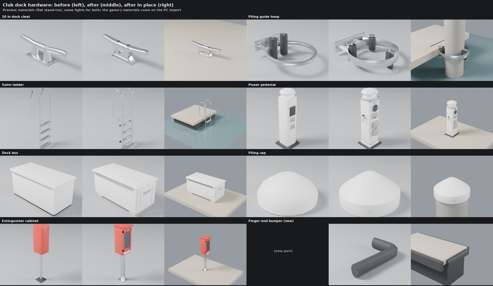

# Club dock hardware detail pass (Nov 9 2026)

Bean's next-passes list, modeling item 10: the Rush Creek club docks' hardware through the part detail loop
(`docs/part-detail-loop`). The meshes are `Tools/blender/build_docks.py` (club docks pass 2); this pass rebuilds seven of
them and adds one. Origins, facing and footprints are unchanged, so `AMarinaActor::DockKitPlacements` and the marina bake
stay as they were. The float drums are the texture loop's (#552) and are untouched.

## What changed

| Mesh | Before | After | What's new |
|---|---:|---:|---|
| `SM_Dock_Cleat` | 368 | 3,344 | The lake-dock cast cleat from the reference photos: closed base flaring onto the deck, a round line hole through the web, rounded horns tapering to lifted blunt tips, two bolts sunk in pockets in the top. 254 mm long, 75 mm high (catalogue 10 in cleats: 2.5-3 in high). |
| `SM_Dock_Hoop` | 720 | 1,660 | 80 x 12 mm flat-bar ring, box-section arms to a bolted mounting plate, gussets, three black rollers (was two) on axles in yokes. |
| `SM_Dock_Ladder` | 704 | 6,008 | 1.5 in rails with smooth bends, bolted flange bases on the deck, ribbed treads with rail sleeves and side plates, a cross brace and two brackets bolted to the dock's face, rubber standoff pads, end plugs. |
| `SM_Dock_Pedestal` | 692 | 3,770 | Plinth and seams, meter in a bezel behind glass, breaker door with screws and pull, two receptacle housings with domed hinged lids, a hose bib with its handle, louvred lamp, base bolts, rating and slip plates. 1.1 m (Eaton Lighthouse class: 44 in). |
| `SM_Dock_Box` | 460 | 3,012 | Moulded feet, ribs on the front and ends, recessed end handles, raised ribbed lid, piano hinge, hasp, staple and a brass padlock. |
| `SM_Dock_PilingCap` | 180 | 792 | One moulding: a snug skirt into the cone, four flush screws. |
| `SM_Dock_Extinguisher` | 444 | 1,418 | Square post on a bolted plate, bracket, door frame round the window, the extinguisher and hose inside, hinge, pull, rain top with drip edge, label. |
| `SM_Dock_Bumper` | new | 1,164 | A black rubber D-profile round each finger's tip and its open corner, two ribs along it, screws sunk in it. It stops square short of the tip piling's corner. |

Triangles are each mesh's own (Nanite on, as before). New slots used: `Trim`, `Glass` and `Gold` (already in
`import_world.py`'s `WORLD_SLOTS`). The bumper is optional in `AMarinaActor::HasDockKit`, so content without it still
uses the kit; `DockKitPlacements` puts one on every finger's tip (`Slip.FingerB`, facing out).

## Scores

Blind reviews: three fresh reviewers each round, shown the same four studio views and an in-place still of each candidate
in shuffled order (not told which is new), with the Commons cleat and bumper photos.

| Part | Round 2 vs before | Round 3 vs round 2 | Kept |
|---|---|---|---|
| Cleat | 3/3 (conf 4, 4, 4); and the closed-base cleat beat round 1's open-base cleat 3/3 | 3/3 (conf 1-2) | round 3 |
| Hoop | 3/3 (conf 3) | **lost 1/3** (the 48 mm pipe ring with welded U yokes) | round 2 |
| Ladder | 3/3 (conf 4) | 3/3 (conf 2-4) | round 3 |
| Pedestal | 3/3 (conf 4-5) | **lost 0/3** (small square meter, smaller lamp); round 4 (round 2 plus domed lids, no back strip) beat round 2 3/3 (conf 2) | round 4 |
| Box | 3/3 (conf 4) | 2/3 | round 3 |
| PilingCap | 3/3 (conf 4) | 3/3 | round 3 |
| Extinguisher | 3/3 (conf 5; the old one was called "a blank box") | 3/3 (conf 1: nearly the same) | round 3 |
| Bumper (new) | scored 3/5 by all three | 2/3 (D-profile over the round tube) | round 3 |

No reviewer called any kept version the wrong part. Sizes are within the catalogue ranges listed above;
`stats_before.json` and `stats_after.json` have each mesh's triangles, size and slots.

What the reviewers still see (for a later round):
- Cleat: the horns read a little long and thin; the base's flare is a separate rounded wedge, not a fillet.
- Hoop: the ring is thin sheet-like flat bar; the yoke plates look loose.
- Pedestal: the lamp dome is large; receptacles have no twist-lock faces; one-sided (real ones often serve two slips).
- Box: faint lid panel lines; shallow handle pockets; no gas struts.
- Extinguisher: the window is dark (the game's glass may show the red cylinder inside); the label is blank.
- Bumper: no moulded corner piece; cut ends.
- Preview materials are flat stand-ins; the game's MI_World_* looks come in on the PC import.

## References

None are in the repo (third-party photos stay out); git-ignored copies go in `Data/Reference/raw/parts/Dock*/`.

| Reference | Used for | Licence |
|---|---|---|
| [Boat Cleat.jpg](https://commons.wikimedia.org/wiki/File:Boat_Cleat.jpg) (Tokmanr) | the cleat's side outline, the line hole, the bolts in the top (square-on) | CC BY-SA 4.0 |
| [Cleat Tie-Down Point on Lake Dock for Boats](https://commons.wikimedia.org/wiki/File:Cleat_Tie-Down_Point_on_Lake_Dock_for_Boats_(29617729357).jpg) | the lake-dock cleat's closed base and lifted horns | see the Commons page |
| [Boat cleat with rope by the dock near a marina](https://commons.wikimedia.org/wiki/File:Boat_cleat_with_rope_by_the_dock_near_a_marina.jpg), [Boat dock has a metal cleat...](https://commons.wikimedia.org/wiki/File:Boat_dock_has_a_metal_cleat_with_a_rope_tied_to_it_near_water_in_a_marina.jpg) | look in use | see the Commons pages |
| [Boat Dock Bumpers](https://commons.wikimedia.org/wiki/File:Boat_Dock_Bumpers_(7729196442).jpg) | rubber on a dock's edge | see the Commons page |
| [Anneau de guidage pour ponton flottant](https://commons.wikimedia.org/wiki/File:Anneau_de_guidage_pour_ponton_flottant.JPG) | piling guide hoop (the cloud could not download it: Commons rate limit) | see the Commons page |
| Catalogue sizes: [West Marine 10 in cleat](https://www.westmarine.com/perko-10inch-aluminum-cleat-2358992.html), [Jif Marine S cleat](https://www.etrailer.com/Dock-Cleats/Jif-Marine/JIF42FR.html), [Jif DMY4 ladder](https://dockbuilders.com/products/dmy4), [Eaton Lighthouse pedestal](https://dockbuilders.com/cdn/shop/files/lighthouse_ss_full_spec_7-4-16.pdf), [Dock Products pedestals](https://dockproducts.com/shop/power-pedestals/41-dock-mount-power-pedestal/) | 10 in x 2.5-3 in cleats; 1.5 in ladder tube; 36-44 in pedestals | numbers only |

## Running it

    python3 Tools/blender/dockloop/render_dock.py Tools/blender/build_docks.py <out dir> [--parts Cleat,Hoop] [--samples 24]
    git show main:Tools/blender/build_docks.py > before.py && python3 Tools/blender/dockloop/render_dock.py before.py <before dir>

(the `bpy` module, or `blender -b --factory-startup -P ... --`). Each part gets four studio stills, an in-place still
and `stats.json`.

## In the game (waits for the PC and a Mac build)

The bumper needs the C++ change in this PR (Mac build and world gate). On BEN-PC after Bean's "resume", once it is on main:

    blender -b --factory-startup -noaudio -P Tools\blender\build_docks.py -- Artifacts\models\world
    scripts\windows\run-python.ps1 import_world.py      # SM_Dock -> /Game/World/Docks, now nine meshes (also rebakes the marina tiles)

then a close-up still of a finger (cleats, bumper, pedestal, box) and a row end (ladder, hoop, cap) for the sheet. The
kit meshes are instances, so the baked tiles themselves do not change.
