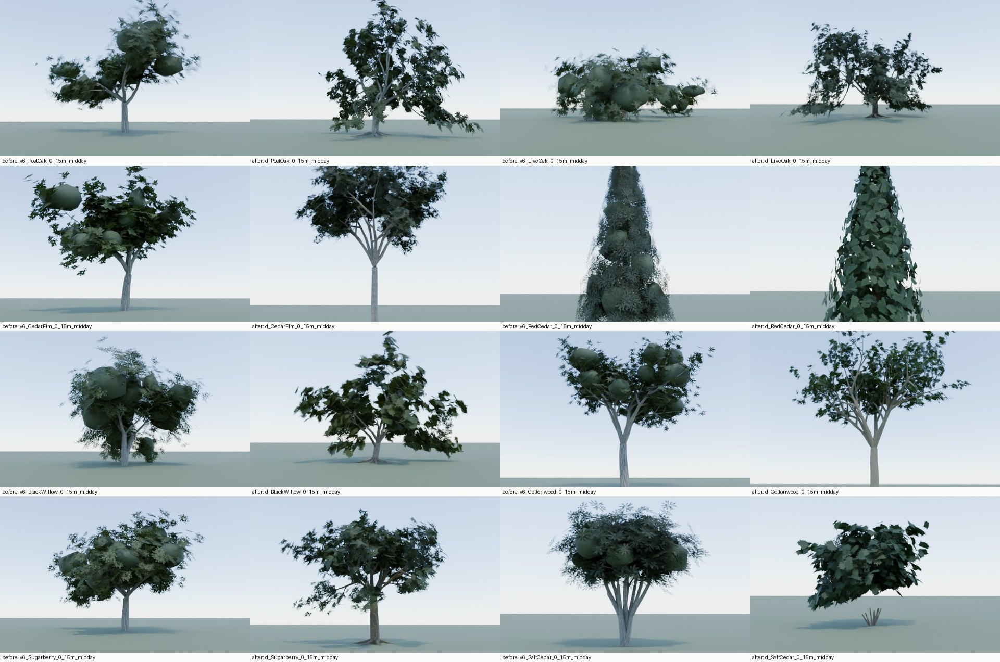
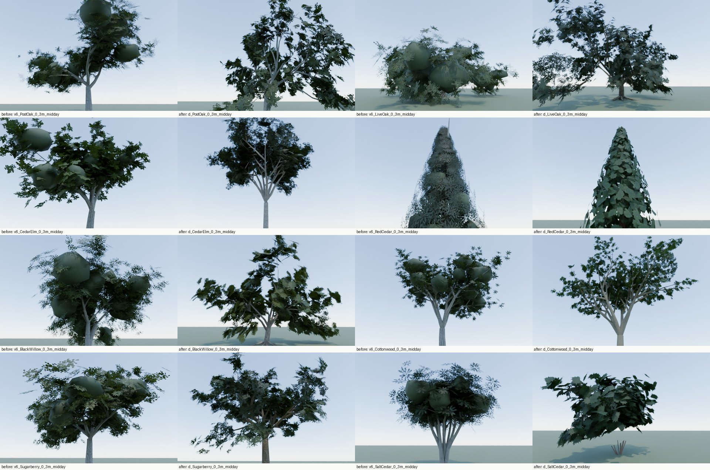
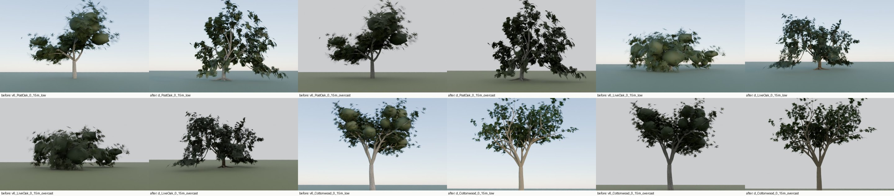
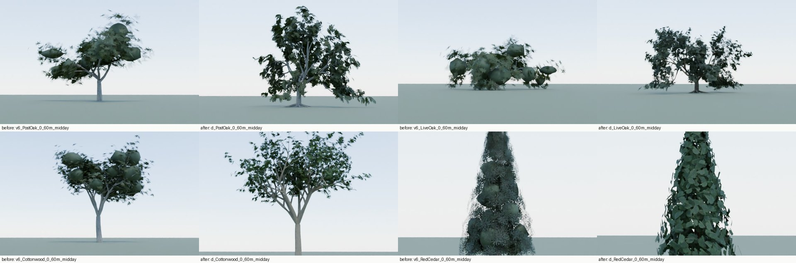
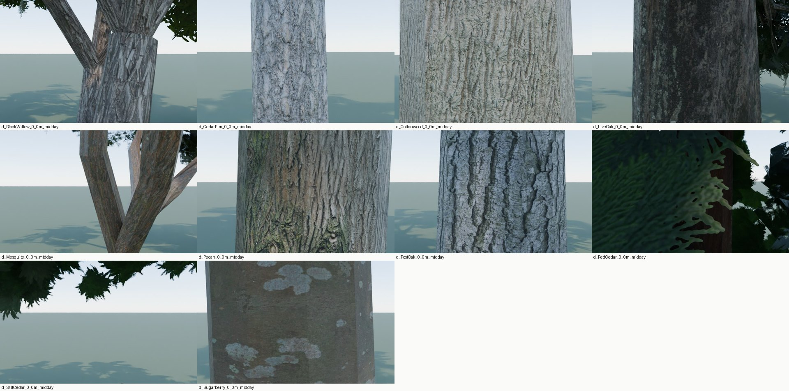
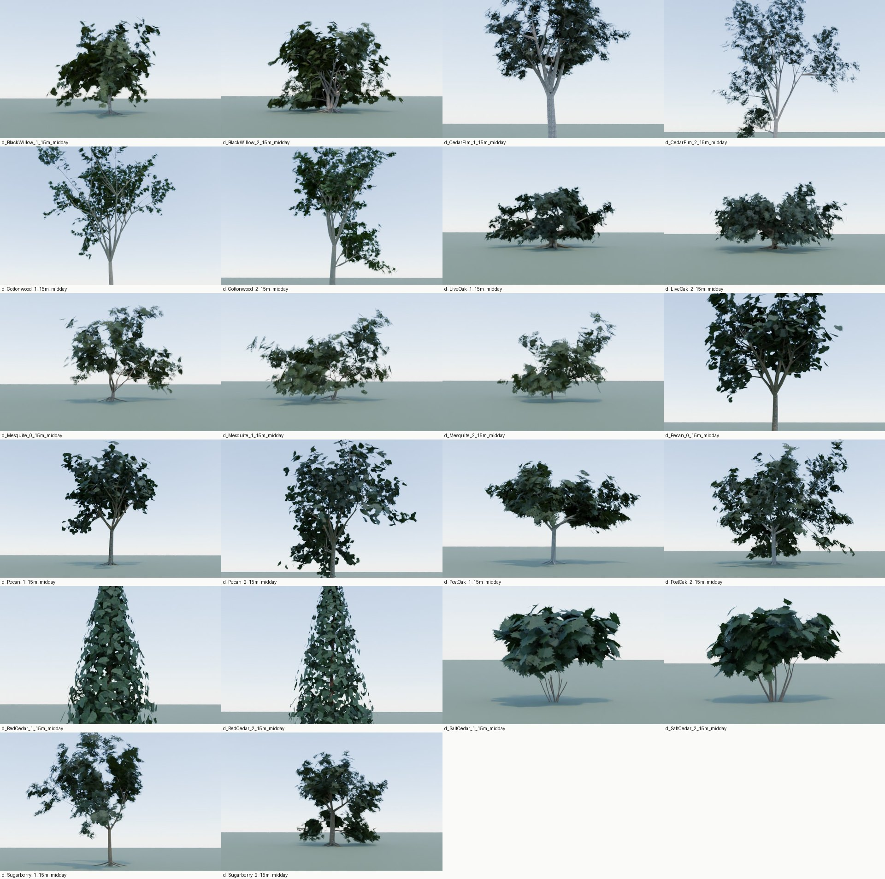
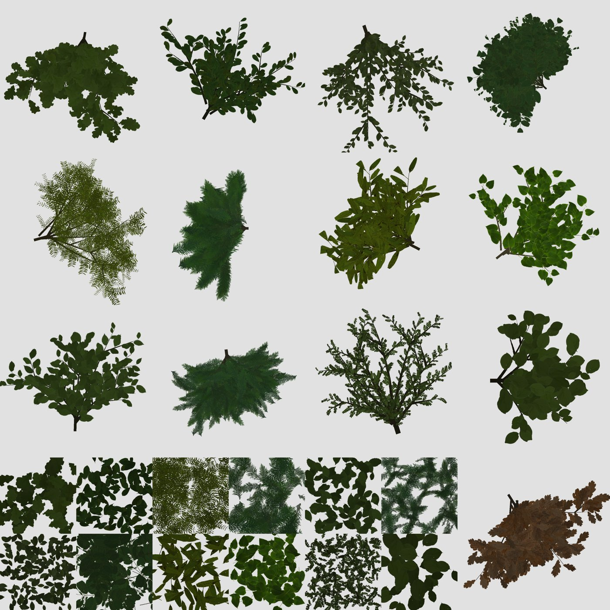

# Track D: trees and shrubs up close

Part of the shore, grass and buildings plan (approved by Bean, 16 Nov 2026). This is the cloud half: tools, renders
and measures. Nothing here is in the game yet; it goes in through one integration PR after the 21 Nov slice. The tools
and how to run them: `Tools/envloop/trees/README.md`.

## Why the crowns had dark lumps

Today's trees (`Tools/blender/build_trees.py`, Visual V6) put a solid ball inside every leafy cluster, painted the crown
colour at a third of its brightness. The balls were there to save GPU time: a ray that hits a solid ball stops, so the
see-through leaf cards behind it are never drawn. But from 3 to 60 m the ball is the first thing seen in 13 to 36% of a
crown's pixels (the `core_share` column below), and that is the "solid dark lump" Bean saw.

Track D drops the balls. In their place each cluster gets a loose scatter of small patches cut from a dense "clump" leaf
tile, in deep shade, with gaps between them: they read as leaves in the crown's shadow, not as a surface. To keep the
GPU cost where it was, the outer leaves are now leafy-branch sprays at true leaf size (fewer, better-filled cards), and
the number of cards follows each crown's volume and a triangle budget per species.

## Before and after, 15 m, midday

Left of each pair is today's tree, right is Track D. Same species, same light, same camera.

## Looking up into the crown, 3 m

## Low sun and overcast

## 60 m

## Bark at arm's length

One CC0 bark per species (ambientCG and Poly Haven), mapped in metres so the plates are the right size on every trunk.

## New species and the three forms

Pecan and mesquite are new. Each species now has three models: two upright and a third that is the bank form (roots
reaching down to the water on one side, low limbs leaning out over it) for willow, cottonwood, salt cedar, sugarberry
and pecan, or open-grown with low limbs for the rest.

## The leaf atlas

`T_LeafAtlasD`, 4 x 4 tiles: one leafy-branch spray per species with leaves at their real size, three dense clump tiles
for the crown's inside, and post oak's dried winter leaves (post oaks hold brown leaves through the winter).

## The measures, 15 m, midday, first model

`core_share`: share of the crown's pixels where you see the solid ball (the lump). `layers`: how many see-through leaf
surfaces a pixel crosses on average before something solid; the GPU pays for each. All rows in `metrics.csv`.

| Species | Triangles before / after | Lump share before / after | Layers before / after |
|---|---|---|---|
| Post oak | 10.5k / 14.3k | 0.27 / 0 | 1.95 / 1.42 |
| Live oak | 9.5k / 21.5k | 0.29 / 0 | 2.27 / 2.00 |
| Cedar elm | 11.0k / 15.0k | 0.26 / 0 | 0.90 / 2.34 |
| Eastern red cedar | 3.1k / 5.9k | 0.13 / 0 | 5.47 / 2.14 |
| Black willow | 13.7k / 14.8k | 0.29 / 0 | 2.02 / 1.83 |
| Cottonwood | 14.3k / 23.1k | 0.36 / 0 | 1.54 / 0.94 |
| Sugarberry | 9.7k / 17.3k | 0.22 / 0 | 1.53 / 1.58 |
| Salt cedar | 8.6k / 8.4k | 0.22 / 0 | 2.38 / 2.61 |
| Pecan (new) | - / 18.7k | - / 0 | - / 1.23 |
| Mesquite (new) | - / 8.0k | - / 0 | - / 1.40 |

The lump is gone everywhere. The GPU's leaf cost is lower or equal for six of the eight existing species; cedar elm and
salt cedar cost more and get another pass before integration. Triangles rise (the budget is 26k per tree, 6k per shrub);
one model, cottonwood's third, is at 27.5k and gets trimmed.

## Blind review

Three fresh reviewers saw the 16 pairs above (8 species at 15 m and 3 m) unlabelled, left and right shuffled, and
picked the side that looked more like a real Texas tree. They chose Track D in 14, 15 and 14 of 16 pairs (the third
called one a tie). Every reviewer named the solid balls as the worst fault in the set, worst looking up from 3 m.

The one species where Track D lost is salt cedar (2 of 3 reviewers at 15 m, 1 of 3 at 3 m): its crown floats over thin
stems. What they disliked on the Track D side: leaves that read a little large and flat, the red cedar's broad-leaf
cards (a conifer needs scale-like sprays), cedar elm's branches fanning from one point like a broom, and some crowns
dark and smeared close up. One reviewer: "nothing reads as a real Texas tree yet", but the best (post oak, willow,
cottonwood, live oak from below) are "close in silhouette". Those are the next round's list.

## What is still wrong

- Eastern red cedar reads as big flat leaves on a cone; it needs scale-leaf sprays, not broad-leaf ones.
- Salt cedar's first model floats a blob over thin stems; its other two models are fine.
- Cedar elm's first model is a lollipop and costs more GPU than before.
- Bark looks pale in the midday renders. The renders use a plain sky and no exposure from the game, so this is judged
  again in the game's own stills.
- Seen from 15 m the leaves of the big-leaf species read a little large. The sprays are at true leaf size, so this is a
  check against reference photos at the station stills.
- The shrubs (yaupon, rough-leaf dogwood) and saplings are built but not yet rendered on their own.
- The "photo or game" check needs the station stills from the Mac and PC, after integration.

## What integration needs

The list is in `Tools/envloop/trees/README.md`: the Mac or PC fetches and commits the CC0 sets (Git LFS), the world
models switch to `build_trees_d.py`, the leaf atlas and the per-species bark materials get their own script, the game
learns pecan, mesquite and the third model, then the Mac gate, PC Ultra stills and the Megaplants comparison.
