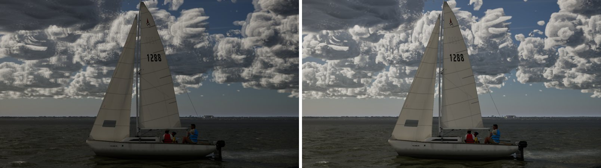
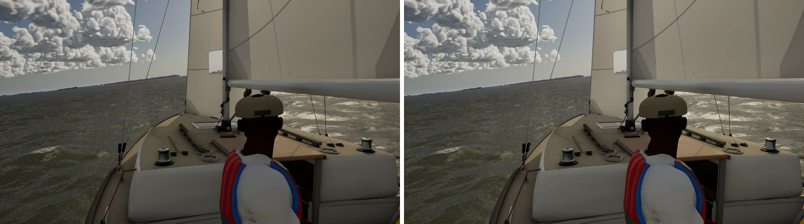
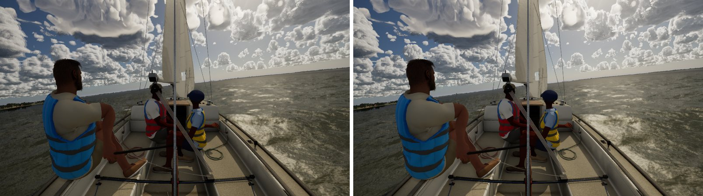
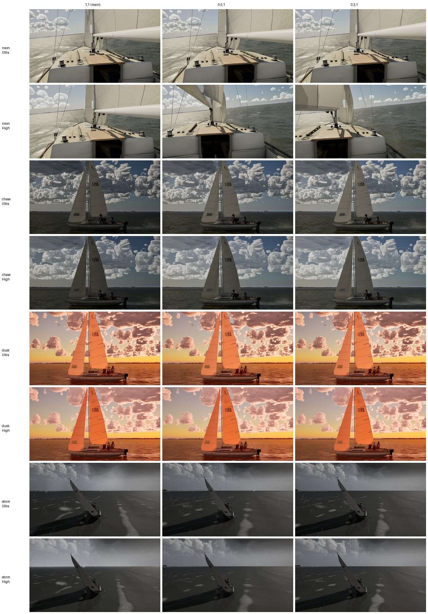

# The histogram's dark side of the exposure band

> **Default since pc/exposure-default (Bean's choice, Oct 26: "Truest"): 0.2,1** on every tier that meters the light
> (Medium, High, Ultra). The histogram may take the exposure 0.2 of the band darker than the incident meter and the
> whole band brighter. `-SailingExposureBand=1,1` gives the old band back for comparison.

Re-audit gap 2: in the chase view (15:00, 111 deg from the sun) the PC's water read 0.019 against the Mac's 0.064. The
water isn't the cause. At an exposure locked at the incident meter's EV the PC's water is 0.059 (Ultra) and 0.063
(High), with the sky 0.23 to 0.25 (`pc/water-sky` findings). On auto exposure the histogram drives the exposure a stop
darker. The bright sky and cumulus fill the 10-90% histogram, so it settles on the band's dark end: the incident EV +1.

## The arg (this branch)

`-SailingExposureBand=<dark>,<bright>` scales the band either side of the incident meter. The histogram may take the
exposure `dark x Band` darker or `bright x Band` brighter, where Band is 1 in clear air and 0.3 under a storm deck as
before. The default 1,1 is the band as it was. This is not a lift: the incident meter's EV is unchanged, and only the
histogram's room to darken shrinks.

`-SailingDumpExposure` logs, once and 6 s in, every exposure input (`ExposureDump:` lines). The PC's are in
`dump-pc-ultra-chase.txt` and `dump-pc-high-chase.txt` for the Mac to diff. Ultra and High are identical apart from the
tier.

## Measured (PC, RTX 4090, 1920x1080, uncooked; linear luminance; pre-exposure from `ShowFlag.VisualizeHDR`)

Water is the frame's lower corners and sky its upper centre. "EV vs locked" is log2 of the locked run's pre-exposure
over this run's. The lock is `-SailingEV=-0.85`, the incident meter's EV here.

| View | Tier | Band | Water | Sky | Pre-exposure | EV vs locked | Clipped |
| --- | --- | --- | --- | --- | --- | --- | --- |
| chase 15:00 | Ultra | 1,1 (main) | 0.022 | 0.119 | 0.971 | 0.82 | 0% |
| | Ultra | 0.3,1 | 0.044 | 0.193 | 1.461 | 0.23 | 0% |
| | Ultra | 0.2,1 | 0.046 | 0.207 | 1.547 | 0.15 | 0% |
| | Ultra | locked | 0.059 | 0.226 | 1.720 | 0 | 0% |
| chase 15:00 | High | 1,1 (main) | 0.025 | 0.133 | 0.954 | 0.80 | 0% |
| | High | 0.3,1 | 0.050 | 0.210 | 1.420 | 0.23 | 0% |
| | High | 0.2,1 | 0.053 | 0.222 | 1.500 | 0.15 | 0% |
| | High | locked | 0.063 | 0.246 | 1.661 | 0 | 0% |
| helm eye 12:30 | Ultra | 1,1 | 0.30 | 0.40 | 0.809 | | 0.003% |
| | Ultra | 0.3,1 | 0.39 | 0.48 | 0.823 | | 0.002% |
| chase 18:36 (low sun) | Ultra | 1,1 | 0.131 | 0.294 | 12.44 | | 7.1% |
| | Ultra | 0.3,1 | 0.135 | 0.306 | 12.86 | | 7.2% |

- At noon and with the low sun the histogram isn't against the dark end, so the band changes nothing. The noon helm eye's
  water and sky differ between the two runs by the scene (the waves and the frame), not the exposure: the pre-exposure
  moved 0.02 EV. The low-sun chase clips 7% (the sun and its glow) with either band.
- 0.2 meets the aim (within 0.2 EV of the locked exposure). 0.3 is just outside it, at 0.23.
- The audit set (`docs/ultra-audit-1024`'s nine views) with 0.3,1: chase, helm eye and action cam are brighter (frame
  mean linear 0.098 to 0.158, 0.126 to 0.150 and 0.177 to 0.200). The other six are unchanged. No view clips (0.00%
  of pixels at 250+ in every one, before and after).

| Audit view (main left, 0.3,1 right) | |
| --- | --- |
| Chase |  |
| Helm eye |  |
| Action cam |  |

## Wider sweep: four views, two tiers, three bands

Same method, and the same pre-exposure calibration per tier (the chase locks: Ultra 1.720 and High 1.661 at EV100
-0.85). "EV under incident" is how far the exposure sits darker than the incident meter; negative is brighter. The
incident EV per view comes from the HDR overlay's band: noon 0.8, chase -0.86, dusk -3.1 (High -3.0), storm -0.1. The
storm view is the bench's (not a capture), and its band is 0.4 under the deck.

| View | Tier | Band | Water | Sky | Pre-exposure | EV under incident | Clipped |
| --- | --- | --- | --- | --- | --- | --- | --- |
| noon | Ultra | 1,1 | 0.388 | 0.476 | 0.902 | -0.72 | 0.00% |
| noon | Ultra | 0.5,1 | 0.388 | 0.479 | 0.849 | -0.63 | 0.00% |
| noon | Ultra | 0.3,1 | 0.390 | 0.480 | 0.870 | -0.67 | 0.00% |
| noon | High | 1,1 | 0.393 | 0.500 | 0.801 | -0.60 | 0.00% |
| noon | High | 0.5,1 | 0.292 | 0.335 | 0.833 | -0.65 | 0.00% |
| noon | High | 0.3,1 | 0.328 | 0.276 | 0.881 | -0.74 | 0.00% |
| chase | Ultra | 1,1 | 0.020 | 0.120 | 0.971 | 0.83 | 0.00% |
| chase | Ultra | 0.5,1 | 0.034 | 0.171 | 1.304 | 0.41 | 0.00% |
| chase | Ultra | 0.3,1 | 0.043 | 0.194 | 1.461 | 0.25 | 0.00% |
| chase | High | 1,1 | 0.024 | 0.134 | 0.954 | 0.81 | 0.00% |
| chase | High | 0.5,1 | 0.040 | 0.187 | 1.270 | 0.40 | 0.00% |
| chase | High | 0.3,1 | 0.048 | 0.211 | 1.420 | 0.24 | 0.00% |
| dusk | Ultra | 1,1 | 0.127 | 0.299 | 12.450 | -0.61 | 6.86% |
| dusk | Ultra | 0.5,1 | 0.133 | 0.306 | 12.854 | -0.65 | 7.20% |
| dusk | Ultra | 0.3,1 | 0.133 | 0.306 | 12.855 | -0.65 | 7.19% |
| dusk | High | 1,1 | 0.132 | 0.316 | 12.229 | -0.73 | 6.19% |
| dusk | High | 0.5,1 | 0.136 | 0.323 | 12.585 | -0.77 | 6.55% |
| dusk | High | 0.3,1 | 0.137 | 0.324 | 12.577 | -0.77 | 6.59% |
| storm | Ultra | 1,1 | 0.032 | 0.122 | 1.504 | -0.56 | 0.00% |
| storm | Ultra | 0.5,1 | 0.027 | 0.099 | 1.491 | -0.54 | 0.00% |
| storm | Ultra | 0.3,1 | 0.029 | 0.097 | 1.492 | -0.55 | 0.00% |
| storm | High | 1,1 | 0.030 | 0.180 | 1.500 | -0.60 | 0.00% |
| storm | High | 0.5,1 | 0.028 | 0.130 | 1.444 | -0.55 | 0.00% |
| storm | High | 0.3,1 | 0.030 | 0.134 | 1.452 | -0.56 | 0.00% |

- **Only the chase pins at the dark end**, a stop's band away from the incident meter: 0.8 EV under at 1,1, 0.4 at
  0.5,1 and 0.25 at 0.3,1, on both tiers.
- **Noon, dusk and storm sit 0.55 to 0.77 EV brighter than the incident meter**, inside the band's bright side, so the
  dark side's width changes nothing there (pre-exposure within 0.06 EV across the bands). The noon helm eye's water and
  sky move between runs with the frame (the helm's camera moves), not the exposure.
- **Clipping:** none in any view except dusk (the low sun and its glow, 6-7% of pixels), and that is the same at every
  band.
- Ultra and High behave alike.

## The default

Bean chose 0.2,1 ("Truest", Oct 26) after the contact sheet: the chase sits 0.15 EV under the incident meter instead of
0.8. Views where the histogram already brightens (noon, dusk, storm) are unchanged. The Mac's VisualizeHDR crashes on
Metal; its own read of the chase (`docs/exposure-diff/` on branch exposure-diff) found the same pin with the same cvars.
